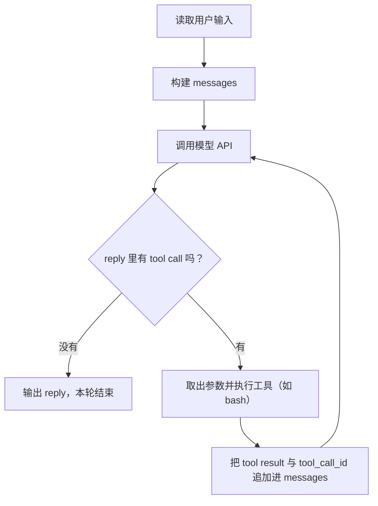
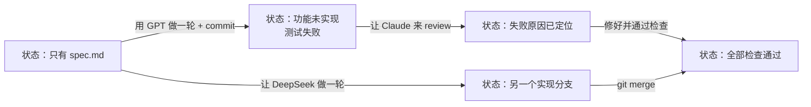
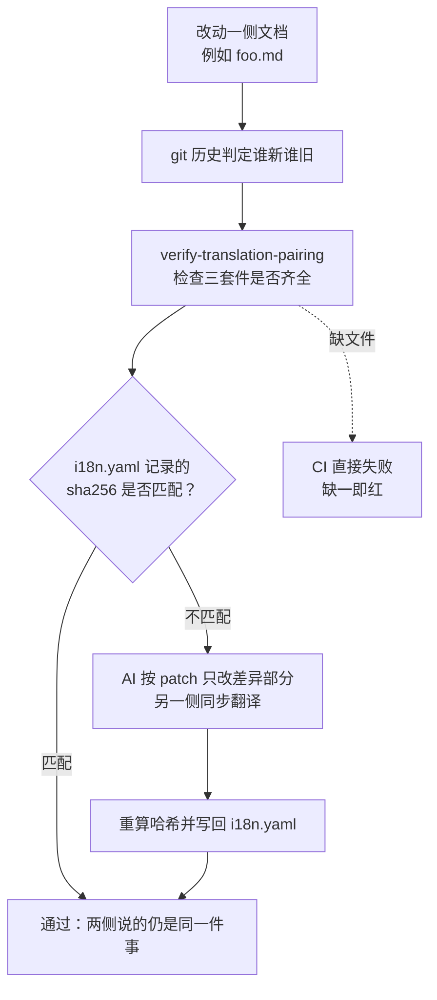
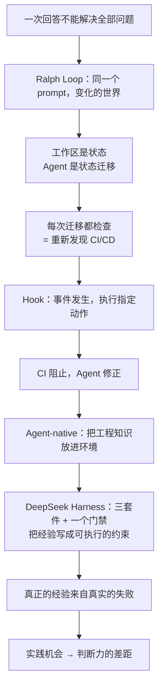

# Agent Native 开发：从 Ralph Loop 到"把工程知识放进环境"

> **课程官方资料**：[课程主页](https://jyywiki.cn/GSE/2026/) · [本讲讲义](https://jyywiki.cn/GSE/2026/lect8.md) · [本讲幻灯片](https://jyywiki.cn/GSE/2026/slides8.html)
>
> **版权说明**：课程讲义与幻灯片系 © 蒋炎岩 作品，依 [CC BY-NC 4.0](http://creativecommons.org/licenses/by-nc/4.0/) 发布；本书为非商业学习笔记，引用图片与文字均保留署名。
>
> **本讲说明**：课程前半程一直在讨论软件工程里那几道缝隙——意图（Intent）怎样变成规格（Spec），规格又怎样变成实现（Implementation），以及版本管理、需求分析与架构设计如何帮助我们驾驭复杂性。这一讲换了一个方向：**既然 AI 已经能写代码，我们该怎样组织一个能够持续开发、验证和修正的软件生产过程？** 讲者从一个 150 行的 ReAct Agent 讲起，用 Ralph Loop 把"一次做完"拆成"状态迁移 + 检查"，由此重新推导出 CI/CD；再借 OpenAI 的 harness engineering、Anthropic 的 16-Agent 实验，最后落到 DeepSeek Harness 这个把经验写进门禁的开源标杆——以及它背后那个关于"实践机会"的社会性威胁。

---

## 目录

1. [回顾与开场：从"实验二"说起](#1)
2. [Agent Loop：从一个 150 行的原型开始](#2-agent-loop-150)
3. [每一次迁移都检查：重新发现 CI/CD](#3-cicd)
4. [Agent Native：把工程知识放进环境](#4-agent-native)
5. [DeepSeek Harness：一个把经验写成门禁的项目](#5-deepseek-harness)
6. [真正的经验](#6)
7. [一个社会性的威胁](#7)
8. [结语：让下一次尝试比上一次更有价值](#8)
9. [附：官方参考与延伸阅读](#_2)
10. [附录：课堂未展示的幻灯片](#_3)
---

## 1. 回顾与开场：从"实验二"说起

*(参考时间: 00:00)*

课程进行到差不多一半。今天进入的主题是 **Agent-native 开发**——不是"用 AI 写代码"，而是从一开始就把 Agent 当作实际参与工作的开发者，为它设计工作环境。

### 1.1 开场：把日常 job 交给 Agent

*(参考时间: 00:00:12)*

讲者先从自己的日常说起。那天早上正好有额度重置，而他习惯在离开办公室之前"上一个 go"，让 Agent 去跑一些非常消耗 Token 的长任务，比如一个比较复杂的数学证明——他不知道该怎么证，但可以让它去证，代价可能是把一周的额度全部跑完。

第二个实验也在当天发布。实验一更像一个产品：你们做的是个人的 Agent，里面会说"帮我 digest 邮件"、"根据你的数据库回答问题"。实验二则往前挪一小步，把"算力换智力"这件事做得更明确——自己做一个 Agent Loop。

他还提到把一些每天固定要做的事情迁到了自己那个机器人上：

- 每天给孩子生成一期 podcast，这样开车的时候可以听，背后掉的是 Claude Code 的 Opus 4.5；
- 每天收到 morning paper 推送，比如 arXiv 上的论文，提示词是他调过的——如果直接让 AI 去总结同一篇论文，结果会不太一样；
- 还有 GitHub trending 之类的内容。


这里有一个判断值得记住：**Agent 虽然具备长程任务的完成能力，但它解决问题的直觉其实稍微差一点。** 讲者觉得这跟博士生很像。

### 1.2 软件工程解决的是一类搜索问题

*(参考时间: 00:02:10)*

*(参考时间: 00:05:56)*

为了给这一讲铺垫，他在黑板上重新画了那张贯穿课程的图：**Intent → Spec → Implementation**。

人脑容量有限。无论是要组一个小团队做一件事，还是自己做一个大作业，你在 intent space 里其实都只采样了一个点，而 intent space 里有很多点。更要紧的是：intent 到 spec 是一对多的，spec 到 implementation 又是一对多的。

这意味着什么？举例来说：

- 如果有一个 review 能跟你来回讨论，经过几轮迭代达成共识，再往下走到一个点；这个点又经过几轮迭代达成共识——那么最终的方案，可能远好于"一条线走到黑"。
- 在需求阶段可以做访谈、做 checklist、跟甲方对齐。如果甲方是一个说得清楚、对自己想做的事情非常清楚的人，你就更容易走向一个更清楚的定义。
- 在规格阶段，可以跟有经验的架构师讨论该选什么数据库、要不要 event sourcing。最近有一个开发者公开表示他们**不用** event sourcing，而是采用另一种函数式的设计，同样把一切都持久化下来——这说明同一个 intent 下确实存在许多合理的落地方式。

**你会产生很多不同的想法，最终收敛到很不一样的方案上**；而一条线走到黑的那个方案，其可维护性、可观测性可能就差十万八千里。

软件工程解决的正是这件事。用 UML 建模的时候，它约束的是这个空间里的行为，让你在项目早期就能和别人达成一致。工具层面也一样：从 IDE、VS Code，到管理版本状态的 Git worktree，再到 jj 这样更先进的工具，还有无数讲不过来的东西。

讲者顺带给了学生们一个可执行的习惯：如果你的 Agent 每天给你推一个 GitHub trending 项目，你就花几分钟进去看一看、追问一下——你会发现每个项目都用了不同的技术栈，里面都有好东西。**每天几分钟，就是在积累技术的厚度和品味。**


### 1.3 AI 给我们的最大能力：随时可以开始

*(参考时间: 00:08:46)*

在他看来，AI 给我们的最大能力是：**你随时随地都可以开始。**

你可以想、可以学，但你不需要想太多——在任何一个阶段都可以直接让 AI 向下做：

- 哪怕最开始只有一个想法，也可以直接让它往下走。它可能到不了那么深，做到某个程度就维护不下去了，或者你自己觉得看不下去了；
- 在讨论的过程中，你随时可以让 AI 生成一个版本，然后比较：变好了还是变坏了？趋势上是变好还是变坏？如果变坏了，就再讨论一轮、再做一版。

在这套用法里，**AI 实际上承担了一个员工、甚至一个团队的职责**。如果需求可以分解成两个 subsystem、模块边界分得比较好，你完全可以启动两个并行的 Agent。讲者自己的做法是：一个 tmux 窗口分成四份，四个 Agent 并行——"最多只能开四个，不然我的大脑就有点跟不上 AI 输出的速度了"，而他做的部分是监工。于是他可以很快地在搜索树上探索，也可以同时推进并行的需求想法。

另一个关键词是 **let it fail**。这并非鼓励随便交差，而是允许原型暴露我们的错误：

- 实现可能没有满足规格，规格也可能没有真正表达需求；
- 即使两者都对上了，需求里关于用户、规模和运行环境的假设仍然可能不成立——纸面上说得通的选课系统，遇到两个人同时抢最后一个名额，就可能露出另一副面孔。

所以当成本足够低的时候，就应该让 AI 先承担一部分"预测"：**这个架构如果换一个人来用会怎么样？用户多了以后会怎么样？两个模块之间有没有我未曾想过的交互？** 很多问题只有你真的把它实现出来以后，才会意识到"这个地方的设计出了一个小问题"。

于是就有了那句很形象的说法："我现在没想清楚，不要紧，你给我搓一个；搓完了以后拿我的 use case 去评审一下。" **构建原型的能力，是 AI 给我们的一件非常好的礼物。**


---

## 2. Agent Loop：从一个 150 行的原型开始

*(参考时间: 00:11:09)*

### 2.1 AI 越来越自主，也还没有"万能"

*(参考时间: 00:11:20)*

往回看这条产品线：ChatGPT、AutoGPT、Devin、Claude Code……**AI 越来越自主。** 2023 年你们还在上初中或高中，可能留意到社交媒体上的新闻：有人在说"模型是有幻觉的"，模型很强但不能完全相信它。Devin 是最早一批 coding agent，号称可以解决数学问题等等；但那时候 GPT-4 的幻觉其实非常严重，说着说着就不知道在说什么，也没有今天这样的思维链模型，所以大家还在观望：到底行不行？

理论上说，如果模型"足够好"，给它一个 bash 工具就够了：它可以用 bash 编辑文档、用 bash 看文档，可以去造芯片、证明黎曼猜想。想一想早期 UNIX 时代——还没有今天图形界面的时候，那些大师就是在 shell 里和其他工具交互的，Knuth 写《计算机程序设计艺术》时也是如此。**如果把我蒸馏了、给我一个 bash，我确实可以干几乎所有我能干的事情。**

但现实是：**今天的模型还没有万能到和最好的人一样好**，尤其是"品味"这件事还有点难学。既然一次回答不能解决全部问题，能不能让它不断尝试？


### 2.2 模型为什么不会一直尝试下去

*(参考时间: 00:12:29)*

这里的障碍来自训练方式。模型在强化学习时有一个很重要的奖励信号：**你要完成任务。** 如果你花了很多时间都没有完成任务，你停留在这个上面，就拿不到奖励。

讲者说这跟训练博士生有点像。有不少同学喜欢在设计阶段就把文献读很多、把问题调研清楚，这时候导师会说：你的时间是有限的，你需要一个"看到什么、需要什么就学什么"的阶段，把问题快速推进下去。**这就是 breadth-first search 和 depth-first search 的平衡。**

今天的 ReAct 型 Agent（能自主调用工具的那种）有完成任务的**压力**，而且完成得更快就会获得奖励，所以它会倾向于一个比较短的 breadth-first：思维链里当然也会想"等一等、也许不一样"，会做一些思考；但它一旦找到一条自己认为合适的路线，就会继续往下。

DeepSeek 的思维链在这件事上很有意思：它想想想一段时间，如果你给它太难的任务，它就会摆烂——"这个任务我解决不了"，然后直接停下。这是受了强化学习影响的。

所以当你在设计里放一个前提"我的模型还不够好、很容易漂移"时，它就会表现得像那个脑子一热的博士生：哗哗哗给你做完；或者因为你已有的代码污染了它的上下文，然后它又有一种强烈的"舔狗"倾向——它遵循指令，就不敢动用户的东西。

### 2.3 一个 150 行的 ReAct Agent：bash tool 就是全部接口

*(参考时间: 00:15:20)*

现场演示的这个小东西，讲者建议每个人都自己做一个。理由是这样的：

> 在 AI 时代，最重要的是**你随时可以自己做一个**。你有一个想法，就自己做出来，然后再和成熟的东西比一比，看那个增量——你先了解一个简单的核心，再去知道复杂的东西多做了什么。你很快就能把功能一个一个加进去，就能体会一个软件从小到大膨胀的过程，也能在里面吸取很多经验。

（演示之前他还专门提醒：**保护好你们的 API key。** 不锁屏的时候你在宿舍去洗手间，终端就在那里，室友可以悄悄 cat 一下、拍一张照，你的 key 就被偷走了。所以演示里特意让它用了他自己 API Agent 的 key。）

这个 Agent 的全部工具面就是一个 bash：

```python
BASH_TOOL = {
    "type": "function",
    "function": {
        "name": "bash",
        "description": "在独立、非交互的 bash 进程中执行命令，返回退出码和输出。",
        "parameters": {
            "type": "object",
            "properties": {
                "command": {"type": "string", "description": "要执行的 shell 命令"},
            },
            "required": ["command"],
        },
    },
}
```

它是一个合法的 Python object，可以 serialize 成 JSON：type 是 function、name 是 bash、有一个 description、一个叫 command 的参数。执行侧对应一个 `run_bash`。


**这里就能看到一个 toy project 和真实 project 的差别。** 他在这个小 Agent 里 hardcode 了一个 timeout。而真实的软件工程里，我们观察到 coding agent 常常会因为对环境的感知不够好而设出不合适的 timeout：

比如我们在墙内访问 GitHub——你的教育网确实可以访问，但它的速度和 agent 认为的 GitHub 速度是不一样的。讲者说他第一次"肉身到墙外"，看着 git clone 能跑满网卡带宽时，还是很震惊的："我的世界观一直是在这个地方，所以我 overfit 了这个环境。"而 Agent 会给出一个不合适的 timeout，然后被杀掉，然后要换一个 timeout——**而"我这样的一个软件"其实并不支持这个 feature。**

这就是最小原型与产品之间的 gap，它可能需要一个架构来补。但也正因为你先做了一个最小实现，才被启发去思考这个方向的问题。

### 2.4 主循环就是一个 while

*(参考时间: 00:18:20)*

整个 Agent 循环就是一个 while 循环：

1. 从终端读取用户的输入；
2. 构建 message；
3. 调用 API（演示里是直接 POST 到 chat completions 接口）拿到 reply；
4. 如果 reply 里没有 tool call，就把 reply 直接输出，这一轮结束；
5. 如果有 tool call（API 已经帮你做了一层 parse），就把参数取出来；如果是 bash，就跑一下，再把结果连同 tool_call_id 一起放回去，回到第 3 步。



就这么简单，150 行，"这个 Agent 真的是能用的"。

现场它接到的任务是：**为我生成一个生成式软件工程的简介 HTML 卡片。** 因为它有 bash，它就可以在 bash 里写字符串，所以理论上完全做得到——只是输出 token 会比较长，会花一点时间。它写了很久。讲者让它在浏览器里打开，它会 prop（打开）环境。


观察这段演示很有意思，因为它是一个"白板模型"——所有 prompt 都是讲者给的：

- 它在**不停地 verify**；
- 它打开了两个浏览器；
- 它开始询问："我已经用截图验证了，你是不是满意？"——这可能不是你要的行为。你可能只是想让它不停地向前完成任务。

**这就是所谓 harness 要做的事。** 你可以把模型的思维链也想象成一种搜索，而 harness 就是**把它可以做的事情约束在一个你认为比较好的范围里**。今天的 harness 核心是一个叫 Ralph Loop 的东西——当然，今天被认为是"版本答案"的这个 Ralph Loop，在真实项目里的情况会比它复杂得多。比如 Claude Code 在某一个版本里就能孵化 sub agent：它生成一段 TypeScript script，里面写一个 for 循环调用 agent，自然语言模板里可以填循环变量、可以填任何算出来的东西；agent 的调用是异步的，你还可以 await 它。

### 2.5 Ralph Loop：三行脚本，和一个笨拙却不放弃的名字

*(参考时间: 00:22:20)*

为什么要叫 Ralph？Geoffrey Huntley 借用了《辛普森一家》里 Ralph Wiggum 的名字——**有点笨、有点可爱，但从来不放弃。** 讲者开玩笑说，这件事也没什么道理可讲："地球人都开始用第一个提出它的人给它取的名字。"


Ralph Loop 简单到只有三行：

```bash
while true; do
    cat PROMPT.md | claude -p
done
```

它的实质是：**同一个任务、检查、修改，直到无法改进。** 讲者引用了 GPT 给他的一个总结，他觉得挺 surprising：

> The prompt stays the same, but the world changes.

也就是说，每轮提示词都没变，变的是工作区：上一轮实现了功能、留下了测试结果、记录了失败原因，下一轮就接着这些状态继续。

这个循环的前提是那个基本假设：**如果模型足够好、又给它一个 bash，它自己就会去探索搜索空间。** 但如果你假设现在的模型还是会漂移——那你就需要把"一把头向下做完"改成"一步一步来"。


幻灯片上还留了一条必须记住的话：**`while true` 本身不会判断"无法改进"**；何时停止，需要另行约定。循环本身没有魔法，实际使用时必须另外定义验收条件、预算或停止条件。

### 2.6 会漂移的模型：舔狗、屎山与"扶起来"

*(参考时间: 00:24:19)*

讲者用一个师生之间的默契，把模型的"不可信"讲得很透：

> 我作为博士生导师有一个权利：学生今天开了一个 PR，我就跟他说"你这个代码是零分的代码，你再拿这种代码来就不要来见我了"。学生虽然会感到痛苦，但他能理解导师可能是为他好，这个项目确实不应该这样实现。所以他回去下一个版本，就会把架构全部推掉。

模型不是这样的。**如果模型在上下文里加载了你的 slop 代码（屎山代码），它就会有一种强烈的倾向：我的任务是把这个 code 扶起来。** 当它跟你说"这个架构要重构"的时候，重构很可能不能保持代码行为百分之百一致——它总会有一些变化，这个变化可能是把项目往好的方向推，但对你来说可能是一种比较粗鲁的行为，因为代码正在线上跑着，你真的只想让它花一分钟把现在这个项目扶起来、让在线的服务不要崩掉。

所以：它遵循指令有道理，不遵循指令也有道理。而在这种两难里，**它选择遵循你的屎山代码，把项目一点一点往泥潭里拖。**

那怎么办？有没有可能稍微往前救一点？讲者给的答案是搜索：

- 让模型停留在 design space 里做 breadth-first search；
- 再适当地做 depth-first，管理这个搜索空间——用 prompt 也好、用一个 loop 也好，任何方式；
- **Ralph Loop 就是一种线性的管理方法。**

这也解释了它对长程任务（long-horizon task）的意义：模型的上下文装不下，最讨厌的事情就是 Codex"哗哗哗跑得很好，突然 compact 开始了"，然后你的用量急剧增加，而且一般来说 compact 之后都会经历一段时间的降智——它会各种做不对，突然有一天加载了足够多的上下文以后又能做对了，坐了一会儿又要 compact。（顺带一提，讲者提到最近有一个"史诗级的更新"，把上下文提升到了 500K。）

### 2.7 Everything is a state machine：工作区是状态，Agent 是状态迁移

*(参考时间: 00:27:20)*

理解 Ralph Loop，可以借用一个熟悉的视角：**Everything is a state machine。** 我们的物理世界也是一个 state transition system，所以可以把 workspace 的状态理解成整个软件开发的状态。

- **状态**就是工作区：它不只包含当前代码，也包含需求、设计文档、测试用例、运行结果、日志和待办事项。刚开始的时候，可能只有一个 `spec.md`，几乎没有任何实现。
- **迁移**就是一轮工作：同一个任务（比如同一个 `SPEC.md` 或 prompt）做一轮，把状态变成下一份状态——顺手做一个 git commit。

于是，一次开发就是一次状态迁移：从"这个功能尚未实现"，到"已有实现但测试失败"，再到"失败原因已定位，修复通过了检查"。


你还可以在 loop 的提示词里加要求：**每次不要做太多；做完以后要检查；还要 review——可以让另外一个 Agent 来做 review。** 这就是 Ralph Loop 的好处：它把"模型一把头向下把任务做完"分成了好多小步。

而分成小步之后，它其实是一个 **non-deterministic 的状态机**：



同一份状态上可以执行不同的操作——这又回到了上面那个 search procedure。而且不只是"选哪个模型"，还有**时间维度**上的动作：

> 每隔一段时间做一件事。比如每个星期做一次架构级的 code review，看现在这个项目有没有变成 AI slop。如果已经变成 slop，我就进入一个"重构 agent"——这个重构 agent 可以设计得狠一点：把所有 AI slop 的东西和相关的东西直接删掉，做一个 commit，再让一个 agent 用更好的架构重新实现。

这样你就得到了一棵搜索树。当然实际运行时，最终还是要做选择：线性地从一个状态走到下一个状态，直到任务完成。

有了这个视角，今天各种 coding agent 里很多有用的 feature 就可以被推演出来。比如 **subagent 并行**：既然工作区是一个状态，那么"重构 A 模块"和"重构 B 模块"这两个迁移自然可以同时发生，最后再 `git merge` 合成一个提交。**有了这样的循环，long-horizon task 就能做得越来越好**：早期的 ReAct Agent（AutoGPT，或者线性的 `claude -p`）跑着跑着就漂移，上下文一爆就越做越差；我们用外层的循环让它完成更强的任务；模型厂商看到这一点，就把"一次 session 里能完成的任务"再调高；我们再套一层 loop——**就这样左脚踩右脚，开始上天。**

讲者在这里也放了一句暴论：

> 今天我觉得我们的 Agent 已经开始完成一些博士生能完成的事了。如果导师想好了一个方向，PhD 系统某种程度上就被替代、甚至被斩杀了。培养人当然很重要——从一个不会的人到会，这个培养过程很重要；但**如果我作为一个 professor，KPI 是产出国家要我产出的东西（论文、研究成果、项目），那么对我来说 PhD 的价值已经不如 vibe agent 了**。甚至有些 PhD 毕业的时候，好用程度可能也没达到 agent 的水平——前提是我给它正确的 loop、正确的 prompt。

### 2.8 我也实现了一个 Ralph Loop，以及一个对照实验

*(参考时间: 00:33:24)*

讲者也实现了一个自己的版本，非常简单。它的结构是：

- 由一个 prompt 驱动；
- 要求每轮**先检查当前状态**，**只推进明确的步骤**；
- 未完成时写文件说明下一步（所以所有状态都放在 repo 里）；
- 只有整个任务确认完成以后，才输出一个 `ralph done`；看到 `ralph done`，循环就结束，否则无限循环下去。

现场跑的任务是"调研一下什么是世界上最好的编程语言"。它估计要跑相对比较长的时间，尤其是它试图去 arXiv 下载论文的时候；它还会去访问 Google，而这台机器上会 timeout——但它至少可以在长时间的任务里跑一段时间、停下来做一个总结、把总结写进状态、再继续一轮一轮。


然后是那个很直观的对照实验：**同一个任务——"给我做一个属于我的名片卡片"**，一个交给 Ralph Loop，一个交给"直出"的 Agent。

- 直出版本非常 fancy：玻璃动效、一个小巧的 Mac OS 终端。但它**把主页邮箱写错了**，还把讲者标注成一个他并不属于的机构；
- Loop 版本朴素多了："计算机学院副教授"，邮箱是对的，还找到了他的 GitHub，也是对的。


讲者很清楚地提醒：**这肯定有随机性**，不能断言谁绝对更好；但可以看到，同一个模型，你投入算力、投入 prompt，最后得到的结果差别会非常非常大。

他还有一句给所有人的建议：

> 网上有各种各样推荐的 prompt 和 skill，你可以复用它们；但最终你可能会发现，**最后还是自己写的那个 prompt 最懂你**——因为你和模型有长期的磨合，磨合以后你才能比较好地理解：什么时候应该放它去做，什么时候应该不信任它。

### 2.9 这个 design space，地球人都不知道

*(参考时间: 00:39:05)*

在这个 agent loop 里，**其实没有一个所谓"最好的设计"**：

- 到底是 Codex 更好，还是 Claude Code 更好，还是 Pi 更好？我们也不知道；
- Pi 生态里有那么多东西：Pi 本身没有 subagent，但你去找 subagent 的插件就不止一个，有的 popular、有的 less popular，到底哪个更好，我们也不知道；
- 而且很有可能你上一个版本里 work 得很好的 prompt，下一个版本模型来了就全变了。

所以他的工程建议很具体：**新模型发布的时候，你最好把那些系统提示词和 skill 全部拿掉，然后拿一个你比较熟悉的任务做一个背靠背的对比。** 你可能会发现，拿掉那些 prompt、skill 之后，模型反而表现得更好——这都是有可能的。

**我们现在活在一个非常非常不确定，但也非常 excited 的时代。**

---

## 3. 每一次迁移都检查：重新发现 CI/CD

*(参考时间: 00:40:57)*

### 3.1 那条最重要的提示词

*(参考时间: 00:41:00)*

回顾刚才那个 loop 的过程，有一条 prompt 非常关键：

> **每轮先检查当前状态，只推进一个明确的步骤，然后验证并评估结果。**

为什么要这样？前提还是那个基本假设：**Agent 训练得不够好**，或者在你当前的上下文下**可能发生漂移**——它自己的思路、想法可能会漂移，去做不应该做的事。

所以就让它先往前做一小步，做一个相对比较小的状态迁移；然后在这个状态迁移处把它停下来：**wait**，然后做检查。检查可以是让另外一个 Agent（另一个模型）来 review 这次提交，也可以是跑一些测试、检查脚本。**这样就可以在一定程度上阻止状态漂移**，而且这些检查对整个项目的推进也是会有进展的。


### 3.2 开发者是不可信的：两条公理与人的投机

*(参考时间: 00:42:16)*

这个想法在软件工程里一点也不新，它是一个非常常见的 practice：**开发者是不可信的。**

讲者说他以前讲计算机系统基础的时候，讲过两条公理：

1. **机器永远是对的**——不要怀疑机器；
2. **你写的代码永远是错的**——错误其实就在你自己身上，所有东西出了问题，你不要埋怨别人。

这是做码农的第一性原理：**所有的错都是你自己的错，没有别人可以埋怨。**

但人的本性还是会相信自己，人是有自信的，而人不可能绝对地不自信；**而人的自信就带来了开发者的某种不可信。** 开发者会说：

- "我今天就改这一句话，文档里改一句话，应该没事的吧"；
- "我就把这个循环变量从 1 改成从 0 开始，应该没事的吧"；
- "我这单元测试通过了，应该没问题吧"；
- 你们每天脑子里想的都是"样例过了，我是不是可以交 OJ 了"。

后面这种心态又带出另一层不可信：**投机**。反正交一次又不花钱，也许十秒钟就得到一个对的反馈，fast pass 就过了；如果不对，再回到 slow pass 去。人是这个社会中生存的，总有这种投机的倾向，而一旦有这个倾向，你就变得有点不可信。

现实后果也经常发生：实习生推一个 PR，然后你的整个生产系统就挂掉了。

### 3.3 祝贺你，重新发明了 CI/CD

*(参考时间: 00:43:36)*

既然开发会不断改变工作区，而我们希望每一个进入主干的状态都是"好"的，那自然就会想：**在每一个状态后面都做一次检查。**

- 检查通过，继续；
- 检查不通过，就拒绝这一次 loop 的结束，回到上面去，把所有问题修好。

**恭喜你，发明了 CI/CD。** 这是软件工程在大约二十年前就开始流行的东西，听起来很高大上，其实想法就是这样：把软件的开发过程也想象成一个 state transition system，每一个开发步骤之后都停下来做足够多的检查；检查多到一定程度、所有检查都通过、你找不到任何问题的时候，你就可以发布——而且检查的过程应该是自动的，发布的过程也可以是自动的。

**你不应该相信任何开发者。** 你进公司的第一天就跟实习生说"做好测试、做好测试、做好测试"，他不会去做测试的——就像老师不断跟你们说做算法题要写测试、写断言，你们不会的，因为你们是投机的。

所以如果你不相信实习生，你就把所有的门控全部写在脚本上；而且非但要写在脚本里，**你还要不让他去运行它**——因为你也不相信他会运行。于是你发明了一个东西叫 `.github`：范围一动就要过 `.github`，里面一大堆运行的配置和脚本，你都看不懂。

讲者解释了为什么 Pre-LLM 时代的学生往往不理解 CI/CD：**因为它通常被集成到一个生产流程里。** 那就涉及容器的创建、需要一个独立于你机器（"你的机器实际不可信"）的环境、跑完所有流程以后还要把结果同步到整个企业的流程里、可能还要在一个页面上看到。这些复杂性都是你需要学、需要了解这个软件系统的设计才能去做的——所以同学之间用得相对比较少。

但它的想法真的就是这样：**在适当的时候做适当的检查，你就可以自动地去推下面的步骤。**


幻灯片上给了这条脉络的更完整版本：

- 1990 年代：Kent Beck / XP 推动频繁集成——改动越少，出错后越容易定位；
- 2000 年：Fowler 与 Foemmel 总结持续集成；2001 年 Thoughtworks 开源 CruiseControl，让自动构建持续运行；
- 2010 年：Humble 与 Farley 的《Continuous Delivery》把 deployment pipeline 系统化，把自动验证延伸到发布环节。

以及三个名字的分工：

| 缩写 | 全称 | 含义 |
|---|---|---|
| CI | Continuous Integration | 频繁把小规模改动集成到共同主干，每次集成都自动构建、验证 |
| CD | Continuous Delivery | 软件始终处于可发布状态，什么时候真正上线可以由人决定 |
| CD | Continuous Deployment | 通过检查的变更自动发布给用户 |

有了工具以后，整条链可以这样走：集成到主干 → 自动 build、编译 → 检查、验证 → 发布（由人决定上限）→ 甚至通过检查的变更自动上线（比如看到一个 release tag，就把所有 release build 推上去）。

### 3.4 Hook：事件发生，执行指定动作

*(参考时间: 00:47:30)*

这种"在某个特定的状态上做一个检查"的实践，被非常广泛地应用了。因为开发流程里有各种各样的事件：你可以 commit、可以 push、可以发起 pull request、可以 merge 到某个分支或某个 protected branch。

讲者在这里回到了一句之前失败过的演示："还记得我让 Pi 去 hook 一下，我要在每次需要输入的时候播放声音提醒我，之前失败了，现在声音好了——每次它需要我输入的时候都会叮一下提醒我，代表它的输出结束了。"他的结论很清楚：

> 你需要把动作落实到明确的事件上，**而不能只是期待它记得做。**

你可以把 hook 加在一个 transition 之前，也可以加在之后。而今天，你不再需要去接触那些复杂的配置：以前 `.github/workflows` 里那一堆 `rust ci`、`repository-name` 之类的配置都是人手写的，写起来很麻烦；现在**你只要有一个清楚的概念：在什么样的状态迁移时、做什么事。**


幻灯片上还补了两个关键区分：

- **本地 pre-commit** 便于及时反馈，但可以被 `--no-verify` 跳过（Git Hooks）；
- **远程检查**配合 required checks 与分支保护，才能让失败**真正阻止合并**（GitHub 分支保护）。

也就是说：**有检查，和检查有约束力，是两回事。** 如果测试失败后仍然能照常合并，检查只是在一旁亮了一盏红灯。

讲者顺带讲了 lint，并现场确认了所有同学都知道 lint 并且用过：

> 现在 lint 泛指**不运行程序、只做静态分析就能发现**的代码检查：缩进、换行、空格，你刚学程序设计时写出的 `A = 1` 那样的代码……我有好多年写代码的经历，看到这种代码会生理性地不适，就相当于我被训练了。
>
> 它非常重要。**你连最基本的这些（可读性规范）都做不好的时候，很有可能会带来更严重的问题。** lint 基本上就是软件工程里最基础一级的守门员：如果你这个都过不了，就不要谈软件工程了。

他也提到今天"薅算力羊毛"的便利：GitHub Actions 每月大概有 2000 分钟的 CPU 时间；国内一些代码托管平台也提供免费容器（虽然排队比较长、跑得比较慢）。甚至**可以在 GitHub Actions 里面"养"一个 Claude Code**：你 push 一个"我要做什么"，用这个 push 事件拉起一个 Claude Code 去修改、再提交、再次触发 hook——可能需要两个流程来衔接，边界要小心，但真的可以做，于是你就得到一个"云上的 Claude Code"。

前提还是那句话：**你要有一个软件工程的概念——什么时候应该跑什么。** 需要跑 lint 吗？需要跑单元测试吗？需要跑系统集成测试吗？需要有一个 long-running 的长程模糊测试吗？


### 3.5 把 CI/CD 写成 Spec

*(参考时间: 00:52:40)*

CI/CD 真正琐碎的部分，往往是业务规则。Pre-LLM 时代写配置非常劝退——名词吓唬人，但真的就那么简单；而任何业务系统都会很琐碎。今天你可以把配置交给 Agent，**但你仍然要表达清楚希望系统怎样工作。**

以课程网站为例，流程可以这样约定：

- **合并的条件**：CI 必须要求 Lint 通过、测试通过；PR 有新提交就重新检查；合并前验证它与最新主干的组合；检查失败就禁止合并，并把要求落实为分支保护规则，约束直接 push 和绕过检查的权限。
- **发布的条件**：通过 CI 后，根据 `main` 分支生成页面并直接部署到 `github.io`；`main` 更新后，对这次提交重新运行 Lint、测试和页面构建；全部成功才部署这次构建的产物，失败则保留上一版（GitHub Pages 工作流）。

而验收这套流程时，**也应该观察失败路径**：

1. 故意引入一次 Lint 错误，确认它真的阻止合并；
2. 让测试失败，确认没有发布新页面；
3. 再修好错误，确认能正常更新。

这样检验的是"门是否真的关得住"，而不只是"配置文件看起来像那么回事"。

幻灯片上还专门强调：**Lint 与测试承担不同职责，不能因为其中一项通过，就省掉另一项。**


### 3.6 CI 在 Agentic AI 时代的含金量

*(参考时间: 00:52:44)*

CI 的 first principle 是"开发者不可信，你不要信任他"。**而 Agent 就是那种最不可信的开发者**——因为 Agent 和人类天生是不对齐的：它是一个大语言模型，它的想法和人就是不一样的。

**你会经常看到它做这种非人类做的事情，人类是不可能做的。** 讲者举了一串非常具体的例子：

- **一写就是 20 KB 的文档。** 你说写个文档吧，它直接 check in 一个 20 KB 的文档。20 KB 的文档你就不可能看了：看第一眼，看两行以后就进入无穷琐碎的细节。
- **事无巨细地交代细节。** 你让它实现一段代码，那段代码其实已经 self-explain 了，连注释都可以不要；但它硬生生地会把它思考的流程、把它在 agent loop 中遇到的问题一个一个写进文档。
- 于是出现了那个很致命的结构：你有一个 `doc.md`，还有一个 `implementation.py`，这两者之间是**有关联**的。但今天基于 repo 的软件维护方式里，**这个关联你是看不见的**：它只是在"你写的那一刻"存在——写实现、写文档的那一刻，你知道这两个东西是关联的；但下一次换了一个 agent、或者上下文被压缩了，它根本不记得这两个文档是要保持一致的。
- 一旦文档和代码不一致，**到底听谁的？不知道。** 整个项目就开始走向滑向 slop 崩溃的边缘。
- **过度反应。** 它会在不重要的细枝末节上疯狂出力，而对 design space 里最重要的那些部分视而不见。
- **用工具填满你的上下文。** 如果做一个网页，它会截图、会用 Chrome DevTools，疯狂地使用工具来填满你的上下文。就在前两天 GitHub trending 上有一个项目：用 subagent 来做浏览器/前端的 verifier，**只把一个最简短的 summary 放回主上下文**，而不是把那些截图塞进去——因为 Codex 这类工具会把一张截图放进你的上下文里，然后这个上下文就一直带着这张图片。正常人不会干出这样的事情。
- 还有一类：**写出人类无法阅读的代码，并且自己非常自信可以维护。**

讲者的判断很直接：**如果这个项目今天还需要人共同维护，你就必须强行阻止 AI 做这些事。** 因为一旦中间某一件事情发生了，就永远无法回头：一旦这个东西成为 AI slop，人就再也无法维护它——那个文档你能改吗？你不可能改，你想在文档里定位到你想改的地方都不可能；你唯一的可能，就是让 Agent 继续改，直到这个项目维护不下去。

于是就有了那句很有力量的话：**CI 阻止，Agent 修正。** 幻灯片把它类比为丰田的 jidoka：发现异常就停线，把质量检查放进生产过程。


**具体怎么做？** 讲者给了一个非常小的例子：在 CI 里创建一个硬条件——**文档不能超过 1000 字**。这是代码就能判定的：把字符串量一下，超过就直接 fail，你永远不可能把这个东西合到主要分支上。

有意思的是 Agent 的反应：**Agent 是可以看到这些检查的**，它可以自己在本地运行 pre-commit hook；文档超过 1000 字，很可能一个本地 pre-commit 就能检查出来。这时它马上发现失败，然后想起来 `README.md` 或 `AGENTS.md` 里写着"文档禁止膨胀"。

但注意，这里还有一个边界：

> 今天的 Agent 还做不到"记住"。即使你有 100 万上下文，`AGENTS.md` 里已经写了很多东西，Agent 其实会看到它；**但随着整个上下文的膨胀，Agent 的注意力会不断涣散、不断涣散、不断滑坡**——当你实现真正的项目，规模到达 10 万行或者更多级别的时候。

所以"文档不超过 1000 字"这类检查在 AI 时代变得非常重要：这样的规则一般情况下不会有人做，因为文档是人写的，人积累 slop 的速度远远没有 AI 快，重构起来相对容易；但在 AI 时代，**这些"可判定的规则"变得非常重要**。

幻灯片把这一整套"把偏执变成可执行的约束"整理成了一张表，并且特别标出了**哪些该机械检查、哪些仍然要人判断**：

| 常见问题 | 自动检查 | 人工判断 |
|---|---|---|
| 一写就是 20 KB 文档 | 文档字数预算・重复段落检查 | 内容是否值得保留 |
| 堆细节、造多余抽象 | 重复率・未使用代码检查 | 抽象是否必要 |
| 小任务变成大重构 | 改动范围白名单・Diff 预算 | 超出范围是否批准 |
| 代码能跑，但读不懂 | Lint・类型检查・复杂度上限 | 命名与设计审查 |
| 改测试，让失败消失 | 受保护的回归测试・测试删除告警 | 行为变更是否合理 |
| 顺手关闭 CI 规则 | 规则文件变更须指定人批准 | 批准者与开发者分离 |

最后一行的阈值按项目约定：**CI 拦住可判定的问题，例外由人批准。**


这里还有一条不能越过的边界：**负责修改代码的 Agent，不能因为过不了检查，就单方面把标准调低。** 测试确实可能过时，架构规则也可能需要改变，但修改这些规则要回到需求和设计理由上去——**删掉失败断言得到的绿色，与修复程序得到的绿色，颜色相同，含义完全不同。**

---

## 4. Agent Native：把工程知识放进环境

*(参考时间: 00:59:32)*

把前面这些串起来看，这一讲讲了什么就很清楚：

1. **Ralph Loop**：以 workspace 的状态为状态，你可以用 Git，然后选择某一个 action 向后做一步；
2. 在做的过程中，做 pre-commit、post-commit、pre-push、pre-merge 这些各种各样的门控检查。

**这就是 Agent-native 开发。**

### 4.1 Harness engineering：从空仓库开始

*(参考时间: 00:59:40)*

OpenAI 有一篇 **Harness engineering: leveraging Codex in an agent-first world**，发布的时候引起了不小的轰动。他们说：我们做 Codex 的团队已经人都不写代码了。

（讲者顺带吐槽了一句：Claude Code 那段时间不是泄露过 source map 吗？"那那个就应该是一个门控"——至少应该有检查确保所有**明文**的东西、API key 都不能泄露出去。）

文章里的那句话很关键：**"We started with an empty git repository."** 人从零开始不写代码了，但人依然要把这个流程定好：**环境、约束、反馈和验证机制。** 而这些东西可能是用自然语言说的——比如说"我每次在 push 之前都要确保代码的明文没有泄露、API key 没有泄露"。

围绕 Agent 建立的运行环境、工具、约束与反馈机制，常被统称为 **Harness**：它是让模型的能力能够稳定用于具体工作的整套配套设施。所以 **Agent-native 开发不仅是"代码由 AI 写"，还包括让工程知识成为 Agent 找得到、用得上、能够验证的东西。**

幻灯片把这件事拆成了两个具体问题：

- **让 Agent 找得到**：人类脑中的工程知识必须外部化，并组织成 Agent 能发现的、版本化的状态；`AGENTS.md` 做目录，设计、计划和决策放进仓库，按需查阅（不必把所有知识一次塞进去）。"我们一直这样做"对刚开始一轮工作的 Agent 没有意义。
- **让 Agent 看得见**：让 Agent 能直接观察程序行为，而不是依赖人类描述结果；每份工作区能独立启动应用，Agent 自己操作页面、查日志、复现 bug。如果每次都等人转述"按钮好像没反应"，反馈既慢又容易丢信息。


### 4.2 把品味做成机制

*(参考时间: 01:03:00)*

如果项目仍然需要人共同维护，那些"AI 倾向"就必须受到实在的约束。只在规范里写"请保持简洁"，效果未必稳定；**把可以机械判断的部分交给检查，反馈就能进入每一次开发循环。**

幻灯片给的两条做法是：

- **让约束可检查**：把重要的架构品味（比如"页面组件不能绕过业务层直接访问数据"、"这类日志必须带必要字段"、"错误处理要沿约定接口传播"）转化为可检查的规则，而不只是写在规范文档里。依赖方向用 linter 检查，**报错信息直接包含修复指导**——只返回一个红叉，会让 Agent 花时间猜规则。
- **让修复持续发生**：技术债不是等到代码无法维护才清理，而是持续进行小规模修复；后台 Agent 定期扫描偏离规则的代码，提交小规模重构 PR。如果生成代码不断复制已有的不良模式，等到全仓库都长成同一种坏样子再修，成本就高了。

（讲者也提醒这条路的边界：**哪些规则值得固定下来，本身仍然需要判断**——不能把"文件短"简单等同于"设计好"。）


### 4.3 落差：ClosedAI 与三层门控

*(参考时间: 01:01:40)*

读到这里自然会想："好，那把完整的 CI 门控拿来看看吧！"——**结果文章里最重要的一句话是 "What we're still learning"**：他们还在看，如果一个软件要以年为周期维护，他们的 Agent flow 还没有想好。讲者的"ClosedAI"吐槽就是指这一点：文章没有附上那个内部项目可直接复用的完整门控配置。（他同时说明：不能由此说它没有 CI，文中确实介绍了相关约束。而且他很确信 Codex 背后还有一整套门控机制在防止 AI slop——因为这个项目看起来是"比较正常、是有人感的"，而**只用 lint 这类东西是不可能写出一个有人感的项目的**。）

现场能看到的那部分门控，是**三层拆分**：

- **pull request** 时跑快速门禁；
- **main** 上跑全量认证（大量的单元测试）；
- **发布**时再打标签。

而 PR 那一层主要是 lint 与格式类的工具（cargo、format、拼写、bad smell 比如文件太大或函数太大、大文件策略、依赖），可以说是非常基础的一层。


### 4.4 别人的经验：Stripe 的 Minions 与混合工作流

*(参考时间: 01:04:00)*

在进入 DeepSeek Harness 之前，幻灯片还收了几个"别人已经做出来"的实践。这一页展示的是 Stripe 的做法（课堂上只是翻到，没有展开讲述；下面按幻灯片原文整理）：

**Stripe Minions：哪些步骤需要 Agent？** 它用 Blueprint 组织一种**混合工作流**，把节点分成两类：

- **实现任务、修复 CI 失败**：由 Agent 决定怎么做；
- **运行 linter、推送分支**：直接执行普通代码，不调用模型。

以及一条很克制的预算规则：**完整 CI 最多跑两轮。** 先在本地修 lint，再推送、跑 CI；无法自动修复的失败，交给 Agent 再修一次；第二次推送、CI 之后，分支就交回人类审查——团队认为继续重试的收益会递减。

这里能给出一条直接的设计思路：**如果某一步每次都必须执行、且执行方式已经明确，就把它写进流程。** 模型适合处理需要理解和选择的问题，固定工序可以由程序可靠地完成。重试也有成本：连续失败时，应该判断反馈是否带来了新信息，而不是把"再试一次"当作永远正确的回答。


### 4.5 并行 Agent 会卡在同一个 Bug 上：Anthropic 的 16 个 Agent

*(参考时间: 01:04:04)*

但把这些门控、循环真的用起来，就会遇到新的问题：**它们自己会互相撞车。** Anthropic 在 C 编译器实验里让 16 个 Agent 协作，开始编译 Linux 内核的时候却卡住了——**大家先撞上同一个 bug，重复修复、覆盖彼此的改动。**

他们的解法很值得学：**用 GCC 构造可以独立验证的子任务。**

- 大部分文件用 GCC 编译，只把不同的子集交给新编译器；
- 失败后把部分文件换回 GCC，逐步缩小导致失败的集合；
- 于是不同 Agent 能去修不同文件暴露的问题——**验证方式改变了任务的可分性**：原来只知道"整个内核编译失败"，大家只能涌向同一个入口；有了可信的参照和可缩小的失败集合，就能把大问题拆成可以分别推进的工作；
- 仍需检查文件组合：**有些文件分别过关，放在一起却失败。**


结论有两条：

1. 增加 Agent 数量之前，**先改善任务表示和反馈**，可能更有效；
2. Ralph Loop 真正落地的时候，**还需要一个 orchestration 的调度 Agent** 来协同大家的进展，甚至让大家"看到"进展。

### 4.6 我们自己的做法：把进展画在架构图上

*(参考时间: 01:04:31)*

讲者分享了他们自己项目里的一个设计（他不便说项目是什么，但机制可以讲）：

- 有一份 `architecture.md`，可以自动生成一张架构图；
- Agent workflow（也就是他们的 agent loop）里有一个 **log book**，里面有很多 task：有些已完成，有些 ongoing；
- 有一个 **Agent dashboard**：每一个 ongoing 的任务都会自动推到 GitLab 的 CI，于是**在架构图上就能看到我有几个 Agent 在完成这个任务、一个估计的百分比进度条、在哪个模块上干什么**。

这对管理者的价值很直接：讲者是这个项目的 lead，下面有几位同学写代码，每位同学又带着几个 Agent——"如果我要管理，其实是很困难的"；但因为这个 Agent-native 的 loop，他作为总架构师**只要看这张图就够了**：他知道底下的小弟们在干什么，可以预估今天或者一个小时以后这个项目会变成什么样，然后决定要做什么调整。

他也提到还没敢做的下一步：像那个机器人产品一样，让一个 master agent（主 Agent）来派活——你所有事情都交给它，它帮你在 log book 里开好多个任务、挂到上面去。

---

## 5. DeepSeek Harness：一个把经验写成门禁的项目

*(参考时间: 01:07:00)*

和 ClosedAI 比起来，讲者认为 **DeepSeek Harness 在 Agent-native 开发领域是一个标杆性质的项目**——"里面藏了非常非常多的好东西"。而且它是开源的。


### 5.1 第一眼就不一样：为什么要用中文写文档

*(参考时间: 01:07:36)*

把 DeepSeek Harness 的代码克隆下来，**第一感觉就是很奇怪：这个项目的 organization 跟其他项目都不一样。**

原因很朴素：这是一个中国人的项目。作为中文母语者，他会选择用中文写文档——因为**我的 system 1 读中文比读英文快**。讲者说他读英文其实已经比较快了，"但我读中文仍然比读英文快，大概快一倍"；而就是这一倍，可以让他快速地浏览文档：**他的视觉（一个快速的视觉模型）能从海量文字里快速提取关键信息，定位到他想找的地方。**

但作为一个要走向世界的项目，这意味着 DeepSeek Harness 要同时维护中文和英文两份文档——**"这不就是地狱和灾难吗？"**

> 任何时候文档就是那种你随手改、随手提交的东西。你怎么保证在项目里有**无穷多文档**的时候，中文和英文文档之间的一致性呢？你们没有想过这个问题——**所以这就是经验。**

### 5.2 三套件 + 一个门禁：中英文文档如何保持一致

*(参考时间: 01:09:58)*

**这就是我认为这个项目里最酷的设计。**

先说一个观感：看它的 `architecture.md`，**非常"有人感"**——干净舒适，中间有很多交叉引用。而且可以负责任地说：**在 DeepSeek Harness 里，所有交叉引用都是合法的，你找不到任何一个不合法的链接**；甚至文档之间的一致性都是被保证的。这么多文档，"毫无疑问肯定不是人类写的"，但它能在项目大到这个体量的时候依然"人还能维护"，这里面是下了很大功夫的。

它的机制可以概括为 **"三套件 + 一个门禁"**：

每一篇文档在它被覆盖的范围内，都是同一目录下的三个兄弟文件（`docs/i18n/README.md` 定义的配对契约）：

```text
foo.md          # 正文（中文或英文，看谁先写）
foo.zh.md       # 另一侧的翻译
foo.i18n.yaml   # 配对记录：两侧内容的哈希
```

规则有几条很讲究：

- **没有 locale 目录、没有独立翻译仓库、没有中英交错的文件**——三套件就在同一个目录里，牺牲的是目录的干净；
- **两侧权威对等**：谁先写，谁就是"这一次的原"，另一侧翻译过来；绑定它们的是"**必须说同一件事**"；
- **一致性由程序机械校验**：`pnpm run verify-translation-pairing`（属于 doc-sync，CI 全量跑）。校验内容是：

1. **三套件齐全，缺一即红**；
2. **哈希记录**：`foo.i18n.yaml` 按英文标题 slug 路径逐条记录中英文的 sha256 前 16 位哈希；哈希跳过代码块和生成区块（这两类本来就要逐字节相同），所以重新生成区块、或者在两侧同步改代码块，都不用重录。

- 当发现新旧版本不匹配（`git` 的历史里谁新谁旧是明确的，就像 `git rebase` 里那样：没见过的新 hash 就是新的），就需要用 AI 帮忙翻译——**而且是 patch-based 的**：看这份文档改了什么，把另一份文档对应位置的部分也改掉，其他地方保持一致。**最小补丁，不重新翻译。**




还有一个很聪明的收尾：**这个机制牺牲了目录的干净，但可以用 IDE 的投影把它藏起来。** 比如配置 VS Code 忽略所有的 `*.i18n.yaml`，中文使用者再把英文文档全部隐藏——"我是中国人，我看到的就是所有的中文文档，用起来一模一样"；英文母语者则忽略中文。**于是你可以得到一个一模一样的开发体验，但它同时是一个 Agent-native 的东西。**

讲者由此回到一个更根本的判断：**软件不应该是一个（文件系统里的）repo 目录树，它应该是由关系组成的。**

### 5.3 人感是可校准的规范

*(参考时间: 01:14:36)*

这套东西里还有几个值得单独拿出来看的点：

- **style samples**：`i18n/` 下有风格样例目录，里面"还是有一些 AI 味的"，但它们的作用是把"人感"当成**可校准的规范**。
- **按需加载（渐进式披露）**：这些规范不是塞进 `AGENTS.md`，而是放在只在需要写文档、需要翻译文档时才被加载的地方。理由很实际：如果把所有的 specification 都放进 `AGENTS.md`，随着项目暴涨，**甚至 100 万的上下文都装不下**。
- **terminology（术语表）**：约定本仓库中中英文术语的统一译法。这个也可以被门控检查，而且很巧妙：既然中英文翻译在 paragraph 或 section 级别是一一对应的，就可以要求某个词的**出现频率**有一致的对应——比如英文里 `AI` 出现的次数，与中文里"人工智能"出现的次数，差值应当落在某个范围内（幻灯片举了"加减三"这样的量级）。讲者提醒要小心调这个决策边界：**不要把实际上可以通过的给筛掉。**
- 为什么值得做这件事？因为**这种漂移太常见了**——当你不约束 Agent 的时候，它会**以光速生产 slop**。

### 5.4 从 git 历史看经验是怎么长出来的

*(参考时间: 01:17:55)*

DeepSeek Harness 还给了我们一个礼物：**它把整个开发历史都留在 git 里**——从零开始、从一个空仓库长到今天这个比较有成熟度的项目。于是可以还原这一整套文档一致性机制的开发过程：

- **2026-06-10**（深夜）第一个提交，空仓库起步；
- **2026-06-25**：**术语先行**——没有任何机制，只有词汇的约定。讲者说这很有意思：这说明他们是**意识到文档这件事情的重要性**的，这一定是说明**他们是有经验的**；
- **7 月 3 日**：引入**对等权威**（两侧权威对等），随后引入**配对契约**——"这是一个非常酷的设计"；
- 而且在很短的时间内，他们就发现这个机制**必须强行进入自动化的流水线**，而不是停留在人的约定上。


讲者还猜到了这个设计的来源：**在 Pre-LLM 时代，我们也有类似的方式维护文档——比如 Python 的 docstring 生成 pydoc**：你的注释和你的文档、代码永远保持一致；Java 有 JavaDoc，C++ 原生不支持但 Doxygen 也有自己的规范，照这个语法写注释就能被提取出来。这样**代码和 API reference 就可以保持百分之百的一致性**。受到这些启发，在 Agent-native 时代要把人的工作迁移给 Agent 时，**配对契约 + 门禁**就是一个非常酷的机制。

### 5.5 还有哪些门禁

*(参考时间: 01:21:20)*

继续往里看，门禁的数量多到"非常稳"：

- **`AGENTS.md` 分层**：每一个目录下都有，构成常驻的指令体系；
- **`verify-doc-budgets`**：给文档设了量化预算（字幕提到 `root` 与 `architecture` 两类文档分别有 1960、2400 这样的数字上限）——这是防止 AI slop 无限堆积的机制；
- **agent notes**：他们的 Ralph Loop 把条目分成 `implemented` / `proposed` / `rejected` / `archive` 四种状态（讲者说他们的版本和自己的 log book 有点不一样：他们自己实现的那个 loop 里，每条 log 会带一个状态，并且会和 GitHub/GitLab 的 CI 整合在一起）；
- **各种 verify**：client、UI、verifier、translation pairing、application entry points，以及 TypeScript script 相关的检查；
- **`verify-type-equivalent`**：**文档里粘贴的类型必须与源码一致，且不允许漂移**；
- **本地自证 + CI 门禁 + 人工评审**（"诶，他还有分数"）；
- **新增文案必须通过语义评审**；
- **链接一致性**：所有链接都要合法；
- **代码块一致性**：如果文章里有一个代码块是个 interface，它会检查这个 interface **原封不动、每一个字符**都逐字出现在某个文件里——这样就杜绝了"代码改了接口、文档没有跟上"或者"文档改了接口设计、代码没有跟上"。

讲者说他们把这个想法**又做了一点扩展**：在他们的 Agent-native 项目里，**代码块是带执行语义的**——可以在 Markdown 的 fenced code block 语法上做轻量级扩展，"specify"这段东西是干什么用的：需要它出现在某一个位置，或者希望它以某一种形式和另外的东西关联起来；然后有轻量级的 check 去检查它。


### 5.6 代价与"监工"的位置

*(参考时间: 01:26:30)*

这么多机械门禁（doc-sync、static、coverage、snapshot……）换来的代价是：**你每一次提交之前可能都要运行大量的门禁。**

但这里有一个很重要的平衡：

> 你又不写代码，**大部分时候你都是监工**。你写 plan，你和 AI 一起写 plan——我们会在 log book 里写 plan，在 plan mode 里先把"要做什么、做到什么程度"搞清楚，然后剩下的事情不是我们做的，是 AI 做的。
>
> 而且我改 log book 的时候，不需要运行那些 CI——因为代码没有动过，所以我不需要运行任何 CR。

于是你看到这个项目的第一眼就会发现它和别人不一样。讲者把它称为"我们中国人的骄傲"：DeepSeek 把这样的东西开源了，而 OpenAI 只是放出了最基础的那一层门控（lint 过了、CI 里 test 跑过了），它内部服务器上跑了不知道多少东西——"他一定会有隔一段时间的 agent review 来防止架构的崩溃，但这些东西全都消失了，他只是把最后你能拿出来用的、能编译的东西拿出来了"。

### 5.7 这些东西是怎么学会的

*(参考时间: 01:28:35)*

从去年到今年，短短半年，这个项目从 6 月份就开始规划这些事了。你看到这些东西，一看就知道"哦，确实应该是这样"——**但是他们很难完全凭空想出来。**

> 如果你只是坐在教室里面做"语言律师"，你的思维就禁锢在你当前的上下文里不停地往下走，而你没有发现你的这个 design space 里还有巨大的空间，可以朝另一个方向去探索。

他们肯定失败过、写过代码，一定是有经验的人——讲者说那位"崔老"跟他是同龄人。

而且即便如此，你最终还是会遇到那一天：**项目烂掉了。** 讲者讲了他跟学生的对话：

> 那个项目的 architecture 烂掉了，我说：你现在先开一份新的白纸，然后一点一点把旧的功能迁进来，保持一个好的架构。

也就是说：**当 depth-first 走到矛头不对的时候，必要时重构（模块级重构、甚至整个项目级的重构）可以让项目走上更加正确的方向。**

---

## 6. 真正的经验

*(参考时间: 01:28:40)*

### 6.1 很难"凭空想出"

*(参考时间: 01:29:04)*

这些是**真正的经验**：

- 真实的负载、依赖和异常，会暴露原型里隐藏的设计假设；
- 你很难凭空想到所有这些有效的边界和反馈方式；只有真的做过、失败过、修正过，才会知道"这里必须有一道门"。

这也是这一讲标题（DeepSeek Harness）真正的着眼点：模型之外，还有一整套让工作得以推进的装备。


### 6.2 垃圾回收解决不了的问题

*(参考时间: 01:29:51)*

但持续清理技术债，也有它解决不了的问题。

我们可以把日常清理类比为垃圾回收（garbage collection，这里是工程维护的类比）：消除重复、修正文档、统一接口、防止坏模式扩散。**即使这些工作全部做好，系统仍然可能建立在一个已经失效的设计假设上。**

例子是数据库架构：

- 假设所有用户的数据都可以集中在一个写入节点，其他节点保留完整副本以分担读请求——用户少的时候非常直观；
- 但写入和数据量持续增长以后，**增加读副本未必能解除瓶颈，因为每个副本仍要承担全部更新**；
- 把代码整理得再漂亮，也不会自动改变这种负载结构。

**失败在这里提供的价值，是帮助我们看清应当改变哪一层设计。**

### 6.3 Friendster：看出怎么改，还要改得动

*(参考时间: 01:30:12)*

*(参考时间: 01:30:17)*

历史上真实的失败一点也不少。社交网络先驱 **Friendster** 迅速吸引了大量用户，随后延迟、宕机频发，在竞争中掉队，架构的瓶颈也就暴露了出来。

亲历工程师 Dathan Pattishall 在 2006 年的复盘里讨论了这套设计的实际问题：**单主库带多个完整副本，每个副本都要重放写入**，I/O 压力导致复制延迟。他提出**按用户拆分数据**，让不同服务器只承担部分数据与相应负载；但据他的叙述，这个方案没有在 Friendster 顺利推进，容量问题的根因并没有被解决。**这套设计后来在 Flickr 落地。**


课堂推论很清楚：**看出架构应该怎样改，和组织真的能够把它改掉，是两件事。**

及时重构既要求技术判断，也要求团队有能力调整分工、迁移数据、安排上线，并承担变化过程中的成本。一直修补局部症状，可能只是在**更认真地维护一个已经不合适的前提**。

讲者补了一句感慨：这是 Pre-LLM 时代的事情；在今天，也许 Agent 真的能把它扶起来。

---

## 7. 一个社会性的威胁

*(参考时间: 01:30:40)*

### 7.1 好想法也会 slop 化

*(参考时间: 01:30:40)*

**你不做很多次、不失败很多次、不建很多东西，就不太可能把一个东西真正做好。**

讲者先讲了一个"团队"层面的威胁：你的 intent 方面确实可以是一个世界级的想法；但如果你组一个草台班子去做，那你进入的很可能就是一条直线——**海量产生的 AI slop**，最后这个好想法被别人抄走。而一个有经验的团队，才可能收敛到一个更好的方向。

幻灯片在这里把互联网时代同类失败列了出来，作为"好想法在落地中失败"的例子：

- **Webvan**：网上买菜的设想并不难理解，但仓储配送设施能容纳多少订单，与实际能获得多少订单，是两个不同的问题。其 2000 年年报披露，配送中心当时的业务量低于原设计容量的 40%，订单量也低于实现盈利所需的水平。课堂从中提炼的教训是：**如果需求密度没有得到验证，庞大的仓配系统会把一次判断错误变得昂贵。**
- **Quibi**：尝试为移动设备提供精品短视频，2020 年宣布结束业务；管理层提出两种可能原因——想法本身不足以支撑独立流媒体服务，或者推出时机不合适。这提醒我们：**有内容、有技术、有产品形态，并不等于用户需要这样一个独立服务。**

Agent 让实现更便宜，却不会使这些问题消失：一个好想法可以迅速生成许多页面、文档和功能，也可能逐步"slop 化"——看起来越来越像成品，重复、冗余和未经验证的假设却越来越多。**局部测试不断通过，真实用户仍然可能不愿意用；代码越写越多，原先需要检验的关键假设反而被埋住了。**


### 7.2 没有 token，就没有做很多次尝试的机会

*(参考时间: 01:31:20)*

于是有了"这个社会性的威胁"更关键的一面：**你必须有尝试的机会。**

> 我开学的时候随口一说："没有 token 的学生应该立即退学"——这只是跟大家开个玩笑。但真实发生的事是：**你如果没有 Token，你尝试的机会就不如别人多。**

**Token 是模型处理和生成内容所消耗的基本计量单位，也代表了一部分实际试错成本。** 你不去经历这个试错的过程，就只能看别人：现在开源社区还是有好的东西可以学，最后就看你的悟性——你能不能通过"看别人 open source"学会 agent-native 开发应该怎么做。**即便如此，你还是需要做很多的尝试、去失败。**


幻灯片把这一节的推论写成了两条：

- **尝试的机会**：没有 Token，就没有做很多次尝试的机会 → **实践机会的差距，会积累成判断力的差距**；
- **学习好的设计**：同时需要很强的学习动机 + 学习能力。

### 7.3 斩杀线：从博士生到本科生

*(参考时间: 01:32:07)*

这就形成了一条**斩杀线**。

> 如果你读完博士的时候，依然不如 Agent 好用，那对于用人单位来说，他们会做什么呢？**他们会选一个 senior，给他无穷的 Token，而不是去培养一个 PhD 学生。**

因为资本要做的是最大化企业的运行效率。以前可以说"师傅带徒弟，我看到你的 potential"；但如果你的回报周期实在太长——你需要四年、五年才能达到 Agent 的水平，那时候公司早就黄了。

而**问题是 Agent 现在就在这条线上，而且 Agent 自己还在上涨。** 于是所有人都在被不断斩杀。

这条线现在已经越到了本科毕业：

> 比如说本科生毕业的时候，你还有没有一个 **20 美元的 Claude Pro** 的价值？

讲者说他自己的 Anthropic 号就养在 Claude Code 里，有一个 20 美元的订阅，发现 Opus 4.5 的额度其实还挺够用的，而 Opus 4.5 真的很强。**"能达到 Opus 4.5 水平的本科生，我觉得非常困难。"**

而如果 senior 既有 big picture，又有自己好的 agent harness——注意像 OpenAI、Anthropic 这些东西**从来没有开源出来**，还要靠国产之光 DeepSeek 来开源——**那就会越来越多的人被斩杀。这是一个社会性的问题。**

### 7.4 大学、资本与新的教育形态

*(参考时间: 01:34:07)*

讲者认为，这个问题的解决**可能只有在大学里能解决**，因为大学是**非盈利**的、不是以盈利性质或者 KPI 为导向的地方。

但现实是：

- 学阀一手遮天——你们肯定在网上刷到过这样的故事；
- 考核我们的指标不是上课，是所谓的科研经费；所以高校某种程度上也是资本家和公司化运营，**高校变得越来越资本化了**；
- 只不过这个资本是另外一套资本体系：由基金委、科技部组织的，优青、杰青，以及院士构成的金字塔。**在这个金字塔下面，每一个层级的产出都类似于公司的产品。**

当学生永远赶不上 Agent 的时候——老师和学生都被斩的时候——**这个体系就完全失效了。**

所以他在这里又发表暴论：**大学肯定要崩溃的。**

反过来，他认为某些教培机构可能是一种**新形态的大学**。他以学而思为例：

- 它是从上到下资本化运营的，靠的是**样板课**；
- 它花 100 万雇一个清北的天才来设计样板课；样板课上完之后，每一个老师都是执行的机器；
- 现在把"老师是执行的机器"换成"**老师 + AI**"，同时花 1000 万去抢最好的天才来设计样板课——**它就完全颠覆了教学教育的体系**；
- 而大学没办法：**我们的惯性很大，我们还得这样上课、还得用这个方式来上课。**

未来会发生什么，讲者说他不知道。但有一句话他讲得很认真：

> 非常感谢开源社区。尤其是我自己，我这一切都是开源社区给的。如果我不在开源社区里看到那些好的东西，我就不会有今天的理解，也不会有今天来上这门课。

于是他给学生的建议也很具体：**回去在互联网上找一找那些真正优秀的项目；可以从 DeepSeek Harness 开始看起。**

> 本质上这个 harness 和我今天讲的那个特别特别小的 Ralph Loop 是同一类东西——我今天讲的那个甚至算不上 Ralph Loop，它算一个 `agent -p`。你可以把它理解成 DeepSeek Harness 的极小版；但 DeepSeek Harness 一切皆插件，它把所有东西都插件化了。

### 7.5 这不就斩杀了吗……

*(参考时间: 01:35:20)*

最后这一页幻灯片没有文字，只有一张图：一个学生站在"尝试"、"失败"的台阶上，头顶的 Token 槽是 **0**；前方的桥断开了，断口上盖着一个红色的印章——

**"学习机会被斩断"**

而断桥的另一侧，是"反馈"、"重构"两级台阶，通向远处的**"未来的大学"**。


---

## 8. 结语：让下一次尝试比上一次更有价值

*(参考时间: 01:36:34)*

这一讲把上半程的"道理"落了地。回顾一下它的链条：



它也把课程的任务推到了更具体的位置：**除了讲方法，还要让学生有机会运行系统、观察失败、理解好的设计，并真正完成几轮有反馈的修改。**

> **一句话总结本讲**：如果一次回答解决不了问题，就让 Agent 反复尝试；如果 Agent 会漂移，就让每一次状态迁移都停下来检查；如果检查要真的关得住，就把它写成 Spec、挂到事件上、放进 CI——**而真正让这一切有效的，不是模型，而是那套从真实失败里长出来的工程环境。**

我们想培养的，是**知道怎样让下一次尝试比上一次更有价值**的人。

---

## 附：官方参考与延伸阅读

以下链接来自本讲官方讲义（[lect8.md](https://jyywiki.cn/GSE/2026/lect8.md)），按对应章节列出。

**第 2 章（Agent Loop / Ralph Loop / 状态机）**

- [Geoffrey Huntley：Ralph Wiggum as a "software engineer"](https://ghuntley.com/ralph/) —— Ralph Loop 的原始介绍，"The prompt stays the same, but the world changes" 的出处。

**第 3 章（CI/CD）**

- [Martin Fowler & Matthew Foemmel：Continuous Integration（2000）](https://martinfowler.com/articles/originalContinuousIntegration.html) —— 每天多次运行可重复的自动构建与测试。
- [Continuous Delivery vs Continuous Deployment](https://continuousdelivery.com/2010/08/continuous-delivery-vs-continuous-deployment/) —— 两种 CD 的区别。
- [GitHub：About protected branches](https://docs.github.com/en/repositories/configuring-branches-and-merges-in-your-repository/managing-protected-branches/about-protected-branches) —— required checks 与分支保护，让失败真正阻止合并。

**第 4 章（Agent Native / Harness engineering）**

- [OpenAI：Harness engineering](https://openai.com/index/harness-engineering/) —— "We started with an empty git repository"、把仓库知识组织为可查阅的结构、用 Lint 与结构测试检查架构边界。
- [Anthropic：Building a C compiler with a team of parallel Claudes](https://www.anthropic.com/engineering/building-c-compiler) —— 16 个 Agent 协作编译 Linux 时撞上同一个 bug，以及用 GCC 构造可独立验证的子任务。

**第 5 章（DeepSeek Harness）**

- DeepSeek Harness 仓库内自带的规范文件即是最好的阅读材料：`docs/i18n/README.md`（配对契约）、`AGENTS.md`（分层指令）、`styles/`（人感样例）、`terminology`（术语表）。

**第 6—7 章（真正的经验与社会性威胁）**

- [Dathan Pattishall：An Unorthodox Approach to Database Design（2006）](https://mysqldba.blogspot.com/2006/11/unorthodox-approach-to-database-design.html) —— Friendster 的主库 + 完整副本、写入复制与复制延迟，以及按用户分片的方案。
- [Webvan Group 2000 年年报（SEC）](https://www.sec.gov/Archives/edgar/data/1092657/000101287001001485/0001012870-01-001485.txt) —— 配送中心业务量不足设计容量 40% 的披露。
- [Quibi：An Open Letter from Quibi（2020）](https://quibi-hq.medium.com/an-open-letter-from-quibi-8af6b415377f) —— 关停说明与两种可能原因。

**第 4 章（Stripe Minions：幻灯片展示、课堂未展开）**

- [Stripe：Minions——one-shot end-to-end coding agents](https://stripe.dev/blog/minions-stripes-one-shot-end-to-end-coding-agents-part-2) —— Blueprint 混合工作流：实现任务交 Agent，运行 Lint、推送分支等确定步骤由普通代码执行；完整 CI 最多两轮。

**附录所引的资料（课堂未展示的幻灯片）**

- [StrongDM：Factory](https://factory.strongdm.ai/) · [Digital Twin Universe](https://factory.strongdm.ai/techniques/dtu) —— 把端到端用户故事做成 scenarios，并为外部服务造行为替身。

---

## 附录：课堂未展示的幻灯片


---

*本电子书由 [videobook](https://github.com/Luke-Evan/videobook) 流水线生成。课程讲义与幻灯片版权归讲师 © 蒋炎岩 所有，依 [CC BY-NC 4.0](http://creativecommons.org/licenses/by-nc/4.0/) 发布。*