# DeepSeek Harness（1）：从一个 150 行的 Agent，到"一切皆插件"的架构

> **课程官方资料**：[课程主页](https://jyywiki.cn/GSE/2026/) · 项目：[DeepSeek Harness](https://github.com/deepseek-ai/deepseek-harness)（课堂上以它作为拆解对象）
>
> **说明**：本讲的官方讲义（`lect9.md`）与幻灯片（`slides9.html`）**尚未在课程主页发布**（截至录制时课程主页只列到第 8 讲），因此本书没有官方课件图，全部插图均来自视频帧。
>
> **版权说明**：课程内容与其后续发布的讲义、幻灯片版权归讲师 © 蒋炎岩 所有，依 [CC BY-NC 4.0](http://creativecommons.org/licenses/by-nc/4.0/) 发布；本书为非商业学习笔记。
>
> **本讲说明**：前八讲把软件工程的概念重新过了一遍，这一讲开始**落到一个具体产品上**：如果真的从零构建一个 Agent-native 的软件开发环境，需求会怎么膨胀、架构会在"受限与自由"之间怎么取舍、设计怎样把"一切皆插件"变成可运行的机制、以及一个干净架构最终换来的是什么——**一整个生态**。讲者以 DeepSeek Harness 为主线，现场用 creator mode 许愿式地做了插件、给超级应用装上了 AI 原生能力，也顺手留下了不少关于需求变更、抽象泄漏与系统设计取舍的判断。

---

## 目录

1. [需求：当软件工程的概念每半年被重新发明一次](#1)
2. [架构：没有免费的午餐](#2)
3. [设计：一个以事件为地基的世界模型](#3)
4. [生态：架构真正的回报](#4)
5. [附：官方参考与延伸阅读](#_2)

---

## 1. 需求：当软件工程的概念每半年被重新发明一次

*(参考时间: 00:00)*

软件工程、项目、项目管理——这些概念讲者说他已经讲过一万遍，不再重复。但正因为它们如此基础，**在今天的 Agent-native 时代，它们一直在被重新更新**。

就在上周，Anthropic 说"git 已经不够用了"。讲者提醒大家：这不是意外——在这门课一开始讲版本管理时他就说过，**我们确实会有一天遇到 git 不够用的情况。**

原因很自然。上学的时候，你自己就是一个 **single thread agent**：学 C++、学 Python、学 JavaScript，然后写自己的项目。而当你拥有 Agent 之后，**你立刻拥有了一家现代公司的架构**。

### 1.1 你现在是一个 CTO

*(参考时间: 00:00:41)*

在这个架构里：

- 你就是那个 **CTO**，你负责全部——但你很可能不需要自己写代码；
- 你底下有负责架构、产品、UI 的 Agent；
- 前端、后端又有好多个 Agent；
- 每个 Agent 又可以带好多个 sub agent，甚至 sub agent 还能再创建更多的 sub agent。

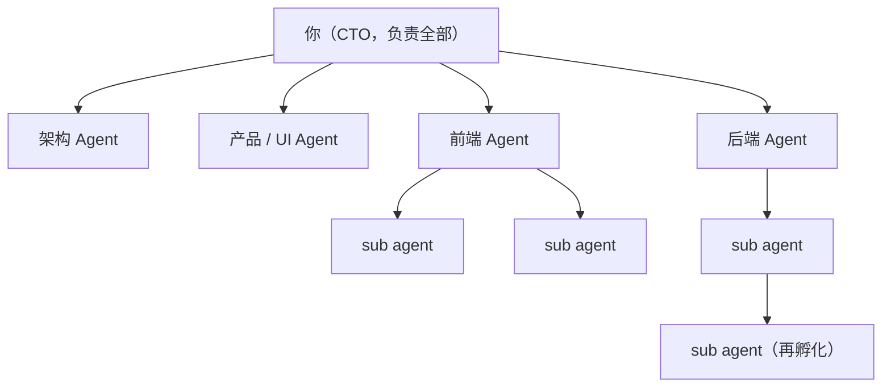

**你事实上是在一个组织架构里工作**；否则，你不可能管理一个复杂的需求。而只要你还在做一个软件工程产品，你面对的仍然是那些 essential complexity 与 accidental complexity——所以：

- 你仍然需要一个**版本控制**；
- 仍然需要一个 **repository**，因为你最终交付的还是一个产品；
- 这个产品最终还要经过 CI/CD 上线、给大家提供服务。

既然每个人（每个 Agent）拿到手的都是一个具体的 task，那么从 first principle 想：**这个 task 一定与 repo 里的某一部分相关**。它可能要重构一个 subsystem，可能要在某个地方加一个功能，可能影响到一些模块——**不同的 task 在系统里的"形状"是不一样的**。

### 1.2 "我需要一把锁"：版本控制的下一道题

*(参考时间: 00:02:14)*

讲者说他本来想在 repo 上加**锁**：

- 有些是**只读锁**（read only）；
- 有些是**写锁**；
- 有些是 **refactor 类型**的锁。

关键洞察是：**锁的类型也在变化**。比如一个 refactor，或者一个很小的 minor fix——虽然它是写操作，但它**对架构不产生 breaking change**。于是：**多个互相独立的小 fix，其实完全应该可以并行执行。**

这样一来，设计空间就打开了：

- 可以借鉴**操作系统里的锁**：先上锁，再干活；
- 也可以借鉴**数据库里的锁**：先把改动做掉，再做 conflict detection——也就是**乐观锁和悲观锁**两种思路。

"我们应该怎么设计这个版本控制？"讲者说，**你慢慢会从组织架构上找到答案**。而毫无疑问的是：**世界正在朝这个方向推进。**

### 1.3 从 150 行 mini agent 出发

*(参考时间: 00:03:10)*

概念讲得差不多了，就该回到具体项目上：**如果你真的要设计一个产品，整个流程会是什么样？**

要选一个 Agent-native 时代的产品来做样本，他选了 **DeepSeek Harness**（讲者简称 DSH；字幕里也常写作"DPC Harness"，本书统一为 DeepSeek Harness）。他前两天刚在北京参加了他们的一次线下聚会，现场很多同学和他面前的听众差不多大：**他们可能没写过很多代码、没经历过"古法编程"时代，是直接对着 web 许愿式编程的一代**。讲者的判断是：他们经过几年成长，很可能会成为非常核心的开发者——所以值得讲一讲，**如果从零开始构建一个 Agent Harness，你会遇到什么样的问题。**

本讲的路线是：**需求 → 架构 → 设计 → 二次开发（生态）**；下一讲再讲 DeepSeek Harness 里那些更细的 Agent-native 开发机制（它内部有非常多的 CI/CD）。

他也回应了一条评论："上节课讲了很多，但看起来好像什么都没讲。"——这确实是实话。因为有些事**说起来简单**：

> 网上有很多 skills，你可以 grow me、grow with stocks、还有 super powers……但你真正拿过来用的时候：比如你用一个 skill 去做 "live 1"，你马上就会发现它**陷入无穷多你不想让它管的事情里面**；尤其当你面对未知的时候，你不知道它在干什么；有时那个 skill 会疯狂地 find out 那个 sub agent，做一些你觉得没有必要的测试或验证。

这些做法**在某些场景下（比如真的在公司里开发产品）是成立的**，但讲者建议学生自己去摸索，有一个切身的感受——**所以他今天亲自来摸索一遍**：把编译好的 DeepSeek Harness 准备好，用它来演示。

他还观察到一件事：**以前（Pre-LLM 时代）你想运行一个比较复杂的开源软件并真的动手改它，都非常困难**；而现在他完全是"许愿式运行"——从部署到外部的东西，全都是一句话许愿："我知道这个项目可以被编译，那么 OK，让它去做。"

### 1.4 一个不 trivial 的任务：把仙林校区建成 3D

*(参考时间: 00:06:36)*

所有 Agent Harness 几乎都遵循同一个循环，因为大模型推理本质是**一问一答**：无论返回的是工具调用还是别的什么，都是一问一答。上一讲的 mini agent 就是这个循环。

**这个 mini agent 能用吗？能用。** 讲者周日坐高铁时突发奇想：既然要讲 Agent Harness，能不能让这个 agent 做一个**真正不 trivial 的任务**？他给了一句话——

> "我要一个比例基本真实的、南大仙林校区的三维图。"

结果相当不错（虽然有些地方不对）。有意思的是观察它的 trace，它是怎么做到的：

- 它找到了一个宝藏数据源：**OpenStreetMap**（开放地图），里面有各地非常细的地图数据——"如果这是一个篮球场，它真的会划出篮球场的那条线"；
- 它从那里爬了数据，然后**根据自己的想法建模**；
- 也正因如此，它产生了自己的"想法偏差"：地图上标注为绿地的部分，它铺上了树；**校门也被它建成了一栋楼**；计算机楼有十层，但高度明显做错了（图书馆的建模相对好得多，尤其是从 top-down 看，几何形状被正确保持了）。

这类问题怎么修？**给它更多提示词**：把每一块区域单独划定出来，仔细思考这块区域的功能应该是什么样，再做精确建模——代价是**十倍 token**，换来一个更好的版本。

讲者也点出了网上那些"图形能力很强"的演示是怎么来的：**它们都是在还不错的基座上，用 skills 不停追着让它一遍一遍验证，靠烧 token 变好的**。而有了三维模型这个 starting point，你就可以去做很多人的梦想——**一个"南大版 GTA"**：你知道哪儿可以走人、哪儿可以蹲点，就可以构建游戏逻辑。

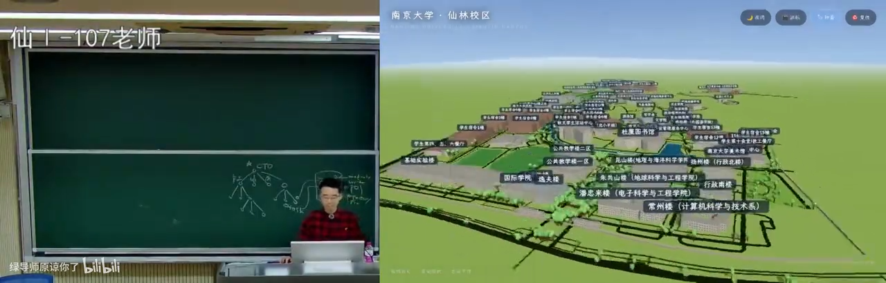

### 1.5 为什么它不能是产品：一个被断网打断的下午

*(参考时间: 00:10:21)*

"这完全可以工作——**但它不能作为一个产品**。"

因为它上一版**假设了网络服务不会中断**。一两轮对话你感受不到这个问题；但在高铁上，讲者跑了比较长时间、已经有一些中间结果时，**网断了，进程直接终止**——而他的 150 行 mini agent：

- **没有会话保存**；
- **没有恢复**；
- **没有网络中断后重试**。

于是他只能从零再跑一遍，或者让它重做一遍。**这就是 essential complexity。**

往后想，如果你要做真正的 Agent 产品（比如 DeepSeek Harness），怎么应对 API 中断？

- 首先需要**重试**——你们都见过 coding agent 的各种重试行为；
- 然后是**间隔**：你在美国数据中心访问 OpenAI 服务，和你在中国挂着一万层梯子访问，是完全不同的网络环境，timeout 也不一样；
- 再然后是**退避策略**：第二次重试应该等间距，还是把间隔慢慢拉长？学过网络的人都知道 **exponential backoff**：如果 1 秒后失败、再 1 秒后还是失败，那大概率下一秒仍然失败，所以你应该等 2 秒、4 秒、8 秒……直到网络恢复。像刚才那种物理世界的故障，**可能要 2、3 分钟才能回来**。

更大的挑战在**服务端与客户端不一致**的场景。以支付为例：

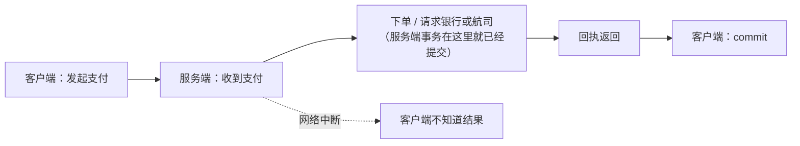

客户端发起请求后，服务端收到支付就把订单下了，因为它牵扯到其他系统（银行、航空公司）的确认**不能等**——等你全部做完再 commit 是做不到的。而如果订单发出去之后**你的手机断网了**：

- 你的手机应用不能 crash；
- 它必须告诉你"网络中断了"；
- 并且必须承认：**这个订单处在一个"我不知道"的状态**——可能下成功了，也可能下失败了，但因为它和服务端缺少同步，**它自己无法决定自己是什么状态**。

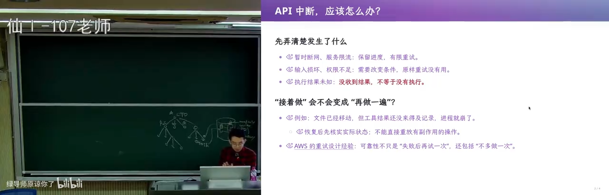

讲者说，这就是软件系统设计里那些**无法回避的 essential complexity**。

### 1.6 从一个 MVP 到一个产品：需求是这样膨胀的

*(参考时间: 00:14:35)*

从 150 行的 agent 到一个产品，你需要面对的东西一下子变多了：

- **项目管理**：Agent 可能同时在好几个工作目录上工作（不管你用 DeepSeek Harness 还是任何 coding agent 都能做到），于是你需要一个 **dashboard** 在多个项目之间切换；
- Agent 需要访问**项目相关的工具与 skills**；
- 工具调用需要**沙箱与权限**。

讲者让 AI 假装自己是产品经理，做一次完整的推演："老板说我们公司今天要出一个产品，**对标现在最好、卖得最火的人机交互 agent**——你先调研一下 DeepSeek Harness、以及最火的那类产品谁卖得最多，然后我们也做一个。"

（**编者说明**：课堂上讲师念的产品名由平台字幕识别为 "work body" / "cold body" 等，本书按课堂读音写作 "Work Buddy" 类产品，具体拼写请以视频为准。）

AI 给出的东西"还是挺有智慧的"：

- 先想**典型应用场景**（用例图）。例如"把文件夹里的本周项目记录整理成周报，列出延期事项，生成 Word 文件"——这是办公场景里非常常见的普通用户需求；
- 在场景基础上**疯狂罗列需求点**：历史检索与任务复用、模板与偏好、执行预算与用量、账号与数据管理、外部内容与指定隔离、用户反馈与问题诊断……
- 当然还会有很多**非功能性需求**；而实际上真实的清单还会多得多。

**如果你直接让 Agent 去实现这份需求，大概率会陷入 slop 状态**——因为 Agent 有一个非常强烈的倾向：**它要直接把这个任务完成**，它不会动脑子去想"未来还会发生什么"。

所以讲者提醒了一个关键区别：

> **做一个产品，和做一个 MVP，是不一样的。**

但 **MVP 可以帮助你看到产品真正的需求**：在使用 MVP 的过程中，你的假设会不断被 validate。他那个 mini agent 就做了一个不切实际的假设——**网络稳定、API 稳定**；这个假设不成立之后，**你的需求就相应膨胀了**。

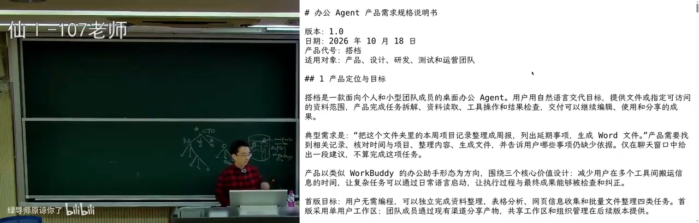

### 1.7 真正的挑战：需求改变（Grok Bot 时刻）

*(参考时间: 00:17:55)*

假设你已经写了一份非常详尽的办公场景需求报告，**带着 AI 写了 50 万行代码并且已经上线**——然后突然有一天，"Grok Bot"式的交互火了。

（**编者说明**：课堂上这个词的读音在字幕里出现为 GROWBOT / GROUBT / grab bot 等多种写法，本书统一写作 "Grok Bot"，拼写以视频为准。）

它带来的是一种**全新的交互方式**：

- **把 Agent 当人**：每个人（每个 Agent）有自己的记忆；
- 所以你可以**拉一个群**，让几个人一起协同完成工作；
- 你也可以要求某人**每天某个时间做什么事**（定时任务）。

这时候你回头看你那份需求：**左边栏是项目、右边栏是几种视图**……而新交互的根基完全不同。于是有了那句程序员名言：

> **怎么杀死一个程序员？改需求三次就够了。**

因为**你之前所有的需求假设全都崩塌了——崩塌的是交互模式的根基。** 所以"应对需求的改变"是非常有意思的事情：

- 大厂的架构可能已经把上一版的功能性/非功能性需求做到极致（性能、交付质量），**但一旦这种摧毁性的事情来了，就只能开始疯狂地拉通对齐、闭环、沉淀、复用**，再走到下一个版本。这没办法——
- 大厂之所以保守，是因为**它有交付质量的要求**：它做了一个选择，期望极高质量地交付需求，所以架构会做得相对保守。

**相比之下，另一条路线是"光速复刻"。** 讲者展示了在 DeepSeek Harness 上出现的 "dsh bot"：不止一个人很快 release 了它——它可以设置多个 bot、可以拉群（群里甚至有一个很像群的图标），可以聊天，**像素级复刻**；而且在这个基础上**你还可以补齐它没有的功能**。

他举了自己作为程序员的不满：Grok Bot 面向普通人，所以**不开放任何编辑配置与提示词的权限**；但对一个程序员来说，他就是想把那个 `configure.yaml` 拿出来改一下，或者把提示词拿出来改一下——**"因为我懂得怎么改提示词，而 99% 的人不知道怎么跟模型对话。"**

还有更"离谱"的脑洞：把左侧的列表结构改成一棵**代表部门的树**，右侧不再聊天而压缩成一个小窗口——"让你有当老板的沉浸感和体验感，提供一点情绪价值"。讲者强调：**这种需求马上就会有人去 web 出来。**

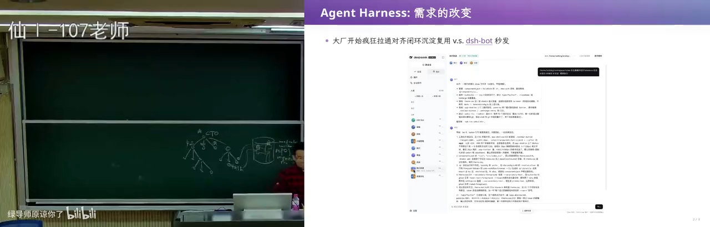

### 1.8 时间倒回 2026-06-10 23:00

*(参考时间: 00:22:10)*

为什么讲这个故事？把时间倒回 **2026 年 6 月 10 日**——那还是大家已经意识到 **coding agent 要变天**的时候。当时主流产品有 Claude Code、open code，还有字节系的一些产品，以及（字幕作 "cold body" 的）另一款产品；讲者也是后来才知道，**它和 Work Buddy 类产品共享了一整套 agent 层的编排底层架构**。

就在那个晚上 23:00——"谁说 DeepSeek 不加班的"——**一个神秘的项目启动了，里面什么也没有，就是一个空仓库。**

甚至当时还有 `CLAUDE.md`（当然好消息是今天你不需要它了）。讲者称之为**一个很恶心的需求点**：

> 当你希望一个项目同时支持多种 Agent 时，你就需要用**它们都能理解的方式**去组织项目文件。

而第一个提交就已经透露出野心：**Link MVP requirement analysis**，以及一个 **microkernel architecture**——**从第一天起，他就想做一个操作系统，想造一艘航母。**

那这艘航母到底是怎么造出来的？

---

## 2. 架构：没有免费的午餐

*(参考时间: 00:23:27)*

### 2.1 顺着需求做架构，会得到什么

*(参考时间: 00:23:37)*

如果你直接对着需求文档、让 Agent 帮你做架构，那么 Agent 的注意力就会落在**需求**上。而需求里自然会出现一些名词，比如"**工作区**"。

于是会发生一件非常自然的事：

- Agent 不可能设计一个"什么也没有"的架构——那样就是没完成任务；
- 所以它一定会**为"工作区"做一个 class**；
- 接着它会设计工作区与其他东西的交互：与模型/Agent 层的交互是什么；工作区可以链接到 session；session 可以向 Agent 发送一个 chat；Agent 之间可以调用 agent loop 或工具做事；结果（比如绘制出的 canvas）可以放到 session 上；
- 然后——**session 的东西该放在哪里？用一个数据库来存。**

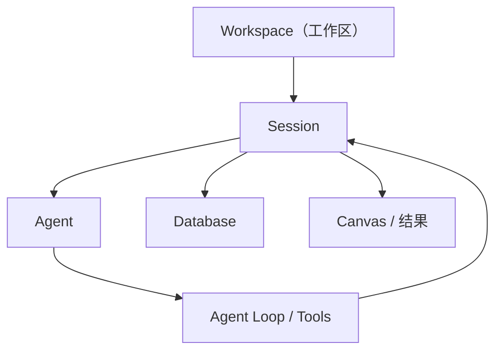

讲者说：**这是一个非常自然的架构设计方式，大厂里也经常这样设计。** 但接下来那句话才是重点：

> **架构意味着没有免费的午餐。**

### 2.2 受限与自由：架构是一个 spectrum

*(参考时间: 00:24:58)*

任何一个架构，都是在**受限**和**自由**之间做一个平衡。

**当你确定了架构，模块与模块之间的边界就出现了。** 边界的好处很直接：开发某个模块时，你不需要（或只需要很少地）知道系统其余部分是怎么工作的。所以第一天把需求切成这样的架构之后，**每个模块都可以独立开发——马上就可以启动大量 sub agent，把这个产品堆出来。**

但代价是：**你做的限制，同时限制了未来的自由度**。当需求改变（Grok Bot 那种改变）时，如果架构不能适应，就会不断出现**抽象的泄漏**，项目越来越难维护。

反过来，如果你做**太极端的自由**呢？讲者举了一个"看起来很美"的设计：**每一个模块都是一个进程，进程之间发消息**（message passing）：

- 这个架构非常干净、非常自由：我可以随便发消息；
- 但它**实际上没有任何用**——它就是一个 actor model；
- 它没有约束：消息该怎么管理？什么时候发什么消息都没确定——**"你等于没有架构"**。

于是讲者给出了一条贯穿全讲的判断：

> **越容易、越自由的东西就越不好开发；受限有受限的好处，自由有自由的好处。带着这个想法去理解所有的架构系统，你会发现每一层设计都是有取舍的。**

几个例子：

- **操作系统的进程**：这是一个非常好的抽象，但它非常"自由"——正因为自由，上层才能搭建各种应用（浏览器、coding agent、虚拟机、任何东西）。**操作系统为了你的自由，付出了代价。**
- **编程语言之争**：人类为了"到底什么语言最好"炒了几十年（"PHP 是世界上最好的编程语言"这个老梗）；越自由的语言（比如 C）能更好地控制机器，**代价是内存泄漏和各种麻烦**。
- **LAMP / PHP 的架构**：它引领了整个互联网世界至少十几年，WordPress 就是典型代表。**但当你要服务 1 亿、10 亿人时，它扛不住了**——从单机到数据库，每一个点都是瓶颈；为了拆开，就有了各种抽象泄漏：先分库分表，再让一台服务器扛，服务器也扛不住了就再拆……**于是演进到下一个版本的架构。**
- **Event sourcing**：概念很干净——**所有东西都是事实，只 append-only 地记下来，剩下的人看到的都是事实的 derivation**。但它也不是没有代价：当前状态完全由历史推导而来，性能优化更难；而且有时候**你只是想 hack 那个当前状态**——比如教务员"没有理由就是想让你强行毕业"，在一个"月黑风高、没有人知道的时候"悄悄操作。这种事在真实世界里可能是合理需求，**但在 event sourcing 里很难办**：你要加入一个特殊的 event 和特殊的处理规则（"强行毕业"），而它在持久历史里**会被审计到**——你不能用"我也不知道那时候是怎么回事"来搪塞，因为**谁 commit 的这个 event，当时就记下来了**。

所以总原则是：

> **如果你的架构和需求是匹配的，你就方便。** 单机能处理的时候，LAMP 就是最合适的价格/架构，PHP 就是最好的语言；**但当你的假设发生改变时，架构就可能成为阻力。**

讲者把这个原则放大到了人类社会：

> 人类社会的进步，某种程度上就是**不断打破旧假设**的过程。新产业诞生、旧产业消亡，在新旧交替的时候，就有人才的流转，**有些人就自然而然被淘汰了**……你们每个人都会经历很多这样的事，最终才能真正理解。

他自己小时候经历过国企改革、房地产崩盘，再到互联网、云计算、AI——**每一波浪潮都有这样的新旧交替，也都是一种架构上的变化。**

### 2.3 案例：MapReduce 用"限制"换来一个抽象

*(参考时间: 00:33:20)*

讲者给了一个具体的架构变化案例：**2004 年，Jeff Dean 与 Sanjay Ghemawat 发表 MapReduce。**

这篇文章非常非常好读——**你只要看那个例子就懂了**：

> 如果要做一个大规模的分布式计算，**你不要去写那些又长又复杂的代码**，你只要遵照一个**受限的代码模式**：map 和 reduce。

- **map**：我有一个 list，再有一个 function，就可以把它变成另一个 list；
- **reduce**：我拿着一个 function 不停地把它"叠"起来——先拿第一个元素，再拿第二个……但如果这个 F 有一些比较好的数学性质（比如**结合律**），你就可以**并行地 reduce 两个部分**，再 reduce 它们的结果。

**如果你能把计算写成这个形式，你就可以用我的框架。** 这就是架构上的取舍：**它限制了你的编程模型**——你只能这样写程序。而作为交换，它给了你一个系统实现：

```cpp
// 早期 Google 内部是 C++：include 一个 mapreduce.h，
// 然后写一个 class，里面声明 map 是什么、reduce 是什么
#include "mapreduce.h"

class WordCount : public MapReduce {
public:
    void map(const std::string& key, const std::string& value) { /* ... */ }
    void reduce(const std::string& key, std::vector<std::string>& values) { /* ... */ }
};

// 然后就可以对着一个分布式文件系统说：
// 「就在这里做 map reduce，最多 2000 台机器，
//   每个 task 用 100MB 内存」——跑吧
```

它内部还有一些很聪明的设计（比如按 key 排序的 **shuffle** 中间过程），而**剩下的系统实现藏在后面，你不需要知道它是什么**。你不再使用 pointer、list 这类基础抽象，而是一个**被系统包裹起来、可能跑在不同机器上的抽象**。

**这是一个引领了世界的设计。** 它同时成功也失败：

- **成功**：大家发现"原来有这样一层抽象层，写分布式程序真的变容易了"，而且还能容错。Google 当时遇到的最大问题是：**机器一多，整个系统就不可靠了**——跑一个全互联网数据的索引，几乎一定会有一台机器掉线或故障。而 **LAMP 的基本假设是"机器是好的"**（你们的电脑做大作业时也假设机器不会突然消失；如果真消失了，你会用社会工程的方式跟老师说"我的机器没了"，但 Google 不能用这个方式解决问题，**它必须用一个 system 抽象来解决问题**）。
- **失败**：这个限制只适合**离线任务**。第一，用起来不那么方便；第二，如果需求走向**实时/流式**（比如银行的订单），MapReduce 就撑不住了，你需要更高效的架构——今天的答案是 **Spark** 这样的计算引擎，和 **Flink** 这样的流式数据处理（而 Flink 本身也和函数式编程有千丝万缕的联系）。

### 2.4 Agent harness 的 first principle：Everything is a plugin

*(参考时间: 00:38:21)*

"我讲了那么多，其实只说了一件事：**架构是受限和自由之间的平衡。**"

现在回到那艘航母：如果设计一个 Agent Harness，**你的 first principle 是什么？** 回到第一个提交——**microkernel，做一个操作系统**。那"操作系统"意味着什么？

> **操作系统不需要知道每一个进程是干什么的。**

UNIX 诞生的时候还没有桌面浏览器、也没有图形用户界面，它不需要知道进程是干什么的，**但它能把这些进程组合起来，并且进程之间可以互相使用。**

于是 DeepSeek Harness 的 first principle 是：

> **Everything is a plugin. —— 所有东西都是可以插件化解耦的。**

每个 plugin 有点像 actor model 里的 actor，**但它不是一个 actor model**。可以这样理解：如果我把每个插件都想象成**一个进程、或者一个人**，让它们之间互相发送消息，那理论上我可以实现任意架构。这个架构想做的只是：

- **把每个模块的 private state 封在它自己里面**；
- **当模块之间需要交互时，你给我发一条消息**，我可能会给你一个返回。

也就是说：**你可以把任何程序、任何软件系统的模块都当成进程提取出来，把模块之间的函数调用换成 RPC（远程过程调用）**——任何一个软件都会变成这个样子。

讲者紧接着抛出一个看起来奇怪的评价：**"所以这个架构是没有用的。"**（意思是：单靠"一切皆插件"这句话本身不足以构成架构，它太通用了。）它的价值必须靠后续那些"协同"机制兑现——而那是第 3 章的题目。

### 2.5 Cordis：谁负责进程管理

*(参考时间: 00:40:12)*

DeepSeek Harness 先发了一篇论文：**Cordis**，里面有大量公式。讲者说他今天不细讲这部分（虽然它也是架构的一部分），因为 **Cordis 负责的是**：

- 服务的解析；
- 依赖的激活；
- 插件的 **load / unload**。

**把 DeepSeek Harness 想象成一个操作系统，那么 Cordis 就是进程管理。** 这里有一个大家都默认了很久的事情：

> 在操作系统里，**一个进程退出时，它持有的所有资源都应该被回收**。——就像你们写 OJ 题从来不回收内存一样，因为你知道操作系统会回收。

Cordis 的设计就是借用了这个想法：理想情况下，**你的进程可以 declare 它需要哪些资源、依赖哪些东西，这些依赖应该被自动加载；而当这个插件 unload 时，依赖的东西最好能自动卸载**——就像进程被 kill 时内存要被自动回收。

不过讲者强调：**整个 Harness 设计真正的难点在"协同"**。

> 如果让这些插件随便发消息、随便协同，那就全乱了——**跟所有函数链接在同一个地址空间里没有任何区别**。但不协同又没用。

所以真正有意思的设计是：**你要构建一个 Agent Harness 的"世界模型"。**

---

## 3. 设计：一个以事件为地基的世界模型

*(参考时间: 00:41:44)*

### 3.1 Session 是唯一的 ground truth

*(参考时间: 00:41:44)*

DeepSeek Harness 里有一个**所有进程共享的共享空间**，关键的数据结构都放在这个空间上。基于它，Harness 又构建了更多抽象——**它没有特权的内核**（所有东西都是 Cordis 的插件），但在"世界模型"这一层是有更细的层次的：

- **Cordis 之下是 Session**；
- 如果要做一个 LLM Agent，**它无论如何还是以大模型为中心的**；
- 所以它的 **append-only 的 session event 日志是唯一的 ground truth**；
- **模型的历史不是"存储"的，而是从这些事件派生的**（derive messages）。

也就是说，它有一个完整的事件日志——**这就是 event sourcing**。（呼应上一节的取舍讨论：这里选择了"事实优先"的干净模型，代价是要为"投影"和性能付出努力。）

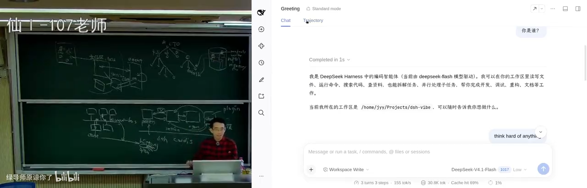

### 3.2 Event bus：插件唯一的公共语言

*(参考时间: 00:42:53)*

在这个基础上，DeepSeek Harness 做了一个 **event bus**：

- 插件可以挂载、**监听** event bus 上的事件；
- 世界上有一份 **persistent event history**；
- 其他所有能力都从这个基础上长出来。

它做了这些约束与设施：

- **类型检查**：`service definition` 有 provider 和 consumer，类型对不上，**TypeScript 根本不会编译这份代码**——这就像"禁止你任意地往别人那里发消息"；
- **权限管理**；
- **事件是扩展点，按领域分类**：每个插件都可以产生事件放到 bus 上。

规则很清楚：bus 上规定的是"消息的格式是什么"、"谁能够往上放东西"、"类型匹配不匹配"。而插件不仅能发、能听，**甚至可以修改这个事件本身**（对尚未落盘的事件）。讲者称之为：

> **它相当于赋予了一系列原子的能力——一个小操作系统。**

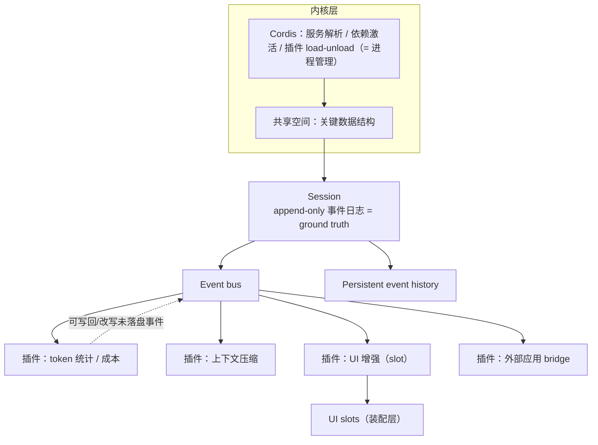

**一个具体的、很能说明问题的例子**：每个插件都可以看到 **LLM inference 的状态**——比如"我的大模型这次吐了多少 token"。这里有一个精巧的设计：大模型的输出**实际上是不 commit 的**，历史里可以有一个 **open entry**，代表"这一轮还没有结束"，模型会不断往里面送新的 token。**这个状态不持久化，但依然可以被看到**——所以你才能实时看到思维链在动态变化。

于是，一个插件只需观察 bus 上"LM 吐 token"的事件，就能统计 **token cost 与 cache hit**，并通过 **slot-based 抽象**把它绑定到 UI 的某个位置上。

**这个插件完全没有干扰系统里任何一个其他部分**——因为它是一个**不侵入**的功能：内部状态是自己的，只有"希望别人看到的事情"才以事件的方式放到 bus 上。

（呼应第 1 章的组织架构：把你的组织画出来，每个模块只暴露它想让别人看到的东西。）

### 3.3 投影：同一份事实，两种视图

*(参考时间: 00:47:26)*

前面那些机制能跑起来，是因为概念体系建得好——**如果 event 的设计崩了，或者 session 的设计崩了，整个 DeepSeek Harness 后面就不可能维护下去了**；反过来，如果概念体系建得好，**上面的插件绝大部分时候只需要 consume**，很少需要侵入系统（虽然它们有侵入的能力）。

一个典型例子是 **projection（投影）**：

- 你看到的那个聊天窗口，本质上就是**从 message history 里算出来的一个投影**；
- 而同一个 session history 还可以投影成**给开发者看的 trajectory**：你可以看到每一次工具调用（比如 `bash`）的 payload 是什么、干了什么、结果是什么，以及额外的信息。

所以——如果你不喜欢那个聊天框，**你完全可以把它设成不可见，放一个自己的东西进去。**

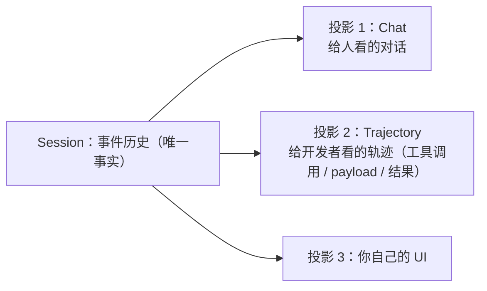

**API 表面非常小**，讲者说这是他看完发布后"震惊瘫坐、原子弹爆炸"的原因——大家可能没有意识到**一个干净的架构可以带来什么**：

```ts
// 追加事实
session.append(event);

// 在事件总线上注册 handler（旁听 / 响应）
session.on('event', handler);

// 从事实派生投影
session.deriveMessages();          // → chat
session.deriveTrajectory();        // → agent trajectory（工具调用与结果）

// 向 agent 提交输入
agent.submit(input);
agent.followUp(...);   // 继续追问
agent.inject(...);     // 注入（这一轮完成后再注入）
agent.steer(...);      // 打断并改变方向
```

他特别解释了 **inject / steer** 这几个"看起来很平常"的操作，其实都是产品设计问题：

- 模型正在推理输出时你继续提问，这个新问题**应该等这一轮工具全部完成再注入**，还是**在下一次工具调用后就立刻注入**？
- 还是你**按 ESC 停下来**再继续？

### 3.4 原子能力：hook 尚未落盘的事件

*(参考时间: 00:50:24)*

还有一个能力，讲者认为是**整个系统设计里非常关键的一环**：

> `session.event` 可以 hook **一些还没有 persist 的事件**。

也就是说，插件不再只能"看"了之后再推一个新事件上去，而是**可以篡改**：比如把一个东西扔掉，或者改写它。例如 agent 下的 **`preStep`**——在每一步之前，插件可以先干一些事，**甚至往 agent 的 loop 里 inject 一段 prompt**。

### 3.5 一个例子：把时区和指纹注入上下文

*(参考时间: 00:51:56)*

这个能力对应的需求非常具体：

> 我希望每一轮对话，都把"我当前所在的时区""我所在的网络""我这台电脑的一些指纹信息"注入到模型的上下文里。

而实现它可以有两条路——这正是"面向需求的实现"和"面向架构的实现"之间的差别：

- **自然写法**：写在需求说明里，然后在你 build context 的地方直接加一段代码（讲者说他的 150 行 mini agent 里也有 `build_context`，可以在那里写）；
- **架构写法**：在 agent 的 `preStep` 上挂一个 hook，把上下文内容改掉。

**这就是整体架构：插件挂在一个总线上，只有少量协作接口；每个插件绝大部分状态留在本地，但它们能感知到全局的 agent loop、session，以及各种 projections**——所以每个插件都能按需得到它想要的关于"当前 LLM inference 到哪一步了""别的插件做了什么"的信息，而一切仍然**以大模型推理为核心**。

### 3.6 白板一块，为什么是核弹

*(参考时间: 00:52:58)*

讲者的判断是：**这套设计的一切都是为了插件的生态。**

他回忆内测版本的观感：

> 最早我们内测的时候这些东西都没有，**它真的就是白板一块**——但白板一块的第一天，开发者群里就有同学说："我们来有一个 token 统计吧、上下文统计吧。"于是它就可以做——**完全不需要干扰系统里任何一个其他部分**。

也就是说，**白板的另一面是核弹**：地基打好了，做任何东西都变得非常容易。

他现场举了几个方向：

- **Text UI**：DeepSeek Harness 原生设计是 **Web UI**（因为 web 可以呈现非常人类友好的界面，UI 用 **slots** 装配）。但如果你"剑走偏锋"，就是喜欢命令行——那就**把用于装配 UI 的 slots 全部扔掉，只留 session 和 agent**，在 event bus 上监听 session 相关事件（包括那个还在吐 token 的 open chat completion），投射到自己的终端。甚至可以做**一个与 Web UI 共享状态的 Text UI**：你在网页里说一声 hi，它在输出的同时，**你在另一个终端里能看到一模一样的东西**。
- **PDF Reader** 这类插件则是 hook 一些生命周期：当"加载 @ 文件"发生时，把自己的能力 inject 进去，同样以事件方式管理。
- 他还提到一个有趣的历史：**最早 DeepSeek Harness 官方仓库里是有 TUI 的，后来 TUI 被从仓库里移除了**，现在是一个第三方的 text UI。

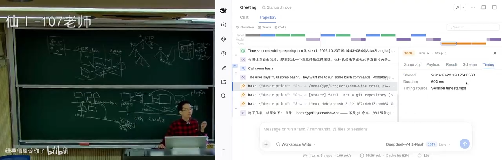

### 3.7 creator mode 与"许愿式插件"

*(参考时间: 00:55:49)*

"真正好玩的地方是：**如果让你们来做，你们会想做什么插件？**"

有人会说："这不就是一个 codex / open code 吗？都长这样，我们还能干什么？"讲者的回答是：**你能干任何事。**

比如脑洞大一点：**把它武装成一个像 VS Code 一样的东西。**

- VS Code 的基本假设是"**一个工作区就是一个目录**"，左边栏可以动态配置很多小块（editor、browser……），它也有自己的插件生态；
- 那我们为什么不能做一个？**一个插件可以维护好多 UI 状态**，那是这个插件自己的事；
- 然后：打开一个工作区、放一个 terminal、加 git、加 side chat……**这不就是 Cursor 吗？**——而这一切跟插件生态里所有的东西都不冲突，**因为它只是不断地看主 session，然后维护一些自己的状态**。

用讲者的话说：**这就是"许愿式"地做任何你想要的东西**——而 DeepSeek Harness 为此专门给了一个 **creator mode**。

**creator mode 和普通 agent session 的区别在权限：**

- 一般 session 只有 agent 的权限：工作区目录的读写、bash，后面还会套一个沙箱；
- 而在**全火力全开的 creator mode** 里，**它是能看到这个世界的**：它可以把插件拆了，可以往里面加插件——也就是说，**它可以在 agent 一边运行的时候，一边往 event bus 上挂东西**。

这个能力来自 Cordis 的**全动态插件生命周期**，讲者打了个类比：

> 就像操作系统：我可以在操作系统里**随时启动一个进程，也可以随时把一个进程杀掉**。

现场演示（"许愿式插件"）：

- 他说"我对现在的 UI 不太满意，能不能在 token 消耗旁边放一个超大号的……"；
- 演示了 **Token usage** 面板：因为有所有事件，所以有**实时统计的近期推理速度**（"我大概是 200 左右，现在已经到 250 了"）；
- 演示了插件管理的功能：消息是立即放进去还是 **steer**，可以打断；
- 到了需要危险权限的时候，系统弹出 **plugin install** 的申请，他点了 allow——**这就是真正的许愿式插件。**

讲者再次强调那个反差：

> 所以你看起来它是一个白板，**但实际上它是一颗核弹。**

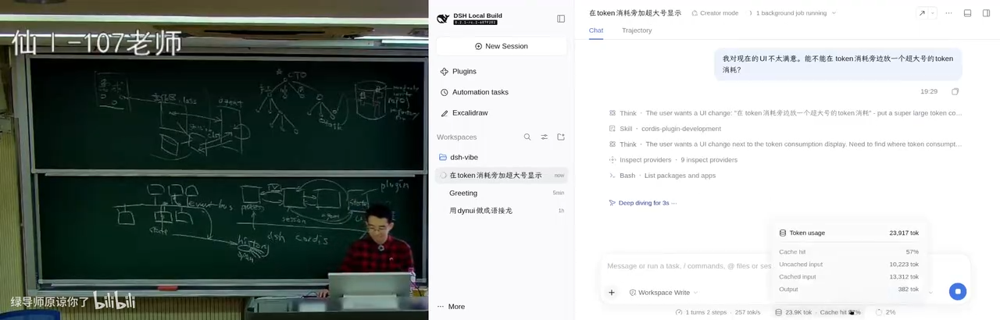

### 3.8 代价：插件不是万能的

*(参考时间: 01:03:03)*

**所有的好处都是有代价的。** 代价是什么？

虽然我们在 **event 这一层**做了统一对齐（大家都要用同一套事件、类型匹配不上就编译不过），**但所有插件自己的状态管理还是在自己手里**——比如那个 "better sidebar" 插件，它的窗口是什么、终端怎么表示，都在它自己里面。它可以创建自己的事件推到总线上让别人看到，**但插件与插件之间的语义可能是冲突的**：

- 假设你实现了一个**上下文压缩**插件，每次把上下文压缩到 1/2；
- 如果你装了**十个**自动压缩插件，每个都压到 1/2——那就是 1/1000，**任何输出都被压到你没法看，信息全丢了**；
- 再比如两个 hook：**一个检查输入、一个改写输入——到底检查在前还是改写在前？我们并没有规定**；
- 或者两个 hook 冲突：**一个要求停止，另一个要求继续**——运行到"停止"那个就被停掉了。

讲者的结论很冷静：

> **这种语义冲突，在这种架构里是永远没有办法解决的。** 你可能需要另外一个机制，比如再加一个 **blackboard（黑板）**，在需要的时候让它们去共享状态——**那这个时候抽象就有限了：当你有这种需求的时候，抽象就有泄露。**

所以：

> **插件不是万能的，架构也不是万能的。** 但是你可以看到，**一个好的架构会给我们带来一些非常有趣的启发。**

---

## 4. 生态：架构真正的回报

*(参考时间: 01:05:56)*

### 4.1 release 一个 nothing

*(参考时间: 01:06:00)*

前面讲的都是"简化模型"：做一个需求 → 需求确定 → release → 挣钱。**但 DeepSeek Harness 走了一条不太一样的路线：**

> 它在 release 的时候，**release 了一个 nothing**。

准确地说，它发布的是**一些基本的抽象，和一些第一方的东西**——**把剩下的交给了开源的生态。**

证据就在眼前：上周北京有一个完全由**开发者自己组织**的活动，"跟官方没有任何关系，没有任何 DeepSeek 的人到场"——讲者只是因为自己去北京，顺便到会场"闪现"了一下。

**而隔绝简单、复杂性低、随便扩展，就意味着在 DeepSeek Harness 的基础上可以长出一整个生态——你想要什么就有什么。**

讲者也坦白了他对开源社区的一点"恨铁不成钢"：

> 如果我是第一方，我可能**不会**用这么好的东西去 web 一个"高达驾驶舱"。我显然会外部/扩展一些**更了不起**的东西。

所以在他看来，**event bus 真正能力不在于接那些花哨的小东西**（hook 一个事件、把 UI 增强一下），**而在于它可以承载一整个生态**——它当然可以互相增强：调用工具、工具再互相组合。

### 4.2 第一种用法：给超级应用装 AI 原生能力

*(参考时间: 01:07:54)*

讲者说他第一个想接入的是**超级应用（super app）**，而且**只需要一个非常小的抽象层**。

以 WPS 这类办公软件为例——他要改造的东西**只需要支持两个操作**（讲者现场数到了三步）：

1. **锁住对象**：比如"第一页可以编辑，第二页就别编辑了"，我现在把第二页锁住；
2. **把对象 hand off 到模型的上下文里**（从总线送到模型）；
3. **把修改后的对象拿回来**，替换回超级应用里。

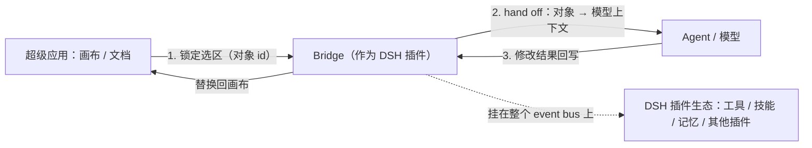

> **我只需要对 WPS Office 做这样一个最小的改造，我就给一个超级应用赋予了 AI 原生的能力**——而且它可以享受 DeepSeek Harness 插件生态里所有东西的好处。

他把这件事的份量讲得很清楚：

> DeepSeek Harness 是一个**非常小的、非常薄的内核层**，但它底下有一整个大的插件生态——**这是 AI 的生态**；同时**我的任何一个超级应用都可以做到这一点。**

现场演示（他花了 5 分钟 web 出来的，**"当然没有 web WPS"**）：

- 屏幕上是一个类似 Excel 的画布，可以拖动各种东西；
- 他做了一个 bridge，要求 AI"在框里画一个 turtle 用的元素，带一些文本标签"；
- **演示中最有说服力的一幕**：AI 开始工作的时候，**所有编辑照样可以进行，但那个对象被锁住了**——因为他对超级应用只需要"锁对象 + 把锁住的对象 hand off 给模型 + 模型改完送回来"这些接口；
- **因为我是放到总线上的，整个生态都归我。**

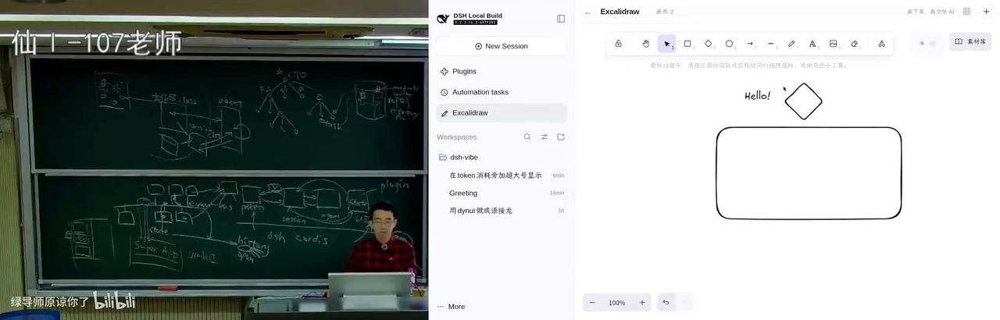

讲者由此质疑了一种常见的产品形态：

> 你用那些产品让它做一个 PPT，然后它自己做了个 PPT editor，你可以拖框、加注释、再让它改——**但你为什么不反过来做这件事？** 这是一个生态，**你直接把它摁进去就完了**，这才是真正的 AI-native：第一方，所有东西都可以编辑它，你不满意还可以再改，不满意这个龟壳你还可以把它删掉。

进一步的空间就打开了：

- 你可以做一个 **Blender 的 bridge**；
- 也可以**把这种"对象 bridge"做成 DeepSeek Harness 的原生插件**——**"这就是我们为什么需要 MCP 呢？只要做一个非常小的 protocol。"**

### 4.3 第二种用法：generative UI

*(参考时间: 01:12:34)*

第二个方向利用了 event bus 的"随便 hook"特性：**建立一条 session 与模型之间的双向通道**。

规则很简单：

> **只要允许模型输出一张带 HTML + JS 的卡片，我就可以把这张卡片放到界面的任意 slot 上。**

而"带 JS"意味着——**这张卡片上可以放按钮、输入框、任何东西**，理论上一张卡片里可以塞一个完整的 React 组件。然后：

- 允许**某些 JS 调用**往 event bus 上注入事件——**我就可以把东西注入到模型的上下文里**；
- 于是形成闭环：**动态 UI 生成 → 用户点击 / UI 状态 → 通过一段 JavaScript 注回上下文 → 模型据此指导 UI 更新**。

> **这不就是一个 generative UI 的应用吗？**

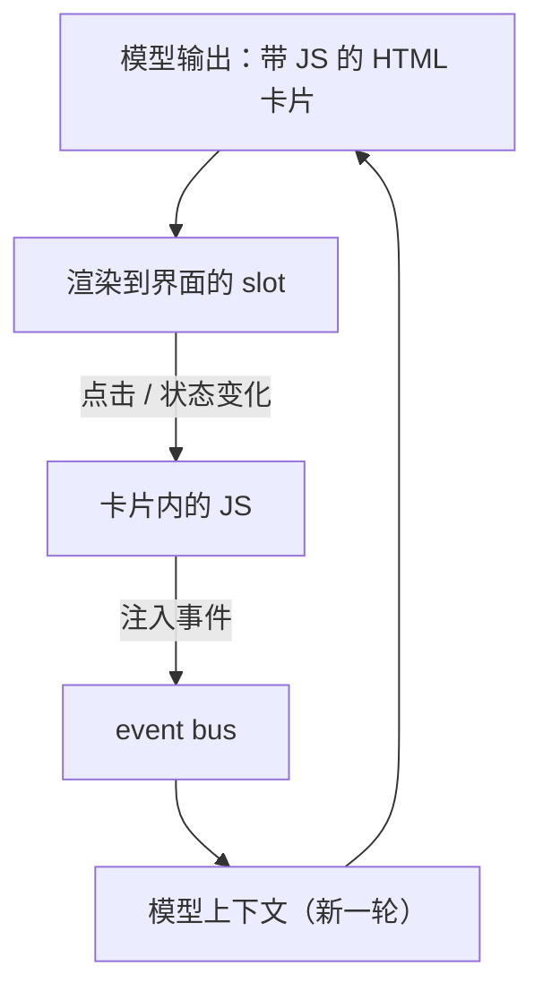

他也讲了实现约定（这正是"设计"在起作用的地方）：他只需和模型约定**一个特殊标记的 `div`**（可以理解为一个小小的 DSL）——**碰到这个标记，就以卡片的方式渲染**。为了让模型知道怎么生成，插件必须**给模型注入一段协议**：通过 `context.systemPrompt` 这样的事件，插入一段 **1.5KB 的协议说明**；而这是**插件唯一主动写进模型上下文的东西**。

反过来，**模型的输出到 UI 状态**这一段不需要新增消息类型——**靠标记 + 投影（event sourcing）**：模型一轮输出结束后，插件检查事实历史里有没有那个标记，有的话就改变自己的状态（往某个 slot 里插入界面）。

现场演示：

- **成语接龙**：以"惊弓之鸟"开局，点击按钮后 JS 往模型上下文注入一句话（字符串拼接），模型接着输出"鸟语花香"、再生成界面的 patch；因为关了思考、又带着上下文，中间有些 bug（"有些 bug 不要紧，因为我关闭了思考"）；
- **五子棋**：要求**棋盘状态在 UI 里，但所有落子都由模型思考后决定**——现场出现了"下在线上"的小 bug，但流程是通的。

讲者对这段演示的定位很清楚：

> **这肯定不是一个成熟的产品。** 但是回想 ChatGPT 3.5 的时候：我让它从 50 数到 100，它"五十、五十一、五十一、五十一……"——你肯定会觉得这东西又慢又不好用。**但当你看到一种可能性的时候，就意味着一定有办法可以做得非常非常好。**

到这一步，你就明白他为什么"看到了核弹爆炸"：

- 一方面，**插件生态让上下文可以被更好地管理**：上下文压缩、动态 UI、上下文 fork……
- 另一方面，**你甚至可以把聊天框整个扔掉**——面对一个任务，生成一个真正好的 generative UI。

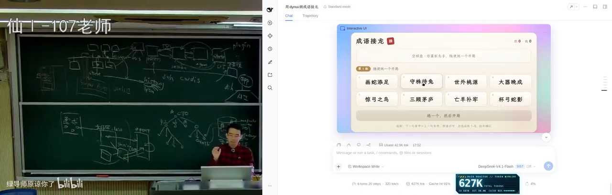

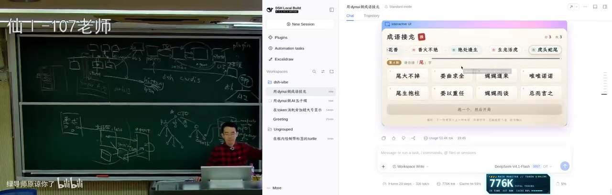

### 4.4 回头看插件本身：入侵了没有

*(参考时间: 01:18:47)*

演示做完，讲者让 agent 自己来解释"**插件实现到底是怎么注入的、有多少入侵**"：

- **工具调用不直接改画布**：只是暂存到 store，`begin` 生成一个 job，把选区 id 锁在画布上；
- 这是一个**非常薄的应用改造层**：因为要支持"对对象的选择和锁定"，并把它们"焊"到宿主里；
- 一句话概括这个设计：

  > **画布 = session；编辑请求 = tool call；提交 = 回合结束的 commit。**

- **完全没有入侵其他的**——这是它的价值：能和其他插件的能力组合；
- 上下文注入部分：动态 UI 插件需要给每个 session 注入提示词（因为它的使用有条件——必须生成带特定标记的 div），于是它 hook `context.systemPrompt` 事件插入那 1.5KB 协议，**这是插件唯一主动写进模型上下文的**；
- 模型输出到 UI 状态：**提取不新增消息类型，靠标记加投影，event sourcing**；
- 另外那个浏览器 remote session 的插件：**打包 profile、点 prompt**，也**完全没有动底层架构**——只靠系统的架构能力。

他还特别指出 **scope 机制**在**能力上限**上的作用：

> 如果我的插件想干一些坏事，**它匹配不上它所声称的东西的时候，就会自动 fail**——相当于被隔离了。

以及那个 "assistant stream" 的插件：**它只是旁听全局事件**，并且做了**对象同一性过滤**——别人的 agent 它不匹配，就不会乱动。

### 4.5 谁的生态：开发者的脑洞 vs 严肃厂商

*(参考时间: 01:25:11)*

讲者用一张图总结了生态的两端：

- **一端是开发者**。他说得很直白："我觉得群里很多都是**无所事事的大学生**——这挺好的：显然他们没我这么 experience（我见过这么多软件系统的设计和实现，知道该怎么用它、怎么最大化发挥它的效能），**但是他们有时间啊，我没有时间在里面 web 那种奇奇怪怪的东西**。"所以开发者会开出很多神奇的脑洞：有些比较小（一个高达驾驶舱、把 UI 做得更漂亮一点——"那个 better sidebar 就是个很好的想法"）；
- **另一端是更严肃的厂商**会介入。

至于谁能挣钱，讲者说："**剩下就看愿意不愿意了。**"但至少——**这些东西全都是 open source 的**。

他给了一个非常具体的预测。在 AI-native 时代：

> 如果我有一个"做得不是那么好"的 WPS Office（可能只有 WPS Office 的七八十%），**但它可以原生地接受 agent-native 的能力**——那我到底愿意用 WPS，还是愿意用这个？

因为当这个应用**接入这个系统之后**，我面对的是**我个人的 agent、我个人的数据库、我自己用得顺手的所有东西、我的内容生成器**。

他给了一个自己的例子。昨天他在小红书上被迫删帖（因为要保密）：他要填一些表格，表格里要填**从 2021 年到现在发表的所有论文**——"你想想 WPS 要填这个表，或者今天你们用 codex、用 computer use 去填这个表，还是要花一些时间的。"

而在他的插件生态上：

- 接了一个**自己的 database 插件**（"可能是我自己 web 的"），它可以向模型提供必要信息——个人信息、发表的论文、管理的学生等等；
- 于是当超级应用需要填"论文列表"这个任务时，**它把这个任务往总线上一丢**；
- 剩下**我的生态世界里的工具、我的电脑、我的记忆、我的 bot 一起协作**，把需要的数据找回来，**一把头把表格填好**；
- 中间**不需要任何 computer use、不需要多余的 token 消耗、不需要疯狂截图**。

> **这就是一个操作系统**——你可以在这里面闭环完成非常非常多的事情。

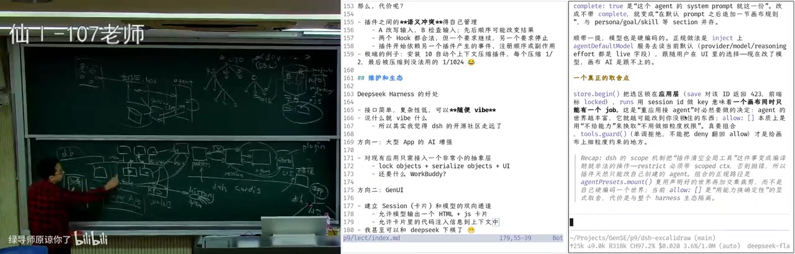

### 4.6 一个操作系统的样子

*(参考时间: 01:28:17)*

讲者说，这就是他喜欢 DeepSeek Harness 架构的原因：

> 大家都可以去想一想，**思路就打开了**，应该可以去做很多有趣的事情。

而且他认为这件事**不只在这一层**：他自己还有一个要保密的项目——在**做 agent OS**（他发过招人的帖子）。思路和 DeepSeek Harness 有点像，同样是 **everything is a plugin**；不同之处是他们的 agent OS **在 DeepSeek Harness 的下面一层，可以和它并行，并为它提供更多能力**。再往上，**每一个超级应用应该怎么设计，可能今天又有了今天的"版本答案"。**

> 所以我相信在不久的未来，**你们看到的所有的东西都会发生根本性的变化。这一天很快很快就要来了。**

下一讲，他会讲 DeepSeek Harness 里那个 **Agent-native 开发**的部分。

---

## 附：官方参考与延伸阅读

**课程**

- [生成式软件工程 2026 课程主页](https://jyywiki.cn/GSE/2026/) —— 本讲（第 9 讲）的讲义与幻灯片截至录制时尚未发布，发布后可在主页找到 `lect9.md` / `slides9.html`。
- 本讲上一节：[第 8 讲 Agent Native 开发](https://jyywiki.cn/GSE/2026/lect8.md) —— mini agent 与 Ralph Loop 的来源。

**本项目与相关设计**

- [DeepSeek Harness](https://github.com/deepseek-ai/deepseek-harness) · [文档](https://deepseek-harness.github.io/deepseek-harness/) —— 课堂上被拆解的产品：microkernel、everything is a plugin、append-only session 事件日志。
- [Cordis](https://github.com/cordiverse/cordis) —— 负责服务解析、依赖激活、插件 load/unload 的"进程管理"层；配套论文 *A Programming Paradigm for Spatiotemporal Composability*。

**架构与数据**

- [MapReduce: Simplified Data Processing on Large Clusters（Dean & Ghemawat, 2004）](https://research.google/pubs/mapreduce-simplified-data-processing-on-large-clusters/) —— "限制编程模型，换取一个可容错的系统抽象"的经典案例。
- [Apache Spark](https://spark.apache.org/) · [Apache Flink](https://flink.apache.org/) —— 当需求从离线走向实时/流式时，MapReduce 之后的两条路线。
- [Martin Fowler：Event Sourcing](https://martinfowler.com/eaaDev/EventSourcing.html) —— "事实是唯一真相、当前状态由历史派生"的取舍与代价。
- [OpenStreetMap](https://www.openstreetmap.org/) —— mini agent 生成校园三维模型时爬取的数据源。

---

*本电子书由 [videobook](https://github.com/Luke-Evan/videobook) 流水线生成。课程讲义与幻灯片版权归讲师所有，依 [CC BY-NC 4.0](http://creativecommons.org/licenses/by-nc/4.0/) 发布。*
