# 软件分析工具：从机械检查到非形式化验证

> **课程**：南京大学《生成式软件工程》（2026）
>
> **主讲**：蒋炎岩
>
> **课程主页**：<https://jyywiki.cn/GSE/2026/>
>
> **本讲讲义**：<https://jyywiki.cn/GSE/2026/lect13.md>
>
> **本讲幻灯片**：<https://jyywiki.cn/GSE/2026/slides13.html>
>
> **版权说明**：课程讲义与幻灯片系 © 蒋炎岩 作品，依 [CC BY-NC 4.0](http://creativecommons.org/licenses/by-nc/4.0/) 发布。本书为非商业学习笔记，引用的文字、幻灯片与图片均保留原作者署名。
>
> **本讲提要**：传统软件分析工具把程序当作数学对象，在类型、抽象状态、执行路径和形式化规格上提供不同范围的保证。AI 带来另一种可能：把代码也看作人类活动留下的样本，利用名称、约定和上下文发现难以预先写成规则的意图偏差。模型可以提出策略，但真正可信的反馈仍依赖能观察、执行和重放程序的机制。最后，这种反馈还可以用于检验架构是否能承受下一次需求变化。

## 目录

1. [软件工程也在改进“改进的方法”](#1)
2. [把程序当作数学对象](#2)
3. [每种工具保留什么，又舍弃什么](#3)
4. [把程序看作人类活动的样本](#4)
5. [非形式化验证：让“我觉得不对”变成证据](#5)
6. [策略交给模型，机制仍然关键](#6)
7. [软件视图、文档与工具的未来](#7)
8. [让架构也获得反馈](#8)
9. [附：官方参考与延伸阅读](#_3)

---

## 1. 软件工程也在改进“改进的方法”

*(参考时间: 00:00:00)*

### 1.1 Intent、spec 与 implementation 之间天然有距离

软件可以看作物理世界过程在信息世界里的投影。人的 **intent（意图）**、写下来的 **spec（规格）** 和最终 **implementation（实现）** 之间并不会天然一致。一个人说“做一个好的教务系统”，团队还得继续问：哪些人会使用它？要完成什么业务？所谓“好”是响应快、容易用、出错少，还是能满足管理者关注的报表？当这个模糊意图逐步变成规格、架构和代码，每一步都可能加入新的假设。

讲者用“还差一个程序员”的玩笑说明这个问题：有人提出很好的商业模式，却没有说清楚具体要做什么；接手的人若又设计了不合适的架构，最后实现就会越来越偏离原本的想法。人和人之间都很难完全对齐，何况将人的想法翻译成机器可执行的形式。

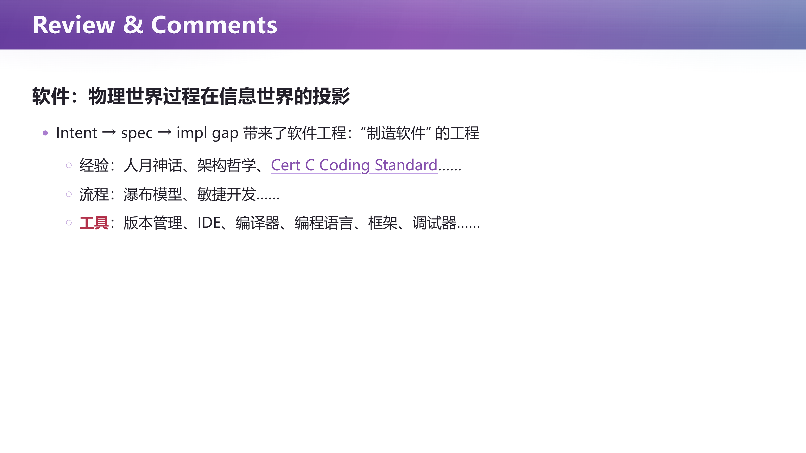

软件工程正是在反复失败中形成的经验体系。规模增长以后，管理更多代码和协作者并不是简单的线性加法：十万行软件往往比一万行软件难上远不止十倍。我们需要工程方法来管理复杂性，也需要工具把这些方法落实到日常开发里。

这个差距并不只是“客户没把需求说清楚”。即使客户已经描述了流程，规格也需要把日常语言转换成角色、状态和可观察结果；实现又必须把规格映射到数据结构、模块和外部接口。每次翻译都可能丢掉上下文或引入新的解释。软件工程的目标因此不是一次性地把话语抄进代码，而是建立可以反复检查的反馈，使偏差尽早暴露。

一旦实现已经形成，偏离并不总能通过“再读一遍需求”来发现。团队可能各自理解了不同版本的需求，设计文档可能遗漏现场约束，代码也可能把临时折衷变成永久规则。软件工程流程的作用之一，就是让这些假设在设计评审、测试和运行反馈中显式出现，而不是等到客户使用后才看到结果。

### 1.2 经验、流程和工具是彼此连接的三层

软件工程的经验包括人月神话对规模和协作的提醒、架构设计对模块边界的安排，以及编码标准对易错写法的约束。讲者举了 CMU 软件工程研究所的 SEI CERT C Coding Standard：它从真实的编程错误中归纳规则，告诉开发者哪些写法更可移植、哪些用法危险，以及怎样通过正例和反例理解规则。

经验也包括需求和文档的维护。代码改了，文档没有改，新的 Agent session 可能只读文档，就会依据过期说明继续修改，错误因此一轮轮累积。代码、文档和人的理解需要持续对齐，这不是大模型出现后才有的问题；AI 只会更快地放大已有的不一致。

流程把经验组织成连续工作：从瀑布模型到敏捷开发，再到提交前的检查、push 后的持续集成。经验说明“什么容易出错”，流程决定“在哪个环节检查”，工具则负责把检查变成能重复执行的步骤。三者不是互相替代的选择。

编码标准的价值在于把许多人反复犯过的错误变成可执行的建议，而不是宣布所有项目都只能有一种写法。比如 CERT C 会把危险行为分类、说明规则依据，并给出符合与违反规则的示例。团队仍要判断某条规则是否适用于当前平台和风险等级。规范如果脱离实际项目，也可能制造机械负担；工程师需要理解它解决的失效模式。

流程也会把工具结果放到恰当的时间点：本地提交前先检查格式和测试，push 后由 CI 再做更完整的构建。开发者若只在最后阶段看到问题，修复成本会更高；若每次改动都有即时反馈，错误更容易和最近一次修改关联。工具的价值不仅是能检查，还在于它何时运行、结果能否被工作流消费。

### 1.3 软件分析工具把软件当作自己的输入

版本管理帮助项目跨时间演化；IDE 和 Agent harness 帮助编辑代码；编译器、语言、框架和调试器帮助程序运行和排错。本讲聚焦另一类工具：把 Git 仓库、C 或 TypeScript 程序当作输入，再产出对开发者有用的信息，例如错误告警、风险报告或测试用例。

在生成式 AI 之前，这类工具大多是一个明确算法。Lint 工具显示红色波浪线，测试工具展示通过或失败的案例，调试器把开发者带到失败行。开发者不断为工具增加检查规则、可视化和自动化工作流，等于用软件改进制造软件的能力。

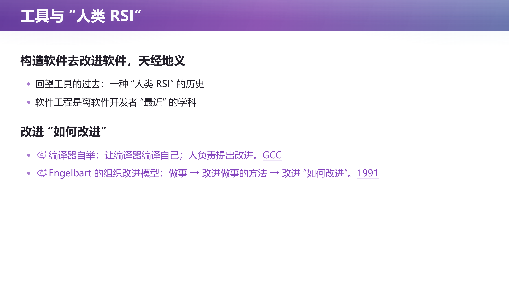

这种循环很自然，以至于开发者未必会把它叫作“自我改进”：发现某类 bug 后增加一条规则；构造一个插件，让失败测试更容易定位；再把它集成进 build 或 CI。积累下来的工具降低了下一次犯同类错误的概率。

CodeQL 体现了“通用机制加项目规则”的设计：源码先被抽取成关于函数、表达式、调用和控制流的数据库，再用类似查询语言的方式挑选结构。例如查找内存分配以及可能匹配的释放，或者定位某个危险 API 的调用点。工具给出候选后，仍要由规则作者界定什么算漏洞、哪些调用路径需要关联。

工具的输出可能是“程序不能编译”，也可能是报告“这个函数有一条路径可能没有释放资源”，还可能只是显示一次测试失败。不同结果的确定性不同。设计良好的分析工具应该说明证据来自哪里、用什么假设分析、结果是否需要人工确认，让开发者知道下一步应当修代码、补测试还是澄清需求。

### 1.4 人类 RSI：工具改进生产工具的过程

讲者把这段历史称作一种“人类 RSI”（Recursive Self-Improvement，递归式自我改进）。开发者用工具生产软件，使用过程中发现工具不足，再改进工具，从而提高之后的开发能力。编译器自举是典型例子：早期可以用汇编实现一个小型编译器，再用它编译更完整的编译器；今天 GCC 可以由 GCC 自己编译。但自举并不表示编译器自动知道该如何变好，设计方向与验证仍来自人类。

这个历史对 AI Agent 有启发。Agent 完成任务时可能发现某个反复出现的问题，于是生成脚本、测试夹具或检索工具，再把它们留作以后调用。比如编译器优化器在低精度场景下总出现指数级的路径膨胀，Agent 可以尝试构造工具或约束来避免重复踩坑。工具能否被复用、结果能否验证、经验能否保留下来，才决定这次任务是否真的改善了下次任务。

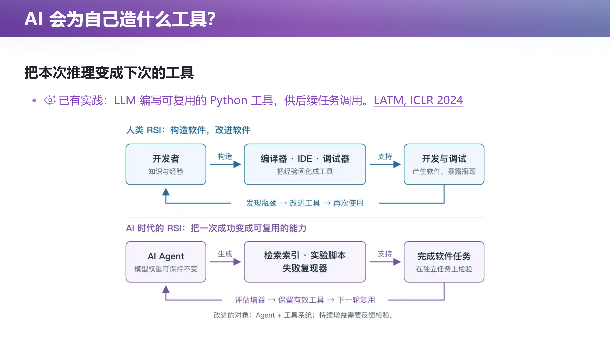

## 2. 把程序当作数学对象

*(参考时间: 00:15:43)*

人类的循环通常是：实践中遇到重复问题，开发者总结经验，把经验做成规则或工具，把工具集成进流程，再从更大规模实践中发现新问题。AI 可以在这里更快地产生工具，但“能生成”不等于“值得长期保留”。可复用工具需要稳定输入输出、可测试的行为和明确的适用范围；否则每次任务只是多出一份未经验证的临时代码。

人类创造的自我改进工具也要通过实践建立信任。编译器能编译自身，并不自动证明编译器没有错误；团队通常还会用不同版本或其他编译器交叉检查。类似地，Agent 制作的分析脚本若没有回归样例或独立验证，可能只是把错误判断自动化了。循环能否稳定增长，取决于改进结果是否可检查。

这一点与 LATM（Large Language Models as Tool Makers）的两阶段想法相呼应：一个模型先为某类任务制作工具，另一个模型再使用它解决问题。重要的不是把工具制造神秘化，而是让任务中的重复推理沉淀为可重复调用的组件。人类软件工程长期依赖这种积累，Agent 也需要把一次成功转成可维护资产，而不是只保存对话。

### 2.1 生成式 AI 以前，规则必须先由人写清楚

程序分析面对的输入是软件本身：工具读取程序，尝试回答“它可能有 bug 吗”“有没有危险行为”或“满足某个约束吗”。然而，意图通常藏在人的脑中，规格常以自然语言记录，而程序才是可被算法操作的结构。传统计算机科学的数据结构和算法擅长遍历树、图和控制流，却不会自然理解“领导满意的教务系统”意味着什么。

因此，在没有强大语言模型的时期，开发者必须把想检查的事情转成明确规则。即便使用通用框架，也要写查询、参数或额外程序。例如 CodeQL 把源码转换成可查询的数据结构，开发者可以写规则，寻找某个内存分配是否在相应路径上释放。工具可以非常通用，但“这条规则代表什么风险”仍由人定义。

这些工具能够处理语法和形式语义，却难以直接判断程序是否符合人真正想要的结果。AI 之前的软件分析是机械的：机器能执行明确写出的步骤，不能自行补足未表达的业务意图。

形式规则可以细到语法树节点或控制流边。比如 SQL 查询数据库，CodeQL 查询源码构成的关系数据；开发者能够编写复杂规则，却仍须先知道要搜什么。规则本身可以表达得很精确，规则所代表的真实意图却未必完整。这就是传统方法的强项与局限同时存在的地方：明确的规则非常好执行，难以形式化的部分仍留给人。

从自然语言意图到可执行规则，开发者必须做建模工作。CodeQL 的语法查询可以准确找到某种代码结构，缺陷预测模型也可以给出风险排名；但输出最终对应哪种业务后果，需要一层解释。规则越精确，执行越一致；输入给规则的意图若本身错了，执行得再精确也只会稳定地产生错误结论。

### 2.2 程序执行可以被描述为状态迁移

软件分析的理论基础是程序具有执行语义。把程序当前拥有的变量、内存和控制位置合起来看作一个状态，执行一条语句就把一个状态映射到下一个状态。赋值语句 x = e 的作用，可以形式化为：先求表达式 e 的值，再把状态中的 x 更新为这个值。语法看起来抽象，但它给每条指令规定了明确含义。

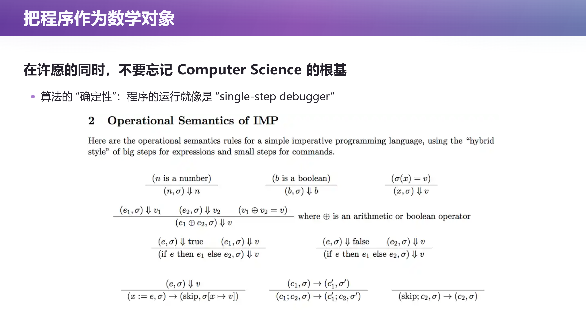

一段顺序程序是多个状态迁移的组合；遇到 if，状态可能进入不同分支；循环则会不断重复迁移。给定一次输入和环境，具体运行通常沿着一条路径前进。换句话说，我们可以把程序作为数学对象来研究，而不必只凭运行后的直觉讨论它。

把语句写成状态函数之后，复合程序可以通过函数组合来描述；分支、循环和函数调用也各自有规则。数学语义不是为了让每个开发者手算整个程序，而是提供共同的、可推理的含义。若语言定义不清楚，我们连“程序应该做什么”都无法精确讨论；如果定义清楚，就能建立分析器，但不代表分析器一定能在有限资源内算完所有结果。

状态机视角也解释了调试为何有效：调试器停在某个状态，开发者可以查看局部变量和下一步转移。若每条语句的语义定义明确，状态变化可以逐步复现。外部输入使下一状态出现多个可能分支；一次运行选中其中一条，静态分析则试图概括尚未执行的其他分支。

### 2.3 测试、分析和验证回答不同的问题

**测试**选择具体输入，执行程序，再将结果与预期输出或性质比较。判定结果对错的依据叫 **oracle**。测试可以由人编写，也可以自动生成；它回答的是“这些执行案例有没有问题”，不直接穷尽所有可能输入。

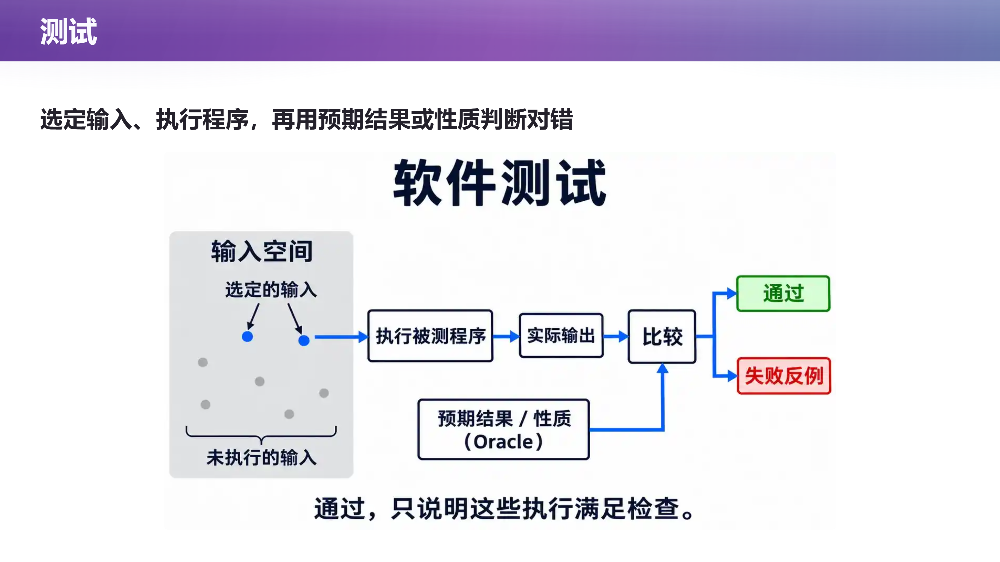

讲者回顾过“测试工程师走进酒吧”的笑话：测试者尝试各种刁钻输入都没有问题，真正的普通顾客只问“洗手间在哪里”，系统却崩溃了。笑点说明测试用例再多，也可能没覆盖最重要的日常路径。另一方面，如果程序里有断言、测试目标清晰，覆盖率和自动生成的测试仍然能显著增加信心。

**分析**试图从程序结构推导可能行为。它可以跟踪变量的取值范围，而不是实际运行每一种输入。假设 x 的输入范围是 0 到 9，程序再计算 y = x + 1，分析器就能推出 y 落在 1 到 10。它把大量具体状态合并成一个抽象描述。

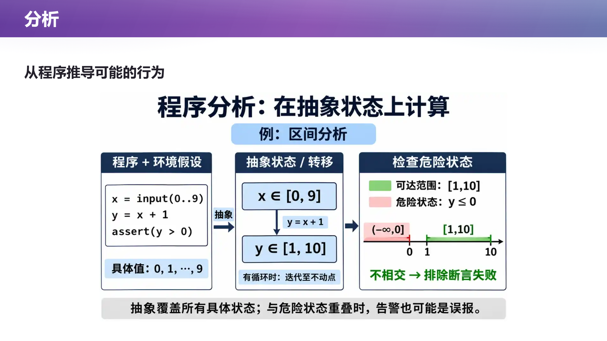

分析初始状态本身就很难。命令行程序会接收 argv 和环境变量，输入可能有许多种；执行中还有循环、函数指针、内嵌汇编以及操作系统调用。一个抽象分析器若想覆盖这些语言特性和外部环境，就必须对它们建立模型。模型越复杂，分析成本越高。

**验证**则进一步把规格变成证明义务，目标是说明在给定假设下，相关执行都满足某个性质。比如证明程序不会访问数组边界之外的内存，或者分布式协议在假设环境中始终维持一致性。测试、分析和验证会互相补足，但它们提供的保证不同。

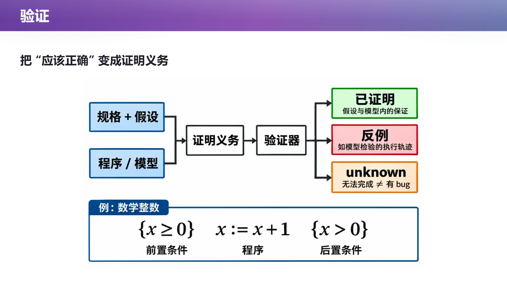

一次测试只观察一条或少数执行路径。测试设计需要两样东西：选择哪些输入，以及拿什么判断输出。酒吧笑话中的测试者输入怪异订单，却遗漏普通顾客对洗手间的询问；它提醒我们，测试集的好坏取决于它能否覆盖真实使用方式，而不是输入看上去多么刁钻。Oracle 也可能只检查程序崩溃，没有检查结果是否符合业务。

测试、分析和验证的证据范围逐渐扩大，但所需成本也逐渐提高。单元测试容易执行，却只覆盖选定输入；抽象分析可推断多种可能行为，但依赖近似；形式验证追求在假设下证明性质，规格与建模成本更高。工程上通常不会只选一种工具，而是让快速检查覆盖常见错误，把昂贵分析留给关键模块。

测试覆盖率统计本身也依赖程序分析：编译器把语句组织成基本块和控制流图，再在路径上插入计数。测试用例跑过某个块，只证明该块执行了；如果没有断言，输出即使错误也可能被标记为通过。测试生成、覆盖率和 oracle 是三个互相关联但不同的问题。

### 2.4 Rice 定理划出通用分析器的边界

Rice 定理指出，对于一般程序，不存在一个总能终止、又能正确判定任意非平凡语义性质的万能算法。非平凡是指性质对一些程序成立、对另一些程序不成立。它不代表具体程序不能被证明，而是说无法让同一个自动判定器解决所有程序的所有语义问题。

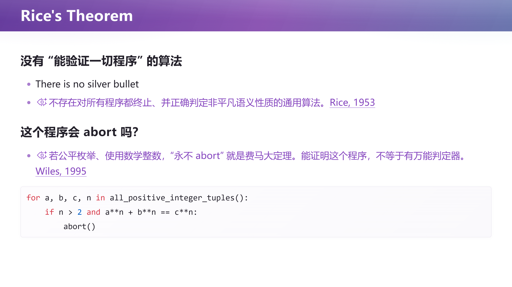

课堂用一个枚举正整数的程序说明这一点：

~~~python
for a, b, c, n in all_positive_integer_tuples():
    if n > 2 and a**n + b**n == c**n:
        abort()
~~~

假设 all_positive_integer_tuples() 最终会枚举每个正整数四元组，计算使用无限精度整数，而且程序有无限时间运行。若存在满足 n > 2 的正整数解，程序就会执行 abort；若没有这样的解，它就永远不会触发。于是“程序会不会 abort”与费马大定理相连。数学家已经证明这个具体命题，并不意味着机器可以自动解决所有类似命题。

现实中，确实可以人为写出让分析器无从判断的程序，例如程序每次处理一个支付请求前都去验证哥德巴赫猜想。工程师通常不会把需求这样写，但“人类大多不会这么做”不能成为通用工具的数学保证。软件工程真正面对的程序集合远小于所有可能程序：常见业务可以用数据库表达状态，用 Java 或其他语言组织规则。若工具能把适用范围限制到有实际价值的部分，就能在没有银弹的前提下得到有用结果。

枚举程序的例子进一步说明，程序的终止行为可以编码极难的数学问题。假定枚举器公平、数学整数精确且没有时间限制，程序会一直运行，直到遇到费马方程的解。要判定它会不会停止，就等于判定该数学命题。Rice 定理因此不是关于“现有工具还不够聪明”的抱怨，而是对普遍自动判定能力的理论限制。

费马程序假设能公平枚举所有正整数四元组。若正整数解存在，最终枚举到时触发 abort；若不存在，程序将永不停止。要在有限时间内判定它是否停止，就必须解决与费马定理等价的问题。这个小程序说明语义属性可以承载复杂数学内容，程序行数短与分析容易没有必然关系。

### 2.5 软件分析靠可解释的取舍变得可用

Rice 定理迫使我们承认：分析工具必须选择要看的程序、要保证的性质和可以接受的精度。可以限制输入语言或代码结构，可以只关注某类错误，也可以容许误报、漏报，或让工具在无法决定时回答 unknown。工程问题不是“能否证明一切”，而是“这项取舍是否能支持团队做出更好的判断”。

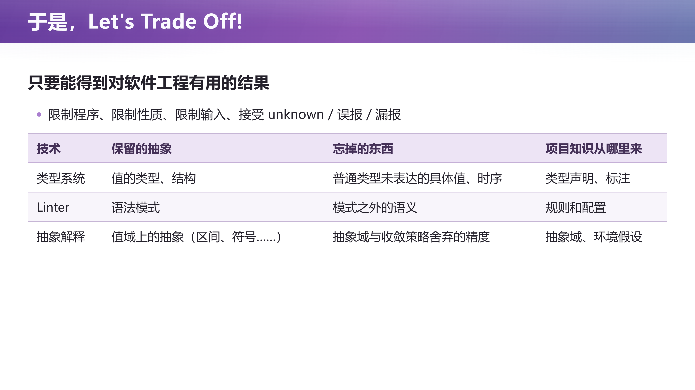

有些旧式缺陷预测工具会给源文件或类打一个风险分。它们可能数循环、整数声明、嵌套层数等，把这些统计量组成特征向量，再用启发式规则或学习方法预测哪个模块更可能有缺陷。分数能够帮助团队优先检查高风险区域，却不等于发现 bug，更不保证低分模块没有问题。工具可用的原因，正是它只承诺有限的结论。

## 3. 每种工具保留什么，又舍弃什么

*(参考时间: 00:38:00)*

可以把程序集合限制到某种语言子集，把性质限制到未初始化读取或空指针，把输入限制到协议允许的状态，也可以在资源不足时返回 unknown。安全工具常偏向健全性，即宁可报告可能的风险，也不漏掉真实风险；面向开发者的 lint 规则则可能优先减少噪声。取舍没有脱离目标的唯一答案，必须说明规则覆盖了什么、遗漏了什么。

有限工具通常通过减少保证范围换来可用性：类型检查只涉及类型，Lint 只涉及约定，Fuzzing 只覆盖实际生成和执行到的输入，模型检验只覆盖所构建的状态空间。把假设写清楚，团队才能知道结论能否迁移到线上环境。看起来相似的“通过”结果，背后的保证可能相差很大。

一个工具“保守”还是“激进”，取决于风险场景。安全关键项目可能宁愿接受误报，也不愿漏掉可能的越界；快速迭代的界面项目则可能更重视结果可读、噪声较低。分析器的假设应与项目风险匹配，不能把某个工具的品牌名当成通用质量保证。

### 3.1 类型系统：用类型信息排除一类错误

动态类型语言可以让程序快速开始运行，但运行途中才发现类型不匹配也很常见。讲者借 JavaScript 的隐式转换举例：数字 0、字符串 "0"、空白字符以及空数组之间的比较和相加，行为并不总符合人直觉。网页可能看起来正常，直到某条路径触发意外转换，才出现难以理解的结果。

类型系统要求程序员在代码里显式表达值的类别，或由类型推断系统推导出来，再由编译器检查运算是否合理。若把不兼容的值相加，静态检查可以提前拒绝程序。Rust 等语言还通过类型和所有权规则提供内存安全方面的保证；代价是程序员需要花力气让代码满足系统要求，有时会与编译器来回“斗争”。

类型系统保留的是值的类型和结构，忘掉的是普通类型没有编码的数值关系、调用顺序和业务要求。int 检查通过，不代表金额为正、权限正确，也不代表这个操作符合用户意图。它的项目知识来自类型声明；通过类型检查只意味着排除类型系统覆盖的那类错误。

静态类型可以让“不可能进行的操作”在运行前失败，例如把函数当成整数使用；可空类型或 Optional 类型还能迫使调用者显式处理“值可能不存在”的情况。所有权规则则限制对象由谁持有、何时释放。它们能消除一部分错误，但仍需要业务类型表达业务含义：普通整数既可能是年龄、美元，也可能是数组索引，类型名本身不保证数值有效。

JavaScript 的隐式转换让某些比较看起来反直觉：不同类型的值经过转换后可能相等，另一些比较又按不同规则处理。类型系统通过拒绝含糊的组合，把错误从运行时移到编译时。语言设计并非只有“强类型最好”这一条轴；不同语言选择了不同的灵活性与检查成本，项目再依据风险决定需要哪些静态保证。

静态检查还会把一些原本只在运行时出现的问题提前暴露。像 Optional 这样的类型要求调用者处理空值分支，Rust 所有权检查要求内存读写满足生命周期约束。这些额外约束会让编程过程更费思考，但通过检查后能排除相应类别的错误。每个类型系统只承诺自己编码进去的性质。

### 3.2 Linter：把团队约定写成规则

Linter 通常检查语法模式和配置规则。它可以发现未使用变量、未定义名称、不可达代码、未处理的 Promise 或异常，以及危险 API 的调用方式。类型检查通过之后，仍可能存在违背项目约定的写法；Linter 可以把团队从经验中总结出的规则固定下来。

例如，C 语言允许把整数强制转换为指针，语言层面能表达不等于安全关键项目就应该允许。若团队正在开发航天器软件，可以规定禁止强制类型转换；确需使用时，必须写下注释解释理由。也可以要求函数嵌套层数超过一定深度时拆分，降低阅读和维护难度。

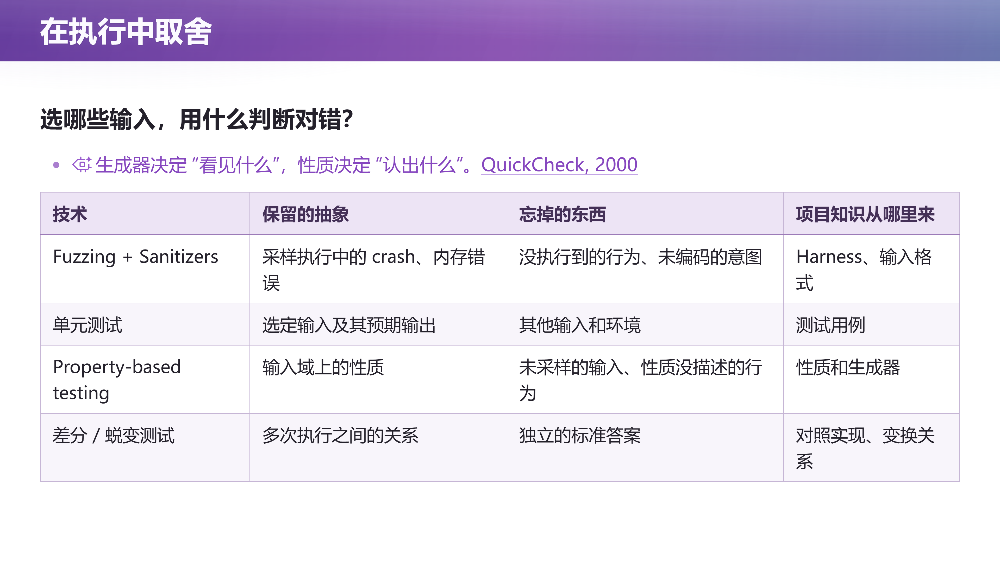

规则也有边界。Linter 只能判断规则是否满足，规则之外的语义仍要由人检查；某条告警在特定情境下可能并不适用。规则越严格，项目一致性可能越高，但也可能让开发者不断为例外做配置。合适的做法是将高收益检查变成自动规则，并给必须的例外留下可审查理由。

讲者把高收益 lint 项目概括为：未使用或未定义名称、不可达分支、空指针风险、没有等待的异步 Promise、未处理异常，以及危险 API 或隐式转换。对于安全关键代码，团队甚至可以把语言允许的操作禁掉，并要求例外附解释。代价是规则要持续维护：过时规则会造成误报，过于宽松则失去价值，所以规则集是项目知识的一部分。

Linter 规则很适合项目级“语言子集”：工程师可以禁止某些语言本身允许的危险用法，要求明确批准例外。它也能让 Agent 在运行代码前看到问题，减少来回执行成本。但规则若误报很多，开发者会习惯忽略；规则若只检查格式，却被当作质量保证，团队又会高估它能提供的保护。

安全标准常对“语言允许，但工程上不接受”的行为制定额外约束。比如强制类型转换可以让整数看成指针，短期内很方便，却会绕开类型系统；在安全攸关模块中，可要求禁止此操作，或在例外旁记录审查理由。规则并不替代设计判断，但它能防止团队无声地遗忘曾经作出的约定。

### 3.3 抽象解释：用近似状态覆盖更多执行

抽象解释把具体运行状态映射到较小的抽象域，例如区间、正负号或变量是否已初始化。程序执行时，分析器传播这些抽象值。若从输入 x 属于 [0, 9] 开始，遇到 y = x + 1，它可推导 y 属于 [1, 10]；即使没有针对每个 x 运行程序，也能得到一个范围结论。

它适合找出未初始化变量、潜在越界或不可能满足的条件。讲者举初学 C 的代码为例：若局部变量 x 在某条控制流路径上没有赋值就被 return，静态数据流分析可发现该路径。某次调试中读到零并不表示程序正确，未定义值可能随编译方式或内存状态变化。

健全分析会宁愿报告“可能发生”也不能漏掉假设范围内真实可能发生的错误，因此常产生误报。循环、函数指针、内嵌汇编和操作系统行为可能让精度急剧下降；分析器需要在抽象域、收敛策略和环境模型之间取舍。它保留了一类可计算的近似，舍弃了无法负担的精确细节。

抽象解释的难点在于压缩状态时必须决定保留哪些信息。区间能回答变量是否可能越界，却不一定能保留两个变量间的相关性；若状态范围越传越宽，分析器可能报告大量实际上到不了的情况。循环需要寻找不变式或固定点，复杂调用需要近似其效果。抽象越精细通常越贵，抽象越粗则越容易产生误报。

抽象值通常需要一个合并操作：不同路径汇合时，区间 [0, 3] 和 [6, 9] 可能合并为 [0, 9]。合并后会包含真实不可达的中间值，范围变粗。若一直迭代循环，区间可能不断扩大，因此分析器还需采用 widening 等策略保证有限时间收敛。这些技术换来可终止计算，也会牺牲精度。

值域传播也解释了为什么分析器有时会把某个变量报成“可能异常”。一条分支上值为正，另一条为负，汇合后抽象状态可能变成一个较宽范围；后来判断条件也许本来能排除错误，但抽象过程已经丢失了变量间的关联。开发者若只看告警文本，不了解近似边界，容易把工具当作确定性判决。

### 3.4 测试覆盖率：先定义“覆盖”才有度量

测试覆盖率不是对程序质量的直接测量。最简单的行覆盖率会问每一行是否至少执行一次；更细的度量可以查看分支或基本块。现代编译器可以在编译时对控制流图插桩：每个基本块入口增加计数器，执行时累积次数，最后报告哪些位置访问过。通过编译器 instrumentation，比逐行单步调试并记下位置高效得多。

讲者还提醒，给 Agent 设“覆盖率必须 100%”的 CI 门禁，可能让 Agent 开始添加只为经过代码、却没有真正检查结果的假测试。覆盖率能提示哪些代码从未跑到，但没有回答这些路径上的行为是否正确。覆盖率 99% 也不一定比 95% 更有价值：未覆盖的 1% 可能正好是支付或权限的核心逻辑，已覆盖的部分也可能缺少有力的断言。

因此，覆盖率适合与断言质量、关键路径风险和失败后的可复现性一起看。把覆盖率作为一个明确的门槛，可以推动团队补足测试；把它误当作正确性的代理，则会激励团队优化数字而不是行为。

覆盖率的实现不是凭空打分。编译器将程序组织成控制流图，在基本块入口插入计数操作；一次测试运行后，汇总计数器便能知道哪些块、行或分支经过。硬件执行计数指令的开销可以很小，但覆盖报告只描述执行到了哪里。它不检查断言是否有力，也不说明没覆盖的代码是否比已覆盖的代码更重要。

插桩也让覆盖率与编译过程形成联系：工具可以按行、分支或基本块统计，所选粒度会改变数字含义。一个分支被执行过，不等于两种结果都被正确断言；循环执行一万次也不一定比执行一次提供一万倍信心。数字适合发现盲点，不适合替代对测试内容的阅读。

覆盖率门禁尤其容易产生指标优化：Agent 可能补上只调用函数、不检查结果的测试，数字随之上涨，但真实质量没有改善。若关键行为难以直接断言，可以增加性质测试或端到端场景，而不是把 100% 当成唯一目标。门禁应和缺陷风险、可观察结果及回归成本结合设计。

### 3.5 Fuzzing、性质测试与蜕变测试

当人工无法写出足够多的测试时，可以让工具自动生成或变异输入。Fuzzing 反复运行程序，结合 Sanitizer 等运行时检测，寻找崩溃、内存错误和边界问题。它的价值之一是留下一个具体触发输入：开发者可以复现、缩小并添加回归测试。它没有执行到的路径仍未知，未编码的业务意图也不会凭空变成判错依据。

Property-based testing 把预期从“这个输入答案是 42”提升为“一类输入都必须满足某种性质”。例如，对合法数据编码后再解码，应还原原数据。生成器负责提供测试输入，性质负责判断结果；失败时工具可以缩小输入，让复杂反例变得容易理解。随机采样次数越多，可能增加信心，但始终不是对无限输入域的穷举。

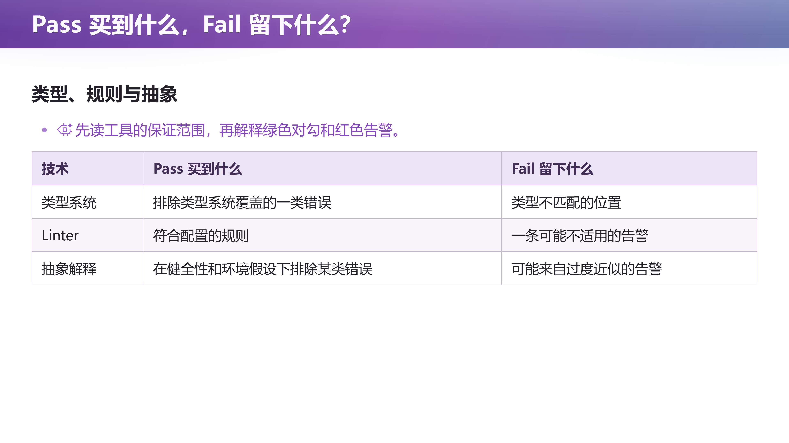

有些程序很难知道单个输出是否正确，这时可以检查多个执行之间的关系。差分测试比较两个实现的结果；蜕变测试则先定义输入变换和应满足的结果关系。例如 sin(-x) 应与 sin(x) 有特定关系，即使我们不容易为每个实数准备独立标准答案，也可以检查关系是否被破坏。使用多个实现时，它们可能共享同一个 bug；发现不一致只是下一步诊断的起点。

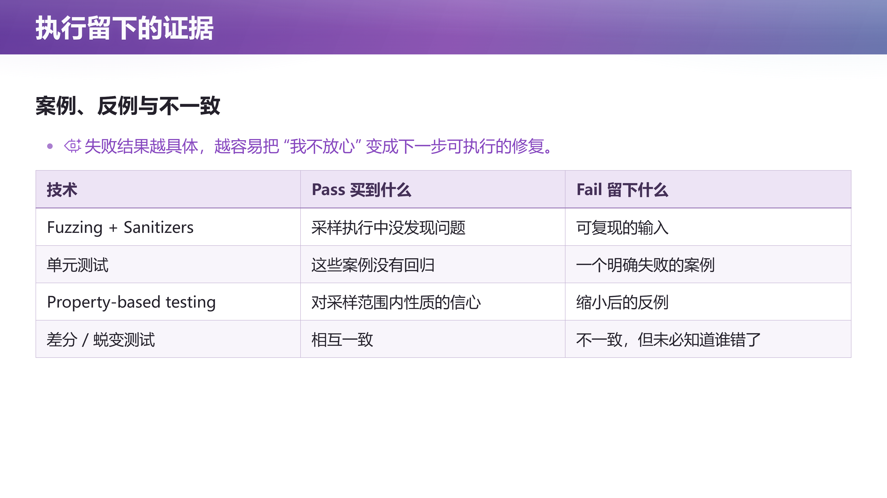

基于性质的测试常配合输入生成器和反例缩减器。比如生成各种合法对象，检查序列化再反序列化后保持原值；一旦失败，工具逐步删除字段或缩短序列，找出仍然失败的最小案例。蜕变测试解决的是测试预言难题：即使不知道某个输出的绝对正确值，也可以检查变换前后的关系。每种技术依赖的性质都要由人正确表达。

Fuzzing 对输入解析器、协议和二进制文件尤其有用，因为输入空间巨大且边界复杂。发现崩溃后，把随机输入缩小到一个短样例，再放入回归测试，能够让偶然发现转成持续防护。基于性质测试补充的是“我们希望哪些关系保持不变”；如果性质本身过弱，工具仍可能让错误实现通过。

对于 sin 的例子，若输入 x 的结果难以独立验证，可以再运行 -x，检查二者输出是否满足已知关系。性质测试同样依赖一个可信性质，若把错误关系写进测试，工具会稳定地验证错误。自动化扩大了试验数量，却不会自动赋予测试预期正确性。

### 3.6 模型检验、符号执行和定理证明

模型检验把系统转换成有限状态模型，在模型范围内检查所有相关状态，并能给出一条导致性质失败的反例轨迹。符号执行不为输入指定单个具体值，而是沿路径累积约束；求解器可以寻找满足路径条件的输入，触发某个分支或错误。两种方法都依赖明确的程序入口、环境假设和建模范围。

定理证明可以在规格和假设之下建立逻辑保证，但证明是相对于形式化规格成立的。规格本身若遗漏真实需求，证明再严谨也不会弥补需求缺失。相同地，模型检验穷尽的是模型中的状态，不是模型之外的硬件、实现细节或外部环境。

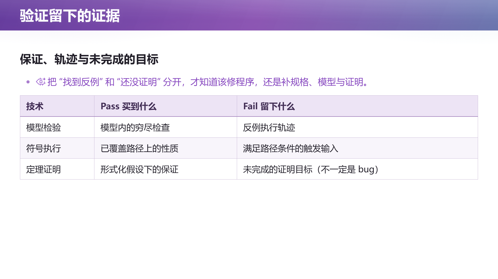

因此，失败和通过都应连同证据来读：类型错误指出不匹配位置；Linter 留下一条可能不适用的规则告警；Fuzzer 留下一个触发输入；模型检验留下反例路径；符号执行给出满足路径约束的样本；定理证明器可能留下未完成的子目标。没完成证明并不等于程序一定有 bug，发现实现之间不一致也不自动告诉我们谁正确。

模型检验的“所有状态”是模型明确包含的有限状态，状态空间可能爆炸；符号执行探索的是程序路径，路径条件也可能难以求解；证明器验证的是形式化规格，不是未写入规格的真实需求。失败可能留下反例，证明未完成也可能只是缺少引理、模型或更好的分解。它们之间可以组合，但不能把各自不同的证据混成一个简单的通过标志。

这些方法还要求区分“反例”与“没有证明出来”。模型检验给出模型内的失败路径，是可以进一步重放的反例；符号执行给出满足条件的输入；证明器留下未完成目标，则说明证明工作尚未完成，不一定说明实现有反例。团队应先读清楚证据种类，再决定下一步是修实现、补模型还是调整规格。

不同工具还需要不同的“失败处理”。Fuzzer 找到一个输入后，工程师可以重放它并缩减为回归案例；模型检验提供状态轨迹，可以定位协议在哪一步破坏不变式；符号执行的约束可以生成触发输入；证明器的待证目标则提示规格或引理仍需工作。把这些结果保存下来，才能变成可持续的工程反馈。

### 3.7 工具结果如何累积成信心和反馈

类型检查、静态分析、测试、覆盖率、模糊测试和形式化验证提供不同层级的证据。每个工具只覆盖某一类性质，但它们可以交叉检查：编译通过、关键路径测试通过、覆盖率合理、Fuzzing 没找到崩溃、协议模型没有反例，这些结果共同提高我们对项目质量的信心。

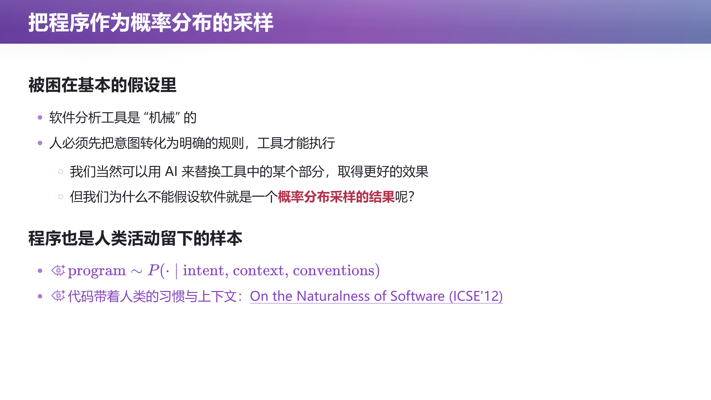

讲者用提交记录里的细节说明工程信号：不一致的缩进、空格混乱、把 .DS_Store 或 .alt 等生成文件提交进仓库，往往表示提交前没有检查工作区。它们不能证明业务代码有 bug，但会降低对维护习惯的信心。若基础规则都没有落实，很难相信更复杂的验证已经仔细配置。

这些工具对 AI Agent 还有额外价值。编译错误会指出文件、行和类型冲突；测试失败会留下输入和预期；覆盖率会指出未走到的代码。相较于“再努力一点”，这类定位明确的反馈更容易让模型采取下一步行动，也能形成短程训练信号。反馈有助于改进，但不能代替人对需求和架构的判断。

## 4. 把程序看作人类活动的样本

*(参考时间: 00:59:16)*

工具输出的定位粒度很关键：只说失败了，Agent 仍要猜测；指出具体文件、行、输入和违反的断言，下一步就容易执行。讲者把这些工具比作强化学习中短程反馈的来源。工具的反馈可以帮助模型改正局部行为，但模型可能钻覆盖率门槛的空子，也可能修测试而不是修需求，因此反馈应围绕有意义的行为设计。

“代码格式不好所以一定有 bug”不是逻辑结论，而是基于过往行为的后验判断。类似地，多项独立检查都通过，会提高信心，却不能把概率判断误写成绝对保证。工具证据应明确标注对应范围：某个测试集通过了、某个静态规则没有告警、某模型在某组假设下没有反例。

人无法逐条阅读大型项目中每个工具的所有输出，因此工程流程需要对优先级作判断。Agent 可以先处理短、明确的编译错误，再看风险较高的告警和测试失败；但抽象层的决策仍需人负责，例如一项规则是否值得执行、哪些错误需要阻断发布。自动化能提高反馈吞吐量，却不自动决定项目标准。

### 4.1 传统分析只看形式，代码里却留下了上下文

传统工具把程序看作有形式语义的执行机器：它根据类型、语法、控制流和执行状态作出判断。讲者指出，工具往往需要人给每条语句补充可计算的信息，例如类型标签、覆盖计数器或路径约束；工程师要把想检查的性质先编码成规则。

但程序也可以从另一个角度看：它是人在特定需求、团队约定、公司环境和历史经验中写出来的产物。实现可能带着老板的想法、当时的业务背景和程序员的习惯。程序因此可以被理解为给定意图与上下文之后，从某种分布中采样出的样本，而不只是孤立的 token 序列。

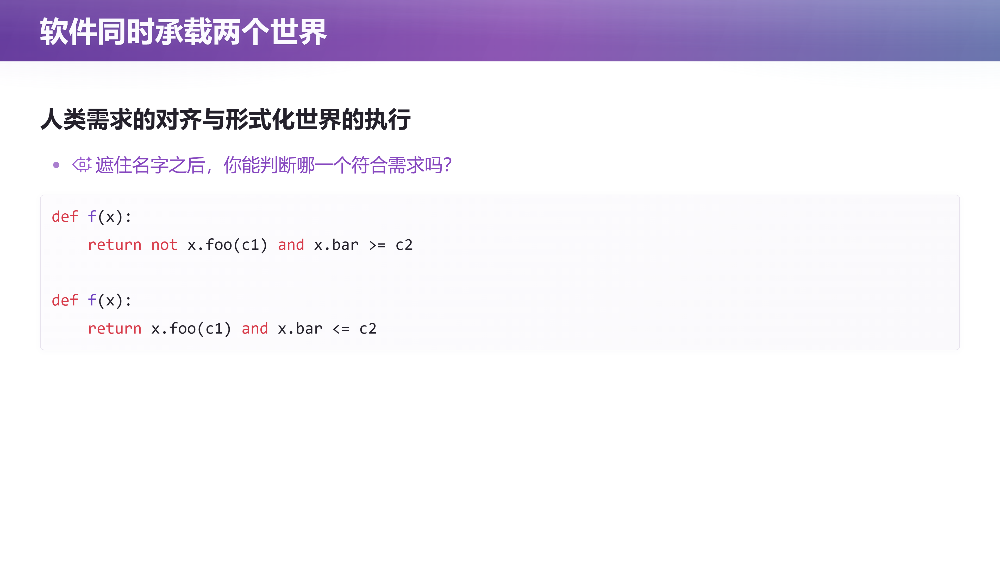

“软件的自然性”研究观察到，代码中存在类似自然语言的统计规律。讲者用 n-gram 作类比：把连续词组统计成模式，可以捕捉到语言中的重复结构；代码也有常见组合和约定。规律本身不等于正确性，但它让模型能够从代码中学习到人的实践痕迹。

n-gram 的例子是把自然语言切成连续词组，统计哪些组合常见，再用这些概率描述语言。代码也有重复结构、API 约定和命名习惯，因此学习模型可以识别“在人写的软件里通常会出现什么”。这能帮助理解代码，却不能单凭频率判定正确：少见写法可能是创新设计，常见写法也可能是长期存在的错误。

采样视角并不是说一个程序真有唯一的概率模型可供查询，而是提醒我们代码来源于人的实践，因而会呈现某些相关性。团队命名规范、已有接口和旧代码都提供上下文。模型可以利用这些关联提出“这里似乎不符合周围代码的习惯”之类的观察，但统计一致性仍然不等同于产品正确性。

从程序样本学习到的上下文不仅来自标识符，也来自依赖关系、注释、相邻实现和历史变更。若一个项目一贯用某种方式处理权限，突然出现另一种模式值得检查；然而历史代码本身也可能有旧 bug。模型使用上下文时需要区分“团队惯例的证据”和“真正业务规则的来源”。

### 4.2 移除名称之后，逻辑相同却难以判断意图

考虑两段匿名逻辑：

~~~python
def f(x):
    return not x.foo(c1) and x.bar >= c2

def f(x):
    return x.foo(c1) and x.bar <= c2
~~~

如果只看布尔结构，两个表达式都可能符合某种规格。Lint 可以检查表达式是否超过复杂度阈值，类型系统也能检查操作是否合法；但它们不一定知道 foo、bar 和常量究竟代表什么，因此无法判断哪个逻辑符合真正业务。

匿名化后，工具仍能计算两个布尔表达式分别接受哪些输入，也能判断它们是否类型正确或复杂度过高；但“哪个符合产品规定”需要知道 x、foo、bar 和常量实际指什么。形式语义保留了执行结果，却抹去了对人的意义。静态分析不会因为代码看起来熟悉，就自动知道变量命名背后的业务约束。

假如变量叫 c1、c2、foo、bar，分析器看到的只是比较和布尔连接；即使两个实现有明显差别，也缺少判断依据。把标识符去掉，相当于丢失了一部分人类语义。传统工具主动忽略变量名称，便于做一般化推理；新工具则可以把名称作为一类证据重新引入，但必须允许名称本身写错。

### 4.3 名称和上下文让同一逻辑变得可质疑

把真实的名字补回来，判断就完全不同了：

~~~python
def can_watch_huang_guo_tv(visitor):
    return not visitor.inside("China") and visitor.age >= 18

def can_watch_huang_guo_tv(visitor):
    return visitor.inside("China") and visitor.age <= 18
~~~

此时条件连接到人的世界：访客是否在中国、年龄是否达到 18 岁、是否能观看某个平台。即使不知道平台真实政策，我们也能提出有价值的问题：地区判断是否反了？年龄阈值方向是否反了？代码里的命名让逻辑获得可以被人理解的语义。

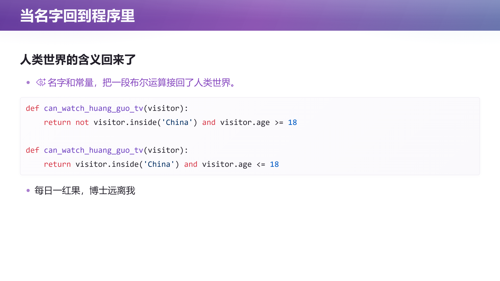

这个课堂例子不是在宣称平台采用了哪种实际访问政策，而是展示上下文如何帮助发现需要核实的地方。变量名和函数名是意图线索，不是需求本身；真正的业务规则仍应从规格、用户和其他可信上下文中确认。

课堂把这个例子接回一个带有地区和年龄限制的流媒体服务，并用“红果”作玩笑。听众只要读到函数名和参数，就能发现两种条件方向明显值得确认。此处的判断来自名字、常识和周边语境，不是对平台政策的正式陈述。换句话说，代码上下文可以启动审查，却不能代替可信的产品规格。

函数名能让错误条件显得可疑，是因为自然语言标签与逻辑共同构成代码解释。对于平台年龄限制的例子，程序员可以构造年满 18 岁与未满 18 岁、境内与境外的组合矩阵，检查每种情况的授权结果。矩阵帮助暴露条件方向，但最终预期值要由真正的产品政策决定。

### 4.4 为什么 AI 时代仍然需要软件

既然模型能解释和生成代码，为什么还要把行为固化在传统软件里？讲者给出的一个理由是效率：CPU 执行确定性逻辑、数据库持久化数据，通常比每次都让一个大型模型重新推理更省能耗、速度更快。课堂上对 CPU 与模型能耗差距的数字是讲者的估算，但核心观点是，稳定、重复、可预测的工作适合交给软件执行。

程序一旦正确执行，就不会像概率模型那样受心情或提示词影响；但“程序对不对”仍取决于它是否符合 intent 和 spec。软件工程的问题是把两段距离接起来：意图如何变成规格，规格如何变成实现。传统形式化工具可以检查形式语义，却很难直接读懂人类意义。模型或许能补上这层解释，但最终仍要以可执行证据核对。

## 5. 非形式化验证：让“我觉得不对”变成证据

*(参考时间: 01:06:00)*

模型适合处理模糊解释，CPU 和数据库适合重复执行确定工作。讲者估算 CPU 执行相同计算可能比让大型模型逐次推理高效多个数量级；这是课堂上的估算，关键在于二者的角色不同。让模型直接生成整个交互世界，可能有灵活性；让程序稳定处理持久化、状态转移和高频运算，则通常更经济、更可重现。

大型模型按 token 生成结果，适合开放式解释与内容生成；普通软件则适合执行明确规则并长期保存状态。两者不是替代关系：模型可以帮助分析一次运行，软件负责以低成本、稳定方式反复执行。只要实现仍有能源、延迟和可重现性优势，就需要继续研究怎样让软件更贴近意图。

程序的确定性有实际价值：同样的输入和状态经过同一段正确程序，会得到可复现结果；模型输出则带有概率性，可能受上下文、采样和提示词影响。模型可以在模糊空间中提出解释，软件可以把稳定决策固定下来。更好的工具链会让二者形成分工，而不是强行让所有工作都交给其中一方。

### 5.1 检查执行轨迹能否对齐意图

讲者把一种新的目标称为 **informal verification（非形式化验证）**：程序可以被看作状态机，运行产生 execution trace（执行轨迹）；希望把轨迹“翻译回人类世界”，再判断它是否符合 intent 和 spec。与传统验证关注“不越界”“没有空指针”这类可形式化性质不同，这里要进一步问：一次业务行为在人类意义上是否合理？

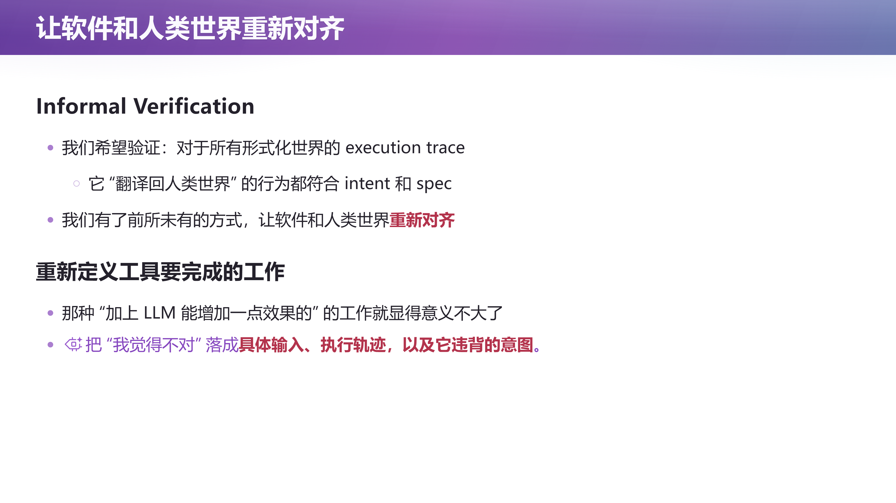

例如，航空器控制软件里整数溢出可能导致数值突然跳到另一端，造成控制行为完全改变；传统分析可以尝试证明溢出不会发生。非形式化验证还想知道，对输入和环境产生的每条执行路径而言，用户请求是否被按真正意图处理。所谓“所有轨迹都合理”当然很难完全证明，但它描述了想要解决的终极目标。

用飞行器控制举例，传统形式化检查关心整数溢出、空指针和控制状态等可表达性质；意图对齐则要再问，输入代表的真实事件是否被正确处理。理想情况下，每条执行轨迹都能翻译成人类可理解的行为，并且符合需求。这个目标跨越了形式语义与自然语言之间的鸿沟，所以传统证明系统本身无法直接完成。

formal verification 通常证明某个形式规格下所有允许执行都满足性质；informal verification 想把轨迹对应回自然语言 intent。前者有严格逻辑边界，后者能表达更丰富的人类判断但不具同等证明强度。两者可以配合：先由模型发现可疑语义，再尝试把关键性质明确化，交给测试或证明工具检查。

### 5.2 让模型提出怀疑，让程序给出证据

实际可行的方式是近似这一目标：模型读取代码、命名和项目上下文，先提出一个可检验的怀疑；再生成输入或调用现有测试工具；程序执行后留下轨迹和输出；模型结合规格解释观察到的行为。发现异常时，可以追问需求、修复代码或补充测试。

~~~mermaid
graph TD
    A[意图与项目上下文] --> B[模型提出可疑行为]
    B --> C[生成具体输入与检查]
    C --> D[运行程序并记录轨迹]
    D --> E[解释行为并对照意图]
    E -->|发现偏差| F[修复代码或澄清需求]
    F --> B
    E -->|证据充分| G[保留可复现结果]
~~~

如果模型怀疑年龄条件写反，可以让它构造不同年龄、不同地区的访客，逐一运行并列出谁被允许、谁被拒绝。这样“感觉不对”就落成具体案例，团队可以拿真实业务政策检查。通过把模型推理接到现有执行机制上，怀疑能够变成可重放的证据。

可操作的闭环应保留完整证据：模型为什么怀疑、生成了哪些输入、运行了哪一个版本、程序经过哪些状态、预期行为来自哪份规格。失败案例可以缩小后加入回归测试；若规格不清楚，则将问题交回产品或业务负责人确认。若没有版本和输入记录，模型即使给出准确分析也难以复现。

以年龄规则为例，Agent 可以生成边界值 17、18、19，并组合不同地区和账户状态。程序输出需要记录为一张案例表，标明运行版本与输入；模型解释哪一格和产品说明矛盾后，再由人核对说明的权威性。这样既保留生成式方法的灵活性，也使结论可以复现，不依赖模型的一句笼统判断。

每次模型分析都应能回到输入、版本和执行记录。若测试失败，应保留触发数据和调用环境；若仅凭截图判断，则要说明界面状态从哪里来；若推断根据是命名或文档，也应指出引用的上下文。这样人才能复核模型是否把一条真实证据误读成另一种含义。

### 5.3 “非形式化”不等于有数学保证

“验证”这个词容易让人误以为模型给出了形式化证明。这里的 informal 强调模型是在自然语言和上下文中解释执行，并不表示它的结论具备定理证明器的可靠性。模型可能误解标识符，遗漏外部约束，或者把常见行为误当成正确行为。它提出的结论应被当作调查线索，而不是自动通过的证明。

这项能力的潜力在于扩大工具可以处理的问题范围：有些判断难以写成 if/else 规则，但人可以结合语境看出值得追问的地方。模型负责提出解释和测试思路，程序运行机制负责产出可核验结果，规格与人类判断负责界定何为正确。

## 6. 策略交给模型，机制仍然关键

*(参考时间: 01:08:11)*

自然语言判断可能产生幻觉，也容易被不完整日志误导。模型还可能把命名习惯当成事实，或过度套用常见模式。合理的工具不应让模型单独决定发布，而应让它指出需要人检查的语义断言，并给出运行证据和反例。这里的“非形式化”既是新能力来源，也是必须保留审查步骤的原因。

模型可能把网络上常见做法当成当前项目规定，或从代码风格推断出并不存在的业务事实。对关键操作，系统应让模型指出来源：代码中的命名、项目文档、配置、日志还是测试。来源越弱，结论越应标为待确认。没有可靠意图来源时，正确的行动有时是询问，而不是继续猜。

### 6.1 Heuristics、Policy 和 Mechanism 的角色变化

讲者用一句口号概括这一变化：

> Heuristics is dead, Policy is Heuristics, LLM is Policy, Mechanism is King.

Heuristics 是启发式规则，Policy 是决定下一步做什么的策略，Mechanism 是使观察、执行和控制成为可能的机制。这句话并不是说启发式方法真的消失了，而是说：过去固化在工具中的部分策略，未来可以由模型决定。模型可以选择查哪里、追问什么、如何解释异常；机制仍要负责可靠执行，并提供能够复核的证据。

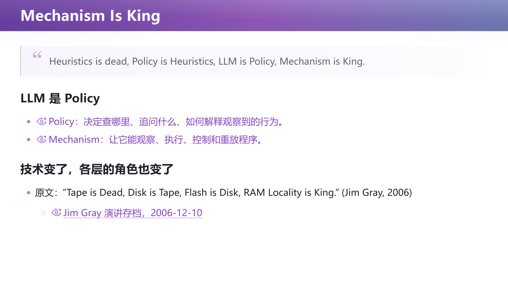

若只是把 LLM 加到旧工具上，让某一个指标略有提高，可能没有充分利用它的新能力。更值得研究的是：工具能否首次检查那些难以写成规则、但人能基于上下文察觉的问题？当 Policy 可以从语境中形成，Mechanism 是否能够让模型针对真实程序观察和行动，就成为核心。

这句口号改写了存储系统研究中的一句话，强调技术变化后层次的角色会变：启发式策略不必全部硬编码，模型可以承担选择和解释；但观察和执行机制依旧要可靠。模型如果只能建议“可能有问题”，却无法调用程序、收集状态、重放路径或定位来源，就缺少把判断落成工程行动的基础。

Heuristics 可以理解为旧工具里被固定下来的实践经验，Policy 决定在当前任务中调用哪条检查，Mechanism 提供实际观察能力。模型可动态选择规则，却不能替代机制正确性。若日志缺字段、测试环境不同于线上，或者程序无法安全重放，模型会根据不完整证据做出过度自信的解释。

原口号中的“King”强调瓶颈所在的层会随着技术变化而改变。若策略能够由模型提供，机制就成为限制上限的部分：能否访问真实程序状态、能否在隔离环境执行、能否控制副作用、能否可靠重放。没有安全且准确的机制，策略再聪明也只是猜测。

### 6.2 从系统日志中学习行为的常见模式

2009 年的一项系统研究尝试从大量控制台日志中发现大型系统问题。日志通常来自多个组件，内容交错且数量巨大；研究先结合源代码提取日志结构，再把日志转换成特征，通过统计方法（包括 PCA）寻找偏离重复模式的行为。它不是预先为每种故障编写规则，而是先学习什么样的日志组合经常出现。

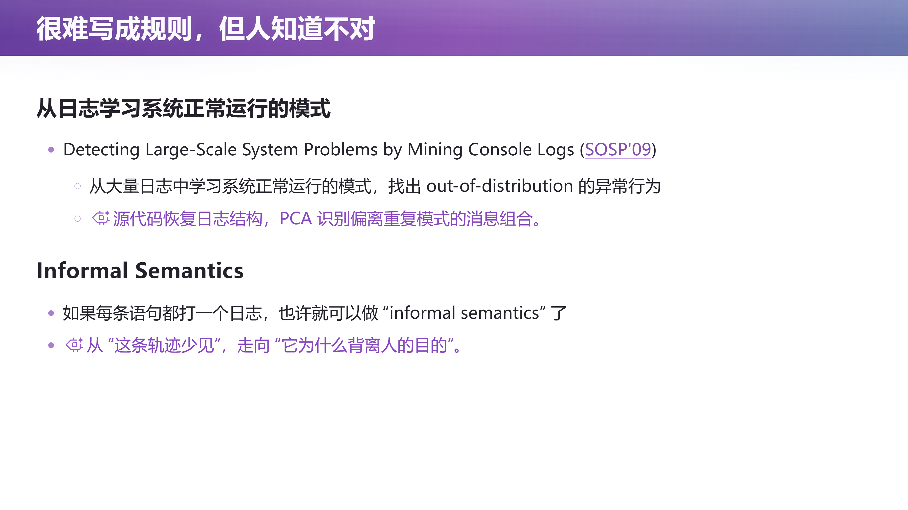

讲者用一千万条日志作示意：如果其中几乎所有轨迹都是 A-B-C，只有少数出现 C-B-A，那么在假设系统大体正常的情况下，这些离群轨迹值得调查。类似地，游戏中角色位置平常只在地图内有限移动，某次却沿 Z 轴持续掉出地图；把坐标变化记录下来，就能指出哪一段轨迹和其他运行不同。

少见不等于错误，常见也不等于正确。异常检测找到的是 outlier（离群行为），并不能自动解释它是否违反需求。仍需要把日志对应到程序位置、输入和业务语义，再由人或模型进一步判断。

日志挖掘研究的流程包括解析模板、提取特征和检测偏离。日志消息常把动态值和固定文本混在一起，先恢复消息结构有助于比较不同运行。讲者用大量 A-B-C 序列与少数 C-B-A 序列说明异常信号，也用角色坐标出界的案例说明异常可以定位到具体执行片段。统计偏离只是筛查，不是判决。

SOSP 2009 的工作展示了机器学习能在没有逐条故障规则时发现日志异常。当数百万次正常行为拥有稳定模板，少数偏离就能缩小调查范围。讲者把它与今天的模型联系起来：当日志有更清楚的语义解释，系统可能不只标记异常，还能说明异常与用户目标之间可能的冲突。

日志异常检测与传统静态规则的差别在于，它先从大量观测学习模式，再寻找离群点。离群点可帮助运维人员从海量记录中缩小范围，却可能把新版本正常行为也标成异常。分析结果应与软件版本、部署环境和业务事件相联系，不能只因为某条日志少见就判为故障。

### 6.3 从异常检测走向 informal semantics

讲者进一步设想，如果代码生成时就能为每条语句保留“这行代码准备做什么、它预期影响什么”的解释，那么运行时可以把解释与实际日志拼在一起。Agent 检查一次执行时，就不只有原始的 A、B、C 事件，还可以看到每一步的自然语言意图，再判断发生的行为是否符合初衷。

这像是把代码编写时短暂存在的设计知识保留下来。传统分析领域长期花力气恢复调用图和数据流，因为代码写下后，很多关系不再显式；若生成代码时就记录相应的解释，后续分析可能更直接。但插桩和记录也有成本，日志也可能不完整或过多。它是一种研究设想，不能简单理解为“每行加注释就能验证系统”。

## 7. 软件视图、文档与工具的未来

*(参考时间: 01:18:54)*

如果程序生成时能够把函数调用目的、数据变化预期或业务边界保留下来，运行日志就可能包含超越原始事件的语义线索。模型可以把执行证据与这些说明对照，而不是仅凭一串变量名猜测。但是逐句注释可能过期，日志会增加体积和运行成本，也可能包含敏感信息；记录哪些内容、何时记录，本身仍需设计。

“给每条语句打日志”只是课堂上的极端构想，用来说明生成时的意图信息可以帮助分析运行轨迹。真正系统需要选择采样、日志字段、敏感数据遮蔽和保留周期。否则大量日志既昂贵又不可读，还可能泄漏用户信息。保留语义的目标应通过可控、可审计的机制实现。

如果每次运行都能把执行状态投射成有语义的说明，工具就能比较“程序预期做什么”和“这次实际发生什么”。这与仅从成品代码恢复意图不同：生成时已有的信息可能仍然可用。但这些说明要和代码版本一起更新，避免生成行为变了、日志里的解释却留在旧版本。

### 7.1 调试器可以把数据结构投射成图

传统调试器展示变量值、内存地址和调用栈，但复杂数据结构不一定适合用原始内存表示。DDD 图形调试器让开发者通过图形方式观察对象和指针关系，尝试把程序状态投射成人容易理解的视图。

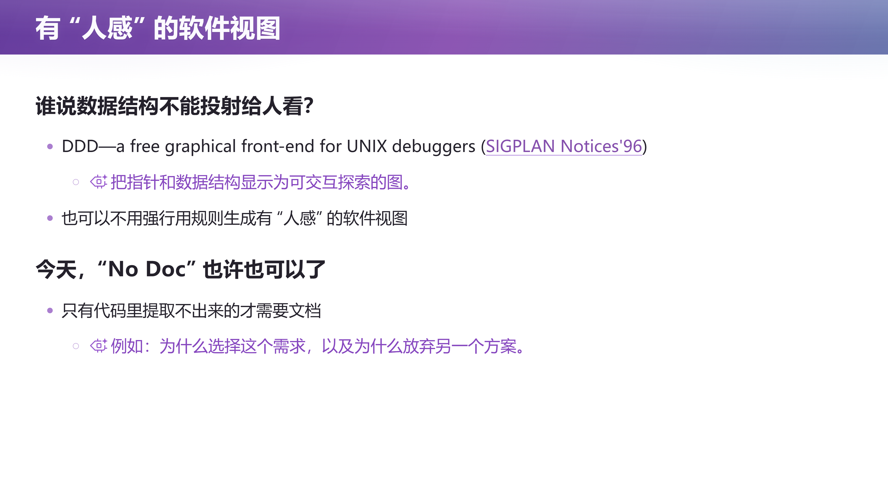

讲者用 AVL 树或红黑树的调试作例子。实现可能没有崩溃，却已经破坏平衡性或指针关系；对整棵树打很多 printf，输出会越来越杂乱。遍历得到排序序列可以检查一个结果性质，但若顺序不对，仍需定位树在哪次旋转后被破坏。把节点及关系可视化，能让人更直接地看出中间状态。

这类可视化不是形式验证，它没有证明任意执行都正确。它改进的是人的观察能力：将机器中的复杂状态映射到人可以理解和操作的界面。人的视觉注意力有限，一张包含太多节点、每个节点塞满信息的图同样不可读，因此工具还必须选择适当尺度和细节。

实现 AVL 树时，即便程序没有崩溃，旋转错误也可能让树失去平衡。按序遍历可以发现输出不递增，但开发者还需找出是哪个插入操作破坏了指针或高度信息。大量 printf 会造成噪声，图形调试器则能把节点、子树和关系直接展示出来。它不替代测试，而是让状态更容易被人观察和定位。

可视化把低层内存中的父子指针变成图上的节点和边，但布局方式会影响人的判断。比如一棵树显示成层次图时，缺少的子节点、错误的旋转和重复引用更明显；若自动布局隐藏了环或裁剪掉远端节点，图又可能误导。因此，视图应说明它展示的是哪些状态、哪些元素被折叠。

可视化调试尤其适合解释算法的中间状态。学生写 AVL 树时，最终中序遍历可能只告诉他顺序错了；把旋转前后的节点高度、父子边和子树形状摆在一起，才容易看清是哪一次平衡操作出错。讲者也提醒，图形界面可以用于调试和教学，却不意味着它能处理任意规模、任意数据结构。

### 7.2 让模型按任务组织软件视图

沿着“状态投射”的思路，模型可以根据任务动态组织呈现：追踪一个请求经过哪些状态，突出对象之间的关系，或者缩小大型系统的状态范围，让开发者只看与当前问题相关的部分。对 Linux 内核这样的复杂系统，如何将状态压缩成可理解、又不丢失关键信息的视图，是软件工程工具可以探索的方向。

模型选择什么视图，并不代表视图内容就可信。显示的数据仍应来自可观测的程序状态；开发者要能追溯到变量、日志和执行路径，必要时切换视图或回到原始证据。模型适合帮助组织信息，不能替代事实来源。

一个面向人的视图必须控制信息量。讲者提醒，人的视觉注意力有限，节点太多或单个节点字段太多都会迅速变得不可读。模型可以根据问题折叠无关部分、突出变化路径，或者从整体切换到局部；但每一层摘要都应该能回到原始状态，避免漂亮视图掩盖遗漏。

把大型系统压缩成视图意味着选择和抽象。对当前调试任务无关的信息可以隐藏，但隐藏规则本身会影响结论。好的工具允许从概要展开到详情，也允许从某个显示元素跳转到变量或日志来源。这样模型的摘要能节约注意力，而不是成为无法核验的新黑盒。

好的视图最好能按需折叠展开：先看请求经过的模块，再深入某条数据依赖，最后跳转到对应代码和运行记录。人一次只能有效处理有限数量的对象，因此“压缩到足够小”有助于理解；但压缩也可能把关键差异隐藏起来，必须让用户知道被省略的内容。

### 7.3 “No Doc”不是没有文档，而是不维护过期副本

讲者提出一种极端说法：“No Doc”。这里不是主张项目完全不要文档，而是质疑是否应该手工维护一份可以从代码直接导出的重复说明。如果文档只是描述函数、结构和接口，理论上可以由代码和生成工具按需产出，并纳入 CI 检查；需要时也能分别生成给新手、维护者或模型阅读的版本。

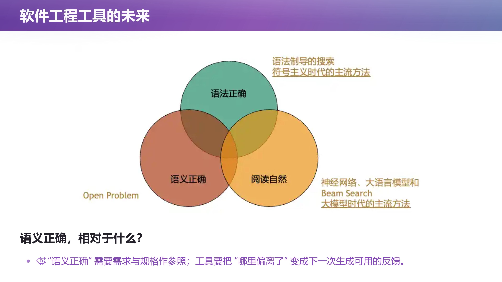

需要长期记录的是代码无法直接推出的知识：为什么选择这个需求、为什么放弃另一个方案、某个约束来自什么业务背景、某项设计取舍当时解决了什么问题。这些是决策理由，不是实现现状。若只从代码反推，模型很可能编造一个看似合理、却并非真实的历史原因。

可从代码稳定导出的 API 文档、结构说明和状态图，可以在构建流程中生成，给不同读者提供不同详略层次；重复手工维护会让文档和实现分叉。相反，ADR 一类记录设计理由：为什么选择某项需求，为什么放弃替代方案。这些知识不能由当前代码可靠推导出来，因此仍值得人工保存。

文档可以有不同受众：给新手的说明要讲背景和概念，给维护者的文档要强调接口和故障模式，给 Agent 的上下文可能需要明确约束和命令。若这些信息都重复手写，变化时很容易不同步；生成文档可以解决一部分。设计决策记录则保存无法自动导出的理由，两类材料不应混为一谈。

“生成文档而非提交文档”的建议只适用于可从代码导出的内容。接口定义变化时，自动生成说明能与代码同步；架构选择的理由、未选择方案的原因、由业务部门确定的限制，则应以 ADR 或其他决策记录保存。否则未来的开发者只看到结果，不知道哪些看似奇怪的约束其实不能移除。

### 7.4 软件生成还要面对语义正确的问题

软件制品有几个不同目标：语法正确、语义正确和阅读自然。早期符号方法比较容易检查语法结构；语言模型擅长生成看起来像人写的代码；但程序能够编译、读起来自然，仍不表示它完成了真正需求。**语义正确相对于什么？** 必须有一份需求或规格作为参照。

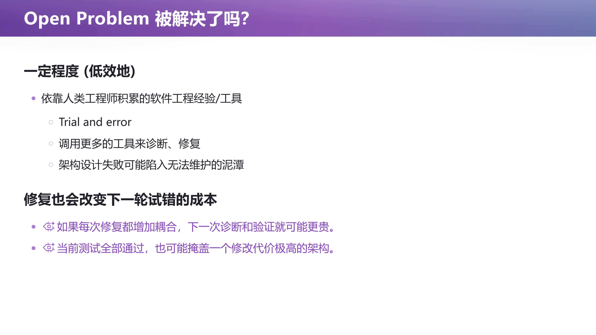

今天的 coding agent 可以先生成一个候选实现，再让编译器、单元测试、链接、截图或其他工具检查；若失败，工具返回反馈，模型再修改并重复尝试。它从人类几十年积累的软件工程实践中借到了检查机制，也学会解释部分失败结果。因此，很多开放问题看起来可以通过反复试错解决，但过程可能低效，而且每次通过检查并不代表需求已完全理解。

## 8. 让架构也获得反馈

*(参考时间: 01:29:44)*

Agent 的候选代码通过语法检查，只说明格式与结构合法；测试通过，只说明被运行的断言没有失败；代码读起来自然，只说明模型熟悉这种表达。三者都没有自动证明需求实现正确。软件生成循环能从编译、测试、链接和界面结果中学习，但它最终仍依据已有规格，而不是凭空发现用户真正想要什么。

模型尝试次数增加会提高找到可用实现的机会，却也会增加计算成本，并可能不断在坏架构上叠补丁。反馈若只关注当前测试，Agent 会优化当前样例；若希望系统可演化，还要检测依赖扩散、重复逻辑和改动影响范围。质量标准决定了试错循环朝什么方向优化。

模型的试错循环可以描述为：给定初始规格，采样一个实现，再交给编译、测试与界面检查；反馈返回后，模型提出下一个实现。它在已有工具和训练经验上工作，确实有机会比一次性生成更好。但它也可能在错误理解上不断打补丁，或者只优化可测量的表层指标，所以循环要允许停下来重新审视需求。

### 8.1 初始架构会影响后续每一次修改

当前修复成功，并不能证明系统拥有好的架构。模型先采样出一个实现，这个起点会显著影响后续质量。若初始设计只适合眼前一句描述，需求增加后可能越来越难改；模型如果只会在现有结构上继续补丁，就会不断增加耦合、例外和验证成本。

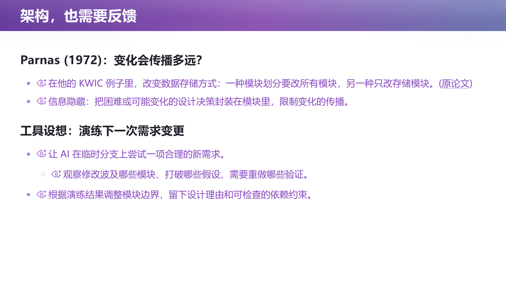

每次改动局部都通过测试，整体却可能逐渐变得脆弱。局部检查回答“这个案例现在能不能过”，架构问题则问“下一次合理变化会影响多大范围”。这两类问题需要不同的反馈。

试错式修复会让项目逐渐累积补丁：新需求来了，Agent 在现有结构上加一个条件，测试通过后继续下一项。若缺少架构层反馈，系统可能短期看似有效，长期却让每次变化都牵动更多模块。初始采样点不是唯一决定因素，但它会设定后续演化的起点和修改成本。

初始实现并不是之后不可改变的命运，但要重新理解和重做架构通常比继续补丁昂贵。第一节课谈到的 intent 到 spec 到 implementation 的距离在这里重新出现：如果最初的规格不完整，模型可能在错误的结构上越修越远。工具需要让“重做需求分析”成为可考虑的操作，而不是只允许在代码层面打补丁。

若 Agent 只保留当前实现作为事实来源，后续需求会不断与旧结构冲突。局部修复通过了测试，仍可能使依赖方向变差、模块责任模糊，或让同一业务规则散落在多处。持续修改成本是软件质量的一部分，因此架构也需要能被测试、比较和复盘的反馈。

### 8.2 Parnas 的模块化思想关注变化传播

Parnas 在 KWIC（关键字上下文检索）案例中比较过不同模块划分。如果改变数据存储方式，一种划分可能迫使每个模块都修改；另一种划分会把存储决策藏在一个模块内，只需改那一处。模块边界的价值不只在于代码组织整齐，而在于它把可能变化的设计决策隔离起来，减少变化传播。

这与 Agent 开发的实际问题一致：若 Agent 很容易让某个新需求牵动整个项目，说明模块边界可能没有把变化封装好。反过来，如果一个合理的新需求只需修改少数明确模块，且原有检查仍有效，说明设计更有余地。

信息隐藏的标准不是“每个文件都要小”，而是把容易变化的决策藏在稳定接口背后。KWIC 的存储方式只是一个例子：如果数据表示泄漏到所有模块，改变它就要全局修改；如果存储决策由单独模块拥有，变化范围就可控。模块划分是否合理，要看关键决策变化时传播范围有多大。

模块之间的稳定接口为变更提供边界。若数据表示被所有调用者直接依赖，存储格式变更会向外传播；若通过抽象接口访问，模块内部可以替换实现。架构反馈可以记录哪些接口假设被打破、哪些测试需要重写，从而帮助团队识别“变化容易扩散”的设计点。

模块边界承担的是变化隔离，而不是为了漂亮地划分文件。把可能变化的存储方式藏到模块内，可以让其余部分依赖稳定接口；把变化的业务决策散落到各处，则任何需求更新都要全局搜索和同步。Parnas 的例子把“哪些决策会变”作为模块划分的依据。

### 8.3 在隔离分支里演练下一项需求

一种工具设想是让 Agent 在临时分支上尝试实现一项合理的新需求，然后观察修改影响了哪些模块、打破了哪些假设、需要重做哪些验证。演练本身不能自动证明架构优良，但能把“这段代码以后恐怕难改”的主观感受转成讨论材料。

团队可以据此调整模块边界，并把设计理由和可检查的依赖约束留下来。未来再次变更时，Agent 可以对照这些理由判断某个依赖是否合理，或者指出哪些模块受到了意料之外的影响。关键是让反馈覆盖“后续修改的代价”，而不只覆盖当前功能。

架构演练可以选一项不太远离现状、但足以检验边界的需求，例如换一种持久化后端、增加权限角色或改变订单状态。Agent 在临时分支实现，再比较改动范围、失败测试和新增依赖。实验输出不是架构分数，而是用于讨论的具体迹象；团队可以结合业务价值决定是否重构。

需求演练也可能产生误导：选的需求若不真实，或者 Agent 对任务理解能力不足，改动范围就不能直接当作架构优劣评分。实验需要多个合理场景，并与业务路线图相联系。它的用途是增加具体证据，而不是自动替架构师作决定。

需求演练可以与常规测试互补：常规测试检查现有规格没有退化，演练则探索一个尚未实现的合理变化会造成多大改动。若新增需求迫使很多不相关模块同时变化，可能提示隐藏耦合；若只改变一个清晰的边界，则说明模块有一定弹性。团队仍要结合真实路线图解释这些迹象。

### 8.4 用软件改进软件，还要保留人的判断

软件分析的未来不是放弃类型系统、测试、模型检验或定理证明，而是同时利用两个世界：程序作为数学对象时可检查的确定性，以及代码作为人类活动产物时留下的上下文。模型提出值得调查的怀疑，执行机制把它变成可重复的结果，人再判断需求是否表达正确、架构是否能继续演化。

Agent 的能力也许会从局部修复扩展到重新理解 intent、重做需求分析或改写 spec；这些操作的反馈更弱、成本更高，也更需要人审查。真正成熟的递归改进不是无限追加补丁，而是能够利用证据反思最初理解，并在必要时重构方案。

要让递归改进真正向前，Agent 需要的不只是继续修改代码，还要能识别理解可能错了，重新讨论 intent，修订 spec，必要时回到架构设计。讲者把这看作软件工程未来的一种方向：从不断修补走向重新理解问题。由于这种判断反馈弱、代价高，人的审查和决策责任仍然重要。

如果模型未来能够重新解释问题、修改需求和重构架构，软件工程的许多传统活动会改变，但质量目标不会自动消失。人仍需决定哪些行为可接受、哪些风险值得付出成本、哪些信息应记录。技术进步扩展可执行的检查范围，不能消除价值判断和责任归属。

这一讲的结尾回到软件工程的起点：质量保障最终要回到需求。更强的 Agent 也许能重新理解软件、重做需求或重写规格，而不只是继续修修补补；但这些行为的信号弱、成本高，也更影响用户。工具能让更多候选方案被检查，最终选择哪一种意图和风险仍需要人负责。

## 附：官方参考与延伸阅读

课程官方页面：

- 课程主页：<https://jyywiki.cn/GSE/2026/>
- 本讲讲义《软件分析工具》：<https://jyywiki.cn/GSE/2026/lect13.md>
- 本讲幻灯片：<https://jyywiki.cn/GSE/2026/slides13.html>

按章节对应的延伸材料：

- **递归式自我改进与语言模型制造工具**：LATM（LLM as Tool Makers），ICLR 2024；[论文页面](https://arxiv.org/abs/2305.17126)。
- **程序作为数学对象**：Rice 定理（1953）；费马大定理的证明背景可参见 [Andrew Wiles, Modular elliptic curves and Fermat's Last Theorem](https://annals.math.princeton.edu/1995/141-3/p07)。
- **程序的自然性**：Hindle 等，*On the Naturalness of Software*（ICSE 2012），[论文 DOI](https://doi.org/10.1109/ICSE.2012.6227135)。
- **从日志挖掘系统异常**：Xu 等，*Detecting Large-Scale System Problems by Mining Console Logs*（SOSP 2009），[论文 DOI](https://doi.org/10.1145/1629575.1629587)。
- **人类可读的调试视图**：Zhao，*DDD—a free graphical front-end for UNIX debuggers*（1996），[论文 DOI](https://doi.org/10.1145/249094.249108)。
- **架构与信息隐藏**：Parnas，*On the Criteria To Be Used in Decomposing Systems into Modules*（1972），[论文 DOI](https://doi.org/10.1145/361598.361623)。

---

*本电子书由 [videobook](https://github.com/Luke-Evan/videobook) 流水线生成。课程讲义与幻灯片版权归讲师所有，依 [CC BY-NC 4.0](http://creativecommons.org/licenses/by-nc/4.0/) 发布。*

