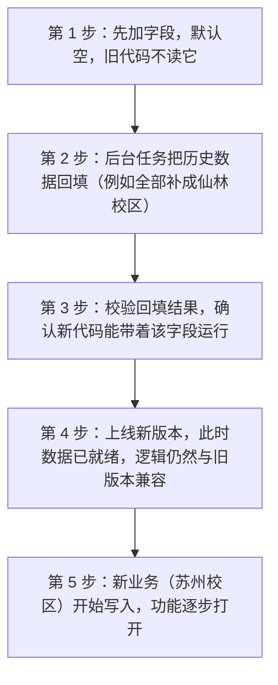
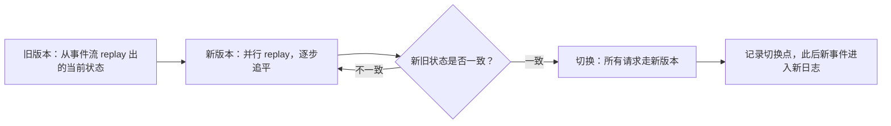
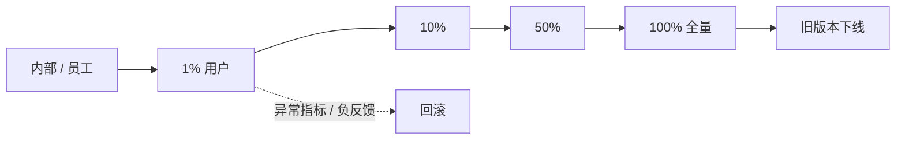

# 软件发布与运维：从一张软盘到 24 小时在线的服务

> **课程**：南京大学《生成式软件工程》（2026）
>
> **主讲**：蒋炎岩
>
> **课程主页**：<https://jyywiki.cn/GSE/2026/>
>
> **版权说明**：课程内容（含课堂演示与板书）系 © 蒋炎岩 作品，课程依 [CC BY-NC 4.0](http://creativecommons.org/licenses/by-nc/4.0/) 发布。本书为非商业学习笔记，引用内容均保留原作者署名；转载与再使用请遵循同一许可。
>
> **本讲提要**：上一讲为止，一条流水线已经走到"质量保障"：需求、架构、最小可用产品，再到测试、分析工具与形式化验证。这一讲补上最后一段——把软件交出去，并且让它一直活着。发布会立刻撞上产品形态的组合爆炸：操作系统、CPU、发行版、移动端、应用商店分区；GitHub 的 release 与 CI/CD 把"由工具链生成的产物"从源码里分出来；部署服务则要处理域名、证书、信任链，以及"你到底拿什么验收"这个最容易被跳过的问题。运维面对的世界更麻烦：线上已经有一个正在跑的版本，而且往往不止一个；需求随时会变，一个字段该不该加、服务能不能停、新版本怎么追上旧版本，最后都回到架构。课堂开头还有一段课前闲聊：当模型证明 VP ≠ VNP、证明黎曼猜想时，"许愿"这件事对人的位置意味着什么。

## 目录

1. [开篇：当数学难题也被许愿](#1)
2. [发布：从把二进制拷给别人说起](#2)
3. [GitHub Release：只托管源代码](#3-github-release)
4. [部署：从 LAMP 到许愿一个 nginx](#4-lamp-nginx)
5. [运维：世界上已经有一个版本在跑](#5)
6. [配置即运维：nginx 里的手艺](#6-nginx)
7. [SRE：为别人的 bug 负责](#7-sre-bug)
8. [给想做产品的人：从室友到 SRE](#8-sre)
9. [附：官方参考与延伸阅读](#9)

---

## 1. 开篇：当数学难题也被许愿

*(参考时间: 00:00:00)*

在前面几讲里，我们把软件工程的整条链路走了一遍：从需求、架构，做出一个 minimal viable product（最小可用产品）；如果不满意它的质量，就做质量保障——传统的软件分析工具，以及在 agent 时代略有不同的做法。今天进入最后一段：**发布与运维**。

不过在运维之前，讲者先花了大半节课讲最近的新闻。这段闲聊不是跑题：它要说明的是，在"许愿就能得到软件"的时代，人的位置在哪里。

### 1.1 从 permanent 到 determinant：一夜之间被推翻的猜想

就在开课之前几个小时，Anthropic 发布了新成果：模型证明了一个已经开放四十多年的猜想——**VP ≠ VNP**（Valiant 于 1979 年提出）。这是一篇几十页的论文，并且用 Lean 做了形式化验证。

要去理解这件事，得回到线性代数的第一课。学行列式时，多数人都会困惑：为什么定义里要有排列的奇偶性？为什么每一项前面要有 ±1？讲者说，他自己当年也困惑过。

把莱布尼茨展开式写出来就清楚了。对一个 n × n 矩阵，行列式是

$$\det A = \sum_{\pi} \operatorname{sign}(\pi) \prod_i A_{i,\pi(i)}$$

奇偶性引入的那个 ±1，作用是在求和时让大量项**互相抵消**。这个抵消看起来只是数学上的修饰，但它带来的是计算复杂性的巨大差别：有了符号，行列式可以多项式时间算出来（高斯消元）；把它去掉，同一个和式叫 **permanent（积和式）**，就难了。

为什么难？把二分图编码成矩阵就明白了：左边 $1..n$、右边 $1..n$ 各一排点，若左边第 i 个点和右边第 j 个点之间有边，就令元素为 1，否则为 0。此时 permanent 枚举的是所有排列，只有当某个排列对应的每一条边都存在时，乘积才不为零——**permanent 数的正是这张二分图里完美匹配（perfect matching）的个数**。而一旦乘上 ±1，这些项就互相消掉了，你数不出个数。这就是 determinant 和 permanent 的分水岭：一个可以算，一个被认为不能。

VP ≠ VNP 说的就是这件事：判断和数数之间，隔着一道真实的复杂度鸿沟。


### 1.2 一个物理学家发明的算法

这条路并非没有例外。在某些结构很特殊的二分图上——比如**平面图**——可以通过一种巧妙的方式给边定向，把你原本要算的 permanent 变成算 determinant（严格说是 Pfaffian），而这个行列式恰好等于图中完美匹配的数量。平面图之所以能被这样处理，是因为它没有那种"交错打架"的糟糕结构。

有意思的是，这个算法不是数学家或理论计算机科学家发现的，而是**物理学家**为了计算 Ising 模型的配分函数、研究相变才需要它。

讲者用这个例子说明的是一种落差感：Valiant 的猜想已经开放了几十年，大量理论计算机方向的博士生都在做它，人类围绕它积累了一整套深刻的数学。然后一夜之间，几十页论文加 Lean 检查就把它推出了。

### 1.3 黎曼猜想、"魔法师"与品味

比 VP ≠ VNP 更大的新闻来自同一个人。

几个月前，在 Anthropic 工作的数学家 Levent Alpöge 做出了一连串成果：先用模型给**雅可比猜想**（Smale 问题清单里的第 16 个问题）找到了一个三维情形下的反例；随后又宣布用模型构造出了**黎曼猜想**的证明——一个悬置了一百六十多年的问题，同样以 Lean 形式给出，等待社区验证；再往后，Navier–Stokes 方程的反例也与这条线索有关。

讲者的判断是：这个人真正掌握的，是**与 AI 协作的命门**——一种 prompt 的"品味"。他敢去碰黎曼猜想，敢把大量精力投在与 AI 的 copilot 上，前提是他判断模型的能力已经到了那个程度；而他在自己写的那份短短几页的博客里也讲得很坦白，说模型在某些方面早就把他甩在身后了。他自己的优势不在于掌控证明，而在于对这个世界框架的**掌控感**比别人强：知道该问什么，知道答案长什么样，知道怎么验收。

对照来看，两家公司走的是两条路线：Anthropic 让领域内的数学家和 AI 一起做；OpenAI 更接近"火力覆盖"，模型数学能力强，就用算力把公开的数学问题硬跑一遍。**在这个阶段，对领域有深刻理解的一方胜出了。**

讲者由此引出两个比喻。一个是古罗马的"消字母"咒语：念一句咒语，每念一次去掉一个字母，人们相信这样就能祛病消灾——那是纯粹的迷信。另一个是这几年的网络梗图。今天不一样的地方在于：**这次的魔法是真的会应验的**。许个愿，一个软件就做出来了；许个愿，一个数学定理就证出来了，而且还能用 Lean 去验证。


讲到黎曼猜想时，讲者还专门展示了自己的"私货"：欧拉当年的原文。那篇论文里，调和级数发散被证明，平方倒数级数收敛到 π²/6 也被证明，用的都是初等变换——虽然对象是无穷级数，手法却朴素得惊人。正是从这种"用函数去表示素数性质"的起点出发，人类走上了试图估计素数分布的道路，一路走到黎曼猜想。讲者说起自己第一次看到 ζ 函数时的震撼：**人类竟然还可以这样**。

### 1.4 做题家之死：评价的尺子又换了一把

面对"爆发时代到底促进还是阻碍人类进步"这个问题，讲者的答案从悲观开始：**做题家死了**。幻灯片上他把这句话写得更直白——TCS 变得更有吸引力了，但做题家变得更没用了。

这句话并不是说反复训练出来的解题技能毫无用处，而是说如果你把它当成吃饭的本领，这个时代已经结束了。历史上，评价的尺子换过一次：机械时代之前，人的体力就是生产力上限；机器出现之后，体力变得不那么重要，体育比赛变成一种娱乐，跑步是为了活得更久而不是证明自己更有力气。接着尺子换成了**智力**——有智力就能管理更多的人和机器，能发明计算机、发明强化学习，那是人类历史上真正的进步台阶。

现在，这把尺子也在松动。下一个尺度是什么，讲者说他也不知道，也知道不好说；但至少**智力不再稀缺**。

### 1.5 群论还会被发明吗

于是就有了那个问题：如果伽罗瓦的时代就已经有大语言模型，群论还会被发明出来吗？

有一种说法是"不会"：既然可以许愿——"给我证黎曼猜想"、"给我证 P ≠ NP"——那谁还去做那些笨功夫。

讲者的答案是反过来的：**不仅群论会被发明，而且会发明出更多像群论一样好的东西**。理由在于人的反馈循环并没有消失：每个人都有自己的领域、自己的偏好，而 AI 提供的近乎无限的注意力，恰好能承接人类有限的记忆力和注意力。他甚至提到，如今甚至有人在预测市场上为"能不能看到 P 与 NP 的证明"开出赔率。VP ≠ VNP 是实数域上的问题，比 P vs NP 稍容易一些，但也是实实在在的一大步。

顺带他还纠正了对自己这门课的一个期待：你们必须去许愿。没有 token 就不知道许愿的结果是什么，也不理解怎样让许愿的结果更好。

至于"VP ≠ VNP 证明了，然后呢"，讲者指出了一个更值得追问的方向：这类结论给出的下界往往只到 M 的 log M 次方这种量级——它确实比多项式大，但离我们直觉里的"指数"还差得远。那个证明给出的指数上带一个 log，与我们设想中"必须枚举 2 的 n 次方种可能"还隔着距离。**于是新的问题就出现了：这个东西到底可以有多大？**

再进一步，人一旦获得了近乎无限的智力，就可以去问以前不敢问的问题。比如："给你一台计算机、给你一秒钟，你能算什么样的问题？"这在计算机科学家眼里是结构极差、没有数学工具可用的题目，没人愿意碰；但在许愿的时代，你可以开始做梦。

所以"文科生最值钱"这种说法，讲者认为应该这样理解：当你愿意把自己的知识和一个非常强的模型结合起来，你就能更好地发挥它的效用。**群论不会消失，人类也不会停下，我们只是换了一个台阶。**

### 1.6 蒸馏你自己：把品味写成可以打分的 prompt

顺着上面的思路，讲者给了一个实验（Lab 3）：**蒸馏你自己**。

做法是这样的：构造一个**只属于你的评测集**——比如"收到的邮件 → 我想要的回复"，"作文题目 → 我写的作文"。这些样本代表你自己的偏好，当然绝对不能泄露给模型。样本太少，指望直接调权重让它变成你，目前做不到；但可以反过来做：写一个 prompt，让模型带着这个 prompt 去回答，然后用评测集给它打分。

关键在那个 prompt 的性质：

- 它必须是**正面的**，即"我是怎么思考的"、"我在什么时候会怎么想"，也就是 chain of thought；
- 不能是一长串 counter example——"不能这样、不能出现这个词、也不能出现那个词"。这样的清单只会越来越长，模型依然学不会遵循你的意图。

一旦评测集建好，对任何手写的 prompt，你都能问模型一个更聪明的问题：**它有没有抓到我这里的核心思路、核心见解和核心观点？** 只要这把尺子是统一的，理论上你就可以不断调 prompt，把分数刷上去。

讲者的经验是，这套框架在自己 review 论文这件事上已经有了一点成效：过去有些东西只能靠他在 prompt 里逐条告诉模型，现在模型能自己提炼出来，可以说"算是比较好地蒸馏了自己"。

这里还藏着一个更深的类比：**这个过程和人类发现新理论的过程是同构的**。伽罗瓦在决斗前夜写下的那两页手稿，本质上就是一份 prompt——他把自己蒸馏了出来。如果这份手稿再加上别人的 chain of thought，能让另一个足够强的模型在别的任务上取得显著提升，那么这份手稿就"是一个有用的理论"。理论的价值，就在于它能迁移。

那么为什么人类的反馈循环不会消失？因为**偏见是分布式的**。每个人带着自己的偏见来到这个世界，两个有偏见的人凑在一起可以一加一大于二；而单个模型把全部训练数据压进同一套权重，能力最强，却也有非常强的偏向——同一件事，它的方向几乎是固定的，除非你用 prompt 去改它。这也解释了为什么让两个同等强度的模型互相 review 时，通常会收敛到更好的方案。

再往前走一步：人类之所以是社会性动物，是因为我们能**共情**——不仅能建模自己，还能建模别人。讲者在课堂上就一直在建模一个虚拟听众：这句话说出去，台下的大三、大二学生会有什么反应？是该小声说，还是该用更有说服力的语气？这套内心模型跑得很快，以至于他一边讲一边调整下一个 token。如果模型也能学会"另一个模型会怎么想、会怎么打分"，它是不是也就有了品味？这是个开放问题，但讲者相信它不构成根本性的技术困难。

而这几件事共同的落点，是讲者反复强调的一句话：**few-shot learning 的本质不是 gradient，而是 test time 的计算**。你听到一个观点，豁然开朗，然后把它拿到真实任务上去举一反三——这一步必须真的算，才叫举一反三。把梯度重传一遍，那不算。

---

## 2. 发布：从把二进制拷给别人说起

*(参考时间: 00:28:57)*

有了需求、架构、实现，也有了质量保障，软件就得交出去。发布是软件工程里最容易被"许愿"跳过的一段：模型默认会给你一个网页，因为网页最好交付；但只要你的意图里包含"我要一个能在 Windows 上双击运行的东西"，问题立刻复杂一个数量级。

### 2.1 最朴素的发布

在没有前端、没有应用商店之前，发布软件真的非常朴素：**GCC 编译成一个 binary，把这个 binary 用某种方式拷给另一个人**，你就发布了。

在 1970 年，这样做是成立的。今天你把一个打包好的二进制丢到某个群里，群友的第一句话一定是："为什么我运行不起来？"你在《计算机系统基础》课上一定经历过：`make` 编译完了，`make run` 一跑，屏幕上跳出一堆错误信息。软件发布比五十年前复杂，就复杂在这些地方。


课堂上展示的一个现代例子，是让模型做出来的一个第一人称射击游戏画面——港口、集装箱、雨、光影。讲者拿它举例，说明**人类的需求和模型的对齐**在"验收标准"这一层可以做到多细：你不用描述"我要照片级的真实感"，你只要在网上找一张真实港口的照片，要求"你渲染出来的这个视角，和这张照片看起来一样"，视觉模型自己就有判断力，它会告诉你验收没通过——"你这个黄不拉叽的，太土了"。有了这个反馈，模型才有修的动力。

### 2.2 更早的发布：把源码印在书上

再往前看，还有更原始的方式。有一本书叫 *101 BASIC Computer Games*，它把**源代码和运行示例一起印在纸上**。读者要做的，就是逐行把源码敲进电脑，然后运行，然后得到一个游戏。

讲者说自己小时候学 BASIC 就是这么干的：书上有一段示例代码，他把它敲进去，跑神经网络的反向传播。他没能把所有代码都记住，但留下了一些有趣的印象。

这还不只是"把代码印出来"这么笨。幻灯片上还有一个更聪明的做法：**一张软盘可以替作者招徕下一位玩家**——《DOOM》把第一章做成共享版，你拷给室友，室友还能拷给隔壁宿舍；想玩后面的章节？打开游戏目录里的 `ORDER.FRM`，照着填单、寄钱订购。id Software 的 README 里就写着这件事。

这就是 release。一直到 Windows 3.0 的时代，软件的发布仍然是这种形态。


### 2.3 软盘时代已经开始考虑部署细节

Windows 3.0a 装在 **15 张软盘**里，每张 360K。盒子里配着安装说明：把盘插进 A: 盘，在命令提示符下输入 `setup` 然后回车，它就装上了。

而就在这个时代，软件发布已经要处理不少细节了。一套盘要照顾**三代 PC**：

- 8086/8088 只能跑 Real Mode；
- 286 能跑 Standard Mode；
- 386 能跑 Enhanced Mode（可回归）。

用户只需要在 DOS 里敲一个 `WIN`，而判断"这台机器能跑哪种模式"是 `WIN.COM` 的活。一个发行版要同时覆盖三种运行模式，这在当时就是相当困难的事。

有一篇 2000 年的博客专门回顾了 Windows 3.0 的整体架构设计，讲的就是"同一个程序如何同时跑在 8086 和 286 上"。今天你大概也能造出一个同时在 ARM 和 x86 上跑的东西，但那需要一点 hack。


### 2.4 今天说"支持 PC"意味着什么

一旦发布出去的东西不是一个网页，你面对的是一张组合爆炸的清单。

**Windows**：你可以说"我只支持最新的 Windows，不支持 XP、7 这些老系统"，这算合理。但 Windows 本身有 x86_64，也有 ARM——你要不要出两个版本？

**macOS**：要不要支持老一点的 Intel Mac，还是只支持你现在能买到的 Apple Silicon？再往前，Apple 还用过 PowerPC，那条线早就停止支持了。

**Linux**：更惨。x86 和 arm64 肯定要发，但要不要发龙芯的版本？作为中国的软件供应商，你很可能必须发。而 Linux 的生态又是一团麻：你能确保用户的发行版里装着你链接的那个 .so 吗？这也是为什么后来出现了 snap、flatpak 这类用容器思路解决问题的东西——它们让系统和包一起膨胀，但确实在一定程度上解决了依赖问题。这个话题，讲者说下一讲讲开源生态时会展开。

**硬件**：你不只要支持软件，还要支持硬件。课堂上那个游戏在讲者的 Linux 机器上非常卡，肉眼可见地没法流畅玩，渲染分辨率也不高——明明装了显示驱动，硬件加速却没打开。这类问题在发布之后会直接变成用户投诉。

所以发布本身就是一个"一下子给大家增加负担"的环节。在讲这一节之前，很多同学甚至没有考虑过这个问题：许愿"给我一个 CS:GO"，模型默认就用 three.js 做成网页。

### 2.5 模型为什么默认给你一个网页

因为**模型的 token 是要花钱的**。当用户没说清楚，模型面对"我要不要支持龙芯、在 Windows 上怎么办、在 macOS 上怎么办"这一连串问题时，token 消耗会成倍增加。它一定会选一条能快速拿到 reward 的路：做一个网页，用 three.js。

除非它和你**对齐**过——它知道你作为开发者，在说"给我做个应用"的时候，默认需要跨平台。

关于这件事，讲者举了自己的例子：他这堂课的准备方式也变成了许愿。以前备课，他会非常仔细地去看一遍最新的 Codex release；现在他"彻底放飞自我"，让 Codex 自己去消化自己。

### 2.6 需求一变，发布面就变

发布这件事的麻烦在于，需求总是后到的。

本来你只想发一个网页，演示也很成功；老板看完很开心，说"这么好，那我们再做一个 Android 版本吧，做一个 iOS 版本，再做一个鸿蒙的"。这时你会庆幸自己选了网页——或者，如果你一开始选的是游戏引擎，你就得考虑用 Unity 这类能同时跑在手机和 PC 上的方案。

还没完。iOS 的国区和美区是分开的，手机能不能下载某个应用本身就是一个问题。这些需求每一个都是一次独立的 build，需要被小心地管理。

幻灯片上给了一个特别具体的例子：把"按空格开火"换成"点屏幕开火"，命中判定要改几行？答案是——**你想不到要改几行，因为当初写的时候没人想过会有触屏**。最开始那个 prompt 让 AI 一路狂奔，跑到现在，屎山就扶不起来了。


而这一切最终**回到架构**：你的游戏或软件的架构设计得好不好，决定了你对需求变更的容忍度有多高。移动端和 PC 端的交互逻辑完全不同——手机上是触屏，PC 上是键盘鼠标；你可以做虚拟摇杆和 ABXY 按钮，但如果架构里一开始就把一些东西硬编码进去了，随着需求一次次改动，架构就可能被改崩。等你一路狂奔到某个时间点，就扶不起来了。

所以最终还是回到那个老问题：**intent、specification 和 implementation 之间的 gap**。如果你的架构在 intent 层面就已经想清楚"这个软件最终要部署给谁、部署到哪"，后面才不至于失控。

---

## 3. GitHub Release：只托管源代码

*(参考时间: 00:41:52)*

讲者在这里插了一段"网上冲浪才会长出来的常识"。你们在做课程项目的时候，多半只是把代码 `git push` 上去；但真正要交付的软件，源码之外还有一大堆**由工具链生成**的东西。

### 3.1 为什么产物不进仓库

GitHub 有一个核心想法：**它只托管那些是源代码的东西**——也就是由人或机器创造性创建的部分。所有由工具链能够生成的东西，都不应该放进去。理由很实在：省空间、省时间、也省网络带宽。

那这些生成物去哪？以 release 的形式提供。

所以在 GitHub 上你经常能看到这样的画面：同一个项目，仓库里只有源码，而 release 页面上挂着好几个种类的包——Linux 的源码包；如果项目贴心，还会给你一个 deb 包，于是用 Debian 或 Ubuntu 的人可以直接安装；有些不那么贴心的项目，什么也没有，甚至连 Linux 的源码包都没有，只挂一个 Windows 的 exe。

这也是一种知识：你逛 GitHub 逛多了，自然就知道"做 release 的时候需要做这件事"。

### 3.2 一次真实的发布：Codex 的一天

讲者举了 Codex 的发布流程作为对照。你们做的东西是在本地 `make`、`just` 出来的；而 Codex 有完整的 CI/CD：内部先跑质量保障、做基于 AI agent 的代码审计，完成后把一个 **git tag** 推送到 GitHub 上。

tag 的本质是一个**指向某个 commit object 的指针**——"这次提交就是我要的"。比如它的名字可能长这样：

`rust-v0.173.0-alpha.4`

tag 一旦推上去，就会触发 GitHub Actions。在 Actions 的页面里你可以看到它的工作流：先 build，再 build，再 build——一个**构建矩阵**，每个平台一个 job：面向 Linux、macOS、Windows，分别按 x86-64 和 ARM64 构建；然后签名、打包、验证，再发布到 GitHub 和 npm。

一次发布有多少产物？**196 个 assets**。群友只想装一个，剩下的文件是干什么的？本体、签名、安装脚本……单看 Linux x86-64 的 `codex-app-server`，就有 `.tar.gz`、`.zst` 两种压缩包，还有供验证签名的 `.signature` 文件。


### 3.3 校验和与签名：你下载的那 100MB 到底对不对

对任何文件都可以做一个 hash digest（校验和）。这件事看起来多余，实际非常必要：

- 浏览器或命令行下载到一半断了，你可能没看到失败信息，只看到目录里躺着一个 100MB 的文件——它到底完不完整？
- 传输过程有没有出问题？
- 更糟的情况：有没有被中间人篡改？

有了校验和，你就可以拿它去比对；有了签名，你还能确认这个包确实出自发布者。

### 3.4 现在这一切都能许愿，但你得先有概念

讲者特意强调：虽然现在这些事都可以交给 agent 完成，但**你对"发布是什么"依然要有正确的概念**。否则你根本想不到去看一眼某个项目的 release 页面，也想不到去写 `.signature`、去算 checksum。

这一点在后面几节会反复出现：许愿可以代劳操作，但代劳不了"知道该要什么"。

---

## 4. 部署：从 LAMP 到许愿一个 nginx

*(参考时间: 00:48:50)*

发布应用程序只是一半。另一半是**发布服务**：如果你做的是多人联机的网络游戏，或者任何一个小型的网站、产品交互系统，你就必须在互联网上部署一个服务。

### 4.1 localhost:3000 的笑话

这里的经典错误是把 `localhost:3000` 的链接发给群友。

"Claude Code 太牛逼了，我现在化身为神，做了一个超级牛逼的 CS:GO，请大家玩一玩——`localhost:3000`。"听起来很好笑，因为你**有这个背景知识**：localhost 是本机回环地址，别人访问不了。但你如果给一个四五年的小学生做 harness，你就必须阻止它做出这种事。

这也解释了"给小学生做一个 harness"为什么比想象中难：模型会很自然地变得 verbose，把每个细节都解释一遍，好像在给小学生讲课；但小学生根本不想看那么多字，他想的是"你帮我一起把这个困难的东西造出来"。反馈不能过多，抽象也不能过度——"这是一个苹果，这是一个香蕉"，然后东西突然就出来了，小朋友同样理解不了。

而且这并不只是"小学生才会犯"的错。幻灯片上贴了一条真实的推文：

```text
claude code is fucking insane
i know literally NOTHING about coding, ZERO, and i just
built a fully functioning web app in minutes
http://localhost:3000/
check it out
```

这个人做出来了，也很兴奋，但他点开的链接连的是**他自己的电脑**。你的排行榜跑在哪？别人该连哪个地址？这些问题他一个都没想过。

顺带一提，客户端和云端其实**可以分工**：客户端跑游戏，云端用容器或 Serverless 接收成绩。分工之后，"部署"就不再是把整个东西塞到一台机器上，而是想清楚哪个部分该待在哪。讲者的总结是：**念魔法咒语需要真正的理解。**

讲者说，他非常笃定"给小学生做 harness"这件事是可以做到的，有兴趣的同学可以找他聊。

### 4.2 LAMP：上一个时代的标准答案

部署在很长一段时间里是有标准答案的：**LAMP**。它是成本最低的方案——买一台真实的服务器，甚至你自己家里的一台机器也行；或者买一台云主机。然后在上面装 Linux、Apache、MySQL 和 PHP：

- **Apache** 管前端请求，也可以承担反向代理和负载均衡的入口；
- **MySQL** 负责持久化；
- **PHP** 负责把业务逻辑接到网页上。

这套组合的关键在于成本：它几乎不需要额外的基础设施，就能让一个小网站活起来。


### 4.3 现场许愿：让校内的同学能访问

今天这一套也可以直接许愿。讲者在课堂上就现场演示了一遍：要求 agent 部署一个 nginx，让**校内**的同学能够访问，并且通过 HTTP 拿到当前的系统时间和系统状态。

注意他在需求里写得多具体：不是"帮我部署一个网站"，而是"让校内同学能访问"、"HTTP 能拿到当前的时间和系统状态"。这就是把验收标准写了进去——**防止它做出 localhost 那种事**。


几分钟后，网站就做好了。刷新之后可以看到这台机器的当前状态：系统信息、负载等等。讲者还顺带调侃了一句：理论上说，连了同一个校园网的同学，都能在地址栏里输入这个地址访问；他这台机器同样也可以访问到隔壁教室的摄像头——以前他真干过这事。


### 4.4 上线那一秒，你就开始为它负责

演示很好玩，但讲者立刻泼了一盆冷水：

> 你在部署服务上线的那一秒钟起，你就开始为它负责了。

互联网上无数的黑客会开始盯着它：里面有没有一个漏洞，可以让他远程执行代码，把你的电脑变成肉鸡、拿去挖矿？一旦你的服务是 public 的，别人能看到它，它就变成了一个公开的目标。

课堂上的现场也印证了这一点：日志里已经出现了校园网内其他机器的访问记录，讲者说自己"感到很慌"——虽然他相信 nginx，也相信这么小的服务不至于有远程代码执行的漏洞，"如果这都有的话，那这个世界就已经彻底崩溃了"。但压力是真实的。


### 4.5 HTTPS、自签名证书与信任链

要把网站给所有人用，就得用更合适的方式，比如 HTTPS。HTTPS 和 HTTP 用的端口不一样，这件事本身不难；难的是证书。

你可以自己做一个 HTTPS，或者做一个自签名证书，把 443 端口打开。但**自签名的证书是不受信任的**——它必须有一条从根证书签下来的完整信任链，浏览器才认。课堂上 agent 配的正是自签名证书，于是浏览器立刻给出警告页面。


这个警告你在很多网站上见过：可能是证书过期，也可能是配置问题。讲者接着讲了一个真实的翻车案例：

他在图书馆的机器上查书时，发现图书馆网站的证书不受信任，但那个网站实际上是有信任链的——问题出在那台老机器的 nginx 配置里，**没有把完整的证书信任链包含进去**，只放了服务器证书，没放中间证书。他自己的 Firefox 里显示"不受信任"，而另一台新机器上却是好的。


同样的事在他自己的课程网站上也发生过一次：因为他没有把中间证书放进 nginx，浏览器和 curl 因为缓存了中间证书，一切正常；但用 `wget` 这种更"老派"的客户端去下载示例代码时，`wget` 直接拒绝了连接。后来把证书补上，问题才修好。

这段插曲很好地说明了 agent 时代的典型体验：**首先它能工作；第二它又不能完全工作；第三如果它不工作了，你又可以神奇地把它恢复，然后你并不知道是为什么。**

### 4.6 验收标准：掌控"不属于自己的力量"

于是回到讲者反复强调的那件事：这些东西**都不属于你自己的力量**。他坦言自己也不完全清楚 nginx 内部是怎么工作的。但你有一个明确的验收方案——"任何人在任何地点都能访问"，并且你把它告诉了 AI，你就在一定程度上掌控了这股力量。

这也是他说 computer science 在今天仍然有用的原因：**当你对这个领域理解越多，你就能在这个领域里做出越不一样的东西。**

他那段关于黎曼猜想的铺垫，在这里收束：那个人敢去证，是因为他相信 AI 的能力已经到了；而他真正比别人强的，是对整个世界框架的掌控感——知道该问什么、知道什么样子算对。你带 agent 走一遍发布流程、验收一遍、理解一次失败，你的知识体系就越补越全。

### 4.7 GPT Store 式的发布：只为 token 付费

讲者认为一个非常先进的理念是 GPT Store：你用 web coding 做出一个东西，它被提炼成一个技能或应用——有前端、有后端、也有 AI——别人也可以直接用，只要为 token 付费就行。

这是一个很好的商业模式：用户绝大部分不会做出一个有千万、上亿用户的产品，也就不需要面对大量的运维和成本压力；而平台提供的 services 可以无缝、弹性地 scale，只要代码做得不是太差。

唯一的遗憾是它生得太早，以至于那时候大家做不出真正像样的东西。讲者觉得今天的时机已经成熟，并猜测 deepseek harness 之类的东西也许有一天会走同样的路——你发布自己的插件，只要插件还在消耗 token，平台就很开心。

---

## 5. 运维：世界上已经有一个版本在跑

*(参考时间: 01:01:22)*

发布完了，事情没完。软件一旦到了用户手里，一旦 public，你就开始担心：会不会有 bug。

### 5.1 运维的对象，是"已经在运行的软件"

为什么发布之后一定会有 bug？因为需求会变，而 **intent 本身就说不太清楚**。有些地方是模棱两可的：到底怎么做，我也不确定，你先做一个吧。

就算 verification 把 spec 和 implementation 之间的 gap 填平了——你证明了程序永远不会 crash——也挡不住需求的变化。举个很具体的例子：

> 南京大学苏州校区落成了。原本只在仙林校区开展的业务，现在苏州校区也要开展。数据库的某张表里，本来没有"校区"这个字段。

你要在数据库里加一个校区字段。从一个"干净的软件"角度看，这没什么：代码改了，测试跑一遍，验证一下，加个字段而已。

但运维管的不是干净的软件，而是：**世界上已经有一个正在运行的软件版本了，甚至不止一个。** 这才是最讨厌的地方。

这也是为什么 macOS 每隔几年就会宣布"这个版本我不支持了"——不再推补丁，也不管了。因为一旦要为某个版本负责，每一次发布就都要在**每一个版本、每一种硬件**上做测试。你不知道在某台老机器上会发生什么：一个证书信任链的小问题，就足以让整个软件拒绝工作——新机器缓存了最新的中间证书，一切正常；两年以前的机器上就是不行。

### 5.2 给数据库加一个字段：渐进式迁移

给运行中的系统加字段，对很多团队来说是摧毁性的。常见的粗暴做法是：先把服务下线，打补丁、迁移数据库，测试完再上线。这就是"系统维护中"的来源。

它为什么讨厌？一个留学在外的人，想买一张回国落上海、再转南京的高铁票，掏手机的时候正好撞上维护窗口——"对不起，不在服务时间"。

所以更好的目标是：**一刻都不能中断**。中断几秒可以忍受，但不该有大规模、长时间的维护窗口。

麻烦就在这里：服务 24 小时不停，我要加一个字段，而且数据库还很大。怎么办？答案是**把变更拆成有顺序的几步**，让每一时刻的新旧版本都能共存：



详细说一遍这个顺序：

1. **先加字段**，让它空着。这一步最容易——旧的代码完全不需要改，它不查这个字段，查出来也会扔掉；写入的时候留空即可。数据库一下子就迁过去了。
2. **后台回填**。历史上的课程记录、业务记录，慢慢跑一个后台任务，把校区补上（全补成仙林）。跑一天也没关系，前台任务照常执行。
3. **校验**。确认回填完成，并且新版本"表里有校区字段"也能正常运行。
4. **上线新版本**。这时候还没有任何苏州校区的数据，逻辑基本不变，只是在界面上多显示一个校区。
5. **打开新功能**。等到新版本稳定，苏州校区的业务才真正开始写入。

如果你按这个顺序做，整个过程里没有任何一刻需要停机；但如果你跳过其中任何一步，就很可能在某个瞬间同时存在"不认识校区字段的代码"和"已经写入苏州校区的数据"。

讲者说得很直白：如果要靠人来保证这件事，这是一个巨大的心智负担。你手上有好几个版本——带校区的、支持新功能的、和线上正式的——你要在适当的时候把它们上线。**这时候运维的人手都在抖**。

软件工程里确实有 best practice 和工具：数据库迁移有迁移工具，版本管理、版本回滚也有工具。但你依然会怕：新业务上线以后，用户会不会出问题？

### 5.3 架构决定能不能"在线换血"

不同的架构，维护一个软件的难度差别很大。

以 state 为中心的数据库记的是**当前状态**。要加一个校区字段，就只能按上面那套流程走：加字段 → 回填 → 切换。而且数据库是并发的：迁移过程中新的请求还会进来，插入的记录可能也是空的；你得挑一个合适的时机（没有空值的时候）再迁移，再切应用版本。

而以 **event sourcing（事件溯源）** 为中心的架构记的是**状态迁移的历史**：库里存的全是动作——选课、退课、改选……当前状态由所有历史投射出来。

这给了你另一种可能：既然有完整的历史，就可以**慢慢 replay 出新版本的状态**。



你可以一点点把新版本追上来；也可以写一个迁移，把旧状态直接迁移到新状态；然后校验两者是否一致——可以测试、可以检验。等新版本和旧版本跑到一起，某一天你就可以切过去，由新版本提供服务。而 event sourcing 的 ground truth（事件流）始终没变：切换的时候甚至可以记一条"切换事件"，从此所有设备都走新版本的日志。如果新版本追平了事件流，就可以切换；甚至可以让两个版本并行提供服务。

讲者在这里回到"许愿的危险"：你一开始许愿的时候不想这些，模型就替你定了——因为你不想把这些事情搞清楚。但你总要吃一次亏，而**吃一次亏是非常宝贵的经验**：吃过亏以后，下一次遇到类似需求，你就知道该选什么样的架构。

### 5.4 performance bug：选课系统又崩了

假设系统安安稳稳跑了一年，你也捏着一把汗，把补丁切了过去——幻灯片上的标题是"捏了一把汗，终于切换成功了！"。

然后，选课开始了。

- 教务系统又崩了；
- 财务系统到了年末，这也是常态。

新版本里有一个 performance bug，同学们开始疯狂地在小红书上投诉。


讲者说，学校里这种体量的系统，在今天的算力下崩溃，**几乎一定是架构问题**：平时一个人点"提交"很快，全校同一分钟点"提交"，这些请求会在哪里排队？但话说回来，问题也没那么简单：即便是优化得非常好的系统，遇上超大规模的负载或特殊情况，还是很难抗住。

他举的例子是双 11。十几年前淘宝刚开始搞双 11 的时候，那真的是发很多消费券、打很多折扣，非常便宜；每年的成交额都是指数级增长，快递堆成山，平时两三天能到的快递，那阵子要两个星期。你要策划这样的活动，运维就更痛苦了。

而今天你们对双 11 已经没什么感觉了：一方面它也不便宜了，另一方面活动拉得那么长，人已经麻了。但**流量峰值并没有变容易**：指数增长的曲线背后，是容量规划、限流、降级、扩容这些具体的工作。

### 5.5 运维要背的锅

为了做到好的运维，除了"看到 bug 要回滚"，还有一长串事：

- 数据库出问题，要诊断；
- 网络连接断了，要处理；
- HTTPS 证书过期了，要续；
- 软件一旦部署，就涉及海量的配置。

讲者拿自己开玩笑：他甚至不知道 nginx 是什么，只听说大家都用；叫 AI 帮他部署了 nginx 的 HTTPS 网页，看到了访问日志。这已经足够让服务跑起来——但"跑起来"和"运维好"是两件事。

---

## 6. 配置即运维：nginx 里的手艺

*(参考时间: 01:13:23)*

服务跑起来只是起点。真正让服务跑得"好"，靠的是一堆看不见的配置。讲者在课堂上问了 agent 一个很实际的问题：

> 如果我想优化网站的性能，nginx 有哪些配置可以做？

回答很长，涉及进程模型、连接管理、传输压缩、缓存、后端交互、日志等等。讲者的评价是：**这里面的水非常深，在 LLM 和 agent 时代，它依然是老师傅的手艺活。** 每一个公司，不管大厂还是小厂，最好都要养一个资深的运维工程师——因为他能节约成本，这就是钱。


### 6.1 worker 与 CPU：一个没有标准答案的问题

最典型的是**进程与事件模型**。nginx 默认会给每个 CPU 分配一个 worker 进程——这听起来很自然，但接下来就有问题：要不要把这个 worker **绑定**到 CPU 上？

- 绑定的好处很明确：减少 cache miss，性能更好。
- 绑定的坏处也很明确：如果这台服务器上还混部了**其他负载**，被绑定的 worker 就可能"挨饿"，跟别人抢 CPU，于是某个 worker 跑得慢一点，你那条 **P99 分位**的延迟曲线就会翘起来，用户体验直接受影响。

那到底要不要绑？讲者说：**不知道**，只能根据你的经验、根据你部署的环境来定。部署在虚拟机里、裸金属上、还是容器里，答案都不一样。默认配置基本能满足要求，但老师傅把这一堆参数一个一个调过去，真有可能把成本省下一半，甚至省到四分之一。

同一层次上的参数还有一大串：进程的并发上限、接受连接的方式、keepalive（它会影响 memory footprint）、静态文件的路径、内核参数，以及 TLS 握手和证书——**HTTPS 上的握手是一个非常大的开销**。

### 6.2 压缩：一个 CPU 与带宽的交换

传输与压缩是另一个典型的 trade-off。你的网站上要下载 JS、HTML 这样的静态资源，为了减少带宽，当然可以压缩。静态内容压一次就够了，还能把 compression level 调高——**用一次性的 CPU 换永久性的带宽**。

动态内容就没那么轻松了，比如 JSON。JSON 的压缩比其实不低，但每一次请求都要现场压，付出的是实打实的 CPU。更微妙的是**对端**：如果对面正好是一台 ESP32 那样的设备，CPU 特别弱，传过去的压缩数据解起来很慢，访问体验反而更差。这时候不压缩、把 CPU 的负担换到 server 侧，可能是更好的选择。

还有一类常见错误：给**图片、视频、字体**做压缩。这些格式本身已经压缩过了，再压一次基本没有收益，有时甚至会让文件变大，纯粹是浪费 CPU——这正是清单里"别压不该压的"那一条。


### 6.3 缓存、超时，以及"到底该等多久"

当网站变大时，**缓存**是对性能影响极大的一个配置项；后端的交互、内存缓冲与限流、日志以及日志写入的持久化（persistency），都会影响性能。讲者举了两个真实案例：

- 一批请求在**随机读磁盘**，可能让某个 worker 变得非常慢；
- 另一批人**反复下载同一个 4MB 的热门文件**，带宽被反复消耗。

负载一旦变得复杂，只有有经验的运维才知道"什么样的东西该设成什么样"。

讲者也点出了许愿模式的局限：你不说，模型就不会有主动性去改 nginx 配置——下一个项目改了，它还是老配置；直到有一天你实在受不了，说"帮我分析一下这个 nginx 的负载，做一下配置上的性能调优"，它才会去做。**需求永远得由你来提。**

最典型的例子是**超时**。设 20ms 行不行？在测试环境里完全没问题，因为请求都在同一个数据中心内；可一旦上线、人一多、再叠加上磁盘 IO 和远程调用，20ms 根本不够完成一次调用——在用户看来，这个服务就是不可用的。

那设大一点，500ms、600ms？也不行：有时候它真的会一直等到超时，整个服务要等很久才给反馈。你在买票的时候走进电梯，网络断了——超时设多少，才能既在真断网时及时给出失败，又在网络没断时把请求走完？讲者的评价是：**这其实非常非常困难。**

---

## 7. SRE：为别人的 bug 负责

*(参考时间: 01:21:03)*

正因为这些事很难，Google 专门为它设计了一个工种：**SRE（Site Reliability Engineering，站点可靠性工程）**。Google 大约有 4% 的工程师是 SRE，它甚至为此写了一本书，现在已经出到第二版。

### 7.1 "keep the site up"

SRE 的目标只有一句话：**keep the site up**。这里的 site 指 google.com——一个全球的、24 小时不能停止的服务。


它不能像 12306 那样，每天晚上一点到五点拒绝对外服务。而且它还是分布式的：你的 Gmail 可能一个入口在欧洲、一个在美国，两边打开的是同一个 Gmail；你在其中一个里做的任何操作，另一个也要体现出来。全球的数据中心之间不能断，这在软件需求随时变更、软件不断发布的背景下，是非常困难的事。

SRE 里的 **reliability**，定义是"以高概率完成预期的功能"。幻灯片上给了一个特别朴素的例子：对学生来说，点了"提交"之后，选上的课得出现在自己的课表里——这就是"预期功能"。幻灯片上给了一个特别朴素的例子：对学生来说，点了"提交"之后，选上的课得出现在自己的课表里——这就是"预期功能"。注意这个定义的边界：SRE **不管需求**，也不管怎么把需求变成正确的实现；它相信新版本已经交付了，它要做的只是让新版本上线，并且按照正确的预期提供服务。

这意味着什么？**即便新版本里面有 bug，一定程度上也是 SRE 的责任。** 所以讲者说，这大概是最惨的工种之一：

- 首先要 **on call**：值班，24 小时待命，晚上睡觉也得接电话；
- 其次要给产品团队写的 bug **背锅**。产品团队的 bug 在自己的测试环境里往往暴露不出来——没有那个规模，也没有那些奇怪的用户习惯；偏偏就有某个用户那样操作、配置又很奇怪，才会触发它。

而如果这个 bug 影响 1% 的用户，一旦这 1% 开始抱怨，就是海量的抱怨——"小红书肯定就冲爆了"。

### 7.2 灰度发布：先给 1% 的人

既然产品团队一定会写出 bug，SRE 就不会一上来把功能推给所有人，而是**一点一点小规模地发布**。这里面既有经验，也有工具：工具帮他发布，也帮他回滚。



这就是你在各种产品上都能看到的灰度发布（canary release）模式。同一个 feature，你不知道它到底推给了谁——它会按画像来发。


大模型是最典型的例子：有时候你用着用着，突然觉得"这个模型智力变高了"。原因就是模型厂在发一个新模型，它不告诉你，而是先看你的表现。单看一个人一个任务，是判断不出好坏的；但如果推给一百万人，再用一个模型去评估这些人后续的反馈是正面还是负面，就能知道这次更新是大幅提升了满意度，还是用户开始频繁抱怨。

**给 1% 的用户推，就能收集到足够有统计显著性的数据**，用来决定这个产品发还是不发。

### 7.3 用行为数据判断"这个功能好不好"

用户体验类的特性尤其依赖这种反馈。因为每个用户都有自己的画像和数据，你可以先只推 100 个、1000 个日活用户，然后观察：推了之后，这些用户使用 app 的时长是变多了还是变少了？变少就是一个非常糟糕的信号——说明这个 feature 让他们不舒服。

更细的特征指标来自**操作序列**。应用本质上知道你所有的操作，比如在微信里：进入语音聊天 → 点击 → 聊天 → 返回 → 在聊天框里更正。

"更正"这个动作，很可能意味着语音识别错了，或者你想补充一句。在单个用户身上，你分不清是哪一种；但推到足够大的人群，比较两个语音模型的"更正比例"，就有了统计意义上的显著性——你据此改进产品。

所以很长时间里，线上可能同时有**多个版本并行**，后台悄悄收集反馈数据。有 bug 时也不至于毁灭性：因为没推给所有人，及时回滚就行。等数据足够好，再从 1%、10%、50% 一路推到全量，最后把旧版本下线。

---

## 8. 给想做产品的人：从室友到 SRE

*(参考时间: 01:27:46)*

讲到这里，一个完整的软件故事就讲完了：从总体的设计、需求，到把软件做出来，再把它发布出去，最后让它一直跑着。

讲者说他非常鼓励大家去做一个自己喜欢的东西。而如果你真的要做产品，路径大概是这样：**室友会是你的第一批用户**；产品变好之后，推广到学校的社团、同学、身边的人；再往后，这个小产品可能真的发布出去，有开源社区的人开始使用。

到了那一步，你大概会想起课堂上讲的这一堆复杂的东西——要发布、要运维、要 on call——然后担心：我这产品该怎么办？

### 8.1 早期用户是死忠粉

这里有一个好消息：**早期的用户一般都很宽容。**

想想看，你作为一个毛头小伙子，开发了一个笔记应用、一个记账应用，或者任何一个你自己很满意的东西。确实，在你的世界里它已经做得很好了；但如果站在顶级大厂产品经理的 UI/UX 角度看，它大概还没有达到"能发到国民级"的水准。

讲者说，他收到过同学的投稿，问能不能在课上宣传一下自己做的产品。他比较委婉地拒绝了——不是因为看不起，而是因为那些产品确实还没到那个水准。

但每一个这样的小东西，起步阶段的使用者，都是**愿意在它不好用的情况下依然用它的人**。这说明这个产品**戳中了他们的一个核心功能点**，提供了别人提供不了的价值。你要做的，就是把这个产品的核心价值不断放大。

而这些人能**自适应**。你的软件会有 bug，甚至可能推一个版本直接不能用；但当你只有一千、一万个用户的时候，你可以快速接受他们的反馈，快速迭代到下一个版本，把问题修掉。只要**让他们真正喜欢你的那个功能没有严重衰退**，他们就会留下来。

这一点是你在做需求的时候就要把握住的：知道自己的核心价值是什么，别为了追新功能把它拖垮。

### 8.2 什么时候才需要一个 SRE

至于"要不要养一个 SRE"这个问题，讲者的回答很干脆：

> 等到你的公司大到一定要请一个专职的 Site Reliability Engineer 的时候，你就已经赚了足够多的钱、用户也足够多了。

一千、一万个用户的时候，你不需要 SRE。那个时候你需要的是：听用户的反馈、快速迭代、别把核心功能弄坏。而当你真的需要有人 24 小时盯着站点的时候，你已经跨过了那个坎。

不过他也补了一句实话：软件就算是开发完了、部署出去了，它确实有无穷多的细节，需要有人帮你盯着。

---

## 9. 附：官方参考与延伸阅读

课程官方页面：

- 课程主页：<https://jyywiki.cn/GSE/2026/>
- 实验 (3)《蒸馏你自己》：<https://jyywiki.cn/GSE/2026/lab3.md>

按章节对应的延伸材料：

- **permanent 与 determinant 的复杂度差别**：Valiant, *Completeness Classes in Algebra*（STOC 1979），提出 VP/VNP 的代数复杂性框架与 permanent 的困难性猜想，[论文 DOI](https://doi.org/10.1145/800135.804414)。
- **平面图上的完美匹配与 Pfaffian**：Kasteleyn, *The statistics of dimers on a lattice*（Physica 27, 1961），物理学家为统计力学问题发明的算法，[论文 DOI](https://doi.org/10.1016/0031-8914(61)90063-5)。
- **欧拉与无穷级数**：Euler, *Variae observationes circa series infinitas*（1737），论证调和级数发散、平方倒数级数收敛到 $\pi^2/6$，并由此给出素数无穷多的新证明，[Euler Archive 条目](https://scholarlycommons.pacific.edu/euler-works/72/)。
- **雅可比猜想（Smale 第 16 问题）**：背景见 [Wikipedia: Jacobian conjecture](https://en.wikipedia.org/wiki/Jacobian_conjecture)。
- **把源码印在纸上的发行方式**：《101 BASIC Computer Games》的背景见 [Wikipedia 条目](https://en.wikipedia.org/wiki/101_BASIC_Computer_Games)。
- **GitHub 发布与产物分发**：官方文档 [About releases](https://docs.github.com/en/repositories/releasing-projects-on-github/about-releases)；版本号约定见 [Semantic Versioning](https://semver.org/)。
- **LAMP 组合**：[Wikipedia: LAMP](https://en.wikipedia.org/wiki/LAMP_(software_bundle))。
- **nginx 配置与调优**：官方文档 [nginx documentation](https://nginx.org/en/docs/)；进程模型见 [Connection processing methods](https://nginx.org/en/docs/events.html)。
- **X.509 证书链与信任**：规范见 [RFC 5280](https://www.rfc-editor.org/rfc/rfc5280)。
- **渐进式数据库变更（expand / contract）**：Fowler，[ParallelChange](https://martinfowler.com/bliki/ParallelChange.html)。
- **事件溯源**：Fowler，[Event Sourcing](https://martinfowler.com/eaaDev/EventSourcing.html)。
- **SRE 与站点可靠性**：Google，[Site Reliability Engineering](https://sre.google/sre-book/table-of-contents/)（第二版为 *The Site Reliability Workbook*）。
- **灰度发布**：Fowler，[CanaryRelease](https://martinfowler.com/bliki/CanaryRelease.html)。

---

*本电子书由 [videobook](https://github.com/Luke-Evan/videobook) 流水线生成。课程讲义与幻灯片版权归讲师所有，依 [CC BY-NC 4.0](http://creativecommons.org/licenses/by-nc/4.0/) 发布。*
