# 软件的演化：航母是怎么造出来的

> **课程官方资料**：[课程主页](https://jyywiki.cn/GSE/2026/) · [本讲讲义](https://jyywiki.cn/GSE/2026/lect10.md) · [本讲幻灯片](https://jyywiki.cn/GSE/2026/slides10.html)
>
> **版权说明**：课程讲义与幻灯片系 © 蒋炎岩 作品，依 [CC BY-NC 4.0](http://creativecommons.org/licenses/by-nc/4.0/) 发布；本书为非商业学习笔记，引用图片与文字均保留署名。
>
> **本讲说明**：上一讲把 DeepSeek Harness 看成一个"操作系统"，静态地拆了它的需求、架构与设计。这一讲给它加上**时间维度**：今天看到的架构、规则和测试，是怎样一步一步形成的？为什么"航母"不是一天造出来的，而软件、数学、甚至人自己的成长，都遵循同一条"小步加增量"的演化路径？当 AI 已经能把"小事"做得很好，人还应该决定什么？讲者从 USS Midway 上的一排船模讲起，一路讲到 SWE-bench、taste-bench，最后回到 DeepSeek Harness 的提交历史——以及那个还没做成的实验：**蒸馏我自己**。

---

## 目录

1. [暴论与建议：当熟悉的工具开始失效](#1)
2. [软件的演化：航母不是一天造出来的](#2)
3. [回到 DeepSeek Harness：从提交历史里学工程](#3-deepseek-harness)
4. [附：官方参考与延伸阅读](#_3)
5. [附录：课堂未展示的幻灯片](#_4)

---

## 1. 暴论与建议：当熟悉的工具开始失效

*(参考时间: 00:00)*

今天继续讲 DeepSeek Harness，但讲者说最近"眩晕瘫坐的频率又变高了"。

### 1.1 日常震惊瘫坐：ETH 与"数学的美"

*(参考时间: 00:00:24)*

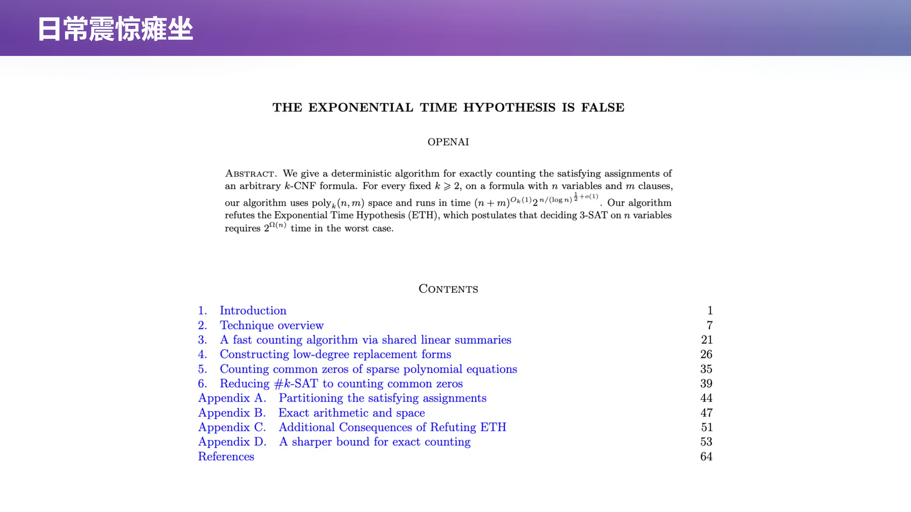

那天早上起来，OpenAI 声称自己找到了一个**去证伪指数时间假说（Exponential Time Hypothesis，ETH）**的结果。要说明它的份量：3-SAT 这类问题原本被认为存在一个"二的 N 次方"式的下界，而他们说把这个界限**往下压了一点点**——注意，**不是**找到了多项式算法（如果真找到，P 就等于 NP，世界就崩塌了），但已经足以颠覆很多人对这件事的认知。同一时期还有一些别的大结果。

由此，讲者有了一个感觉：

> 我们上数学课、上理论计算机课的时候，追求一种**美**——但也许这种"美"是一种**幻觉**。

它当然是美的：有一个非常小的内核，从这个内核上可以推出很多有趣的结论。他举了 P 与 NP 的例子：**为什么我们用 P（多项式时间）来刻画"有效计算"？**

- 因为 P 在**复合（composition）**下是封闭的：一个多项式时间算法里可以自由调用另一个多项式时间算法，无论调用多少次，结果仍是多项式时间；
- 所以你可以自由地使用已有的算法库，不必为每次函数调用"付账"；
- 这带来数学上的便利，可以推出很多结论。

但这个定义也**把 n² 和 n¹⁰⁰ 放进了同一个抽屉**：n¹⁰⁰ 在 n = 10 的时候根本跑不出任何有用的结果，可它依然属于 P。讲者的判断是：

> 这某种程度上是**人类为了弥补自己大脑只能装下这么多抽象**而做的一个 work-around。

而理论计算机真正想问的问题其实是另一个：**给我一个形式化的计算模型**（比如 RAM model：CPU + 指令集，每条 load/store 花一个周期），**允许你运行 k 步，你能解决的所有问题是什么？** 这才是"人造了一台计算机，它到底能做什么、不能做什么"的问题。而 P 是一个**非常粗犷的近似**，很多细节都被抹平了——在 k 步的模型里，数据放在内存的什么位置、要不要压缩，都会产生巨大影响，而这些在多项式时间里都不重要。

人类一直在解决"比较干净"的问题，这也包括生物学。我们花了几千年建"门纲目科种属"的分类树——那个网站建得非常漂亮，代表人类文明——但从现代生物学看，这种**树状模型受到很多挑战**：猫和狗很容易分，可你去看微观生物，界限就变得非常模糊，"这两个到底是不是同一个祖先来的"甚至可能不是一棵树，而是一个 **graph**。

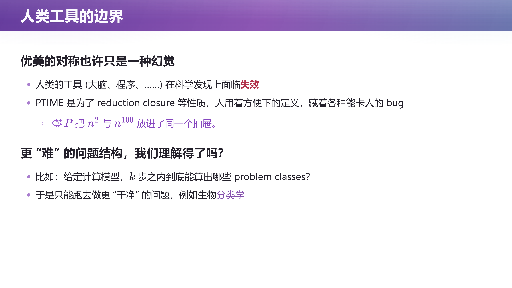

### 1.2 我们刚好站在"平坦"的地方

*(参考时间: 00:07:33)*

于是有一种可能性：**实际世界的结构其实很"差"，我们只是刚好生活在一个非常平坦的局部**（或者在某一个宏观尺度上变得比较平坦），而**平坦使得经验可以被压缩**。

讲者说他前一天还在和 GPT 聊这个：我们的**对称性推导出了能量守恒**——"物理规律在不同时空应该保持一致"这一个 first principle，就能推出总存在一个守恒量。但如果世界的结构其实非常差，我们可能只是**刚好**处在一个有守恒量的区域里，于是经验可压缩、**压缩产生智能**。

这里有一条隐约的因果链：

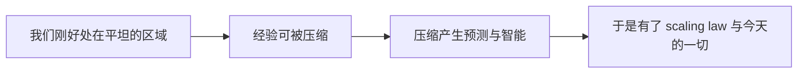

这也解释了为什么**AI 会带着我们想到很多夸张的东西**。

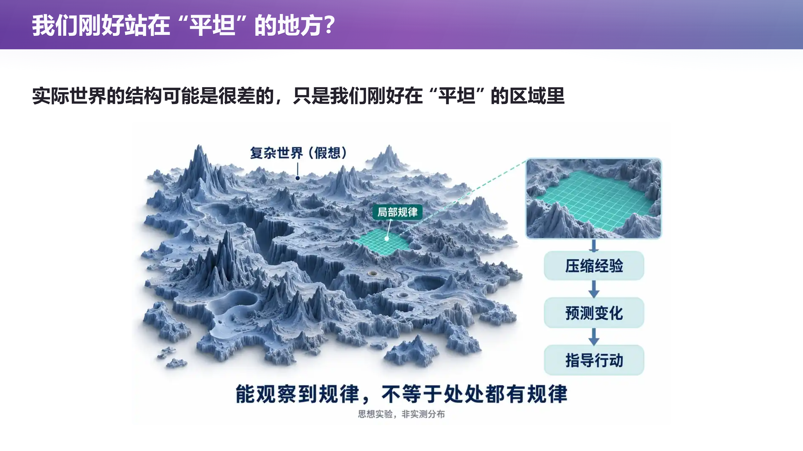

（本页之后，讲者还谈到"描述得出不等于驾驭得了"：洛伦兹 1963 年的三条微分方程就能定义一个系统，微小初态误差却会放大——规律很短，长期预测仍可能失效；另一种可能则是 AI 找到了可压缩的结构，只是它超出了人类惯用的表示方式。这一页在课堂上没有单独停留，见文末附录。）

### 1.3 暴论一：教育循环正在松动

*(参考时间: 00:09:00)*

讲者说他最近在小红书发了很多暴论，需要解释一下。他先画出现行的循环：

> **家庭投资教育，大学培养人才，企业购买劳动。**

以前这条链是通的：家里给你投资教育，你疯狂学习考上大学，大学把你培养成人才，然后企业把你买走——**你的劳动力是有用的**。但现在这个循环越来越困难：

- 如果一个 **senior 带上 agent 就超过了 junior**，资本家可能就不想再招应届生了；
- 为了面对竞争，他先把自己的优势稳住，再谈"交给后人的智慧"；
- 于是你们毕业时面临的职场压力会非常大——"我招一个 agent 也可以，为什么要招一个新人、花很长时间来培养？"

**AI 可能同时改变两件事**（这也是幻灯片上的说法）：

- **能力的价格**：花几年练出来的本领，可能变成人人可调用的服务；
- **能力的证明**：一份漂亮成品，越来越难说明其中有多少是人的贡献。

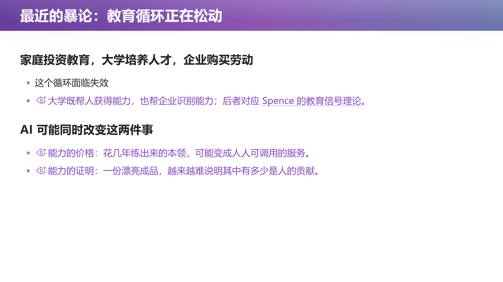

### 1.4 用 AI trajectory 证明自己

*(参考时间: 00:10:09)*

讲者说他知道大家都很焦虑，所以"我有一个答案给大家"：

> **你可以用你的 AI trajectory 去证明自己。**

具体做法很朴素：

1. 从现在开始，把**你所有的 AI trajectory** 保存下来；
2. 做一次**压缩**：把不必要的信息（比如 tool call 的输出）去掉，把有用的 assets（比如生成的图片）留下；
3. 于是你得到一个**属于你自己的时间轴**——上面有你干过的所有事情。

为什么可行？因为现在你干任何事都问 AI：今天吃什么、春和源有没有开新店、去另一个城市怎么走……他上周去 CNCC，就是让 ChatGPT 按他的位置、偏好做一次尽量 comprehensive 的搜索。**这条轨迹里能看到什么？**

- 你今天跟 AI 聊物理，明天聊天文——**你的想法是什么，AI 给你的是什么，你给的反馈是什么**；
- 你最终生产的代码**能不能跑**；
- **哪些想法来自你，哪些来自 AI**——这些 facts 都是可以审计的。

他承认"上有政策，下有对策"，你总有办法抵抗它；但这样一份**不可变的日志**对用人单位更方便：

> 他可以说"2026 年 3 月 10 号你跟 AI 讨论了这么一个东西，你还有印象吗？用今天的眼光你怎么看？"——**你几乎无法造假**。他只要随机采样，如果你对这件事有记忆、能说出正确的东西，那几乎可以肯定是你自己做的。就算你伪造了 trajectory 混进面试，一下也会被打回原形。

更让讲者觉得"恐怖"的一层是：它能评估**你的成长潜力**。

- 你们高考可能都是同样的分数、进了南京大学，但起跑线之后的走向完全不同；
- 有的人"进大学那一刻就是人生巅峰"，从此再没学进任何东西；
- 有的人能力不断增长，**在某个时刻发现怎样和 AI 交流更好，把一个 skill 沉淀到自己的 harness 里**；
- 这些**方法论的变化、人生观的变化**，都能在 trajectory 上被发现。

对用人单位来说，这就得到一个"人物画像"，能准确预知你在未来的指数（成长曲线）。

讲者的感受是矛盾的：

> 这是一件非常恐怖的事——它像在**窥探你的内心**，甚至限制思想刚硬。但你把这个轨迹保存下来、用合适的方式投影成简历，短期内就会得到回报。**你相当于跟魔鬼签了一个契约，出卖了自己的灵魂。**

一个延伸的暴论：**以后不需要靠见面聊天来交朋友了**。他有这样的体验：有同学来找他聊 Agent OS，聊着聊着就收敛到"英雄所见略同"。而有了 trajectory 以后：

> 你们只要派出你们的 agent 先聊一聊，**立即就知道观点一致和不一致的部分在哪里**，然后继续展开辩论，辩论完再由 agent 增强。

因为他发现，自己思考任何问题时，AI agent 都代表了该领域里**所有的知识**：他有一个粗糙的想法，AI 可以补全无数细节，甚至告诉他"哪些部分被别人想过了、论文是什么、哪里想得不够周到、哪些地方大家还没想过"。**人类扩充知识的速度会变得非常快**——至于哪天"全人类都被斩杀"，那是另一说。

他甚至开玩笑说这可以作为"颠覆性产品"：**用来匹配交友**。你的人格已经编码在你的 AI trajectory 里了——"只需要由 OpenAI 给你分配对象就可以了。"

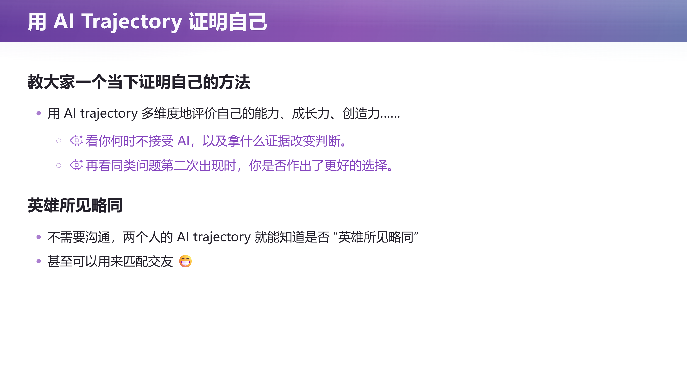

### 1.5 上学是一笔期货投资：贷款上班与"AI 不扩散条约"

*(参考时间: 00:17:40)*

讲者把话说得更直白：**上学本身就是一笔"期货投资"**——今天投入学费、时间和放弃的工作收入，押注几年后市场仍然需要你学到的技能，**但没有企业提前承诺收购**。

沿着这个逻辑推下去，就有了"贷款上班"的暴论：

- 你要上班，就先承诺你能超过 AI、先交保证金；
- 在 mentor 带领下，如果一段时间内你超过了 AI、给公司带来了价值，就能得到回报；
- 如果你一直不再成长，保证金就不退给你了。

他说这"是真的有可能发生"。再往后，也许人类会走向一种类似**核不扩散条约**的东西——AI 能力不能再增长——"Anthropic 和 OpenAI 也在讨论这件事"，但目前没有缓和的趋势。

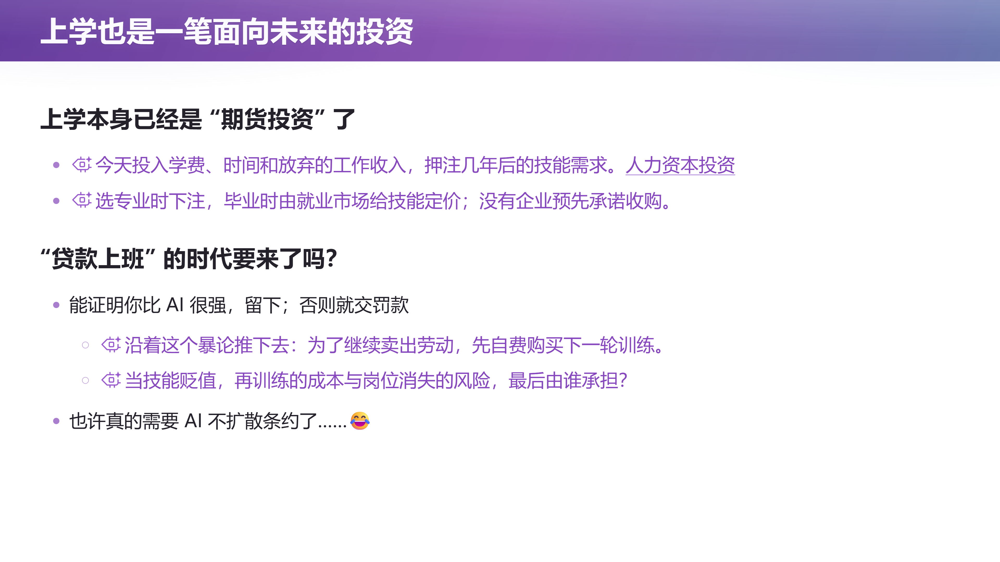

---

## 2. 软件的演化：航母不是一天造出来的

*(参考时间: 00:19:34)*

### 2.1 回到 DeepSeek Harness：一个"什么也没有"的操作系统

*(参考时间: 00:19:34)*

上一讲说 DeepSeek Harness 是一个操作系统：**Everything is a plugin**，意味着内核**不带任何实际功能**。

那操作系统是什么？它其实是一组关于进程的 API：创建进程（spawn / fork）、操作内核对象的句柄（handle / 文件描述符）、通过文件描述符读写、管理持久数据……

**DeepSeek Harness 就是这样一种东西**：它什么也没有，但它有一个 event bus，以及一组原生插件，规定了"你怎样和 agent 交互（`agent.inject`）、怎样和模型的上下文交互"等等。

但讲者强调了一个比喻的分寸：

> **航母已经造好了，但上面的飞机还处于试验阶段。** 它还不知道这艘航母上能放什么武器——现在有一些试验飞机，**还没有一种"航母战斗群"的概念**。

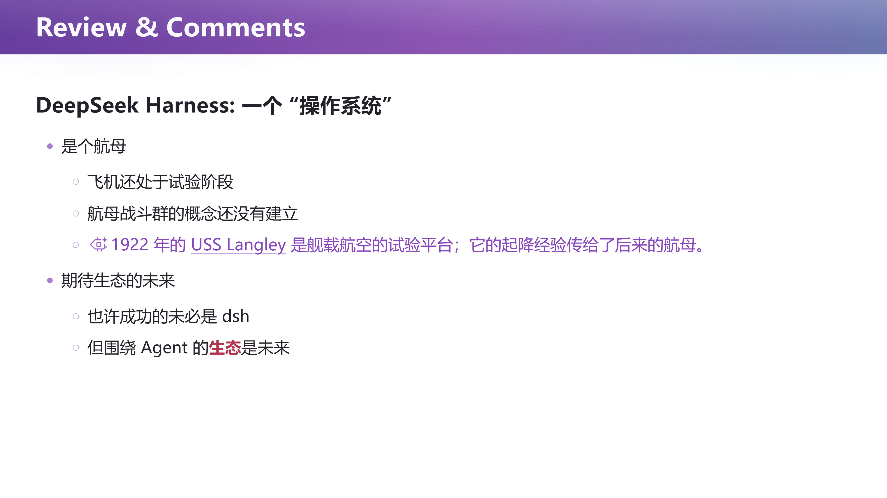

所以他愿意期待生态怎么长大：

> 也许最终成功的未必是 DeepSeek Harness——可能最后活下来的是某个商业公司的产品——**但围绕 Agent 的生态一定是未来。**

一个具体的信号：DeepSeek Harness 好像要发移动端应用了。如果你的 PC 可以长期开机，移动端和 PC 建立通道，**你的 PC 就可以一直在后台工作**——就像 Grok Bot 那样，只不过用的是你自己的 PC。讲者觉得这在中国是一种非常好的模式。

他甚至给了学生一个"许愿式"的作业：在 DeepSeek Harness 上做一个**你的人物画像 / runtime 简历**。因为 everything is a plugin，你可以很容易地监听各个插件的行为、你和插件的交互、插件和上下文的交互，**还能把模型的输出投影下来**：

> 于是你可以做一个叫"实时简历"的功能——**你的简历每天都在更新，但你自己不需要维护它**。

界面可以参考 GitHub 的贡献墙：点开一个人，看到的是一格一格的时间轴，颜色越深表示那天提交越多，摸鱼了就是空白。**"虽然这个也可以作假——我现在这个墙非常绿，是因为提交都是 AI 帮我做的。"**

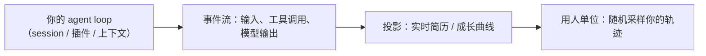

**插件的生态就像操作系统一样。** UNIX 诞生那一刻，做梦也不会想到今天有人会写 `cat`、然后**管道给 `claude -p`**；但这样的用法一直在演进当中——以前是 `too long, don't read` 管道给 pager 查看手册。**这就是生态的未来。**

### 2.2 航母的故事：从 USS Midway 说起

*(参考时间: 00:23:37)*

今天要讲一个航母的故事。造航母很难——中国第一艘航母严格来说也不能说是百分之百国产，是买了苏联的航母改装。

讲者是什么时候意识到这件事的？**2019 年他去了一趟圣迭戈**，那里有一艘航母博物馆：**USS Midway（中途岛号）**，1945 年下水。下水时二战已经结束（日本已投降），所以它没去太平洋战场；但它服役了非常长的时间，1970 年代经历了一次现代化改造，**1992 年还是海湾战争的旗舰**。

他站在同一个位置拍了照，第一个感觉是**非常震撼**：

> 我是做软件的。这样的一个复杂系统，我**不知道是如何能够构建出来的**。

看内部的老照片（基本是 1945 年下水时的状态）就明白复杂在哪：

- 要走**蒸汽**（不像今天大部分是电器，有电就能驱动一切）；
- 要有通信线路，也要有电；
- 更重要的是要做**损管**——航母是战争机器，随时可能被鱼雷、轰炸机袭击。

他在船上遇到的志愿者是当年在这艘航母上服役的老兵。他很好奇：这样的系统出了故障怎么维护？老兵的回答很朴素：

> **这些航母的设计都是那些非常天才的人做的，我们完全不需要知道它是怎么做的。但是每一个人都会得到一本操作手册**，上面明确写了"你遇到什么情况的时候应该干什么"。

就像模拟飞行一样：发现什么地方起火，你就要把**几号阀门**从什么状态改成什么状态。讲者从这里看出：**设计者其实已经推演过各种各样的可能性**，才使得这艘航母能在战争里真正起作用。这也解释了为什么"我们有那么多船，造航母却显得那么困难"。

而最有启发的，是**甲板最底层的一个陈列柜**：从美国海军第一艘航母到今天最先进的航母，一代一代是怎么演化过来的。

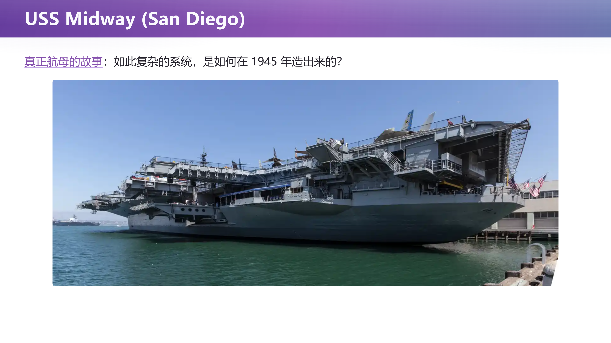

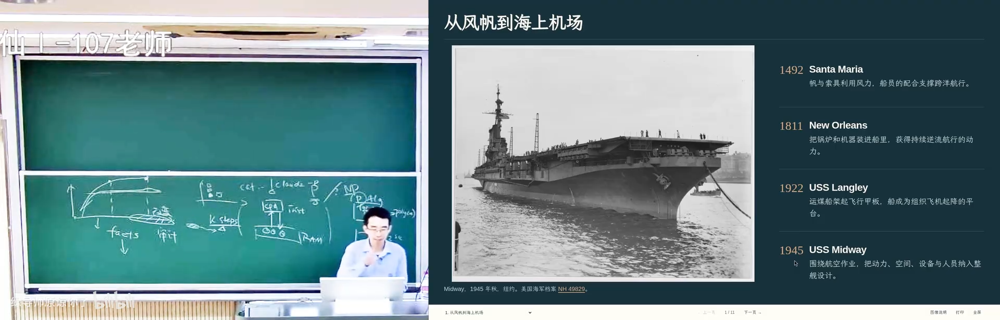

### 2.3 从独木舟到"运煤船改航母"

*(参考时间: 00:27:55)*

把历史往前推：古代文明都有桨船和帆船。在几千年的演化里，人类终于有了足够好的材料、足够多的经验，发现"如果把船造成这个样子，我们就能在海上做长途航行"。

- **1492 年**，桑塔玛利亚号原本是一艘商船，成为哥伦布首次发现新大陆的旗舰——这艘船大家还是能理解的：上面都是机械装置，是**人类可以驾驭的复杂性**；
- **1811 年**，新奥尔良号——高压蒸汽的汽船。**为什么叫"轮船"？因为它的轮子在外面**（今天的螺旋桨藏在水下，看不到）。

讲者在这里给出了一个贯穿全讲的观察：**这些东西都是"平滑演进"的。**

> 人类受到自己大脑的限制和物理世界做实验的限制，任何时候都只能**往前做一个小的 δ（delta）**：发现某个结构有用就加上去，发现没用就减掉。

例子随手就有：

- 古代桨和帆长期并存——桨也有、帆也有；到要远航的船才发现桨没有用了，桨被收掉；
- 轮机、螺旋桨、舵曾经同时并存；终于有一天大家发现"不需要那个轮子了，只要螺旋桨就够了"，轮子就消失了。

所以**弃船（汽船）越来越好，因为它可以挣钱**；能挣钱，大家就会去研究更好的汽船。这就是商业驱动的演化。

然后是**讲者说"那天收获最大的一张图"**：**USS Langley**——美国海军第一艘航空母舰，而且是一艘**试验型**航母。它并不是今天意义上的航母，而是**直接由一艘运煤船改来的**。

- 运煤船看起来很像泰坦尼克号，再往前是蒸汽船（烟囱在这儿），再往前又是平滑的一步……
- 然后有一个"很天才的想法"，又是一个非常小的 δ：**"运煤船能载重，那我们能不能把上层运煤的部分换掉，换成一块木质甲板？这不就变成跑道了吗？"**
- 换句话说：**"能不能把机场搬到运煤船上？"**

接下来是推理与工程：

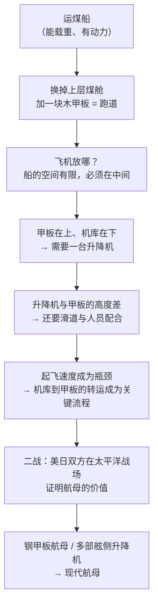

这个过程里有一个很"工程味"的细节：**即使装上了升降机，它降到底的位置和原有甲板之间仍可能有高度差**，还需要滑道与人员配合才能完成转运。**"有这个部件"和"整个流程能工作"之间，总会冒出新的接口问题。**

而演化不只有"大跨越"，也有无数小改动：

- **管线设计**：甚至两根管路谁在左边谁在右边，都可能影响船的可靠性；
- 比如有一根管子通的是**高温蒸汽**，如果保温做不好，就会影响别的东西——第一版设计没考虑到，第二版就改掉；
- 所以既有"把船改成机场"这种**架构级的 significant change**（可以叫重构、加了一个之前所有船都没有的大 feature），也有 **bug fix** 和**子系统重构**。

> 看起来我讲了一个航母的故事，其实我讲的是**任何系统在设计时都会经历的通用过程**。

### 2.4 我们也在造航母

*(参考时间: 00:35:45)*

讲者说"其实我们也在造航母了"，并顺手放了一个链接（"是我在造航母的链接"，属于夹带私货）。他们也想造一个像 DeepSeek Harness 一样的东西：

> 我们大约处在这个阶段：**造出来了一条可以起降飞机的航母**，但它还有很多问题。

他觉得 AI 时代很有意思的地方是：**造航母的方式变了。**

- 以前人类几千年是从独木舟开始——一块木头挖掉一块，人在上面，它就是个船；然后发明桨、帆、舵、各种东西；
- 现在有了一个"能力无限的、有思维链的模型"，你可以**从一个起点直接大跨步往后跳**；
- 你不需要把完整的东西都做出来：**做一个 MVP，原型验证成功以后再回来，重新构造**；
- 这就是 AI 时代的软件开发：**许愿式编程**——先许一个愿，看它造出什么东西；然后再用 1.1、1.1 的严格过程，把每一个东西做好。

他们的承诺是：做一个和 DeepSeek Harness 一样好的操作系统，一个真正的操作系统，同样可以支撑一个生态。

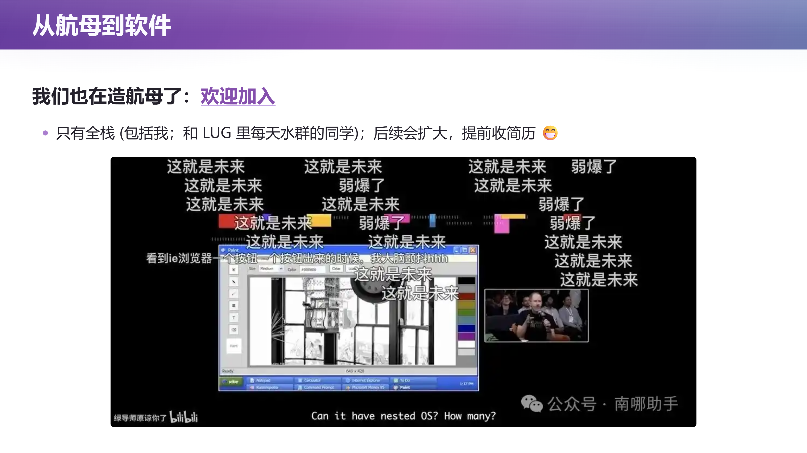

### 2.5 软件的"时间维度"

*(参考时间: 00:38:00)*

**人也是这样的**：你在时间轴上成长，一开始也许没展现出什么，突然有一天领悟了一件事，能力就不断提高。你把那一刻写进日记；三年五年后想不起来，但某天再回想起来，当时的启发又回来了。**人是这样，软件也是这样，任何复杂的东西都是这样。**

软件早期通常只是**一个非常简单的 idea**：

- "我看到一个木头，能不能把它挖掉一块，就能从河这边到那边？"——一句话，你就发明了船；
- "我就是想克隆一个 UNIX，一个免费的 UNIX 供大家用"——这就是 Linux。

**如果这个想法走在正确的道路上、确实能解决真实世界的问题**，你就可以通过刚才那种"往后改造"的方式成功。

但这里有一个陷阱：**过早引入复杂的架构，可能反而约束未来的走向。**

> 每个提前设计的扩展点，都暗含着一个预测："未来会沿着这个方向变化。"一旦预测错误，扩展机制本身就变成了需要维护的负担。

这一点你必须体验过才知道：跟 AI 编程时，AI 会给你设计一些架构，但随着软件维护、每次修改，它越来越难维护；**随着 essential complexity 的增加，一开始那个架构可能就是错的。**

而人类历史上，很多架构经受住了时间的考验，同时也有很多部分被重构——就像航母：从真的**有轮子**的轮船，到今天我们还叫"轮船"、但它**没有轮子**了。

为什么上大学要上基础课？很大原因是：**你要去学习软件系统早期那些设计，以及它怎么随时间演化。**

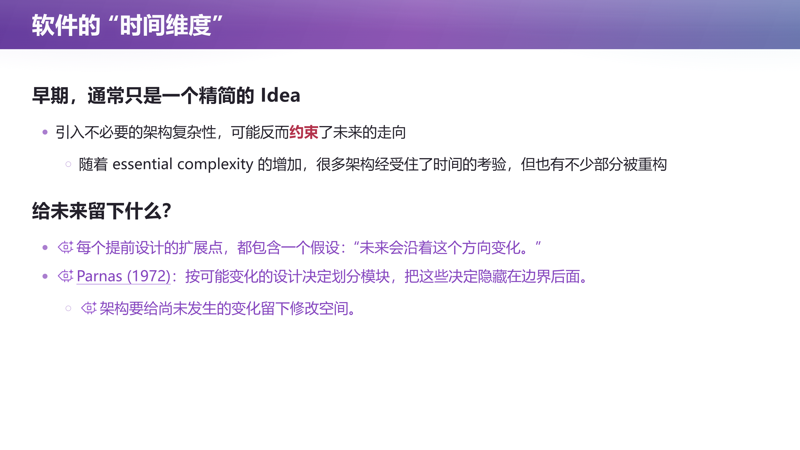

### 2.6 演化：哪些东西容易换

*(参考时间: 00:41:00)*

讲者说，幻灯片里 AI 给的调度器和 Python 例子"并不是很好的例子"，因为**AI 还是没有办法共情**——他想讲演化时，航母显然是更好的例子。但这两个例子依然值得看：

**Linux：调度算法可以被替换。**

- O(1) 调度器 → **CFS**（Linux 2.6.23 进入内核）→ EEVDF（6.6 起逐步引入）；
- CFS 同时引入了 **scheduling classes**，把具体调度策略封装在模块边界后面；
- 这个例子值得观察的地方是：**局部算法的淘汰，也能成为整理架构边界的机会。**

讲者从 Python 2.7 时代过来，感慨说你们入学时就没见过 Python 2 了：

- Python 2 和 3 **不兼容**，其中一个很有意思的语法是 `print` 后面跟空格——`print` 是一个内建语句；
- 这在当时的 parser 上就带来一些小麻烦；
- Python 3 里 `print` 必须是函数，不再是 keyword 性质的东西。

**为什么当年要这么设计？** 因为在第一天设计这个"给人类用的最小编程语言"时，**'print 一定要好用'**——那时几乎除了 print 没有别的功能。**他不会想到今天整个人工智能的生态都安在 Python 上面。**

**Python：已经被依赖的语义很难换。**

- Python 3.0（2008）明确不向后兼容，重新整理了文本与二进制数据的语义；
- Python 2 原定 2015 年停止支持，但大量用户尚未迁移，**期限延到 2020 年**；
- 教训是：**迁移成本要算上所有依赖旧行为的代码**——这些依赖会约束后续设计，而不只是"解释器内部改了多少行"。

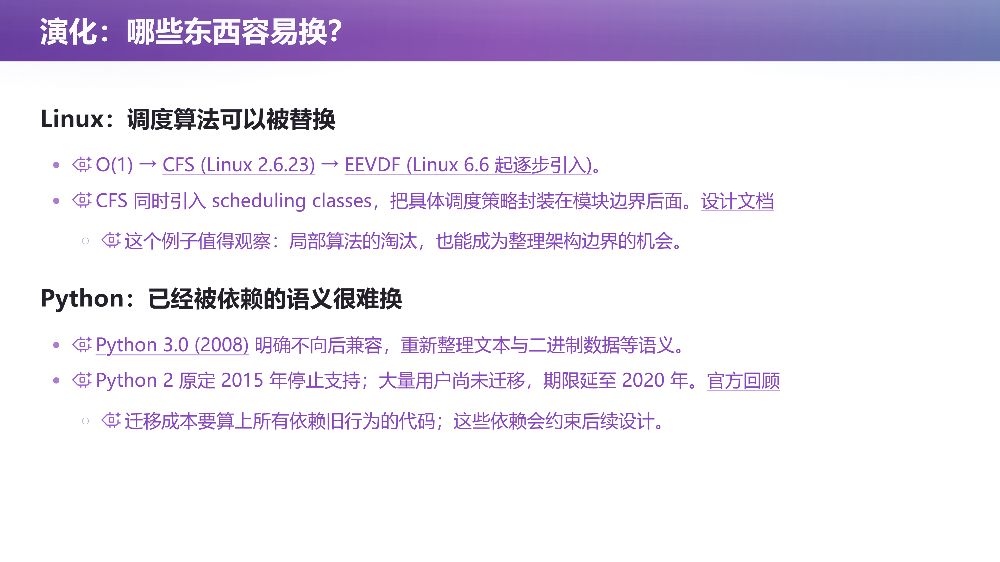

（这一节在幻灯片上还有第三个例子：**Kubernetes——核心与生态一起演化**。核心的 idea 很精简：声明期望状态，controller 反复观察、调整，让实际状态趋近期望；CRD + 自定义 controller 把领域知识带进来；K8s 1.24 移除内置 dockershim，把与 Docker Engine 的适配移到核心之外。课堂上只是带过，这一页没有停留，见文末附录。）

### 2.7 理解复杂软件的两种姿势：简化版本 + 版本历史

*(参考时间: 00:43:20)*

讲者说，我们一直都在用**简化的版本**去理解软件：

- Linux 0.11 真的很简单，什么也没有，没有任何所谓 advanced technology。你们现在学操作系统可能从 xv6 开始，但 0.11 更原始；
- 你们今天上课，老师会说"这个东西怎么牛逼"，但**所有牛逼的东西，中间一定有一个平滑演进的过程**；
- 所以如果你觉得一个很厉害的东西"不知道是怎么做出来的"，**你就回到一个不存在这个东西的版本**——回到独木舟——再看它一点一点是怎么把它加进来的。

他甚至觉得，现在"定义、定理、证明"的学数学方式有点**反人类**：

> 它直接告诉你这个东西，你自己去悟——而没告诉你**人类走了多少弯路、都失败了**，最后才发现这是正确的路线。

回到 Linux 0.11，你可以直接看懂：所谓系统调用，`read` 就像一个函数调用一样进来，执行 A、B、C 三个操作，再回去。而讲者是在 **Linux 2.6** 的时候进入这个世界的；今天的 Linux 已经复杂到人类自己也理解不了，但他理解问题时**经常回到 2.6**：

> "如果在 2.6 里我要做这件事，我会怎么做？这么做好在哪、不好在哪？那我今天应该怎么做？"

更妙的是，**绝大部分问题都可以回到 0.11 的模型上问**。他给了自己的课堂例子：

- 我要向操作系统要一些信息，**是不是一定要穿过操作系统的边界**（做一次系统调用）？
- 有没有可能让操作系统和应用程序**共享一个页面**：OS 每秒写一次时间，进程切换时把当前 CPU 的 id 写进去，而应用只读不写？
- 这件事在 0.11 里就能想清楚，然后再把它"往后 rebase"成今天的一个 feature。

于是就有了那个很漂亮的方法论：

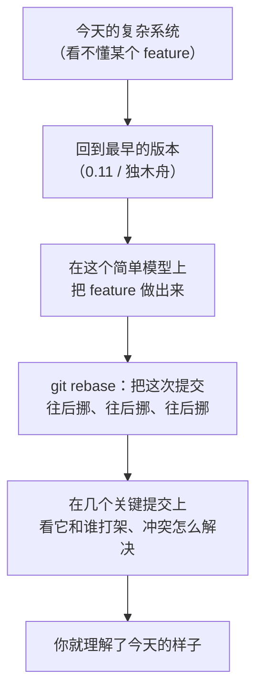

为什么这个方法有效？因为**如果所有东西都搅在一起，你的软件就不可能维护**。好的架构一定把复杂性分解下去了；你新加一个 feature，它跟软件的绝大部分耦合都相对比较松。所以你只需要知道**在几个关键的提交上，你的 feature 和谁打架了**——那就是你必须理解的 essential complexity。

他顺带解释了"为什么 Pre-LLM 时代说程序员有三大浪漫"：做一个操作系统、一个编译器、一个数据库（也可能是做一个 CPU）。**今天这个答案变了**：

> 你们看所有投 AI infra 简历的同学都说："我在 nanoGPT / nano-vLLM 上改了一个东西"、"迁移到多卡上"、"我有几块树莓派或者 RK3588 那种带 NPU 的卡，做了并行推理加速，然后接入了一个我魔改过的 nano-vLLM"。

**这些事情都是有意义的**——"但是你们可能没有意识到你们在做"。讲者说，他把"造航母"和"你们学习"**都用同一个 git model 解释了**。

### 2.8 到了"今天"：仍然是状态机

*(参考时间: 00:48:00)*

讲者再次强调这是人类的局限：

> 人类只能理解简单的东西，而演化其实就是人类把一个东西一点一点造出来的过程。如果航母、软件就摆在你面前，**没有人能看懂**——尤其是新入局的新手，你会感到无尽的复杂性。但你可以通过理解它的发展历史，**rebase 你想要了解的 feature**，来理解任何东西。

而在"今天"这个时间点上，软件依然是**状态机模型**：

- 一个版本是一个状态；
- **fix、feature、chore、refactor**……都是让项目进入下一个状态的动作；
- 一次修改能否成立，要看它如何改变已有行为、是否仍满足必要约束。

也正因为有了计算机，**我们才第一次能把"人类创造一个东西"的过程从初始状态完整记录下来**——`git history` 就是一个宝藏。讲者由此抛出一个更大的想法：AI 时代，作为"还能守住人类最后一点创造力"的人，是不是应该去干更大的事？

- 能不能把**数学的发展史**构建成 git？
- 能不能把**造船、造航母的历史脉络**构建出来？
- 能不能把人类知识历史里"分支之间的 rebase 关系"整理出来？

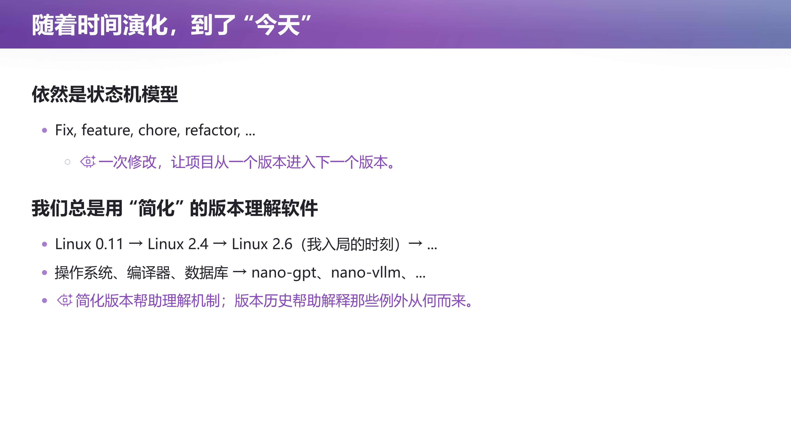

### 2.9 从"小事"到 SWE-bench

*(参考时间: 00:50:47)*

讲者把这一讲的落点收在一个推论上：

> 所有的东西都是由**一个一个提交**组成的，而**每一个提交都是一个小任务**。

这是一个非常关键的假设。小任务就意味着：**绝大部分提交都是 bug fix 或者小的 feature request。**

那自然要问：**AI 能不能完成这些小事？**

**SWE-bench** 是整个系列里知名度最高的工作之一（现在还有更长的，比如 terminal-bench）。它衡量的是：模型在软件工程这种 GitHub issue 任务上表现得有多好。

有意思的是它的时代背景：这是一篇 2023 年的论文，GPT-4 时代。你看它的输入还是"模型输入"，而**不是 workflow**——那时候没有 agent 能真正跑起来。它的输入包括：model input、issue 是什么、一个 **golden patch**、一个 **generated patch**，以及一系列**测试用例**。

讲者也坦言它不完美：

- 他们仔细研究过 SWE-bench，它**绝对不是一个完美的 benchmark**；
- 很多"fix a bug"的任务，bug 的引入其实是因为代码**源头上设计出了小问题**，以至于要不停修修修；如果他是人类，更倾向于**重构那段代码**，而不是 fix 这个 bug；
- 但不管怎样，这是一个**明确的任务、明确的反馈信号**，可以评估"这件事做对没有"。

于是它成为衡量"模型做小事的能力"的标准。而它的历史数据相当惨烈：**早期 Claude 2/3 的 resolve rate 只有 3.779%**（当时 Claude 在 OpenAI 如日中天的时候，只能声称"在某些垂直领域做得好一些"）。

但讲者认为这篇工作最有 vision 的地方**不是分数**：

> 它的意义在于：**做这种小事，在软件演化里的价值有多大**。

因为在演化路线里，**绝大部分任务都是小事**——从 GitHub 上某种意义上 random sample 出来的，多半是"我今天程序 crash 了，你帮我修了"、"这个日期计算没算闰秒，我想加一个星期"、"这个功能能不能做个小改进"。你日常开发，绝大部分时候都在干这件事。

所以：

> **如果有一天 SWE-bench 被解决，就意味着工程里绝大部分琐碎的事情都被解决了。** 这也隐含了一句话：**低级工程师就被斩杀了。**

它预见了今天我们大家都非常焦虑的情况。但它也留下了问题：**SWE-bench 没有覆盖什么？**

- **初始状态**：在 initial commit 的时候，你总有一个计划——"我们要造航母了"，脑子里有一个想法，于是建一个 repo、放一个 initial state、放一个计划。**这件事不好 benchmark**；
- **架构级的重构**：当软件到某一个程度，你终于受不了那些琐碎的 bug fix，开始重构。重构意味着架构上的变化（可能是局部的，也可能是总体架构）；
- 讲者举了实例：他们见过一个代码写得像 slop、逻辑非常复杂——**根源是两个模块没有解开**，写代码时必须带着那两个模块的状态；他们的办法是**把整个模块一起重构**，重构完 bug 就消失了，那个 issue 根本不需要被 fix。

架构变化的成本有多高？他举了"把某大型项目从 Zig 全部迁移到 Rust"的例子：

> 这是非常疯狂的事情，"竟然没有出笑话"。当时我的感觉是：这可以吗？这不会留下两个非常糟糕的 bug 吗？——没有。当然也跟项目结构有关；如果你去动 MySQL 这种，我估计就不行了。

而且架构有很多层：**顶层设计架构**、每个代码文件里的架构、甚至一个函数里到底写 functional 还是 imperative 的**微架构**。任何相对较大的、到 subsystem 级别的架构改变：**它什么时候发生？它应该什么时候发生？到底什么样算好？**

**这些在人类世界里也非常稀疏。** 而稀疏就意味着：**模型没有办法通过大量反馈和样本学到它**。但人类是很好的 **few-shot learner**——讲者说，他在圣迭戈看到航母时想到了一件完全不相关的事，展开了非常长的思维链，刷新了自己的认知。

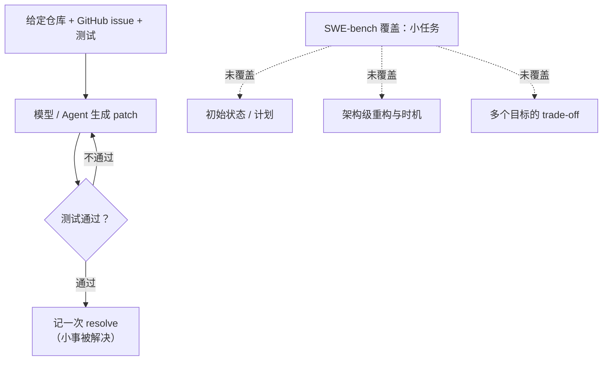

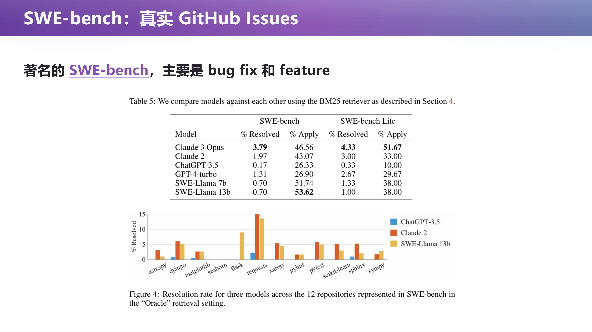

### 2.10 从解题能力到 Taste

*(参考时间: 01:00:50)*

到 2025 年 7 月，**mini-SWE-agent 已经在 SWE-bench Verified 子集达到 65%**（不同子集与运行设置要分别看待，不能把这个数字当作所有工程任务的成功率）。由此产生一个关于 scaling 的直觉：

> 只要某个 benchmark 已经"有一点点希望够到"，持续投入模型能力、训练和工具，最终很可能把它攻下来。

他甚至讲到刷分的"间接泄漏"：现代模型如果要刷分，不会直接把测试用例漏进训练，而是把"方法"漏进去——比如"遇到 SWE-bench 类型任务要疯狂自己写测试"，这样分数就能高一点。

但当"小事"都被解决之后，问题变成：

> **现在我们需要一个足够好的 taste-bench 了。**

因为在小事上，反馈是明确的：**做完了 / 没做完，对了 / 错了**。而到了"大事"（架构决策），强化学习的反馈**非常稀疏**，而且**并不是谁比谁好**：

- Linux 当时那样做一个 UNIX 可能就是最好的吗？后面还有更多经验；
- 重构的时候有多个可能的架构：要不要用 event sourcing、干脆把底层架构也换了？还是加一层缓存？还是用 scale 的方式解决性能问题？
- 我们面临很多选择，而**每一个选择都不是严格"谁比谁好"**。

就像高考：几张试卷，每张一个总分，加起来作为你的总分。**但这里其实很微妙**：

- 不同科目代表不同类型的能力，甚至不同题目都代表不同类型的能力；
- **你的画像是一个 vector**，而不是一个标量；
- 也许需要一个 **human vector**：根据你的 AI trajectory 得到真实的画像；
- 尤其对真实项目来说，我们需要的是 **trade-off**：架构大改成 event sourcing，重构代价变大、风险增加；想降低风险就要把改动做平和一点，但工期就拉长，这次迭代可能到不了目标。

> **当你面临十几个目标要权衡的时候，其实没有绝对的好和坏。** 这也是现在 AI 做这件事还做不好的原因。

所以 taste-bench 不能是 Yes/No/Score，而应该是**多维度的相对比较**：

- 给两份**都能通过测试**的实现，放在相同需求下比较：谁更贴合问题？谁更容易理解？**下一次修改有多贵？**
- 再给一个后续需求，**观察原来的优劣是否反转**；
- 比较判断有很长的历史：Thurstone（1927）就研究过如何从成对判断中度量难以直接计量的属性。

讲者的判断是：**小事已经解决了，大事我们还需要一个 taste-bench。** 而像"解数学"这种事，可能已经不是小事了——它已经涌现出我们无法理解的能力。也许下一个 benchmark 出现的时候，"我们就可以见证人类的末日"。

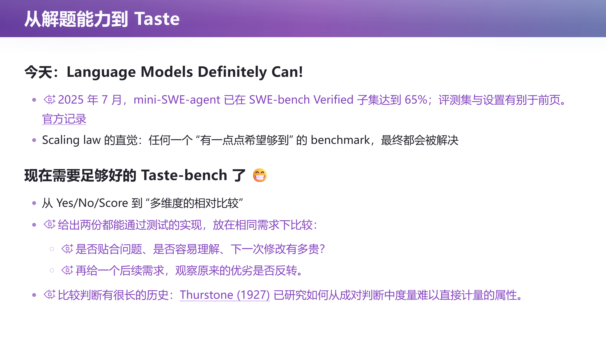

---

## 3. 回到 DeepSeek Harness：从提交历史里学工程

*(参考时间: 01:04:33)*

### 3.1 1000 个提交就是一部航母建造史

*(参考时间: 01:04:33)*

讲者说"DeepSeek 还是太慷慨了"——它把**从第一天起的所有提交**都给你看，于是你能看到整艘航母的构建过程。

他拿到 DeepSeek Harness 后干的第一件事，就是整理它的提交：**最早的 1000 个提交**。

- 初始化就相当于航母的 **initial state**：当他真正决定造航母的时候，就有了起点；
- 刚开始是做一个 MVP：微内核、需求和架构的场景；
- **第四个提交**就以源码形式 vendor（内联）了 **Cordis** 的框架包。

这里有个很有意思的事实：**Cordis 在 DeepSeek Harness 之前已经存在好几年了**，而且它其实是一个**个人项目**——那位作者当时想要管理他的一些 QQ bot 插件，发现每次加载、卸载都很麻烦，于是"干脆做一个架构吧"。

> 他也经历了一个过程：一开始管理插件没有任何章法，**然后突然有一天他发现了一个方法**——这个发现就很重要。

于是原始的几个架构设计 commit 成了很重要的东西，最终形成了 Cordis；而 DeepSeek Harness 在第四个提交就实现了对 Cordis 的 merge：**everything is a plugin**。接着它开始大量实现：先做 LLM inference，再做 agent loop，然后 1.1、1.1 一点一点往前。

**所以你看：每一步都是小的。**

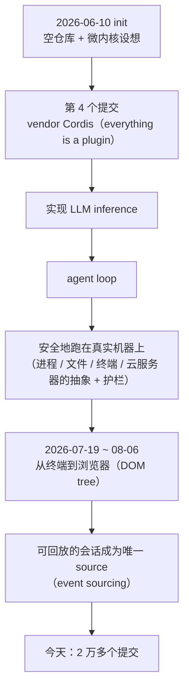

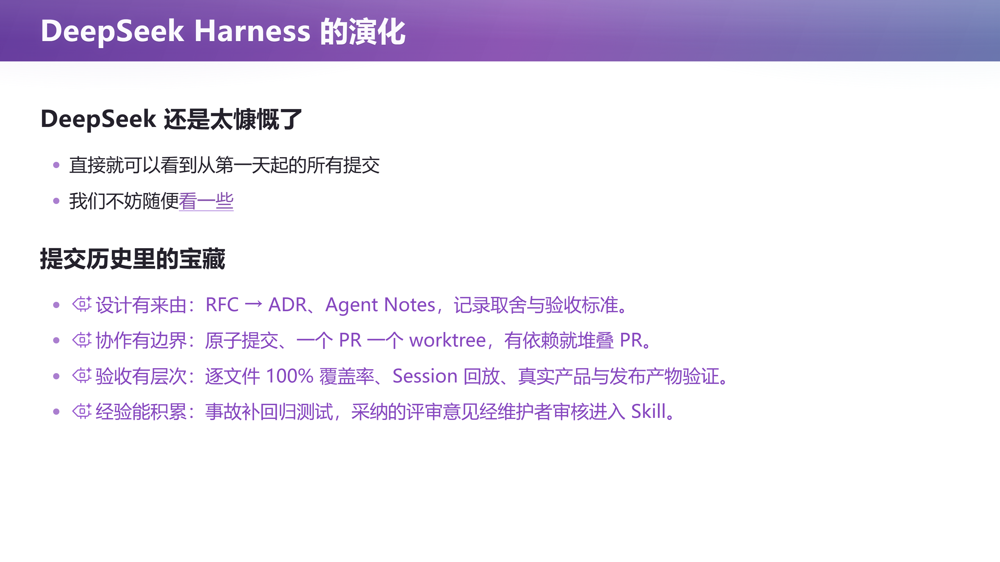

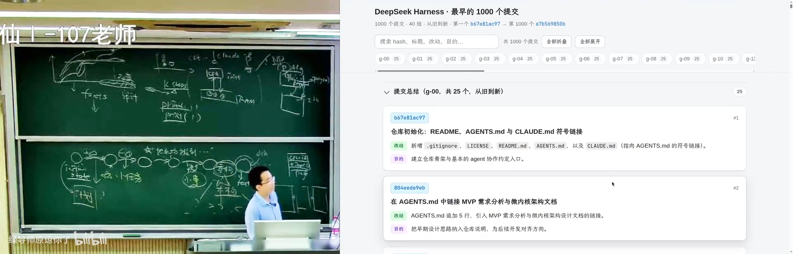

讲者现场还让 agent 把这些提交总结成"航母式"的时间轴，结果 agent 真的打了一个航母的比喻（"这是我不想要的"）：

- 2026-06-10 到 06-20 十天：**把可回放的会话做成唯一的 source**；
- **把 agent loop 与适配器分离**；
- 把一个"能跑的循环"变成"在真实机器上安全地跑"——**不是新增多少工具，而是把进程、文件、终端、云服务器做成抽象**，并增加护栏（超时、取消、溢出……）；
- **7 月 19 日到 8 月 6 日：从终端到浏览器。** 这是一个非常重要、也非常重要的决定——一开始他没想到：如果用浏览器这个框架加上一棵 **DOM tree**，会让界面变得非常容易扩展。

讲者认为这个比喻"还是有点对的"：一艘船是很通用的（可以载货、载人），放上一块外部甲板，就变成了可以试验各种飞机的航母。**这就是飞行甲板的那一步。**

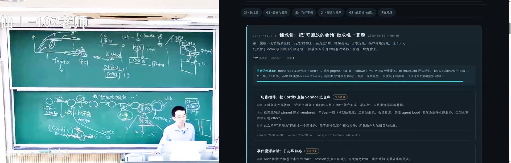

当然他也承认这肯定有问题：如果真的一条条看提交，还会漏掉很多有趣的东西。

### 3.2 设计有来由：RFC → ADR → Agent Notes

*(参考时间: 01:11:18)*

他让 AI 从提交历史里总结"演化里的工程实践"，第一条就是**设计有来由**：从 **RFC** 到 **ADR**，再到 **Agent Notes**。

**RFC 是什么？** 你们都知道网络中那些 RFC（Internet 协议的文档）。它的字面意思是 **Request for Comments**——一种**草案**：

> 如果我要做一件重大的决定——比如"我要不要把 TUI 扔掉"、"我的 event bus 应该怎样设计"——那我是不是应该先放一个 RFC 上去？

因为**每个人都有假设，做这种重大架构决策的时候，他可能是错的**。所以先放一个 RFC，内部几个小团队开始讨论。

讲者说他们自己也这样做：放在飞书上、一个共享文档，大家先 comment；需要开会就坐在一起开个会；讨论完之后，**甚至可以直接做个 MVP**。

> 现在比以前好：以前开发成本很高；现在我们一旦有一个想法，就可以直接扩展一个、另开一个分支，看效果；效果不好就把所有东西都砍掉，回头再慢慢来。

讨论收敛之后，就写成一个 **ADR（Architecture Decision Record，架构决策记录）**：保存**最后的选择以及理由**。

现场演示里有一个很好的具体例子：

- 一开始，**system prompt 存在 request header 里**，其他消息存在 session 的事件里；
- 后来出现一个需求：**支持在对话中途替换 prompt** 的模型——这需要往历史里追加一条 `system` 角色的消息；
- 但"prompt 在 header 里"的架构**没有办法**解决这个问题，于是就需要一次**架构重构**。

这个重构比起"在航母上加一层飞行甲板"要小一个量级，但**对于上下文管理这个 subsystem 来说，也是一个非常重要的设计决策**。而当时代码是不改的（"大家讨论这个东西应该怎么样"），9 月 5 日再进入 **implemented** 阶段——**这里有一个状态机**：不确定的、需要长时间运行的任务，会有一个 agent loop 的状态，这个状态也在整个 git repository 里。

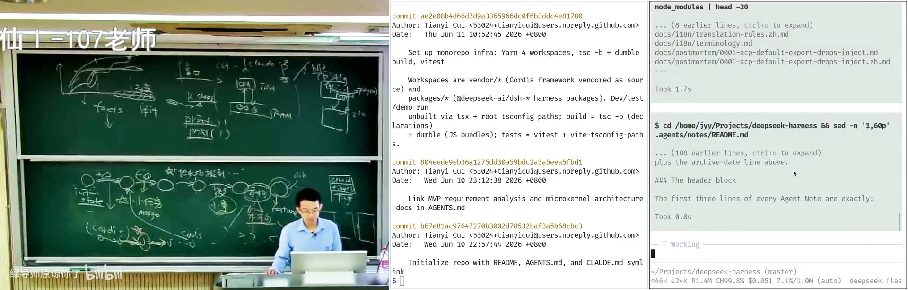

### 3.3 协作有边界：原子提交、一个 PR 一个 worktree

*(参考时间: 01:16:07)*

第二条是**协作有边界**。现场看到的提交数量令人印象深刻：

> **两万两千个提交。** 每一个都是一个小提交。

讲者感慨："以前我们要做这件事要写多少脚本？"——写一个脚本，还很自作聪明地用人脑计算机去想该 grab 什么、然后 word count……"我们发现这么多生命都浪费了。"（他也承认，某种程度上那是防止脑子生锈的练习——"当你打开编辑器的时候，你就是程序员"。）

他们的协作模式是**演化出来的**：

- 团队小的时候是 **linear history，没有 merge**——好处是每一个提交都是单独的、可理解的；
- 但如果以后有 external developer，就会变得非常麻烦：每次 main 动了，所有分支都要 **rebase**，rebase 以后要触发所有 CI 流程。

幻灯片上的总结更完整：**原子提交**让一个逻辑变化能够单独理解和检查；**一个 PR 对应一个 worktree**（同一 Git 仓库的独立工作树），让不同任务各自修改、安装和测试；**有依赖的工作组织成堆叠 PR**，让上层建立在下层修改之上。

不过讲者也提醒**隔离的边界**：在课堂材料里，DeepSeek Harness 曾遇到"在一个 worktree 里安装 Git 钩子管理工具 **Lefthook**，却影响了其他 worktree 的 hooks"的问题。

> **目录分开了，不代表所有底层状态都分开了。** 工程规则也要通过实际故障检验。

### 3.4 验收有层次

*(参考时间: 01:17:28)*

第三条是**验收有层次**：

- **逐文件 100% 覆盖率**：可以推动开发者处理错误路径与清理逻辑；但**执行到一行代码，不等于它的行为已经正确**；
- **Session 录制与回放**：固定模型响应，可以检查组装后的事件、持久化结果和用户输出，也**避免每次回归都依赖真实模型服务**；
- **真实产品入口与发布产物验证**：从源码运行正常，不代表安装包带齐了 worker、资源和依赖；**在错误端口上打开一个页面，也不能证明刚修改的 GUI 已经生效。**

### 3.5 经验能积累

*(参考时间: 01:18:00)*

第四条是**经验能积累**：

- 一次事故可以留下**复盘、修复提交和回归测试**；
- 被采纳的评审意见可以整理为**候选规则**，再由维护者审阅并更新 **Skill**；
- 这样下一位开发者或 Agent 不必完全依赖记忆。

但讲者马上补了一句冷静的话：**规则也会积累负担**——所以 Agent Notes 要归档、重复要求要清理、检查要考虑运行时间。**流程本身也是软件演化的一部分。**

### 3.6 把"不好"挡在项目之外

*(参考时间: 01:17:50)*

> **但是，所有这些由人类保证的东西，都没有办法阻止 AI 生成 AI slop。** 谁用谁知道。

AI 一定会这样：只要你不说清楚，它有两种反应——

1. 如果你用了那种"grill me"式的技能，它就疯狂地问你、一遍一遍问，问到你不耐烦为止；
2. 如果你不说，它就猜，然后想着完成任务，去做很多**不必要的测试和验证**——因为你要做的事情本来是实验性的，它没有你的上下文，做了很多东西，**让维护和修改变得非常复杂**。

所以最终，**这个项目还是由人来驾驭的**。人显然不可能在短时间内做成这么大的东西——**"相当于极速造航母"**。而为了防止 AI 毁掉整个项目，他们做了很多事：

**第一，文档的一致性（上一讲的双语文档）。**

- README 有中文、有英文，两个文档**严格保持一致**；
- 靠一个"我觉得很脏"的 YAML 文件来处理；
- 起到了效果——至少阻止了文档不一致——**但也付出了代价**：repo 膨胀了，一大堆意义不明的 YAML 文件；
- 当然可以在 IDE 里配置"不显示这些文件"，眼不见为净；"但它实际上是存在的"。

由此他再次强调那个观点：

> **软件项目不应该用目录来存储。** 软件项目里有很多复杂的东西，它们之间是有关联的；我们应该把这些**关联**存储下来，而不是……当然我现在用 YAML 来存储这些关联，但用文件可能只是一个 work-around。

**第二，生产"与人类对齐"的好代码——没有好办法，只能一个一个强行排除。**

> 我们没有办法真的阻止 AI 生成 slop。那么我们就想：**AI 会生成什么样的 slop？给它写一个验证器。**

在 commit 的时候、push 到 remote 以后、或者每日 run 的时候，去检查"AI 有没有犯什么错误"；如果犯了，就阻止这次提交。

**一个意外插曲**：他在 DeepSeek Harness 项目里让 agent 总结"里面的 gatekeeping 是怎么做的"，结果因为工作发生在 dsh 项目中，**Agent 自动触发了 dsh-prose-standard skill**——生成的说明也受到该仓库文风规范的影响，之后他又加入了一些引导提示词。

> **同一个写作任务，仅仅换一个工作上下文，就可能被另一套规则塑形。**

这个 skill 是"文字编写的规范"，有点 un-slop 的感觉：**删掉推理过程、重复和修饰**。

为什么这件事重要？讲者讲得很透：

- 如果你用 AI 写文档，它会把思维链里的东西——"这个东西要这样设计""怎么验收"——**什么都写进文档**；
- 于是你写一个文档，说"我做了 A、做了 B、又不是 C"；**这些 A、B、C 实际上都和实现（比如 `index.ts`）关联起来了**；
- 当实现改掉的时候，**文档和实现就必须同步修改**——它引入了同步修改的代价；
- 更糟的是：AI 编程迭代几轮以后，A 和 B 可能真的没有了、代码里也删了，**但那个"不要 C"却被错误地留下来了**。很多不该留下的东西，在软件演化过程中被留在了 repo 里。

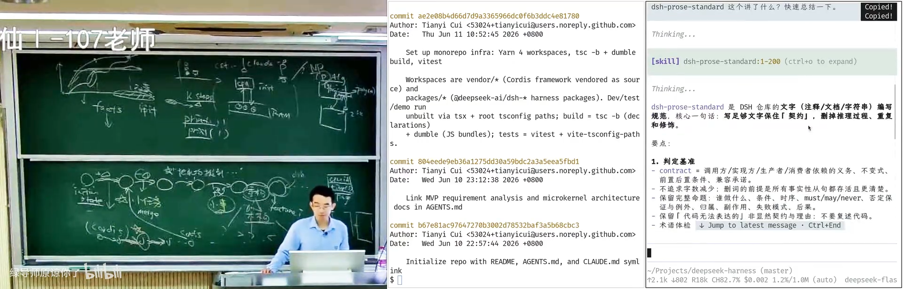

**第三，七类检查器。** 讲者带大家看 DeepSeek Harness 里的 checker，一共**七类**：

- 代码与类型；质量；架构与依赖约束；行为正确性；持久化与兼容性；文档、构建、交付与评审；以及测试。

首先是**所有项目都应该用的** lint 与类型检查机制——"虽然你们可能不用"。它可以把很多低级错误挡在门外：

> 虽然模型能力很强，但不代表它不会犯低级错误，尤其是在比较大的代码库里。

具体例子（都是现场从规则里翻出来的）：

- **改了接口，所有调用方必须一起改**——编译器本身可以找到；还要检查"所有东西都能编译"；
- **新增的不同用途的 id 不能混用**（不能因为都是字符串就混用）；
- **同一份代码遵守同一套 lint 规则**；
- **类型安全与异步正确性**：检查丢失的 Promise、异步不回收、危险的断言、`@deprecated`；
- **禁止 `unsafe`**：对 hobby project 来说任何不安全特性都能用；但在严格的项目里（比如某些包不允许引入 unsafe），Rust 可以加一条规则禁止你使用它——于是**你第一次实现、或者 agent 做实验性实现时可以用，但它永远不可能通过 lint 检查、推到远端**，必须再改再改，直到做好；
- **`no-unused-variables`**：这是非常有用的规则——"你们都写过 `for (int i = 0; ...)` 里定义了 j、然后 `j++` 的状况"，未初始化/未使用，编译器和 lint 都能帮你找到；
- **prefer const**、**no unused expressions**、**作用域检查**；
- **每个非第三方的导出必须有 JSDoc**；
- **禁止硬编码 UI 文案**；
- 还有一些与项目本身绑定的检查：runtime、closure、climb domain graph、Cordis config……

讲者说："我肯定没有办法在课上一个一个讲过来"——因为它和具体项目、具体语言绑定，讲起来会很枯燥。他展示的更多是一种**方法**：

> 如果你遇到一个你感兴趣的项目（比如你是做 bioinformatics 的，真的要靠它拿到 PhD），就用我的方式来打开它：**总结它的文档质量保障是怎么做的、总结它的提交、把它化成一条 commit 时间轴。**

**第四，门禁分层。** 在整个流程里：

- **pre-commit** 时做一系列检查，包括 i18n 配对——中英文文档必须一致，如果 commit hash 对不上，pre-commit 直接拒绝；
- **pre-push** 时做 type check；
- **CI** 时做更复杂的检查。

还有一个很有意思的**控制流检查**：

> 我要求**所有的控制流都是由我的插件发起的**。这样如果 agent 不小心写进一个硬编码的函数调用，我就可以把它拒绝掉。

这背后的取舍讲得很清楚：

- Agent 有时会把一个功能**完整实现一份**，然后在你的代码上加一行函数调用直接调过来，**第二天就回来破坏了你的架构**——因为它没有遵循架构约定；
- 你可以在提示词里写"请严格遵循我的架构、所有东西都要这样用"，但**这句话对人是没有意义的**——你做了一个干净的架构，默认所有人都会遵守；
- 写进去以后可能让指令遵循更好，但会让文档变得人类更难读。**你总要做这样的取舍。**

其他规则还有：浏览器代码不能无意间依赖 host 实现；浏览器应用请求相对当前文档解析；网络调用不能悄悄绕过用户代理；窗口更新应该怎么处理……

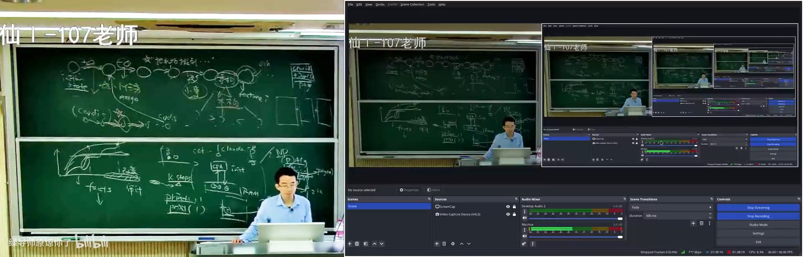

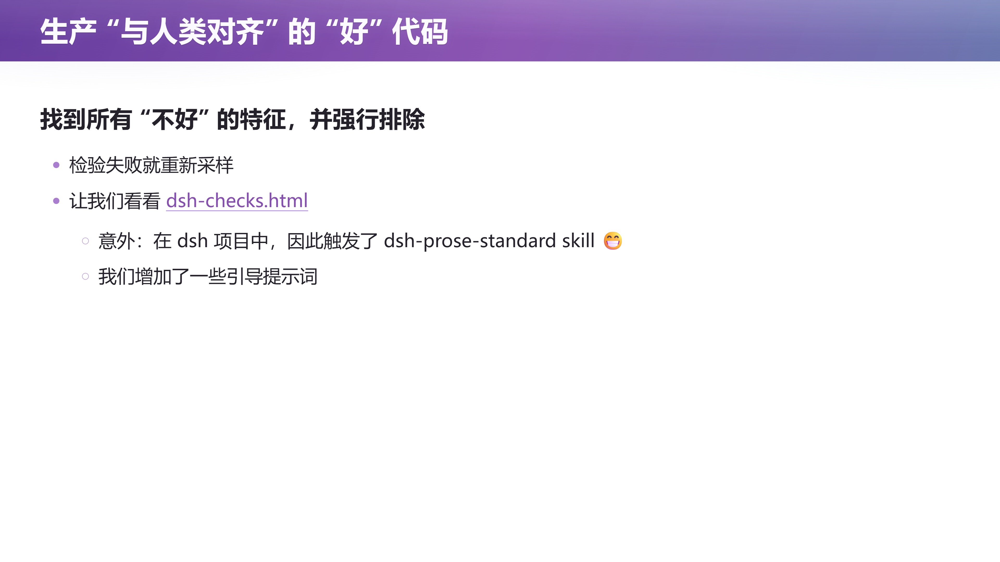

### 3.7 排除了坏答案，还没有学会什么是好

*(参考时间: 01:30:50)*

虽然已经尽了最大努力，DeepSeek Harness 也尽了最大努力，**但还是有很多问题没有解决**：小事已经解决了，大事我们还需要一个 taste-bench。

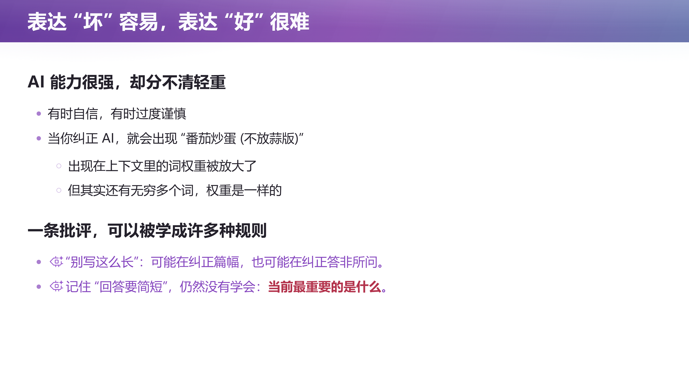

**AI 今天能力很强，但它分不清轻重**：

- 有时**过分自信**：它觉得搞定了，其实没有达到我的预期；
- 有时**过度小心**：这件事其实不用那么小心，但它做了非常多的测试；
- 而如果你去纠正它，**糟糕了**——你但凡说"不要这样"，它就会把"不要这样"写进文档：先在文档里写一份，在代码里再写一份，注释里再写一份；不断膨胀的上下文又会不断抢夺它的注意力。

于是有了那个绝妙的比喻：**"番茄炒蛋（不放蒜版）"**。

> 你纠正"不要放蒜"，本意可能只是让它自然地给出合适做法；它却把这次纠正变成了**标题里最显眼的内容**。接着纠正香菜、韭菜、辣椒，就得到"番茄炒蛋（不放蒜、不放香菜、不放韭菜、不放辣椒……）"。

为什么？讲者的解释是一个**解释性比喻**（不是对模型内部权重的测量）：

> **每一个出现在上下文里的词，都会在模型眼里被认为是非常重要的。** 但其实这个世界里还有无穷多的词——"不要放韭菜""不要放蘑菇"——它们和"不要放蒜"**理论上权重是一样的**，只是我没有写进去。模型不理解它们之间的重要性。

**一条批评，可以被学成许多种规则。** 比如"别写这么长"：

- 可能是在批评篇幅，也可能是在批评**答非所问**；
- 模型若只记住"回答要简短"，下次可能删掉真正需要的解释，**却继续回答错误的问题**；
- 某套去除套话的规则在一种语言中有效，换到中文也未必仍然奏效。

这里讲者拿出了他的老本行：**程序合成（program synthesis）**，以及其中一个核心方法 **CEGIS（Counterexample-Guided Inductive Synthesis，反例引导的归纳合成）**——它和今天我们用大模型的方式很像：

- 我有一个 spec：`F(1) = 2`、`F(2) = 3`、`F(3) = 4`；
- 模型生成一个 `λx. x + 1`；
- 我再给一个反例：`F(4) = 6`；
- 模型再生成 `if x == 4 then 6 else x + 1`；
- ……于是就有了那个公式：

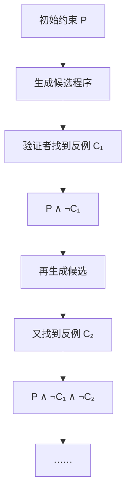

> 所以"番茄炒蛋不放蒜"**是一个很糟糕的提示词**：你说了"不放蒜"，就意味着"不放香菜、不放韭菜、不放辣椒"同样重要——**而那个 high-level 的 guideline 其实还不知道。**

他还给了一个**极小但致命**的例子：

> 在无界整数上找一个 k，使所有整数 x 都满足 x ≠ k。

每次验证者拿出反例 x = k，生成者就换一个尚未出现过的 k——**它总能通过此前积累的有限反例，却永远完成不了目标**，因为目标本来就无解：对任何 k，都可以取 x = k。

这个例子（改写自 Solar-Lezama 的课程）说明：**你需要检查搜索空间和目标，而不只是"又排除了一类坏情况"。**

更常见的困境是：**答案并非不存在，只是我们一直困在错误的表达方式里。** 这正是水罐实验（Luchins, 1942）要说的：

- 连续练习"能用 B − A − 2C 解决"的题目，会让人形成**解题定势**；
- 现在给三个无刻度水罐：A = 23、B = 49、C = 3，要求量出 20；
- 熟悉的办法：49 − 23 − 2×3 = 20；
- 更直接的办法：**23 − 3 = 20**。

> **旧办法依然答对**；而"继续改良它"的反馈里，未必会出现发现新办法的线索。**局部修改无法逃出已经进入的陷阱——我们需要设计空间的跳跃。**

对应到 AI：只问"怎样把这份答案改好一点"，就可能一直把"换一种答法"留在搜索范围之外。对于代码也是如此：不断给原方案增加分支，可能永远比不上**重新划分状态或接口**。

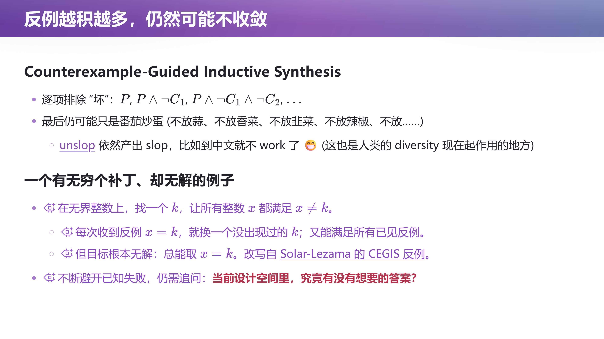

### 3.8 "蒸馏我自己"：为什么还没成功

*(参考时间: 01:36:50)*

最后讲者分享了一个**非常贴身**、而且**到目前为止仍然失败**的实验。

问题是这样：

> 我有**所有我回复过的 email**，应该如何用好？

他发现：把回过的所有邮件都放进上下文、说"你就照着我的风格来"，**模型也做不对**；"模型没有提炼这种东西的能力"。于是他想做一个**递归自我改进（recursive self-improve，RSI）的 loop**：

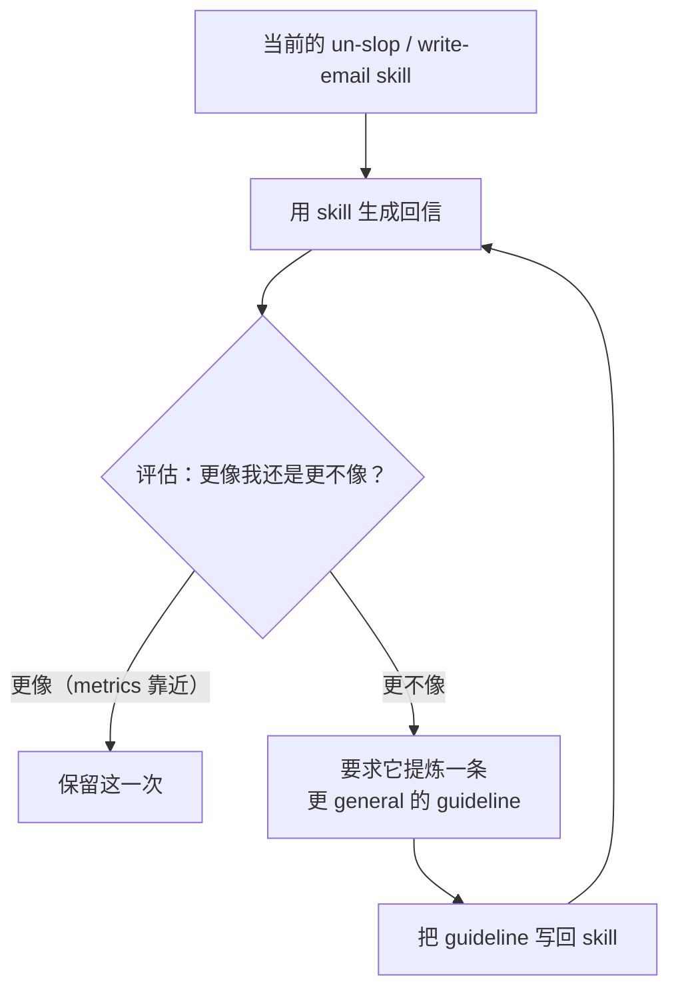

评估怎么做？他说得很具体：

- 他有很多**人写的文稿**和回信，可以算出**回复有多长**；
- 还有一些**统计信息**，比如词频、句子长度、标点使用；
- 然后给模型一个 prompt：**"你可以 evaluate"**——用这个 skill 去改写我过去回过的所有邮件（但不许看我的原回信），算出每一个 metric 是**离我更近了还是更远了**；
- 更近就留下；更远就要求它**提炼一条 general 的 guideline**——"不是'不要用 not X but Y 这种句型'这种具体的规则，而是一条**覆盖更广**的原则"。

> 比如"不要蒜"的本质到底是"不要无关的东西"，还是别的什么？能不能把一个 guideline 的 principle 加回到 skill 里，让它的品味提升？

**但今年还做不到。** 讲者说这仍然是失败的、没有收敛。

他提出了一个可能的解释（仍然是推测）：**邮件保存的是"最后怎么说"，未必保存"为什么这样说"**，更没有完整保留那些被放弃的选项。同样一句简短回复，可能来自事情很简单，也可能来自双方已经有充分共识；**只模仿表面形式，会丢掉决定形式的条件**。

一个值得验证的方向是：**让同一封来信对应几种不同回复，比较各自的取舍理由**，再用没有参与"加规则"的新邮件，检验这些取舍能否迁移。但这还不能作为已经成功的方法来介绍。

他最后落到一句很诚恳的话：

> 目前模型的"悟性"仍然不够：我们能够越来越精细地**排除已知错误**，却还没有因此获得一个**知道何时应该打破惯例、重新选择方向**的自己。

而他相信——因为今天讲的这条"人类的过程"是可同构的：

> 有没有可能我们有一个 self-improve 的 loop，最终能**把小事干好的同时，也把大事干好**？

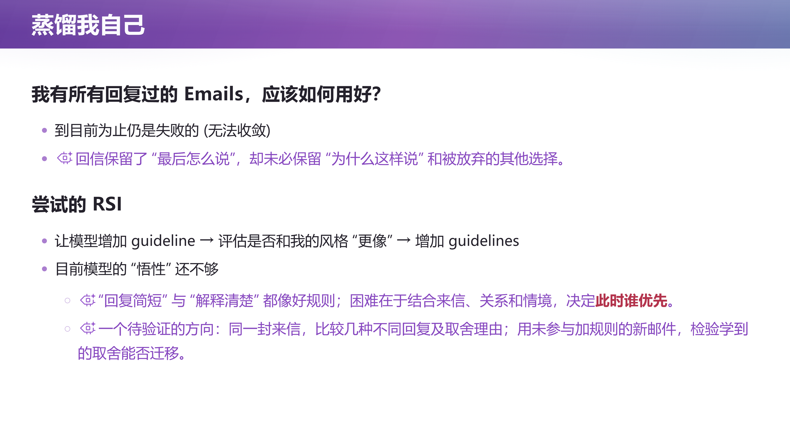

---

## 附：官方参考与延伸阅读

以下链接来自本讲官方讲义（[lect10.md](https://jyywiki.cn/GSE/2026/lect10.md)），按对应章节列出。

**第 1 章（暴论与建议）**

- [OpenAI：Building scientific understanding with academic communities](https://openai.com/index/building-scientific-understanding-with-academic-communities/) —— 关于 ETH 结果的发布说明（发布方也强调这仍是需要学界独立检验的研究材料）。
- Spence 的教育信号理论 —— 大学既帮人获得能力，也帮企业识别能力。

**第 2 章（软件的演化）**

- [几种船的故事（课堂材料）](https://jyywiki.cn/GSE/2026/p10/ships.html) —— 帆船 → 汽船 → USS Langley → USS Midway 的能力与组织方式变化。
- [Linux CFS 设计文档](https://docs.kernel.org/scheduler/sched-design-CFS.html) —— O(1) → CFS → EEVDF，以及 scheduling classes 如何把策略封装在边界后面。
- [Python 3.0 What's New](https://docs.python.org/3/whatsnew/3.0.html) · [Python 2 停止支持回顾](https://www.python.org/doc/sunset-python-2/) —— 不向后兼容的语义重整，以及迁移成本如何把期限从 2015 推到 2020。
- [Kubernetes：Controllers](https://kubernetes.io/docs/concepts/architecture/controller/) · [dockershim 移除说明](https://kubernetes.io/blog/2022/02/17/dockershim-faq/) —— "核心轻、生态重"与责任边界。
- [SWE-bench（arXiv:2310.06770）](https://arxiv.org/abs/2310.06770) · [官方榜单](https://www.swebench.com/) —— 真实 GitHub issue 上的修改任务；2025 年 7 月 mini-SWE-agent 在 Verified 子集达到 65%。
- [Solar-Lezama：程序合成课程（CEGIS 与那个无解反例）](https://people.csail.mit.edu/asolar/SynthesisCourse2020/Lecture10.htm) —— "反例越积越多，仍可能不收敛"。
- Luchins（1942）的水罐实验 —— 解题定势：熟练本身也会制造陷阱。
- Thurstone（1927）—— 从成对判断中度量难以直接计量的属性，是 taste-bench 的方法学祖先。

**第 3 章（回到 DeepSeek Harness）**

- [DeepSeek Harness](https://github.com/deepseek-ai/deepseek-harness) —— 从第一天起的提交历史；`Cordis` 的 vendor 提交、event sourcing、终端→浏览器的转向。
- [课堂整理的提交历史](https://jyywiki.cn/GSE/2026/p10/dsh-commits.html) —— 本讲现场翻的那份时间轴。
- [课堂整理的检查规则](https://jyywiki.cn/GSE/2026/p10/dsh-checks.html) —— 七类 checker 的动机、例子与适用条件。

---

## 附录：课堂未展示的幻灯片

以下四页经逐帧比对，确认在课堂录像中未出现（讲者口头覆盖了部分内容，但页面没有停留），按流程收入附录。

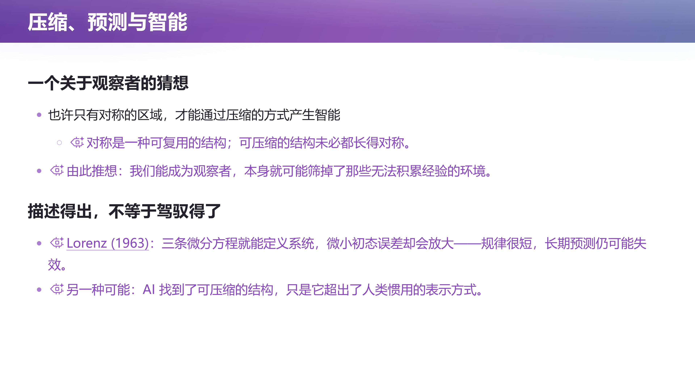

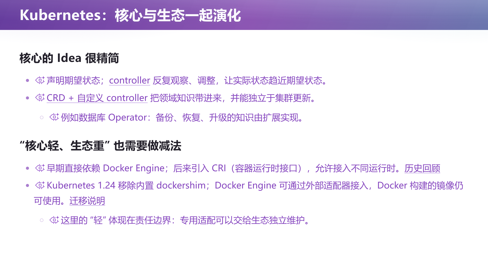

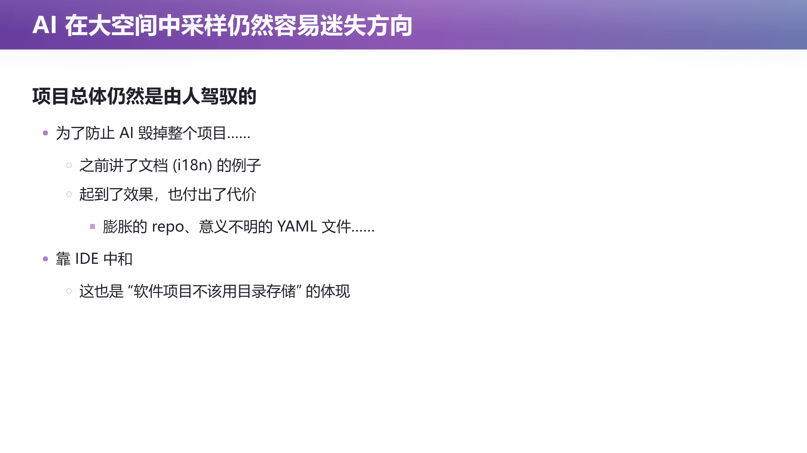

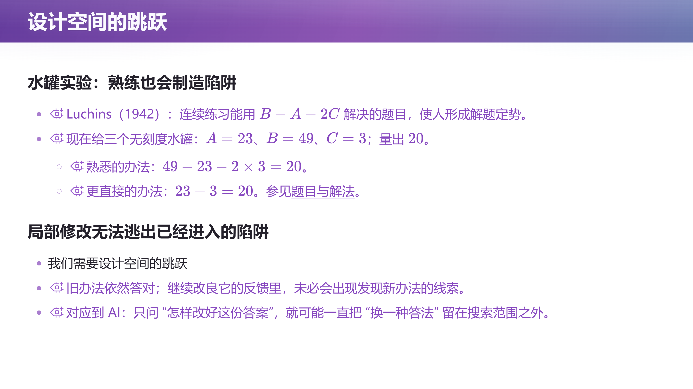

---

*本电子书由 [videobook](https://github.com/Luke-Evan/videobook) 流水线生成。课程讲义与幻灯片版权归讲师所有，依 [CC BY-NC 4.0](http://creativecommons.org/licenses/by-nc/4.0/) 发布。*
