# 软件质量保障（一）：从"能运行"到"能驾驭"

> **课程**：南京大学《生成式软件工程》（2026）
> **主讲**：蒋炎岩
> **课程主页**：<https://jyywiki.cn/GSE/2026/>
> **本讲讲义**：<https://jyywiki.cn/GSE/2026/lect11.md>
> **本讲幻灯片**：<https://jyywiki.cn/GSE/2026/slides11.html>
>
> **版权说明**：课程讲义与幻灯片系 © 蒋炎岩 作品，依 [CC BY-NC 4.0](http://creativecommons.org/licenses/by-nc/4.0/) 发布。本书为非商业学习笔记，引用的文字、图片与幻灯片均保留原作者署名，转载与再使用请遵循同一许可。
>
> **本讲提要**：上一讲把 DeepSeek Harness 当作一个"操作系统"来静态地拆解需求、架构与设计；这一讲转向另一个问题——模型写出来的几百行代码、能打开的界面、能点的按钮，凭什么说明需求被可靠实现了？讲者从"航母不是许愿许出来的"讲起，用 Fault / Error / Failure 三层拆解 Ariane 501，再走到测试的层次、覆盖与断言、许愿出来的 CS:GO、架构与灵光一闪、差分测试与模糊测试，最后落到一个能插拔 SD 卡的小机器人。

## 目录

1. [从"能运行"到"能驾驭"](#_3)
2. [任何程序员都有"幻觉"](#_7)
3. [Fault、Error 与 Failure](#faulterror-failure)
4. [Ariane 501：备份也复制了 Bug](#ariane-501-bug)
5. [质量保障的基本方法](#_12)
6. [测试："在我机器上能跑"到底说明了什么](#_15)
7. [同一份程序，不同的运行](#_17)
8. [程序的正确性](#_18)
9. [但是，测试仍然极为有效](#_19)
10. [软件工程中的测试：从局部到用户验收](#_21)
11. [测试用例的设计：从哪里挑输入](#_24)
12. [代码执行过，就对了吗](#_26)
13. [把测试变成日常工程](#_30)
14. [许愿一个 CS:GO，为什么还不够](#csgo)
15. [架构决定了质量](#_32)
16. [差分测试：让两个实现互相找茬](#_36)
17. [模糊测试：给输入搜索一点方向](#_38)
18. [一个插拔 SD 卡的小机器人](#sd)
19. [附：官方参考与延伸阅读](#_39)

---

## 从"能运行"到"能驾驭"

*(参考时间: 00:00:00)*

这一讲的主题是软件质量保障。上一节课讲的是"造航母"：一艘真正的航母摆在面前，人会觉得震撼——人类怎么可能造出如此复杂的系统？今天让人觉得震撼的不只是航母。操作系统、编译器、应用服务器，凡是工业级能用的东西都是航母。很多同学听说应该去读一读操作系统内核，于是把仓库克隆下来，一看五六十万行代码，直接懵了：README 好像还看得懂，但完全不知道从哪下手。

因为这些东西是在演化中长出来的。航母要能起降飞机，要能容错，需求一层层压上去，系统只能越来越复杂。回到演化的模型：最开始只是一只独木舟，它只有"在水上漂着"这一个功能，这是整个系统最小的状态，也就是 repository 的第一个状态；然后人类在这条 repository 上不断 commit、加 feature，加着加着就会有传承、有思维链式的推导、有多人协作，甚至在社会层面出现专门的组织来改进船——这跟今天 agent 做事的方式很像。状态一路演进，才有了今天这个复杂的软件系统。

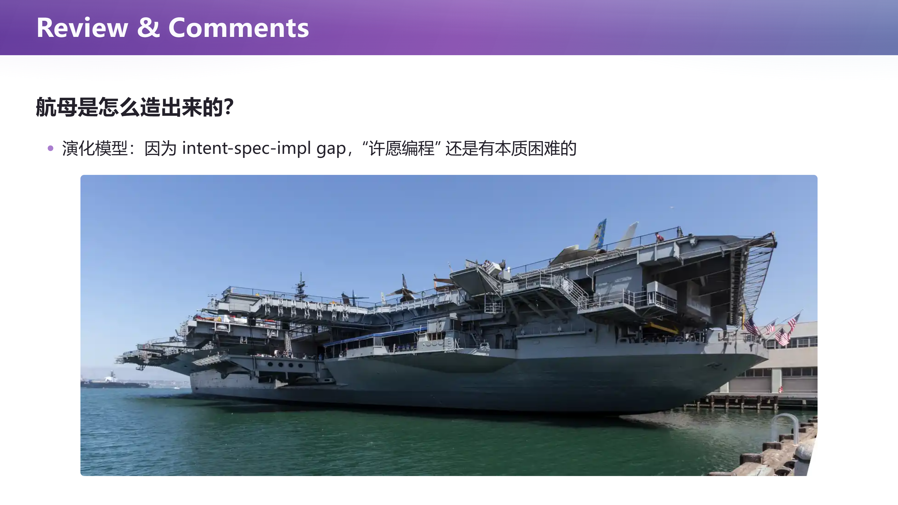

### 许愿一艘航母

"许愿编程"为什么好用，但总让人觉得差一点？因为向 AI 许愿要一艘航母，和向 AI 许愿要一个应用，本质上是同一件事。你说：我要一艘能起降最先进喷气式战斗机的航母。就这一句话，然后让 AI 去造。AI 并不知道你真正的意图；它理论上"知道"这个过程，却没有亲身经历过从简单到复杂、一次一次思考的完整流程，于是直接上手就造，造出来的东西自然很难符合预期。让它造航母它造不了；让它造一个小一点的教育系统，它一样造不好。intent、specification 和 implementation 之间的 gap 一直都在。

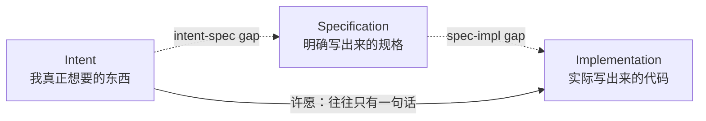

### 从还能理解的历史时刻 rebase

那我们怎么理解一个复杂的软件系统？比如你想知道某个 feature 是怎么工作的，可以先查它是哪一次提交引入的，然后从软件最开始的状态"rebase"到那次提交上。想象一下：在只有一只独木舟的时候，你要求它在上面起降飞机，这是不是一个合理的需求？显然不合理。等船大到一定程度，起降飞机突然就变成了一个合适的需求；再往后你就能推出，人们是怎么在采矿船、运煤船上加一层甲板，把它改造成能够起降飞机的装置，以及这块甲板又是怎么演化的。

软件的演化是连续的过程，所以你一定要从某个自己还能理解的历史时刻开始 rebase。这也是上学时做那么多大作业、去实现各种软件系统的意义：你对一个精简的系统有了非常深刻的了解，才有能力 rebase 今天的特性，用小东西去理解大东西。讲者的判断很直接：用 AI 写大作业，肯定丧失了大家对软件系统的理解——自己上手做过一遍，和 AI 告诉你"坑点在哪里"，是差别很大的两件事。古法编程过来的人，有些细节是在不断试错里磨出来的，可能就是一个 bug 调了好几天，才换来那点经验。

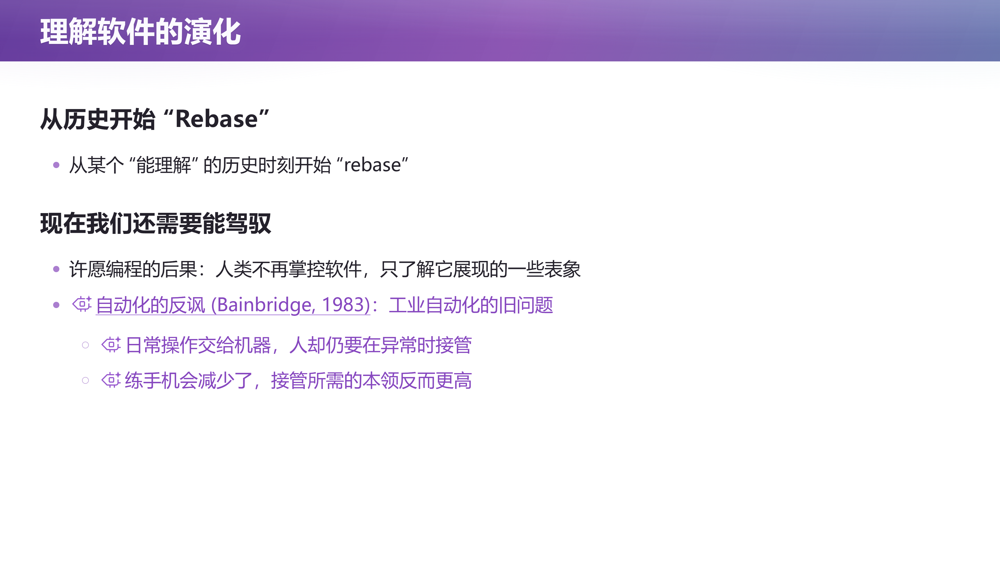

### 许愿编程的后果：只了解表象

讲者说自己现在也许愿编程，但一旦网断了，他甚至不知道应该怎么办。这不是玩笑，而是许愿编程的后果：**人类不再掌控这个软件，只了解它展现出来的一些表象。**

以前软件生产很慢，是人一行一行写的，所以我们不停地提交，每个提交都很小——这是 git 非常重要的 best practice：一次提交只做一小件事。做完了，这一小件事就可以审计、追踪、git blame，可以知道是谁、在什么时候引入了这个 bug。某种程度上，这也是"可以 rebase"的基础。但当每一次 AI 提交都改动一两万行代码、两三百个提交就造出一艘航母的时候，人类就失去了对软件的掌控。我们不知道它是什么了：它测试通过了，基本功能正常，看起来就是那么一艘航母，我叫它起飞一架飞机，它真的能起飞——除此之外，我对它一无所知。

Agent 回头说"我构造了一个高质量的设计、一个优雅的软件"，那到底怎么高质量了？高到什么程度？还有没有可能扩展？只要你不真的把新需求交给它做，它就没有办法评估。等你真的把需求加给它，它会发现：对不起，是我错了，我对架构的理解没有想象的那么好。它会给你一个非常诚挚的道歉——然后那座屎山就再也扶不起来了。

### 自动化的反讽

幻灯片在这一页补了一个更早的注脚：Bainbridge 在 1983 年讨论过的"自动化的反讽"（ironies of automation）。工业自动化早就遇到过同样的问题——日常操作交给机器，人却仍然要在异常时接管；而正因为日常操作被机器接管了，人练手的机会变少，接管异常所需要的本领反而更高。许愿编程把这件事搬到了软件上：你越是把实现交给模型，越是在异常发生的时候说不清它为什么错。

所以这门课还是开给计算机科学的同学：写过操作系统、编译器、数据库实现的人，至少有能力静下心来学。上一讲讲"人类不再掌控软件"，但人类依然要对软件的质量做出某种承诺——某种意义上，软件质量保障在 AI agent 的时代变得更重要了。

## 任何程序员都有"幻觉"

*(参考时间: 00:08:00)*

进入调试理论之前，要先清醒地认识到一件事：**任何程序员都是有幻觉的，任何程序员都是不可信的。** 你的代码写出来，天生就是有 bug 的。在计算机系统基础课上我们讲过软件设计的公理：未测代码永远是错的——你不去真正保证质量，它就不会自己变对。

而且，人类的幻觉其实远远比 AI agent 的幻觉大。古法编程过的人都知道：写一道期末考试题，调了半天好像对了，再调两个小时。如果没有人给你编译器、不允许你运行程序，还要求你一次写对，你写得对吗？肯定写不对。人类的幻觉是有分布的：经受过良好训练的人在架构设计上不容易出现 agent 那种偏离，但写具体代码时就是会偏——这就像让你从 1 数到 300，看起来再简单不过，你基本上一定会数错，因为短时记忆扛不住。

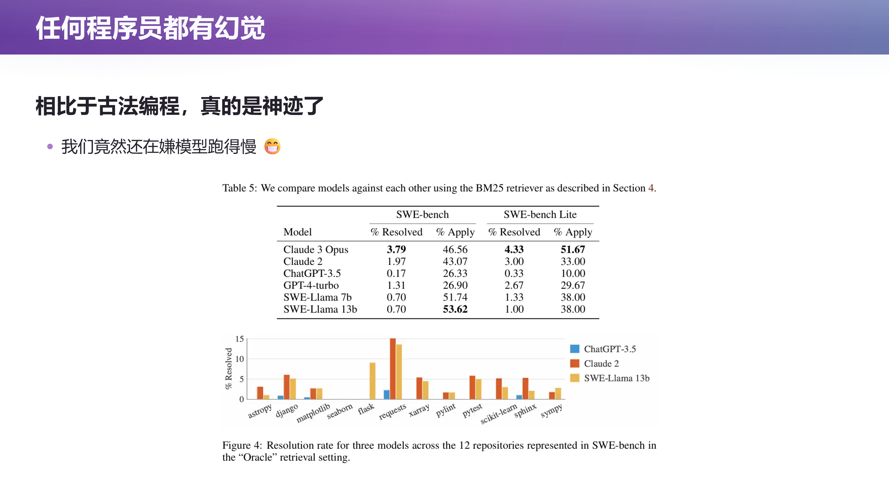

但话说回来，相比于古法编程，今天的 AI 真是神迹。我们已经习惯了它这么快，甚至经常嫌模型跑得慢、嫌它降速。回想 GPT-3.5 和 GPT-4 的时代，这两个模型其实已经很强、博古通今，虽然大家一直诟病它们幻觉严重。可在 SWE-bench 1.0 这类真实软件工程任务上——把代码贴给它，问能不能给一个 patch，这个 patch 打进去程序就能修复——它们兴致勃勃地写下 patch，放进去，其实并不能修复。分辨率（resolution rate）非常低，无论是 ChatGPT-3.5、Claude 2、Claude 3 Opus，还是当时那些小号的开源模型。


### 写代码，谁还没手滑过

写程序写出的 bug 有很多类型，最常见的是手滑。写 shell 命令的时候，哪怕你已经很熟练，也依然会 typo：一个命令打错、一个参数打错、一个文件名打错，都非常正常。所以在前 LLM 的时代，甚至还有 `thef**k` 这样的项目——你在 shell 里打了一个命令，报错说找不到什么东西，或者你直接把命令打错了，于是你就在 shell 里骂一句脏话；它会根据 shell history 找到你上一个问题，用一系列匹配模式找到常见的错误，然后把它修好。你看它的提交历史，十一年前还在改 `configure`，现在这个项目基本上已经死了；讲者说自己今天翻车了，没来得及装。

人类在 blame AI"幻觉很严重"的时候，往往没想到人类的幻觉也极度严重。区别在于，**人类是一个 reactive 的 agent**：幻觉之后，人会立刻根据输出的反馈调整行为，快速把它修好。

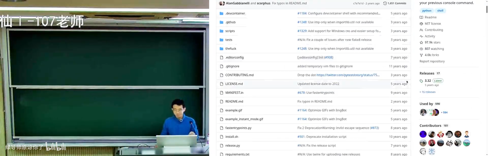

### 一段人人都写过的二重循环

```c
for (int i = 0; i < n; i++)
    for (int j = 0; j < n; i++) {
        // 对每一对 (i, j) 做点事情
    }
```

内层循环本该递增 `j`，却递增了 `i`。这段代码放在你面前，你看到 bug 了吗？人眼很容易把实际写出的代码自动补全成自己以为写出的代码：你脑子里想的是"第二重循环，`j = 0`，`j < n`"，结果眼睛往上一瞟，注意力权重被上一行错误地加大了——就像模型的 self attention 出了错。写错之后，视觉系统扫一眼，觉得非常符合你脑子里的架构设计（先读数据、预处理、二重循环、输出结果），于是你会有一种强烈的倾向，认为代码和脑中的设计是一致的，所以它大概是对的。

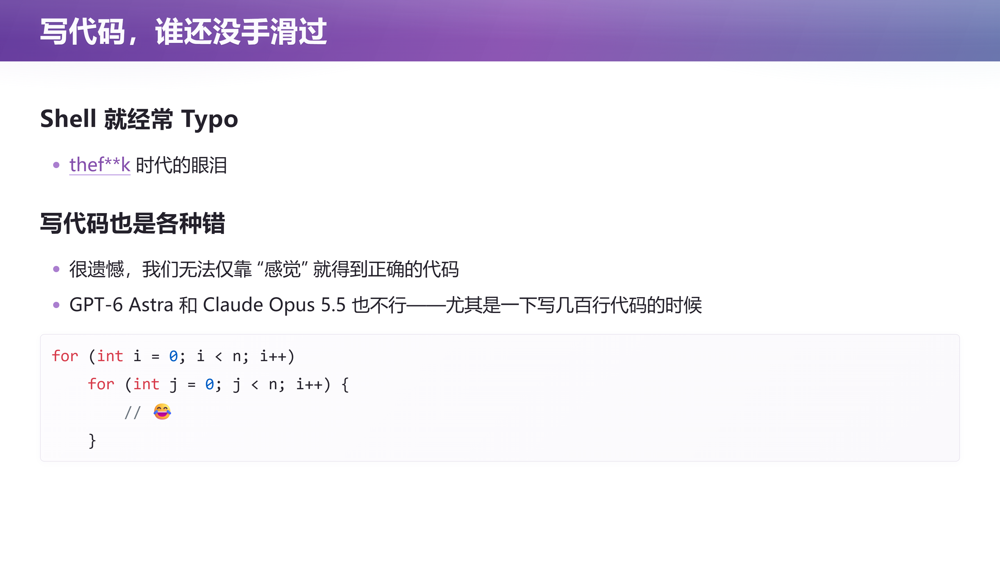

而这样的 bug 有千万种：手滑是一种；漏掉某种很重要的情况是一种；算法本身就写错了，又是一种。程序里到处都是 bug——每天 GitHub 上都有那么多 patch，号称修复了很多 bug，也就是说这个世界满满都是 bug。那为什么 bug 这么难找？

## Fault、Error 与 Failure

*(参考时间: 00:13:16)*

先给这个 bug 一个名字：**fault**。它就埋在 100 行代码里，人眼看不出来。

只有程序执行起来，问题才会显形。初始时 `i = 0`，PC（program counter）停在第一行，这还没有错。开始执行：`i = 0`、`j = 0`，第一次循环可能还是对的；`i = 0`、`j = 1`，第二次也可能对；但等到内层该推进的时候，`i` 已经在递增了——它已经不符合"二重循环"的要求。你要的是 (0,0)、(0,1)……(0,n-1)，然后 `i = 1` 再来一遍；实际发生的却是 `i` 和 `j` 一起乱跑。讲者在这里自己也"幻觉"了一次、算错了一轮，正好说明这件事有多容易看走眼。

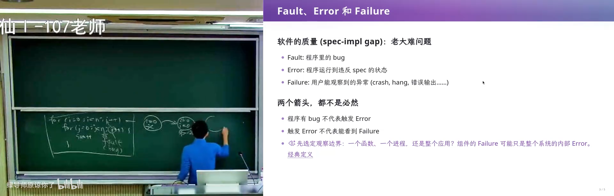

所以什么是 bug？**bug 是程序的实现和你的 specification 不一致。** 而 specification 很可能根本不存在，或者存在但没被说清楚。所谓 bug，就是你的实现和你真实要求的程序到底要干什么，发生了不一致。

从纸面上读不出这种错误，尤其是安全漏洞：缓冲区溢出很隐蔽，可能只是坐标算错了，或者某个整数溢出了。讲者课上举过一个例子：如果用无符号整数存钱，从 0 块扣 100 块，你会变成一个无穷大——花不完的钱。

到这个时刻，不一致其实已经发生了。我们把这个状态叫做 **error**：一个明确不满足 specification 的状态。Fault、error、failure 在中文里可能都叫"错误""失败""失效"，很难区分；在英文里，fault 必须经过程序的执行，才能变成 error。

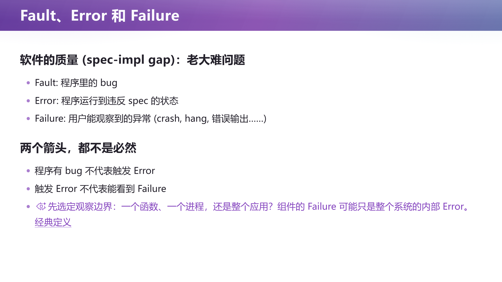

这里真正困难的地方是：**error 的发生是 silent 的。** 它不会报告"我这个位置已经错了"，没有人告诉你。CPU 是一台无情执行指令的机器，它才不管你：这是 load，我就 load；这是 store，我就 store。于是它不断往后执行，`i` 变成 1、`j` 还是 0，一直走下去。你什么时候才知道程序出错了？只有运行了很久——几秒钟以后，你感觉不对：这个输入明明 0.0001 秒就该算完，为什么三五秒还没结束？**这时候你才观察到一个真正的 failure。**

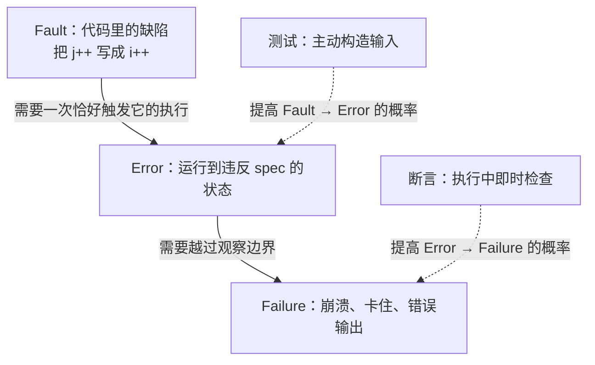

### 两个箭头，都不是必然

这条传播路径上每一步都是有条件的。

- 程序有 bug，不代表这次运行会触发 error。代码里可能还有一个 `if`，只有当随机数恰好等于某个值时才走进去；那你测试很多很多次，这个 bug 都不会被触发。
- 触发了 error，也不代表用户能立刻看到 failure。它可能只是把栈上某个没人用的地址弄脏了；缓冲区溢出真的覆盖了内存，但那段内存在这次执行里没人用，整个程序的执行和输出看起来就完全正常。

还有一层：**观察边界要先选定**——是一个函数、一个进程，还是整个应用？组件的 failure，可能只是整个系统的内部 error。同一个异常现象，站的位置不同，名字就不同。

## Ariane 501：备份也复制了 Bug

*(参考时间: 00:21:44)*

不只是普通程序员，最严格的地方也会犯这样的问题。1996 年的 Ariane 501 就很有意思：火箭起飞时运行了一段已经没有用途的对准代码，其中"浮点数转 16 位整数"的操作缺少越界保护，相当于整数溢出；溢出触发了一个异常。这个 bug 肯定在代码里，但各种审计最后都没有发现。火箭上天以后，它只有运行足够长的时间，计数器才会溢出——他们大概没有在地上做完整的模拟测试，测试不够充分，没测出这种情况。

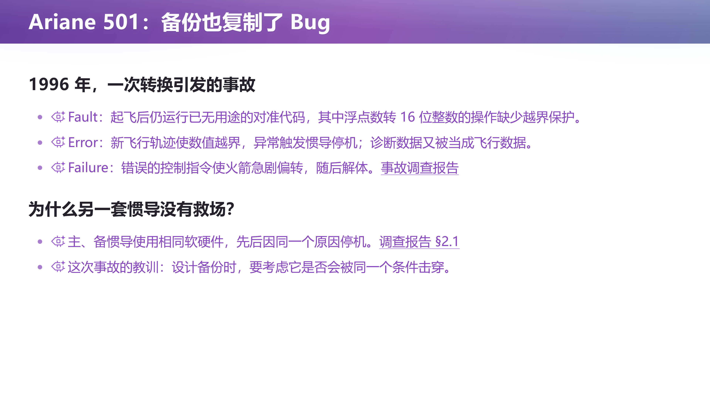

### 三层拆解

- **Fault**：起飞后仍在运行已无用途的对准代码，其中浮点数转 16 位整数的操作缺少越界保护。
- **Error**：新的飞行轨迹让数值越界，异常触发惯导停机；而诊断数据又被当成了飞行数据。
- **Failure**：错误的控制指令让火箭急剧偏转，随后解体。

异常对火箭来说是有容错的，整个系统不会 crash，它有一套错误恢复的流程。但恢复流程把数据搞错了，错误的控制指令让方向就变了。

最要命的是：**主、备惯性导航使用了相同的软硬件，先后因为同一个原因停机。** 做备份的初衷是好的：如果错误是偶发的——比如某台计算机计算不稳定，或者两套惯导读到的传感器数据不同、走的分支不同——备份就能救场。但这次的溢出在两套系统上几乎是同一时刻发生的，备份被同一个条件击穿了。

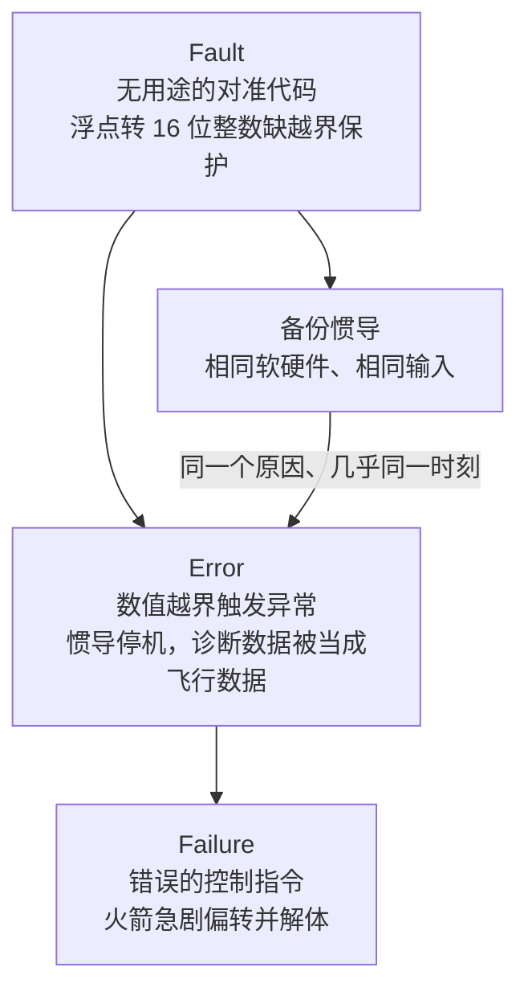

这一页的教训不是"备份没用"，而是：**设计备份时，要考虑它会不会被同一个条件一起击穿。** 相同的软硬件、相同的规格、相同的输入，会让冗余变成复制品。

### spec 本身就不清楚

事故之后再追问一层：我们不是不想维护 spec 和实现的一致性，而是 spec 根本不存在，或者不够清楚。哪一条 specification 覆盖了"程序不应该 crash、不应该有浮点数异常"？也可能传感器真的读错了，异常本来就可能发生——而异常需要被正确地处理。对一个开放的、与外部世界有交互的软件系统来说，specification 到底是什么，并不是那么清楚。道理简单，做起来极其困难。

所以在讲任何测试、验证的方法之前，先要接受一个前提：软件就是很难，找到 bug 就是很难。接受这一点之后，才能谈怎么系统性地让质量变好一点。

## 质量保障的基本方法

*(参考时间: 00:24:52)*

在承认"bug 不可能全部消除"之后，提高软件质量最有效的方法反而很朴素：**更好的架构、不容易伤人的编程语言、更具防御性的编程方法。** 架构和设计永远是决定软件系统质量的第一因素，而不是你写了多少测试用例、用了多么花哨的工具。火箭上的软件，团队一定已经尽了最大的努力，但依然不能消灭 bug。

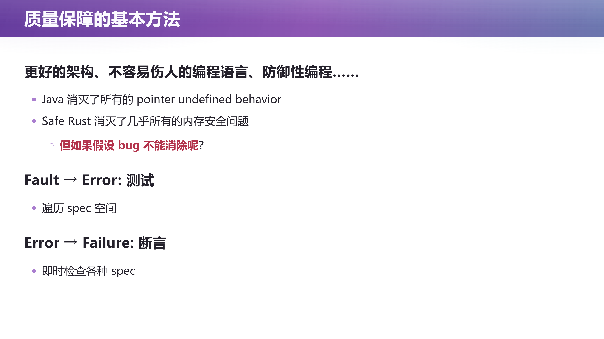

### 语言能消灭一整类错误

为什么 Java 那么快地取代 C++，成为主流的面向对象语言？因为它消灭了所有 pointer-based 的 undefined behavior。C 里"指针一时爽"：你可以把任何整数 pass 成 pointer 再 dereference，可以存函数指针，用函数指针去实现面向对象——这个能力给了开发者一个机制，同时也给了他一个非常容易犯错的入口。

内存分配还自带一条 specification：每一个 allocation 都要有一个配对的 free。这句话听起来容易，做起来不是——对一个 malloc 出来的指针，程序有无穷多条执行路径（return、longjmp 跳回去……），spec 要求的是**在每一条执行路径上，刚好有一个 free**，而且 free 之后这个指针永远不能再被访问。use-after-free 之所以严重，是因为操作系统可能把用户的页面重新分配到那块内存上，你通过手里那个还留着的指针一读，就读到了密钥这类敏感数据。把这种信任交给一个连 shell 命令都会打错的人类，显然不对。

所以 Java 用 managed runtime 牺牲一点性能，换来"不存在这类 undefined behavior"的保证。它不能阻止空指针——Tony Hoare 说自己发明空指针是"billion dollar mistake"——但空指针是 defined behavior：访问它只会抛 NullPointerException，外层还能 catch 住继续执行。这件事从 Java 程序员的脑子里被永久地去掉了。Safe Rust 则几乎消灭了所有内存安全问题。

### 两条箭头：测试与断言

但 bug 显然不可能全部消除。于是回到那张路线图上：假设 bug 到处都是，我们还有两件事可做。

- **Fault → Error：测试。** 遍历 spec 空间，主动去找能触发缺陷的输入。
- **Error → Failure：断言。** 在执行中即时检查各种 spec，把本来可能隐藏很久的错误状态尽早变成可观察的失败。

这两条箭头不是"必然发生"，而是"有条件发生"。理论有用，恰恰是因为它告诉你：这两步都需要人为创造条件——你需要一个好的输入，也需要一个好的检查。

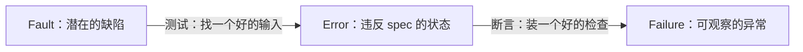

如果你想要尽可能多地把 fault 变成 error，你希望 spec 尽可能完备，并且生成尽可能多的输入去覆盖 spec 的方方面面；只有这样，才有可能触发一个藏得很深的 error 状态。反过来，最坏的情况是一个 failure 都没有：假设你选的编程语言永远不会 crash、没有 undefined behavior，你只有整数的数值运算，那程序不会崩——但你也没有任何方式检查输出对不对。

这就是为什么很多算法题很难调。一个动态规划题，输入一个长度为 100 的整数序列，你给它一串随机数，程序输出 1384，它没 crash——可是 1384 对不对？输出 1383 对不对？你需要找到合适的检查。而"在什么时候、用什么方式检查"，有一点 art 的味道：它取决于你对问题结构的理解，而不只是"跑一遍看看"。

讲者还给了一个很实际的建议：拿成熟项目的 bug 数据库当字典，让大模型按类型（比如 use-after-free）逐个审查代码；愿意花多少钱，就审多严。不要小看这一步——你让 GPT 写一份代码、让 Claude 看一遍，它真的有可能找出里面的问题。

## 测试："在我机器上能跑"到底说明了什么

*(参考时间: 00:36:27)*

测试是最便宜的软件质量保障方法，因为"运行一下样例"实在是太便宜了。讲者说，你们都会测试——你们都会运行一下样例，然后就结束了。

他还讲过一个关于成长的故事：大一刚开始学编程时，你一定面对一个命令行框框，往里面复制粘贴输入，粘贴 100 次、1000 次、1 万次；直到上计算机系统基础课，你突然发现有个东西叫管道，于是写一个 build rule，按一个键就能自动编译、运行样例和你自己写的测试数据。这就是你在大学里的成长：一开始没意识到这件事重要，一旦意识到，质量保障的流程就被加进了开发流程。

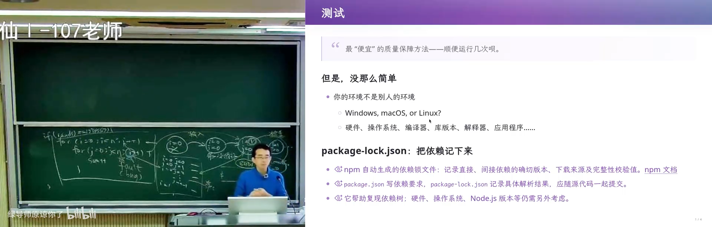

顺着这个方向想，就是持续集成：编译完就自动跑测试，通过就什么也不干，不通过就报告。这个技巧绝对有用——比如保研要机试、要计时，花一分钟把编译和运行配置好，写完代码甚至做一个 hook，保存即编译运行，能省下很多宝贵的考试时间。

但真实的软件系统没有这么简单。真实的软件不是"输入一个序列、求序列里的什么东西"这种 OJ 题：它要在真实的软件环境里运行，得到真实的结果，而且这个结果还要符合我们对软件的定义——软件是物理世界的一个过程在信息世界里的投影，这就麻烦了。

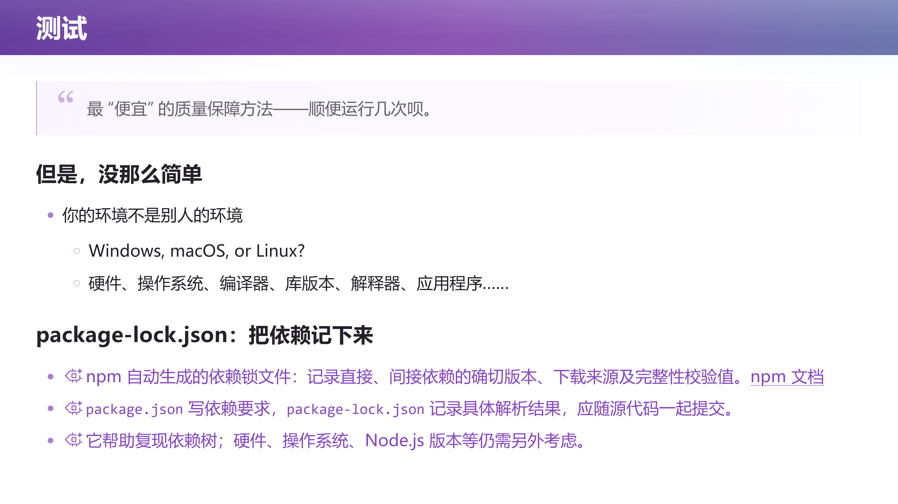

### 你的环境不是别人的环境

你保证在 Windows 上写的代码，在 macOS 或 Linux 上还能正常运行吗？以前写网络编程一定会遇到大小端：有些机器是大端，有些是小端。你死去的计算机组成原理又开始攻击你了——`int x = 0x12345678`，内存是一个 `int8` 的数组，那 12、34、56、78 到底谁在前？如果你用位运算 `& 0xFF` 取低位，就等于假设了小端；到了大端机器上，这个程序就不工作了。

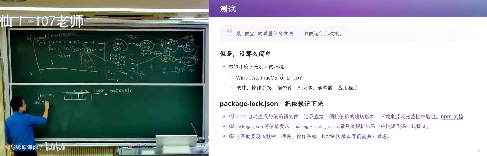

写 C 的时代，你根本不知道对面那个编译器是什么、库是什么。JavaScript 很大程度上解决了这个环境问题：在 Mac 上写一个 three.js 的游戏，在 Linux 上基本也能正常运行。但它解决不了依赖的问题：你有大量第三方库，每一个库的每一个版本行为都略有不同。讲者说他有一段时间很讨厌 Python 的 `lxml`：它能解析 XML，而 Word、PowerPoint、Excel 搞不定的时候，就要去改那些 XML，所以很多 agent 至今还在用这个库。而它曾经在版本之间改变过处理某些 emoji 或 Unicode 字符的行为，于是原来能工作的程序就 crash 了——你的程序只是 `import lxml`，它的行为悄悄变了。这也是环境的一部分。

### package-lock.json：把依赖记下来

这就是依赖锁文件存在的原因。以 npm 为例：`package.json` 写的是依赖要求，`package-lock.json` 记录实际解析出的依赖树——包括直接依赖和间接依赖的确切版本、下载来源以及完整性校验值，应该随源代码一起提交。把锁文件保存在仓库里，可以减少"同一份源码在不同时间装出不同依赖"的情况。

但锁住依赖树不等于锁住整个运行环境：硬件、操作系统、Node.js 版本，仍然需要另外考虑。光"运行环境"这一项，就够你做出非常大的 effort 去探索了。

## 同一份程序，不同的运行

*(参考时间: 00:43:35)*

就算环境完全一致，你的运行也不是别人的运行。系统的负载、文件的内容、`gettimeofday()` 返回的时间、网络延迟与中断，都会改变执行结果。

程序本身是没有时间轴的：一条指令执行完，下一条接着执行。除了实时操作系统有保证之外，操作系统并不承诺"你在 T 时刻执行的代码，会在 T+1 毫秒被执行"。而几乎所有的现代程序都隐含地假设：只要开始执行，它就会一直往前推进。所以如果程序执行得太慢，就可能触发超时；或者你分配的是一个有限队列，跑得够快它一直不满，跑得不够快它就会满、会被扔掉一些数据——同样的输入，行为就变了。

然后是非确定性里最恐怖的一项：**线程调度也是输入。** 两个线程同时执行"读取计数器、加一、写回"，如果都先读到 0，最后可能只得到 1。单线程测试重复运行一万次，也覆盖不到这种交错。讲者每年在操作系统课上都会讲一个伤人性命的并发 bug：一台放射性的治疗仪，在并发的时候，操作员点得快一点，两个部件就处在一个不一致的状态，结果给病人造成了过量的剂量照射。这不是"程序算错了"，而是两个本来都对的步骤被排成了错的顺序。

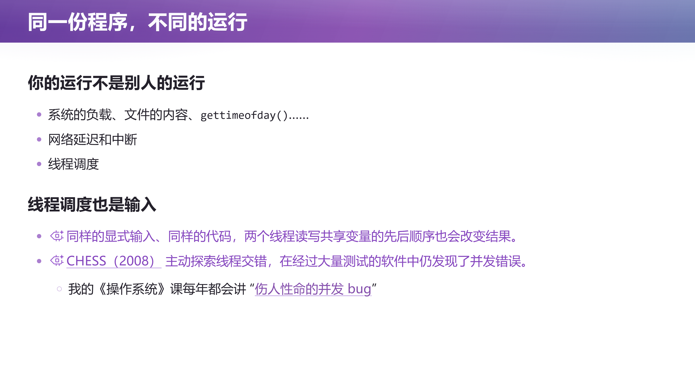

幻灯片里还提到 CHESS（2008）：它主动去探索线程的交错，在一批已经经过大量测试的软件里仍然找出了并发错误。所以非确定性也是输入的一部分：时间、网络响应、线程调度都是程序的输入，测试要探索的空间远远不止函数参数的取值。

## 程序的正确性

*(参考时间: 00:46:33)*

我们希望程序在规格约定的**任何环境、任何输入**下都符合 specification。这里有功能性要求：软件行为与设计一致，且不 crash；也有非功能性要求：性能、安全性，甚至可访问性——如果你真的要发布一个产品，它对听障人士、视障人士是不是友好，这些都有统一的国际标准，满足某个标准，你的网页才算得上对残障用户友好。

而"任何"这两个字，正是困难所在。我们退一百万步讲：假设你能把 specification 规定的输入空间里所有输入都跑一遍，你也不能总是说清"这次跑出来这个结果，到底对不对、到底和你的 specification 一致不一致"。再加上"永远不能 crash、不能有内存安全错误、性能要达到标准、安全性要达到标准"这些要求，测试的难就难在这里。

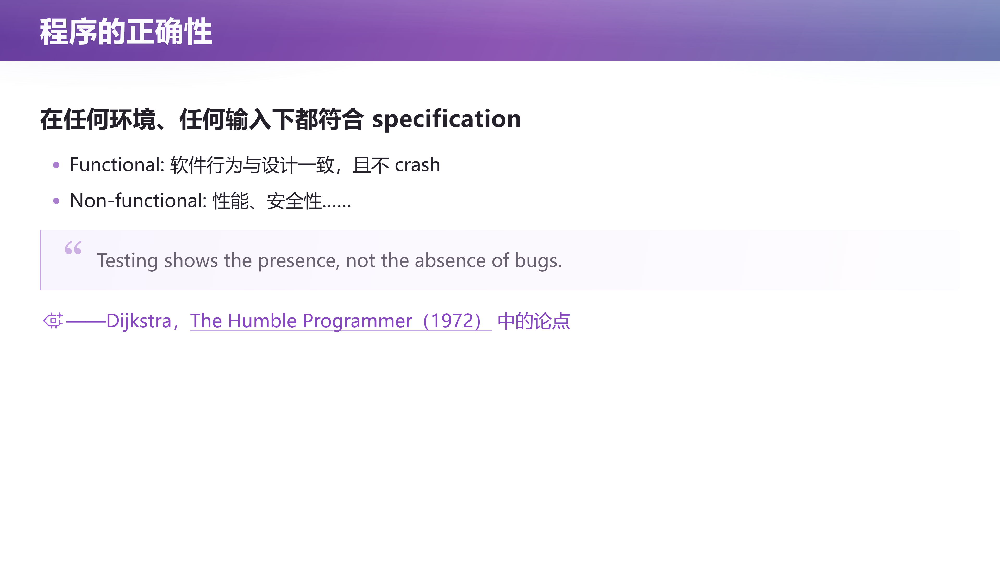

> Testing shows the presence, not the absence of bugs.
>
> —— Dijkstra，《The Humble Programmer》（1972）

这就是 Dijkstra 那句话的意思：测试能显示 bug 的存在，而不能显示 bug 的不存在。测试发现一个反例，就足以说明程序有错；运行一万次没有发现反例，却不能说明第一万零一次一定正确。

## 但是，测试仍然极为有效

*(参考时间: 00:47:02)*

上面说的那些困难都是真的，但测试仍然极为有用。为什么大家这么喜欢测试？

因为如果把所有的 specification、所有的输入环境都画成一个个点，测试——尤其是系统测试——关注的恰恰是最符合"软件作为物理世界过程在信息世界投影"的那些典型案例。这些案例跑出来是对的，它就给你一种信心：正常情况下，至少有一定正确的结果；如果还有错，那大概是 typo、代码审查漏掉的行、因为你大脑的 self attention 不够而留下的细枝末节。

而且，如果你对一个功能理解错了，是不太可能在跑过许多典型场景之后还全部正确的。这里的关键是：**程序天生是可以泛化的。** 正常人写程序是带着泛化去的，你手里有整份需求说明书，你是软件工程师，拿了钱就是干这个需求的。所以典型场景下表现正确，就 imply 你的程序在很大范围里都是对的；你没有信心的，是那些犄角旮旯——极限场景、性能场景、并发调度器发生很大变化的时候、换一台机器、和其他程序交互的时候。这些地方缺测试用例，你就没有证据。反过来，那些"只为了让测试通过"的程序是没有泛化性的：如果 N 等于 1 才输出正确答案，那它只是 overfit 了测试用例——这种代码你们在期末考试的时候都写过。

### 1/n! 与"蒙对"的概率

错误的程序在典型输入上"蒙对"的概率其实很低。比如一个所谓的排序函数，原样返回输入：遇到已经排好序的数组时，它会完美地蒙混过关。但对 n 个不同元素的均匀随机排列，它碰巧正确的概率只有 1/n!——这个数字小得离谱。（这个计算针对的是这种具体的错误实现，不能直接推广成"所有 bug 都很难通过随机测试"，但它很好地解释了为什么选择有区分力的输入如此重要。）

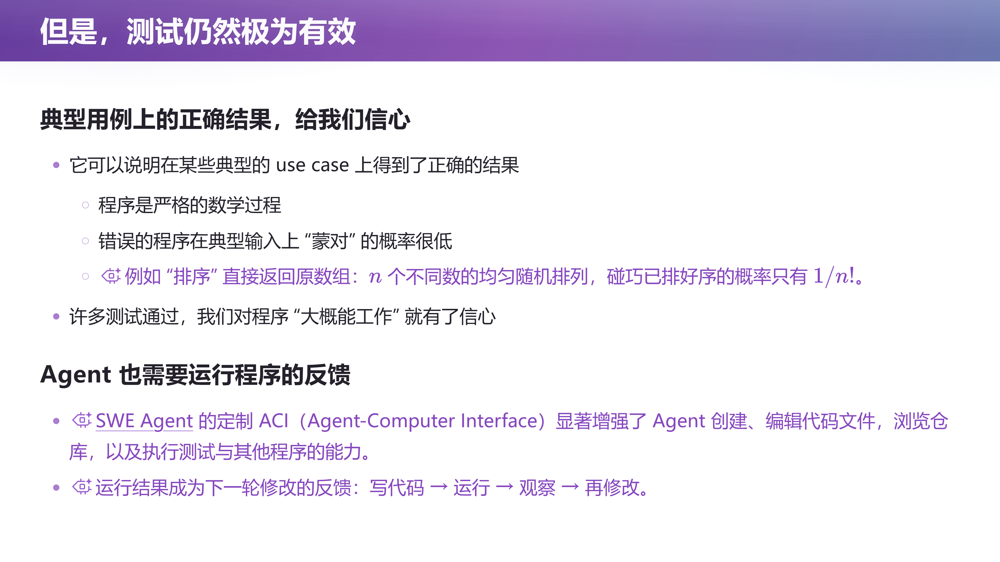

### 失败的测试才是最有价值的反馈

测试真正有价值的地方，往往不是"通过"，而是"失败"。一次失败告诉你三件事：程序里存在一个 fault；错误发生在哪一行、哪个调用栈；以及由此可以排除掉哪些区域。如果你正好有一个空指针异常的 call stack，你就知道大概率是那附近的东西；这有点像条件概率——已知有 fault，并且看到了这样的测试失败，你可以猜得更好。

更进一步，你可以沿着执行轨迹二分：一旦某个状态出错，后面就会一直带着错，于是你就去二分这条 trace，检查"现在这个状态是不是对的"：对，就往后找；不对，就往前找。你总能找到第一个"从正确状态进入错误状态"的那一步代码。Everything is state transition：你总是从一个状态走到下一个状态，那段代码就应该是和 bug 相关的。回到那个二重循环：代码把 `i` 从 0 变成了 1，而你想要的其实是 `j` 从 0 变成 1——所以这条改了 `i` 的语句就是 bug 的 root cause。

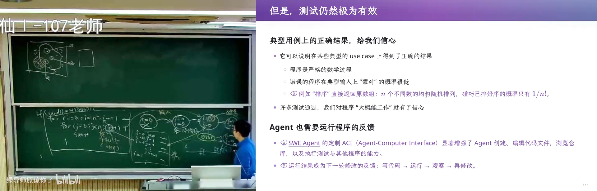

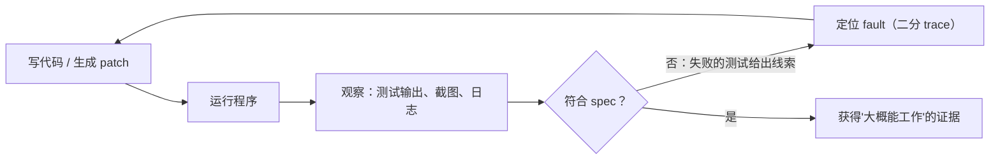

### Agent 也需要运行程序的反馈

这些证据还可以进入下一轮修改：写代码、运行、观察结果、再修改。SWE-agent（arXiv:2405.15793）把这种交互能力落实为一个专门的 Agent-Computer Interface（ACI），让模型能够浏览仓库、创建和编辑文件、执行测试与其他程序。那个工作发表在 Claude Code 这类产品开始设计之前，讲者相信它们肯定借鉴了这些文章。

结果首先是正向的：它通过 react loop 把测试用例运行失败的结果告诉 agent，agent 再去修改 patch；随着尝试次数增加，成功率确实越来越高——虽然还达不到今天的效果，但非常有前瞻性。讲者当时并不是特别看好，因为他那时还没有"scaling law 的 vision"；而相信这个 vision 的人会去赌：这条曲线会随着模型增长一直往上，还没到头。他们赌的是能训练出更好的 coding 模型，通过强化学习和后训练，让模型从"一个 test fail"越来越准地找到出错的地方。大模型就是一个概率分布，它可以不断通过强化学习逼近那个正确的分布，而这一切都是数据驱动、完全透明的。

## 软件工程中的测试：从局部到用户验收

*(参考时间: 00:55:23)*

在大模型之前，软件工程领域已经把测试这件事了解得非常明白了：测试要从局部到整体做。

想想你做 OJ 的时候：每道题只做 system test 或者验收测试，把一大串输入喂进去，看一个结果。但你的 bug 可能是非常低级的小错误。理论上，如果你有 100 万行代码，而每一个小模块都能单独测试，那么小模块里的问题就可以立即暴露，你不需要用一次 system test 去发现一个 unit test 就能找到的问题。System test 该暴露的是：几个模块接起来以后，协同工作的机制正常不正常。

人不喜欢这么干，因为人都偷懒，喜欢把整个东西跑一遍再看。今天的模型也学会了偷懒：它为了更快完成任务，在自觉有自信的时候一把写两三千行代码，然后不写任何 unit test，直接跑 system test；它认为 system test 跑完就对了，甚至连一个测试用例都没留下，截个图看一眼就说"给你搞定了"。但在真正的软件工程里，这样做的成本更高：用一次 system test 去发现一个 unit test 就能找到的问题，浪费的是钱和时间。

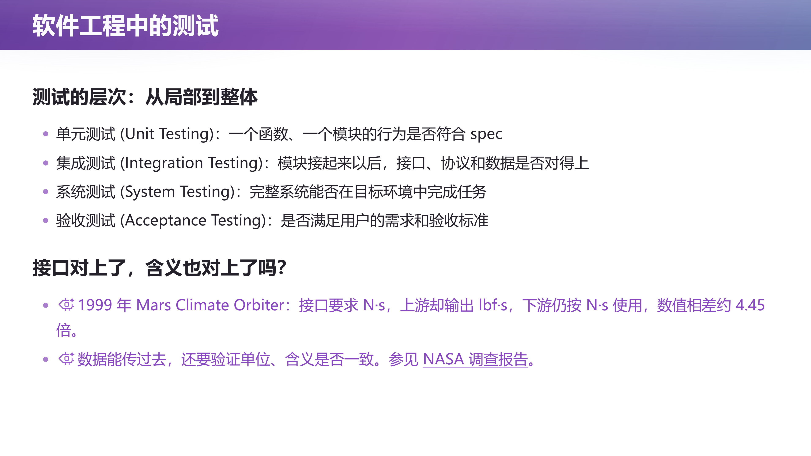

### 四个层次

拿一个选课系统来说，四个层次分别在回答不同的问题。

- **单元测试**（Unit Testing）：一个函数、一个模块的行为是否符合 spec。比如输入学生已修课程和某门课的先修要求，判断函数是否给出正确结果。它应该尽量小、快，并且容易把错误定位到局部。
- **集成测试**（Integration Testing）：模块接起来以后，接口、协议和数据是否对得上。先修检查返回的字段，选课服务是否理解？数据库里记录的课程编号，和接口传来的编号是否一致？两个模块单独工作正常，不代表接起来一定正常。
- **系统测试**（System Testing）：完整系统能否在目标环境中完成任务。学生登录、查询课程、选课、刷新页面，再确认结果仍然存在——真实的服务、存储、身份验证和界面一起参与，才能发现只在整合之后出现的问题。
- **验收测试**（Acceptance Testing）：这些行为是否满足用户的需求和验收标准。技术上"提交成功"，不代表业务上"选课成功"；如果课程已满时系统仍允许超额选课，或者选课结果没有对学生清楚呈现，系统就可能违背了用户真正关心的规则。

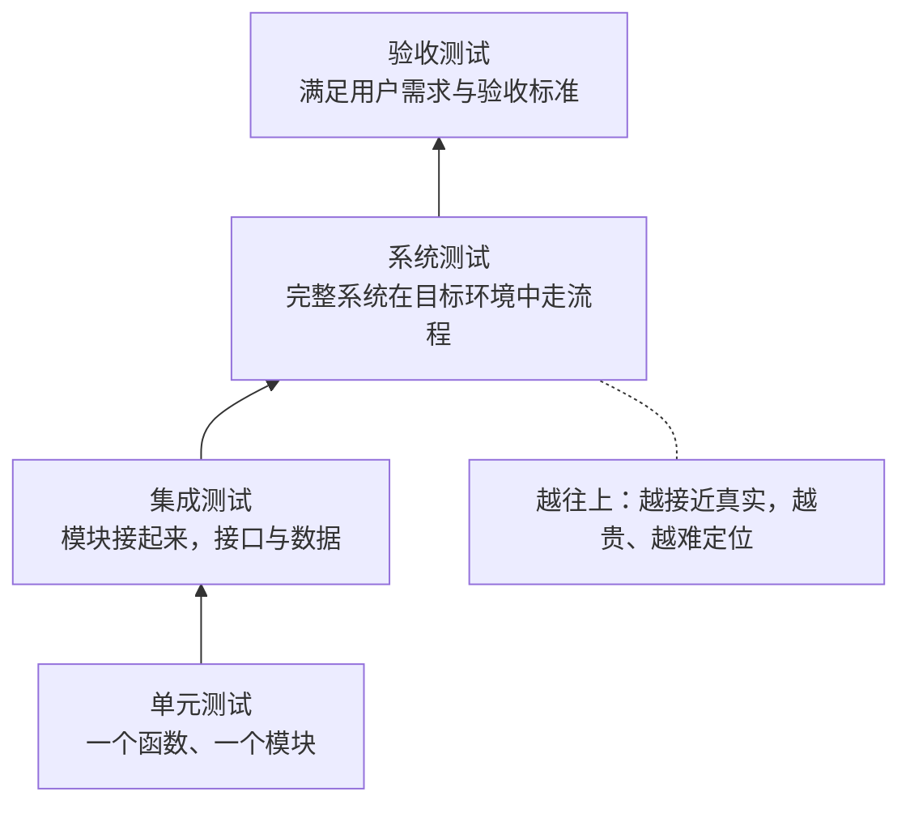

### 接口对上了，含义也对上了吗

接口不只是"数据能传过去"，还包括双方对数据含义、单位、错误情况的理解。1999 年的 Mars Climate Orbiter 就是一个昂贵的例子：接口要求的是 N·s（牛顿·秒），上游软件输出的却是 lbf·s（磅力·秒），下游仍然按 N·s 来使用，数值相差约 4.45 倍。数据传过去了，两边也都没有报错，但整个任务建立在一个差了四倍多的数上。这就是"集成测试通过"和"系统正确"之间的距离：能连上、能跑通，只说明协议的形状对上了；单位、含义、边界条件下的约定，需要单独验证。

## 测试用例的设计：从哪里挑输入

*(参考时间: 00:57:11)*

挑选测试输入有两种基本视角：黑盒测试从规格出发，不依赖实现内部结构；白盒测试从代码出发，检查哪些逻辑实际被执行过。你们的 OJ 就是一个非常典型的黑盒测试：你只管程序的输出，或者一些可观测的行为——最后有没有超时，一切正常就认为这次测试通过了。

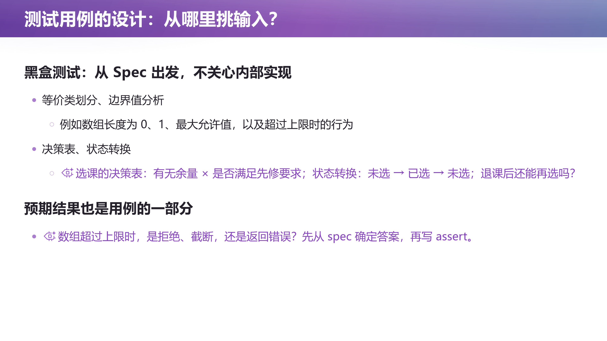

黑盒测试可以先做**等价类划分**：把预计会由同一种规则处理的输入分成一组，从每组里挑代表。比如一个最多接受 100 个元素的接口，空数组、允许范围内的非空数组、超过上限的数组，就可能对应不同的处理规则。再做**边界值分析**，重点检查 0、1、99、100、101 这些最容易出现差一错误的位置。规则涉及多个条件时，可以用**决策表**：选课这件事，"是否有余量"和"是否满足先修要求"有四种组合，逐一写清应该接受还是拒绝，就不容易只测最顺利的那一条路。行为依赖历史时，可以用**状态转换**：未选课程可以变成已选，已选可以退回未选；那么重复选课、重复退课、退课后重新选课，各自应该怎样处理？

### 预期结果也是用例的一部分

测试之前必须知道预期结果。数组超过上限时，是拒绝、截断，还是返回某种错误？这是 spec 问题，要先把答案定下来，再写 assert。如果测试作者自己也不知道答案，那运行程序只是在观察现象，还没有完成验证。

测试想要越来越"冲"，就要理解它的本质：你有一把枪，每设一个测试输入，就是打出一颗子弹，而子弹是要钱的。设计得好的单元测试成本比较低，你可以多打一些；system test 成本高，就少打一些。最终你要打到输入空间——或者说程序所有可能的运行空间——上足够多的点，使自己建立起"这个软件还能正常工作"的信心。

## 代码执行过，就对了吗

*(参考时间: 00:58:38)*

后来就有了更多自动化的方式：从代码出发。程序运行一个测试以后，我们就得到了这次运行碰到的所有语句的集合——因为程序就是状态的迁移，每一次状态迁移执行一条语句。比如 test1 执行了第 136 行，test2 执行了第 139 行；等你把所有的测试跑完，发现第 7 行从来没有被覆盖过。

按照计算机系统的公理，未测代码永远是错的。第 7 行如果有编译问题，编译器能帮你找到；但如果第 7 行里你写错了一个逻辑，对不起——你至少没有建立对第 7 行的信心。

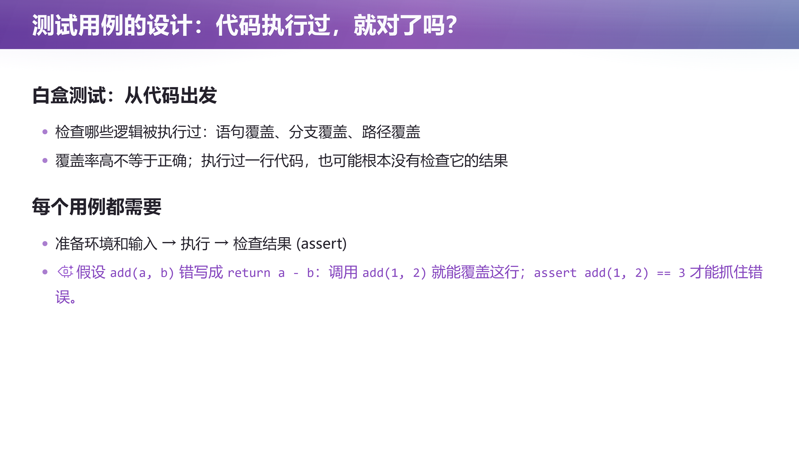

所以逻辑是：你希望有各种各样的覆盖——语句覆盖、分支覆盖、路径覆盖。所有语句至少要被一个测试用例覆盖；一个条件的不同分支都要走过；甚至有些路径，比如循环一次和循环两次，你都要能测到，因为 for 循环或 while 循环转一次和转两次，确实可能导致不同的结果。循环和并发很快就会让路径数量大到无法穷尽，但这不妨碍"尽量覆盖"是一个可操作的目标。

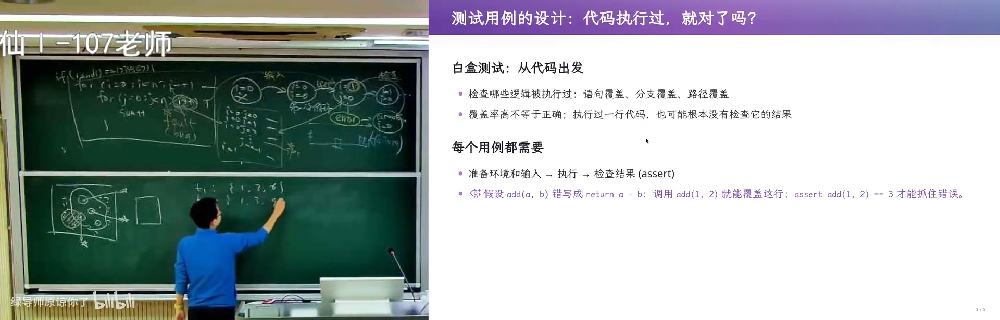

### 覆盖率高不等于正确

```python
def add(a, b):
    return a - b
```

调用 `add(1, 2)` 就覆盖了函数里的计算语句，覆盖率是 100%。只有继续检查 `assert add(1, 2) == 3`，才抓住了错误；如果用例只检查 `add(1, 0) == 1`，它甚至会通过。

覆盖告诉我们代码有没有被执行，断言告诉我们被观察到的结果是否符合要求，而输入的选择决定错误有没有机会暴露。每个完整的用例都应该包含三个动作：准备环境和输入，执行操作，检查结果。缺少最后一步，就很容易出现"Agent 跑了一大堆命令、得到一大串日志，却没有真正核对核心行为"的情况。

### 许愿一个测试套件

今天，生成各种各样的测试用例对大语言模型来说都比较简单了。既然你已经知道了测试的概念和 first principle，你就可以为项目许愿：请给我构建合适的单元测试；单元测试完了统计覆盖率；对没有覆盖的代码报警；不断添加单元测试，直到覆盖率达到 100%。以前这种要求只有大公司或者真正严肃的软件项目才会提，对人是很大的 overhead；但有时候真的就是一个测试用例救了你——这段代码看起来没问题、没覆盖好像也没什么，可别人调用你的时候，另一条路径上真的有可能出错。

### 测试工程师走进酒吧

有一个经典的测试工程师笑话，恰好指出了另一种盲区。

一个 QA 工程师走进酒吧，先点了一杯啤酒，然后点了零杯啤酒，然后点了 99999999 杯啤酒，然后点了一杯、点了一只蜥蜴、又点了一杯啤酒，再点了一个奇怪的东西……酒保应对自如。测试工程师高兴地离开了酒吧。然后第一个普通顾客走进来，问：洗手间在哪里？突然，酒吧开始崩塌、起火——程序 crash 了。

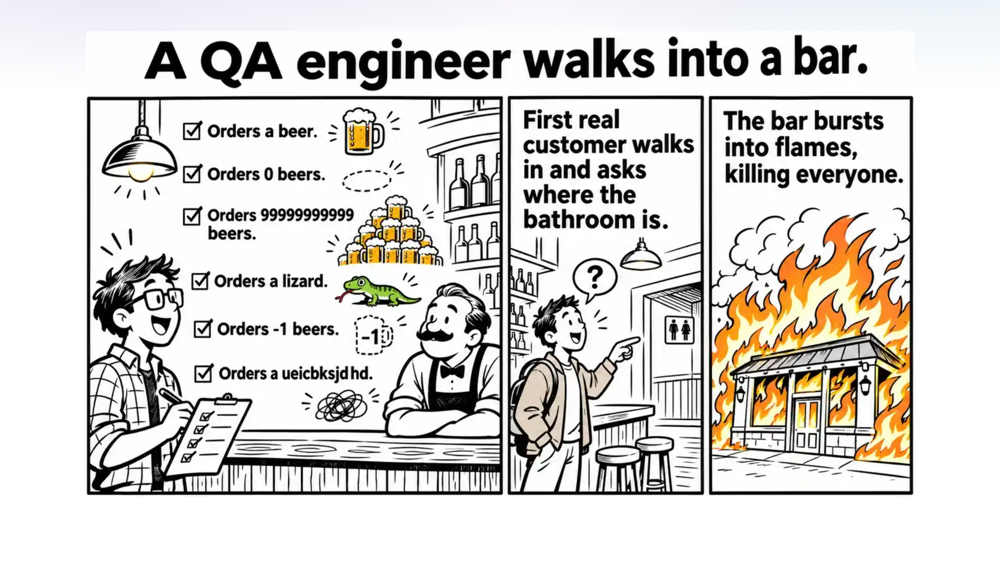

这个笑话不是说边界值没有用。那位测试工程师显然非常尽职，他测的那些边界值——一杯、零杯、极大数量——你们写的程序很有可能在"一杯"的时候就出错了。它说的是：他的测试全都集中在 `order something` 这一条流程上，而用户实际会走的另一条流程（问洗手间在哪里）从来没有被走过。输入再刁钻，也不能代替对使用场景的理解：程序的输入空间可能非常非常大，总有你没想到的情况。顺带说一句，GPT 写的程序常常有过度防御的问题——它写大量的检查，而且一定要把每一种不合法的异常分开；其实所有检查不合法输入的分支，统一扔一个异常出去可能就够了。

## 把测试变成日常工程

*(参考时间: 01:03:25)*

软件工程课本上讲的东西，讲者说"他们说的都对"——他自己就是专业做测试的。核心是测试金字塔：大量快速的单元测试，适量的集成测试，少量的端到端测试。这背后其实是一个成本问题：你有多少钱，你的子弹就是有限的，所以要在合适的地方用合适的测试。它强调分工，不是要求所有项目遵守一个固定比例。

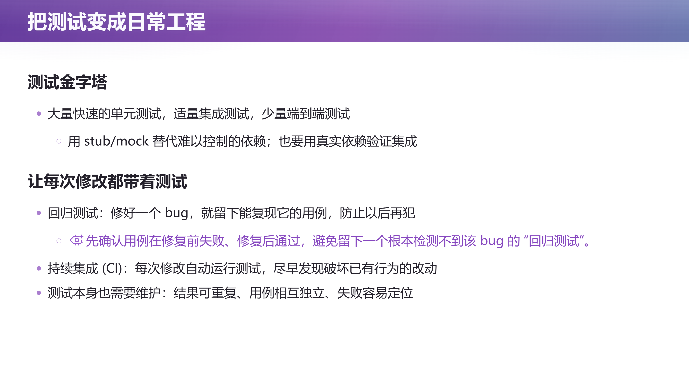

### stub 与 mock：给依赖找个替身

有些依赖很难控制，就要用 stub 或 mock 做替身。比如你的程序要 `gettimeofday()`、要读文件、要 receive 一个 packet：给智慧教室开发软件，你可能要从摄像头拿到数据——那就麻烦了，你必须有一个摄像头才能做系统测试。作为初级软件开发者，你会很不情愿做这样的测试，因为麻烦，连接它也需要时间。

这时候软件测试的经验告诉你：可以做一个假的设备，让它不断给你供图像。Android 的虚拟设备（AVD）就是这样一个 mock：哪怕你没有安卓手机，也可以做安卓开发；早期它打开的摄像头永远只能读到一个静态数据，后来某个版本才可以真的传一段视频进去。但就靠这个，很多需要摄像头的应用能跑起来了——包括那些"申请摄像头权限、打开、拍张照片、关掉权限"的代码。如果没有真机就没法测试，那显然不是一个合适的 practice。

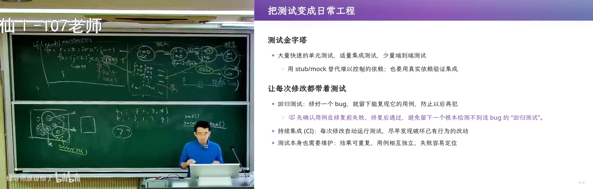

Stub 常用于提供预设的响应，mock 还可以检查交互是否符合预期，比如同一个操作有没有被调用两次。但替身正确模拟了什么、遗漏了什么，需要开发者自己负责；最终仍然要用真实依赖检查集成。

### 回归测试与 CI

修复 bug 时，要把触发它的场景留下来，成为回归测试。你改过一行代码，那么所有和这一行相关的测试都要重跑，从单元测试开始，一点一点重建对软件的信心。最有说服力的检查，是确认同一个用例**修复前失败、修复后通过**；否则你可能留下了一个根本检测不到该 bug 的"回归测试"，那只是在增加测试数量。

持续集成（Continuous Integration，CI）把这些检查变成每次修改后自动发生的事情：测试通过就什么都不做，不通过就报告。反馈越早，越容易把失败和刚刚引入的改动联系起来。测试本身也需要维护：用例要尽量独立，环境和数据可重复，失败信息能帮助定位问题。如果每次失败都要先猜"是不是测试自己又抽风了"，测试提供的信心就会不断被削弱。

## 许愿一个 CS:GO，为什么还不够

*(参考时间: 01:06:23)*

许愿编程的时代来了。

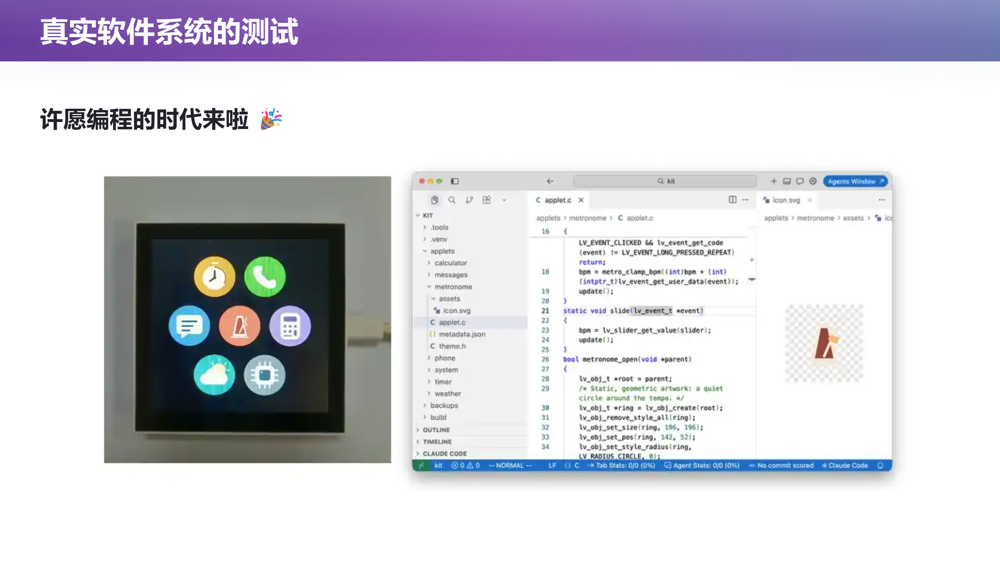

讲者说自己前两天就许了一个愿：仿照 Apple Watch 做一个小界面，跑在 ESP32 这样的小设备上，里面有节拍器、有 to do list，还有一个可以和 AI 聊天的小工具，是给小朋友做的。他一天到晚都在许愿。

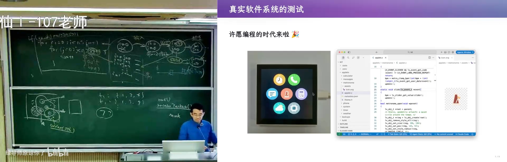

这一节课的例子更狠：向 agent 许愿，做一个 CS:GO 风格的游戏。

提示词大概只有一句话：实现一个相对比较精美的 CS:GO。没有别的，也没有什么 skills。这是一个典型的 **long-horizon task**：需要很多步骤、跨越较长的执行过程——生成代码、启动程序、操作界面、截图检查，再根据观察继续修改。

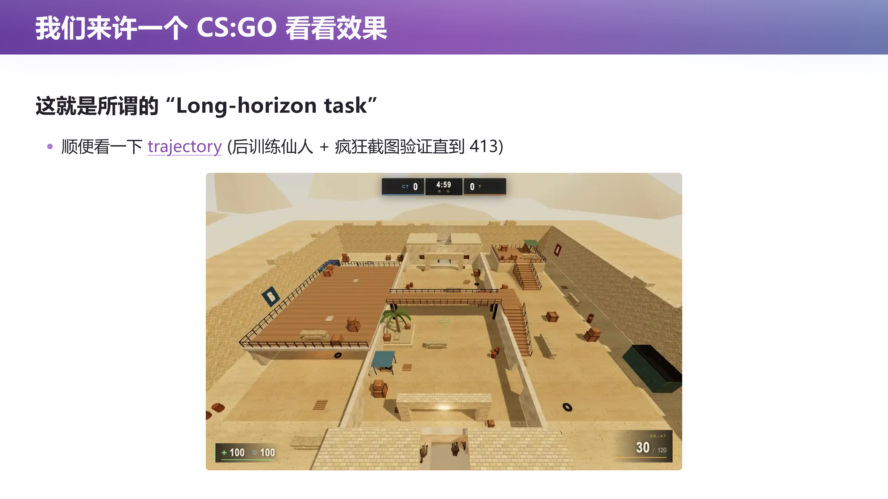

### Agent 的 trajectory

从 trajectory 看，agent 并没有偷懒。它做了不少测试：写了玩法脚本，跑 12 秒看 AI 交火；写了多机位截图；写了测试检查。它做了大量的截图，最后截到每个 response 有 50MB，直接把请求打成 413（请求体过大），agent 已经跑不下去了，必须开一个新的 session 才能继续。


前五六十轮，它其实已经搭出了一个可以玩的东西；后面就进入了非常低效的循环：看截图、测试、修复，看截图、测试、修复，写测试检查、写测试检查……那已经不是在修 bug 了，那是讲者自己启动的一个循环。

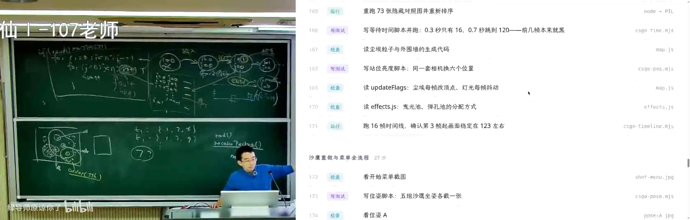

看起来它做了一个非常详尽的测试。但实际进入游戏，肉眼十秒钟就发现了一堆问题：漂浮的旗子和箱子，栏杆可以直接穿过去，人物看起来像浮空的，切枪的动画有点问题。质量显然不能交付。

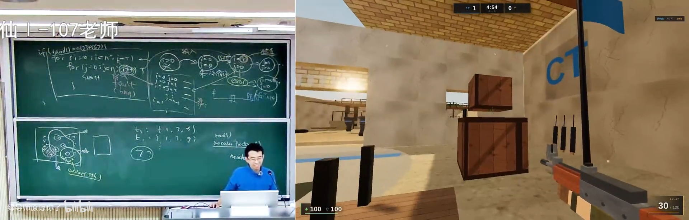

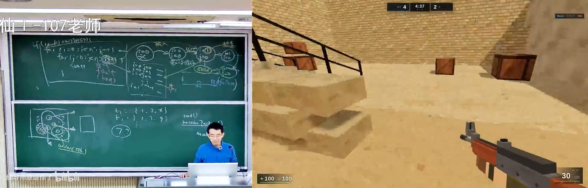

讲者说，DeepSeek 的 flash 模型真的是"后训练仙人"——上一个版本绝对做不到这个效果。转折点是大家在 GPT-5.5 那一代突然发现：模型对审美有了自己的要求，因为它有视觉能力，能对美和丑做出判断，于是你只要在强化学习里不断用"精美"去奖励它，它就能学会"我多做几步应该能做得更精美"。而这个游戏的所有素材都是 agent 生成的，效果还是相当惊艳的。

但惊艳不等于正确。一张截图可以帮助判断场景有没有显示、角色有没有出现在预期位置，却很难充分验证射击规则、弹药消耗、碰撞判定、计时和胜负条件。反复从整个游戏界面出发，意味着每次检查都要同时依赖渲染、输入处理和游戏逻辑。

### 一个"设计问题"

讲者后来直接问 agent：这个箱子为什么会浮空？是不是设计的问题？结论是：它是 CJS 加手写的极简 AABB 物理，没有碰撞——不要紧，因为没有碰撞也可以靠建模来表达"这个栅栏不能穿、那个箱子不能过、墙不能过、子弹打到墙上"这些规则。但因为架构的问题，有些东西是硬编码出来的：箱子是硬编码拿出来的，所以很容易出错；而且你必须做大量截图，才能修复这些问题。

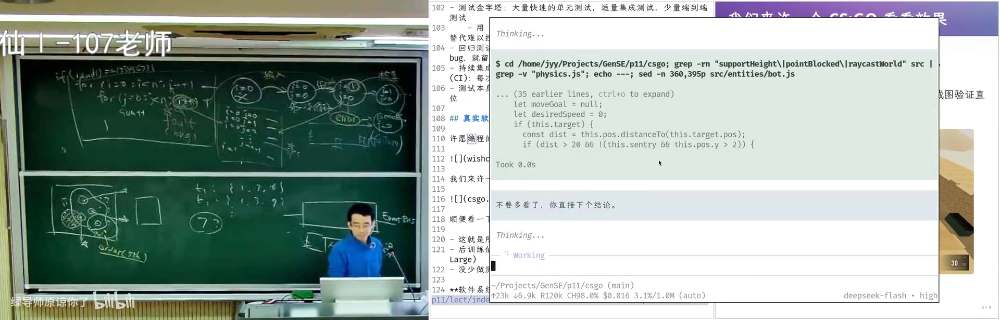

## 架构决定了质量

*(参考时间: 01:12:46)*

当我们谈软件质量保障的时候，其实不是说"我们要做多少测试"，而是：软件系统越大，你做一次系统整合测试的成本就越高。而很多问题几乎一定必须用整合测试、必须让跨模块的边界一起协作，才有可能测出来。所以真正的软件质量保障就这一句话：**架构决定了质量。**

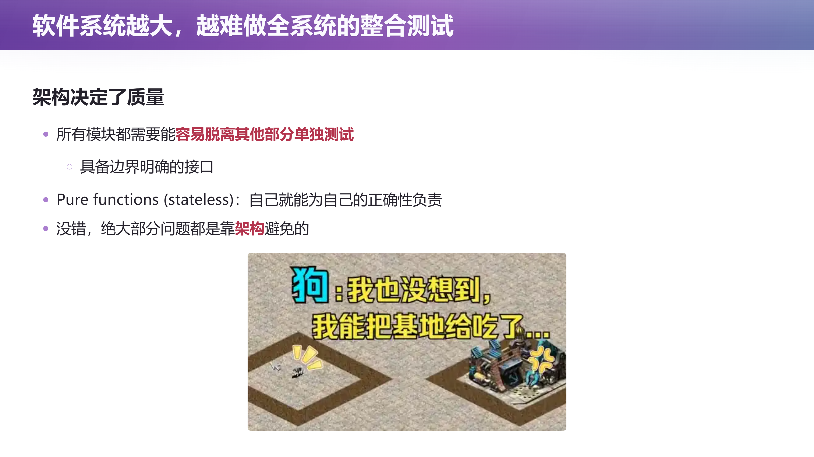

最好的情况是：你的软件里每一个部分接口都非常清楚，每个模块都可以单独验证。比如做一个智慧教室的人脸到课监控（讲者说这好像是最近最热的话题，不过他没收到任何官方消息，只是打个比方），如果做一个 event bus，那就一定要把"人脸"模块和"到课"模块分得非常开，使得每一个子系统都能单独测试。他对人脸模块的信心可以是这样的：我有一万张、一百万张的 benchmark，在这上面效果都很好，对输入的各种格式、各种帧率，都能达到性能预期。人脸模块和到课模块之间只有一个接口：我不停地把人脸的向量传过去。那么到课模块的正确性，就是"输入任何向量数据，我依然能产出正确结果"。每一个模块的接口都非常清楚，每个模块都可以单独验证——而这就需要很好的架构。

### 童年回忆里的老游戏

这个游戏的引擎是 agent 自己做的，因为提示词里没有任何要求。如果要讲者来设计，他一定会设计成"所有物体都能单独检查、所有部分都能用代码检查"，不需要截图。

他举了一个很有意思的架构失败案例，来自童年回忆里的一款老游戏：把基地收起来之后，基地会突然消失，变成一条狗。这个游戏里有无数 bug，很多是后来才被玩家开发出来的——船厂可以修飞机，维修厂可以卖步兵，在 CS:GO 这种引擎里你根本想象不到。那个 bug 是这样产生的：如果基地收起来之前，已经有一个单位占着那个单元格，那么基地收起后就会因为单元格被占而"卡没"。所以玩家会用工程师去防守——这样敌人的工程师就没法把半只脚踏进基地。可这时候那条狗出现在哪里呢？它正好卡在基地中间，恰好是基地收起之后要出现的位置。于是你把基地收起来，机器直接被狗吃了。

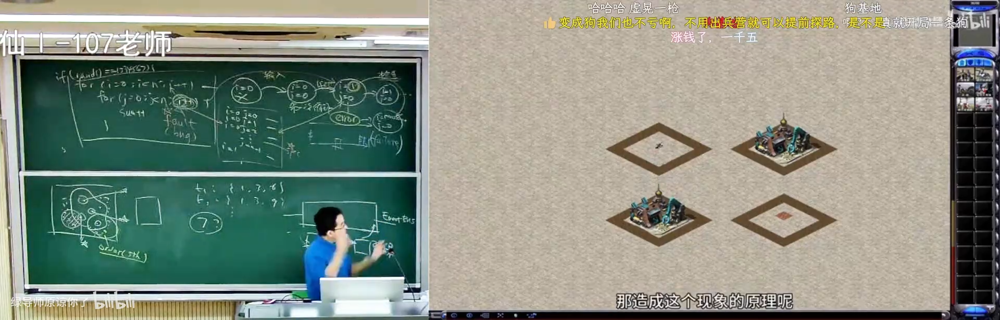

为什么会有这种匪夷所思的 bug？因为引擎里硬编码了很多东西：它假设地面有层，用 2D 模拟 3D，每个单位有一个高度。它设计的时候，并不是按"对于任意可能的游戏进展都成立"来设计的，所以一旦进展超出它的假设，设计就崩溃了。

### 即使做对了所有 practice

许愿编程的时候，你当然可以用上软件工程的那些 practice：每个地方都做单元测试、覆盖率要达到 100%；单元测试完了，每个模块之间要互相集成，集成测试也要用代码写、不能截图；最终验收要跑出轨迹、截图确保"一次真实的游戏是正常合理的"。

但是，即便你做了所有这些，只要架构没有设计好，问题依然会来。从第一节课开始讲的那座金字塔——intent → spec → implementation——是会漂移的：设计没做好，项目就直接走向某种万劫不复的深渊。你们现在是本科生，最重要的就是试错：去做、去踩，然后看着这座屎山是怎么倒塌的；回头再想，原来老师上课讲的"真正决定质量保障的是架构"，是这个意思。所以**重构才是改进代码质量的最佳途径**。

### 为什么喜欢函数式设计

为什么我们会喜欢 functional design、喜欢函数式编程？因为 pure functions。

你随便写一个函数，只要引入一个全局变量——比如一个全局对象，你 `global.get()` 一次，过一会儿又 `global.get()` 一次——那么这个程序的正确性就变成了：对**所有可能的全局状态**，里面所有的执行路径都正确。这还意味着，如果这是一个 CS:GO，你可能需要把整个全局状态构建出来、或者 mock 出来，才能测试这个函数，这就是成本。而且全局状态一旦涉及并发，会不会在两次 `get()` 之间被别人改掉？哪些全局状态是可能的、哪些是不可能的，你要考虑到什么程度？这些都是测试这个函数时要想清楚的思想负担。

纯函数就没有这些问题。它就是数学上的函数：没有副作用，输入 X 不变，输出永远不变。这样的函数非常好测试，它的正确性完全由自己负责——理论上，只要足够的单元测试，就能保证它的正确性，甚至更容易证明它是对的。这也是为什么我们喜欢 Rust：喜欢它不完全是因为那个"非常恶心的变量生存期"，而是它会强迫你重新思考什么样的状态应该放到全局去。那个编译器会让你不由自主地倾向写出 functional design，或者写出正确性非常显然的代码——把对象 hand off 给你，你再 hand off 回来。当然，函数式设计也不是万能的：你需要组合函数时就会写出高阶函数，而它一旦和别的函数组合，specification 就互相牵连了——这个函数到底对谁负责？scope 有没有改变？所以不是说它什么问题都能解决，但平时写代码时更 prefer 它，你会获得一定的收益。

### 灵光一闪

架构做好以后，剩下的你只需要把软件工程教科书丢给 agent，它就能做好。但除此之外，质量保障和任何编程一样，都需要一点**灵光一闪**——当然，架构本身也是灵光一闪，需要一点**品味**。而"品味"恰恰是今天的 AI agent 还没有完全学会的东西。

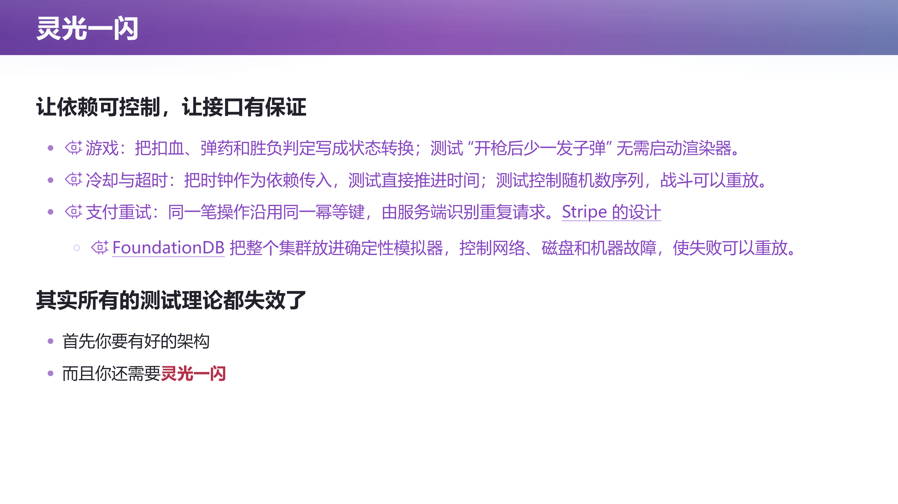

这一页把"灵光一闪"具体化为两句话：**让依赖可控制，让接口有保证。** 游戏里把扣血、弹药和胜负判定写成状态转换，测试"开枪后少一发子弹"就不需要启动渲染器；冷却与超时把时钟作为依赖传入，测试直接推进时间；测试随机战斗则控制随机数序列，让某一段战斗可以重放；支付重试让同一笔操作沿用同一个幂等键，由服务端识别重复请求（幻灯片上给了 Stripe 的设计作为例子）；FoundationDB 更彻底，把整个集群放进确定性模拟器，控制网络、磁盘和机器故障，使失败可以重放。而这一页的结论也很硬：**其实所有的测试理论都失效了**——首先你要有好的架构，而且你还需要灵光一闪。

急速堆屎山，短期产出快，但到某一刻就维护不下去了；先搭架构、做验证和测试，短期效率低，却有持续增长的潜力。而这个反馈信号来得很晚，对强化学习很不友好——毕竟完成任务就能拿到奖励，所以你才会看到模型像刚才那样选择："我不管了，反正你要我就给你，就这么地吧。"

## 差分测试：让两个实现互相找茬

*(参考时间: 01:25:12)*

在质量保障这件事上，"所有测试理论都失效了"还有另一层意思：面对一个真实系统，背完测试分类并不足以知道下一步该做什么，你需要的是灵光一闪——找到一个适合当前系统的实验方式，把难以观察的行为变成可检查的证据。

学过计算机系统基础的同学对 NEMU 不会陌生。它是一个用于教学的处理器模拟器：你要写一个 RISC-V 或 x86 的全系统模拟器，一个真的带声音、带图形、什么都能跑的虚拟机，那是一个完整的计算机系统。把程序跑在自己实现的模拟器上，运行了很久才发现游戏画面不对，应该从哪里开始找？最终画面距离某条指令的实现错误，可能已经隔了大量执行步骤。

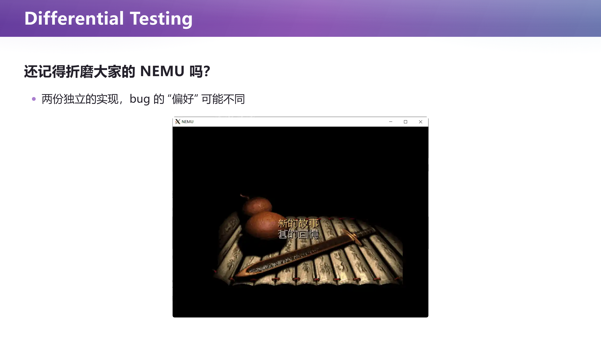

### 从仙剑奇侠传到 DiffTest

这里可以讲点故事。2013 年，俞子豪同学在他的毕业设计里实现了第一个版本的 NEMU，并且光速把它变成了第一年的计算机系统基础实验。同学们一定是一片哀嚎：你想把它调对，这简直是不可能——因为再没有人做过，只有俞子豪手上有一个可能也不是 golden 的版本（那个版本可能也有 bug），但它至少能工作，能向你展现《仙剑奇侠传》。他把所有固件都打好了，说：请你运行它。在没有辅助的情况下，同学们调得惨不忍睹。

大概在 2014、2015 年，讲者在计算机学院楼下的咖啡厅聊天：同学们苦不堪言，那让我们许个愿吧。当时许的几个愿，现在都已经实现了。其中一个愿是向俞子豪许的：我们的 CPU 能不能像动态链接库一样？就是一个接口——总线的接口、握手协议、总线上数据进出加一根中断线；代码上的接口也表现成这样，这样 CPU 就可以插拔。Core 和 uncore 分开以后，外设的模拟可以复用，甚至可以在这个总线上挂两个 CPU：同样的状态往两边各送一份，但接口的输出只保留一份。每个周期把 register 和内存的状态放进 QEMU，单步执行一条指令，再把结果 dump 出来。当时的参考实现是 x86 的 QEMU——它什么都能跑，能跑一个 Windows 虚拟机，我们就相信它是对的，只要跟它做到百分之百一致就行：它跑一步，你跑一步。

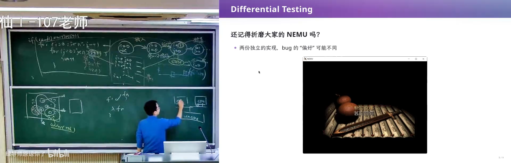

从有了这个机制以后，找 bug 就太容易了。还是那个调试理论：你有一个程序跑完，看起来是对的；但如果你的 eflags 里有一位错了呢？比如上一次运算结果是不是零，有一个 zero flag；还有一个 parity flag。你错了，刚好测试蒙对了一条——如果你的测试只有一个用例，unit test 刚好蒙对，或者两条指令组合的时候弄错了，你是不可能把一个复杂的程序调对的，因为两三千行代码里每一条指令看起来都长得一样：怎么译码、行为是什么、然后执行它——你根本找不到。

但 differential testing 可以提前把它暴露出来。你可以最大化地观察程序里面的状态：EAX、EBX，还有 eflags。以前你不知道它对不对——它反正算出来一个值，没 crash，你只能假设它对。现在你有一个 golden version，它说"你这个 eflags 算错了"，你马上就知道是上一条哪条指令算错了，查一下手册就可以修。

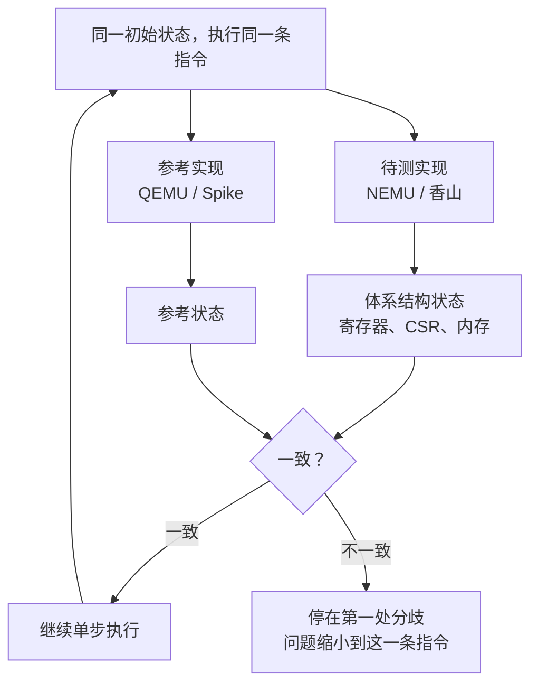

### 分歧之后

两份独立实现的 bug"偏好"可能不同：一方把操作数写反，另一方漏处理符号扩展，错误未必发生在同一个地方。所以你不必先由人手工写出整个复杂程序每一步的正确答案，就有机会发现异常。手滑类型的偶发错误，可能分布在不同的地方；当然，两边也可能对手册里的同一句话产生同样的误解——所以结果一致是有用证据，却不是绝对正确的证明。出现分歧之后，还要分析哪一方违反了规格。

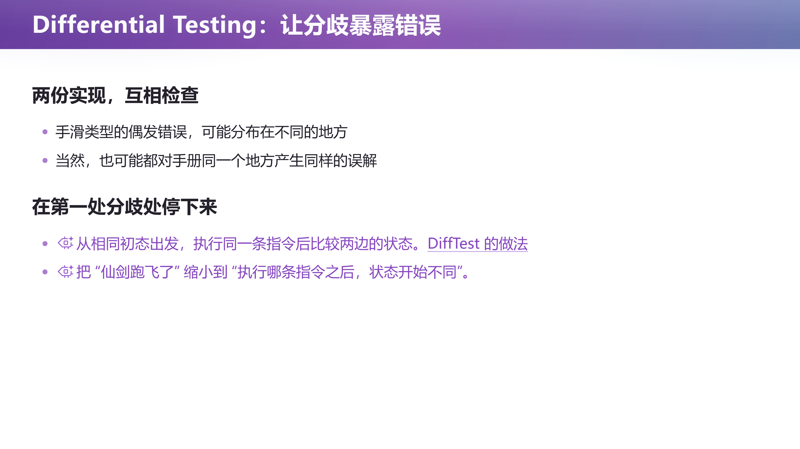

同样的方法也可以用来找编译器的 bug，但会麻烦一点：C/C++ 有 undefined behavior，一个 UB 的程序编译两份、输出不同，不代表编译器有 bug——也可能是程序本身就没有定义的行为。于是这就变成了一个"带条件的生成问题"，难度稍高。

这套思路也进入了真实处理器的验证。香山的 DiffTest 框架让待测设计与 NEMU、Spike 等参考模型协同执行、比较验证状态；幻灯片上给出的经历是：运行了 4 亿个时钟周期之后，发现香山的 `mstatus` CSR 状态不一致。CSR 是控制与状态寄存器，`mstatus` 保存处理器的一些关键运行状态。这样的例子说明，错误可能藏在很长的执行过程深处，而自动比较提供了持续观察它的办法。

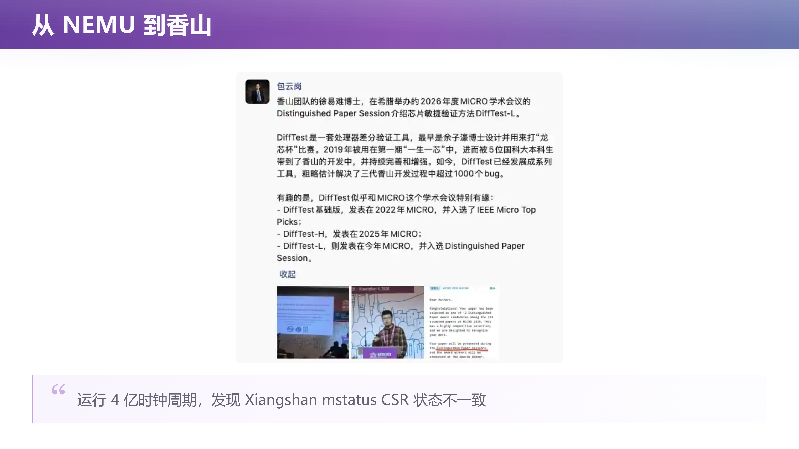

讲者说，他在朋友圈看到一条动态，还致敬了一下；那个包老师可能不知道，differential testing 是他们当年一起聊天时许的一个愿做出来的，QEMU 那一侧的实现是俞子豪做的。最早的设计不是用来打龙芯杯比赛的，是用来拯救大家的计算机系统基础课程实验的。后来它被用在第一期"一生一芯"里，不断改进，今年他们拿到了一个可以在 FPGA 上模拟的、非常快的版本——模拟 CPU 执行可以用软件模拟，也可以用硬件来加速 golden version 的比较。

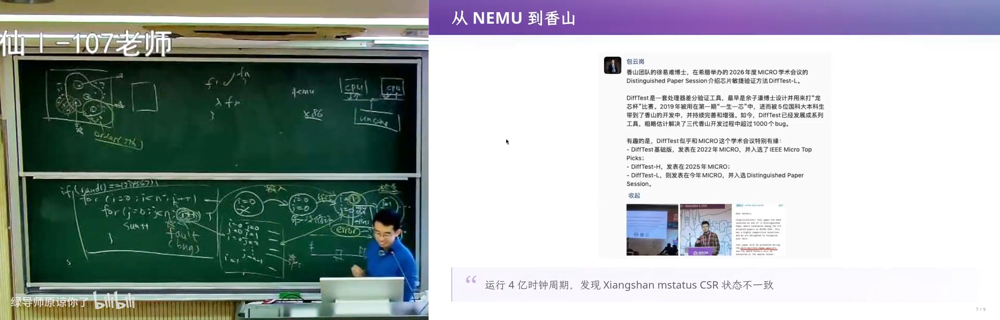

## 模糊测试：给输入搜索一点方向

*(参考时间: 01:30:42)*

还有很多你们能想到的。测试是去遍历输入空间，那我们有没有可能写一个程序，自动地去遍历？这不就是一个搜索问题吗？

假设你写了一个程序 `a.out`，它接受四个参数 S1、S2、S3、S4，还可以有一个环境（比如 S3 等于 `a.txt`），并且真的有一个 `a.txt`，那还有一个 S5。无非就是搜索五个字符串、五个字节序列。如果 `a.txt` 不超过 100 字节，每个参数不超过 10 字节，那你就可以把 `a.out` 的全部输入编码进一段 140 字节的序列里。如果你能把这 140 个字节的所有空间都遍历一遍，你就达到了完整的输入覆盖——所有程序的行为至少都跑过一遍了。

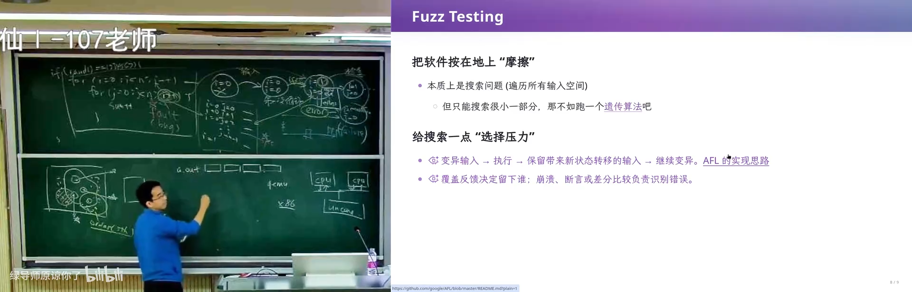

但这个过程很低效。所以我们需要一个更高效的搜索过程：维护一个种群，维护很多个这样的输入，每次把输入变一下——把一个字节从 A 改成 B，或者把程序里出现过的常量替换进去；也可以把两个输入做 crossover，取这个的前一半拼上那个的后一半，确实有点遗传算法的感觉。然后你不断生成新的输入，那什么样的输入比较好呢？**覆盖了以前没覆盖的代码的比较好**。这就叫反馈制导的搜索。

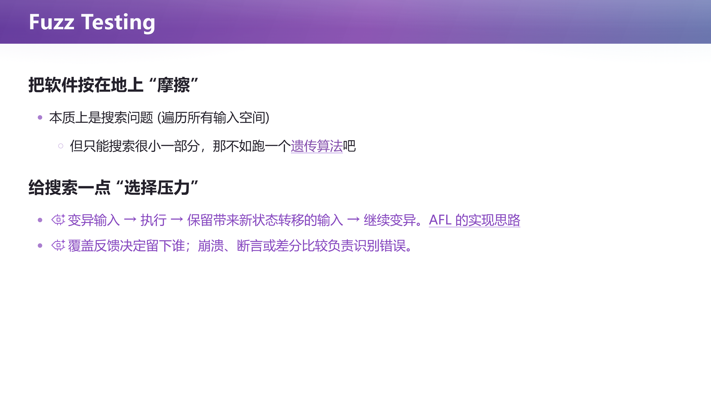

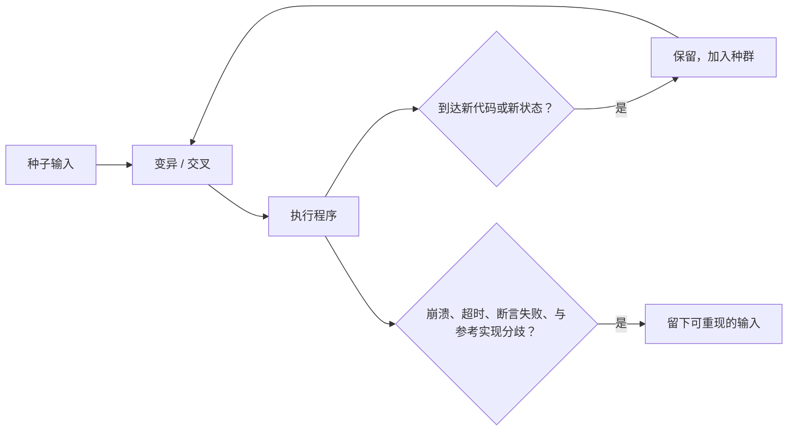

本质上，你就用一百台服务器的集群，没日没夜地为你的软件生成测试用例，看有没有安全漏洞——当然也可能有功能性的新问题。这个非常有效：Linux 内核上长期运行的模糊测试项目已经找到非常多的问题，而且很多 bug 到现在也没法复现，可能修都修不了，但确实找到了非常多的 bug 和安全漏洞。

但要注意：**搜索反馈和正确性检查仍然是两件事。** 执行到新代码，说明这个输入值得继续探索，并不说明它已经找到 bug；崩溃、超时、断言失败，或者与另一个实现产生分歧，才是错误的线索。所以模糊测试可以和差分测试组合：一边负责找输入，一边负责比较结果。发现失败之后，留下能重现问题的输入，才能把偶然撞见的异常变成可以调试、可以回归的工程资产。

## 一个插拔 SD 卡的小机器人

*(参考时间: 01:35:33)*

这套东西学到最后，你会发现真正需要的是知识——架构，测试的基本理论，然后是结合你的经验：过去三十年里，软件工程的人到底怎么做质量保障。你学会了，就可以 generalize 到自己的项目。你的项目未必需要 differential testing，也未必用 fuzzing，但你会被启发：也许确实可以写一个定制的测试输入生成器，让它覆盖很大的一片测试空间。

然后你就可以许愿。但要注意：**AI 现在可能还干不到你认知之外的事情**，尤其是你们是这个领域的专家。你需要为 AI 提供一个认知。

讲者很喜欢 Android 初创团队的那个例子。San Mehat 向同事许愿，他说的是：

> a little bot... to control how it goes in and out, and then I would create a little closed-loop test.

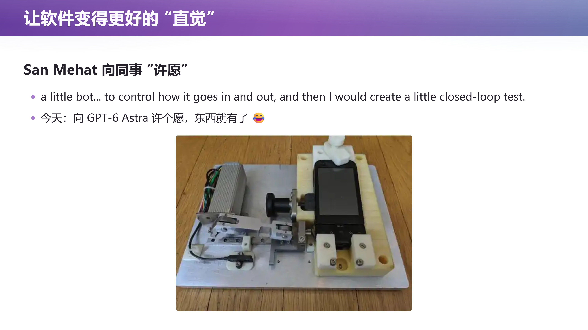

背景是这样的：他们发现 G1 上那个 SD 卡的插槽，Linux 驱动不太稳定，后来甚至整个驱动都重写了。这需要测试，但这件事没法只靠模拟——你就算在 QEMU 里模拟通过了，也说明不了什么（那时候 QEMU 还不够成熟，零几年的时候效果也不够好）。所以他们用 3D 打印（部分部件）做了一个物理的小装置：软件给舵机送一个信号，它就把 SD 卡拔出来、插进去，测试再观察系统的反应，进入下一轮。

这个装置的价值不在于机械动作复杂，而在于它把原本依赖人的操作，变成了程序能够重复安排的输入。反复插拔时才有机会出现的问题，终于可以持续追踪，而不必靠一个人坐在那里碰运气。沿着这个思路，测试者还可以进一步安排"正在访问卡时拔出""拔出后再次插入"这样的操作序列，并记录出现异常时的条件。这些是从装置得到的测试设计思路，不意味着只要有了机器人，所有错误就会自动被发现——你仍然需要知道观察什么、怎样判断异常、怎样复现它。

今天，我们可以把类似的愿望直接交给 agent，让它帮忙编写测试程序、记录日志、控制设备或者生成输入。代码生成的成本下降以后，更值得投入精力的其实是那个实验设计：怎样让难以触发的条件可控制，让内部错误可观察，让一次偶发现象可以再次发生。能够想出这样的测试，并把它接回架构和日常开发，才是驾驭软件的一部分。

讲者最后展示了一个许愿的成果：他家小朋友设计的一个光栅动画卡扣，拉下来的时候是一个动画——把四帧动画拼起来，全部自动完成；只要给一张四帧的动图，它就能拼成一个可以拉动、可以换一张 5cm×5cm 照片的小物件，钥匙扣已经扣好了。

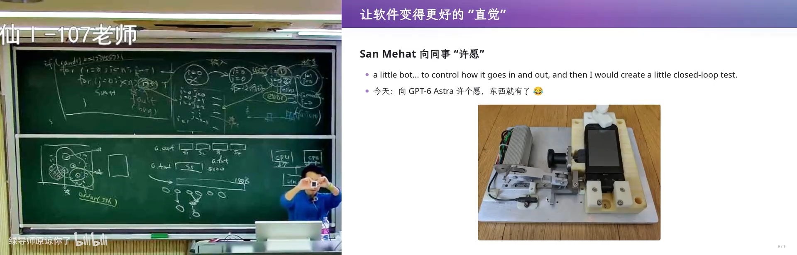

现在所有东西都是许愿。但许愿的前提是：**你有正确的概念。**

## 附：官方参考与延伸阅读

课程官方页面：

- 课程主页：<https://jyywiki.cn/GSE/2026/>
- 本讲讲义《软件质量保障 (1)》：<https://jyywiki.cn/GSE/2026/lect11.md>
- 本讲幻灯片：<https://jyywiki.cn/GSE/2026/slides11.html>

按章节对应的延伸材料：

- **"在我机器上能跑"到底说明了什么**：npm 关于 `package-lock.json` 的文档，<https://docs.npmjs.com/cli/v11/configuring-npm/package-lock-json/>。
- **但是，测试仍然极为有效**：SWE-agent，*Agent-Computer Interfaces Enable Automated Software Engineering*，<https://arxiv.org/abs/2405.15793>。
- **差分测试：让两个实现互相找茬**：香山（Xiangshan）处理器的 DiffTest 框架文档，<https://docs.xiangshan.cc/zh-cn/latest/tools/difftest/>。
- **模糊测试：给输入搜索一点方向**：AFL（American Fuzzy Lop），<https://github.com/google/AFL>。

**版权说明**：本讲讲义与幻灯片系 © 蒋炎岩 作品，依 [CC BY-NC 4.0](http://creativecommons.org/licenses/by-nc/4.0/) 发布。本书为非商业学习笔记，引用的文字、幻灯片与图片均归原作者所有，并按同一许可署名使用；课程站点备案信息见[苏 ICP 备 2020049101 号](https://beian.miit.gov.cn/)。

---

*本电子书由 [videobook](https://github.com/Luke-Evan/videobook) 流水线生成。课程讲义与幻灯片版权归讲师所有，依 [CC BY-NC 4.0](http://creativecommons.org/licenses/by-nc/4.0/) 发布。*
