# 软件质量保障（二）：当证明变得便宜

> **课程**：南京大学《生成式软件工程》（2026）
>
> **主讲**：蒋炎岩
>
> **课程主页**：<https://jyywiki.cn/GSE/2026/>
>
> **本讲讲义**：<https://jyywiki.cn/GSE/2026/lect12.md>
>
> **本讲幻灯片**：<https://jyywiki.cn/GSE/2026/slides12.html>
>
> **版权说明**：课程讲义与幻灯片系 © 蒋炎岩 作品，依 [CC BY-NC 4.0](http://creativecommons.org/licenses/by-nc/4.0/) 发布。本书为非商业学习笔记，引用的文字、图片与幻灯片均保留原作者署名，转载与再使用请遵循同一许可。
>
> **本讲提要**：上一讲讲了怎么用测试逼近"软件是对的"，也承认测试只能发现 bug 的存在、不能证明 bug 的不存在。这一讲接着往前走：既然测试给不了保证，那能不能真的**证明**程序是对的？从 McCarthy 1962 年那句"不要调试程序，去证明它满足规格"，到 Hoare 三元组、模型检验、精化映射、符号执行、CompCert 与 seL4，再到 proof assistant、Curry–Howard 对应，最后落到"当证明也变成一种 tax"以及携带证明的代码。贯穿始终的问题是：当构造证明突然变便宜了，软件工程的哪一部分会变、哪一部分不会变。

## 目录

1. [测试背后还是架构](#1)
2. [从"调试程序"到"证明程序"](#2)
3. [Everything is a state machine](#3-everything-is-a-state-machine)
4. [模型、路径与完整证明](#4)
5. [Proof Assistant：铁面无私的反馈](#5-proof-assistant)
6. [当 proof 也变成一种 tax](#6-proof-tax)
7. [证了个寂寞：形式化也要能执行、能测试](#7)
8. [携带证明的软件](#8)
9. [There Is No Silver Bullet](#9-there-is-no-silver-bullet)
10. [附：官方参考与延伸阅读](#_3)

---

## 1. 测试背后还是架构

*(参考时间: 00:00:00)*

上一讲建立的那条链条，这一讲还要用到：程序员写了 bug，也就是 **fault**；这些 fault 要沿着程序的运行、被一个合适的测试用例触发，才会让程序进入违反 spec 的状态，也就是 **error**；而 error 还要再往前走一步，才会变成用户能观测到的 **failure**——挂住、崩溃、结果算错。

这条链上每一段都可能断掉。有些 error 是 silent 的：某个数字抄错了一位，或者某个内存地址被意外覆盖，但那个被覆盖的地址恰好没有影响后续计算。此时程序状态其实已经违反了 spec，你却什么都没看到，于是产生一种幻觉：这个程序大概是对的。反过来说，即便真的有 error，也要靠 failure 才能让人知道——程序本该 0.01 秒出结果，却跑了一分钟，你知道它 hang 了；程序 crash 了，你知道出事了；输出不对，你也知道出事了。**有 bug 不代表能触发 error，触发 error 也不代表一定看得到 failure**，所以需要 testing，需要 specification 和 assertions 把这条传递链接起来。

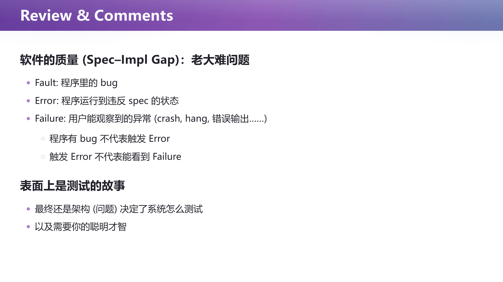

### 1.1 表面上讲的是测试，实际决定它的是架构

画面上的内容看起来都是测试的故事，但最终**还是软件架构决定了系统怎么测试，以及你的架构好不好测**。

拿上上节课许愿出来的那个 CS:GO 举例。一个自然的追问是：这样的东西怎么测试？前提是架构本身做得还可以——你一定会把游戏引擎和游戏界面分开。引擎负责碰撞判定、射击、角色逻辑，界面负责把状态画出来。引擎里没有一个像素，也没有一张截图；它维护的是游戏状态：子弹有坐标、有速度、有 type（是 AK 的子弹还是 AWM 的子弹），每一帧或者每一个 tick 推进一次状态，这个推进甚至可以完全确定性——从同一个状态出发往下走一步，得到的下一个状态是唯一的。人的输入也是状态转移的一部分：player 1 按下了左键，状态该怎么变，也是引擎定义的规则。

真正要画到屏幕上时，还有一个函数把"没有任何图形、但包含手臂姿态等等"的引擎状态投射成一个显示状态，再渲染成你看到的沙盘模型。这就是为什么现在的游戏都支持 replay 和 OB 视角：所有人的状态在时间轴上必须绝对一致，不同的只是投射方式——玩家看到第一人称视角，OB 看到上帝视角。

于是测试自然分成几层：引擎里每个函数都可以有足够多的单元测试，引擎还可以有 replay 测试；界面部分则是另一套验证方式。这本来就是工程意义上很合理的答案。

### 1.2 Agent 给出的"合理"答案

讲者也顺手问了 GPT：能不能把单元测试、模块测试和系统测试分开？模型给出的答案同样合理得挑不出错——源码放在 `src/`，测试分三层，外面再加一个 `justfile`：

```text
project/
├── src/
├── tests/
│   ├── unit/
│   ├── module/
│   └── system/
└── justfile
```

`just` 可以理解成退化版的 `make`：它本身不聪明，只是给命令提供一个统一入口，让你能敲 `just test`、`just test unit`、`just test system`。


那为什么又说测试和软件设计需要聪明才智？因为**规模不一样**。如果只是这两天想许愿一个 CS:GO、发到 B 站起一个"震惊"的标题，这个目录结构已经足够好。但如果你维护的项目现在已经十万行、未来可能变成一百万行，就不能再用这种方式组织测试。

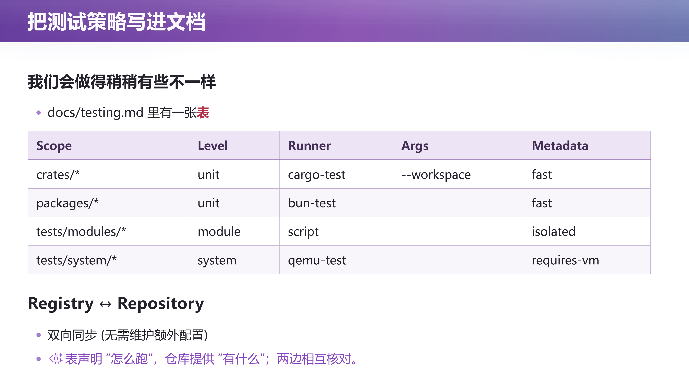

讲者的做法是：在 `docs/testing.md` 里维护一张表，让这张表成为测试策略的**单一事实来源**（Single Source of Truth）。表里每一行描述一条测试规则——覆盖哪些目录（Scope）、什么层级（Level）、用什么 Runner 跑、带什么参数（Args）、以及一些元数据（Metadata，比如"跑得快""需要隔离""依赖虚拟机"）：

| Scope | Level | Runner | Args | Metadata |
|---|---|---|---|---|
| `crates/*` | unit | cargo-test | `--workspace` | fast |
| `packages/*` | unit | bun-test | | fast |
| `tests/modules/*` | module | script | | isolated |
| `tests/system/*` | system | qemu-test | | requires-vm |

背后的机制和 `justfile` 其实没有本质区别：后面有一个"编译器"，把这张 Markdown 表格编译成统一的执行计划。区别在于**不需要维护两份东西**。你可以往表里加 tag，然后声明"每次 pre-commit 都要跑完某个 tag 的所有测试才能 commit"，"跑 CI 的时候要跑一次完整的 system test，MR 才能 merge"。所有文档都写在一起，不会散落在某个 YAML、某个 commit hook、某个与平台绑定的配置目录里；项目里只留你自己定义的术语体系。


这套设计和工业界一些成功的构建系统（比如 Bazel）在想法上很相似：声明式地描述"有什么、怎么跑"，再让工具去生成执行计划。

### 1.3 Registry 与 Repository 要双向核对

只有表还不够。这里的关键是 **Registry ↔ Repository 的双向核对**：表声明"应该怎样跑"，仓库提供"实际有什么"。

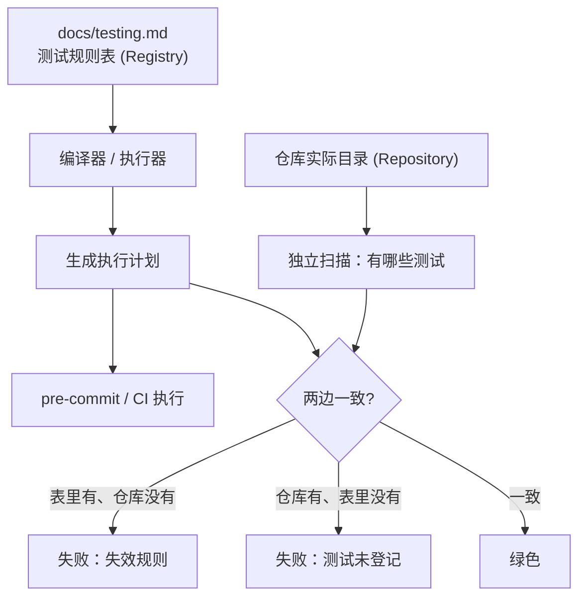

不仅要检查表里的路径是否还存在，还要**独立扫描仓库**，检查新加入的测试有没有被登记。理由很实际：假如执行器只遍历表中出现的路径，那整片没登记的测试就会悄悄消失，CI 依然一片绿色——你以为覆盖了，其实漏了一整块。

### 1.4 弱反馈，以及强化学习里的 tension

讲者把这件事放回模型的语境：这类工作在强化学习里属于**反馈信号特别弱、反馈链特别长**的事情。模型希望尽可能快地完成任务；而你在这里做的，是先构建一套基础设施，甚至会复用别人的基础设施，会浪费很多 token。但从人的角度看，一个相对比较大的项目因此更好维护了。

所以"概念上都懂"和"真的做得出来"之间还有距离。要做测试、要做单元测试、模块测试、系统测试，这些话谁都会点头；但**这件事情到底怎么做，到今天还是要在实践里不断看别人怎么写、慢慢形成自己的感受**。

## 2. 从"调试程序"到"证明程序"

*(参考时间: 00:12:33)*

上一讲引用了 Dijkstra 那句著名的话：测试只能证明 bug 的存在，不能证明 bug 的不存在。测试可以帮我们找到很多 bug、修掉它们，让软件质量变好，这一点毫无疑问。

那有没有可能真的做出一个**绝对正确**的软件？

在很多人的默认认知里，这不可能。写一个复杂的系统——从大二做 NEMU 的实验，到写操作系统内核、写数据库、写 rewrite engine——你早就默认了一件事：我不可能写出绝对正确的东西，它一定有 bug。我们写出一段代码，堆一个十万行的屎山，跑起来大概是对的，然后靠不停测试让它更对。

但这件事，早在更早的时候就有人想过了。

### 2.1 McCarthy, 1962

1962 年，John McCarthy 写下了这样的主张：

> Instead of debugging a program, one should prove that it meets its specifications, and this proof should be checked by a computer program.

也就是说：不要去 debug 程序，而应该证明它满足规格；并且这个证明应该**由计算机来检查**。要做到这一点，就需要形式系统（formal system），需要人们能够轻松地在里面写证明。原文还有一句关键的补充：我们可以要求计算机在检查每一步上做得比人愿意做的多得多，所以每一步可以比现在更"大"。

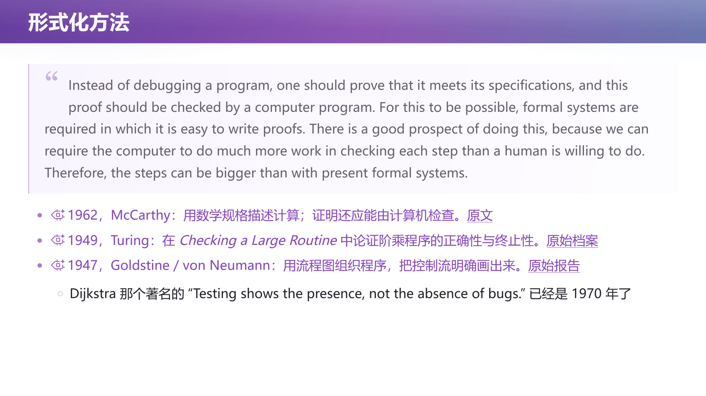

这个愿望比 1962 年还要早：1949 年 Turing 在 *Checking a Large Routine* 里已经论证过阶乘程序的正确性与终止性；1947 年 Goldstine 和 von Neumann 用流程图组织程序，把控制流明确画出来。他们说的是同一件事：**有没有可能用一个严格的数学对象，像自然数那样，来描述计算**。

### 2.2 要写证明，而写证明很痛苦

"写证明"这件事你们其实经历过。离散数学刚开始学的是逻辑，然后是各种证明，那是思维体操，也常常让人死去活来——每个字都听懂了，面对一个看起来非常简单的题目却无从下手。五个学分的离散数学结束以后，大家如释重负：终于不用再处理那个非常复杂的数学系统，可以直接 rush 一个 CS:GO 出来，又回到计算机的世界。

而这段被折磨的经历，恰好就是形式化方法想要的东西。

自然数是怎么定义的？零是自然数；如果 n 是自然数，那么 n+1 也是自然数。于是 0+1 是自然数，0+1+1 也是自然数——这就是皮亚诺公理。我们给它们起名字：零叫 0，(0+1) 叫 1，((0+1)+1) 叫 2；在二进制里也可以叫 0、1、10。有了自然数，你就可以在上面定义加减乘除，定义递归、定义函数，它就成了一个严格的数学对象。于是像 x² + 2x + 1 = (x+1)² 这样的东西可以被严格证明。

那么，**能不能把一个程序也变成这样的数学对象**？

### 2.3 Hoare, 1969：计算机程序的公理基础

1969 年，Tony Hoare 发表了一篇很短的论文，标题写得很霸气：*An Axiomatic Basis for Computer Programming*（计算机程序的公理基础）。摘要里说，这篇论文尝试用**最初在几何学研究中使用的技术**，来探索计算机程序的逻辑基础——就像初中平面几何那样，有公理，有推理规则。说实话，这篇论文本身并没有给出特别多的东西，它真正的贡献是开创了一整条路线。

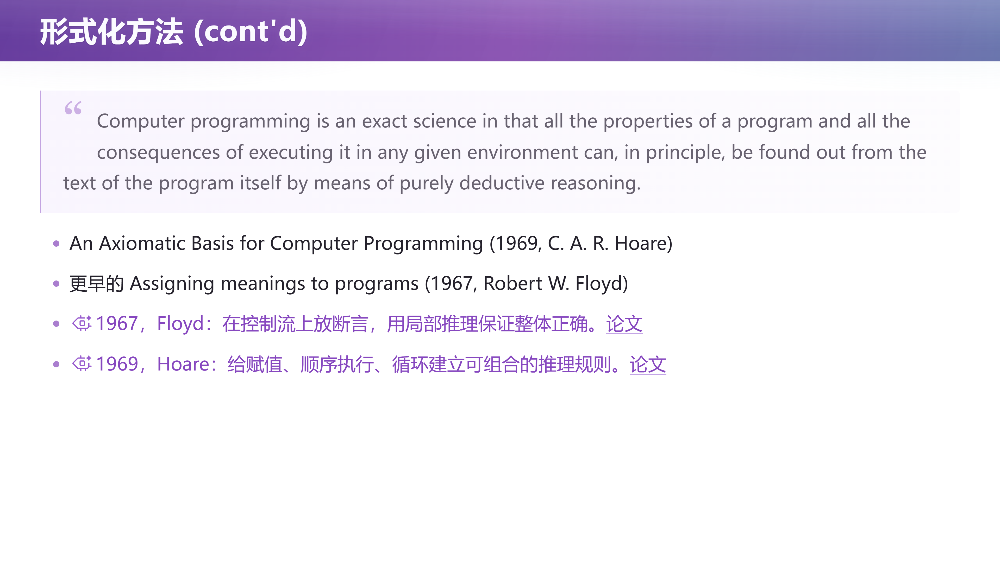

Hoare 的出发点是一个非常朴素的观察：**程序就是状态转移**。Everything is a state machine。一段程序有很多输入，输入 1 给出输出 1；或者说从一个状态加一个输入，走到下一个状态。

既然如此，我们可以把所有可能的行为压起来，用一个公理化的推理系统去证明它：

`{P} C {Q}`

从满足前置条件 P 的状态开始执行程序 C，如果执行终止，那么结束状态满足后置条件 Q。

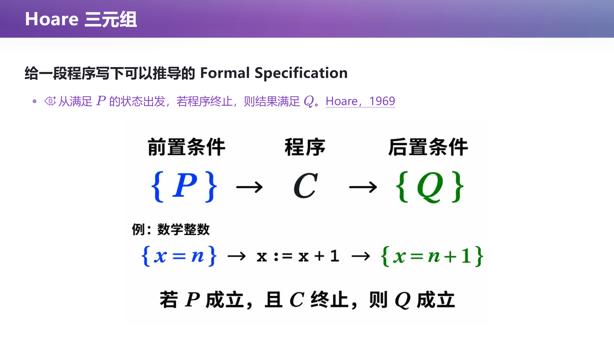

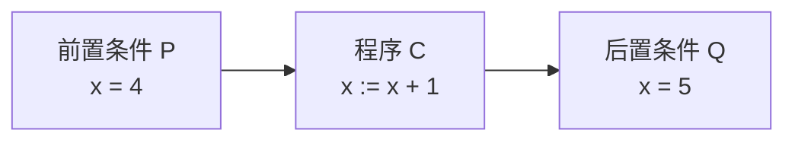

如果程序会终止，我们就可以把一步又一步的执行串起来：先执行这句，再执行那句，性质一路传递下去。举例来说，如果现在 x > 0，然后执行 x += 1，就可以推出执行完以后 x 仍然大于零。

**最难处理的其实是循环**，因为顺序执行的程序"执行完了以后结果是这个程序执行的结果"——这话接近于废话。但如果是 `while (B) { ... }`，直觉是：循环结束以后，你一定可以断言 ¬B。所以在循环里，你需要找到一个**不变式**（invariant）：不管循环执行多少次，这一段程序始终满足的数学性质都不变。有了它，再加上退出时 ¬B 成立，才能把循环前后接起来。

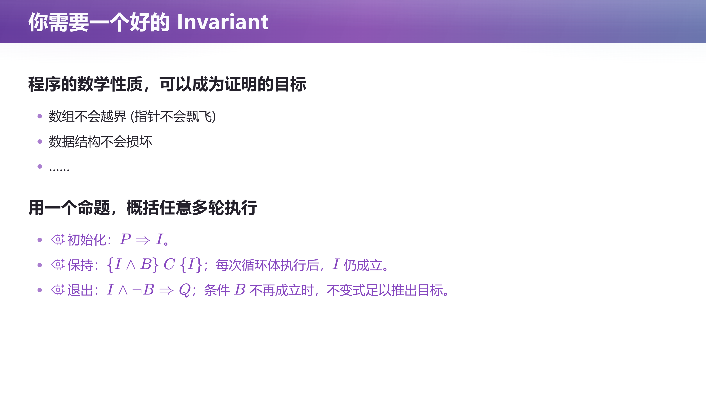

### 2.4 程序的性质可以是证明的目标

这一套东西的价值在于：数组不会越界、指针不会飘飞、数据结构不会损坏，这些都可以变成**证明的目标**。

以大家一定写过的数据结构为例：一个带 `parent` 指针的平衡二叉搜索树。根上的值比左子树大、比右子树小，比如 9 下面挂 7 和 10，这就是一棵合法的树。而如果你要维护 `parent` 指针、还要做旋转——第一次写、又不抄书的话，谁写谁知道——就会发现写着写着指针就丢了，树被拉坏了。

于是你一定会写很多断言。对任何一个节点 `p`，你希望：

```c
assert(p->parent->left == p || p->parent->right == p);
assert(p->left->value < p->value);   /* 假设子树非空 */
```

每一条语句其实都自带了一些 assertion。比如你希望程序永远不 crash，那就希望指针访问永远合法、永远不会有除零：

```c
return p / q;   /* 隐含：q != 0 */
```

形式化方法想做的事情就是：**你写的所有这些数学性质，最终都被证明是真的**——不是"跑起来没崩"，而是无可辩驳地为真。程序带着这个证明，它就是对的。

除此之外，程序执行的每一个瞬间也都可以有性质：理论上你可以用一个列表收集所有执行过的语句，去证明"从开始执行到当前状态"的某种性质。这些都属于形式化方法的地盘。

### 2.5 有点生不逢时

这是个非常美好的愿景。但放在当时，它有点**生不逢时**——尤其是你考虑到编程语言的发展速度：你希望让**每一个**程序都带一个证明，这件事在当时真的做不到。

课本上常举的例子是 Boyer–Moore 多数投票算法：模拟一个投票过程，找出得票严格超过一半的人。你手上只有一个 candidate 和一个 count，来了选票同名就加一、不同名就减一，减到零就换人。这个算法是对的，但它把历史丢掉了——程序是一个**有损的压缩**，它把正确性留给了后人的智慧。要证明它，你得构造一个非常巧妙的循环不变式，把所有可能的情况都 capture 进去。这还只是一个只有两个变量的循环；如果去证明数据结构、指针算法，那就更复杂了。

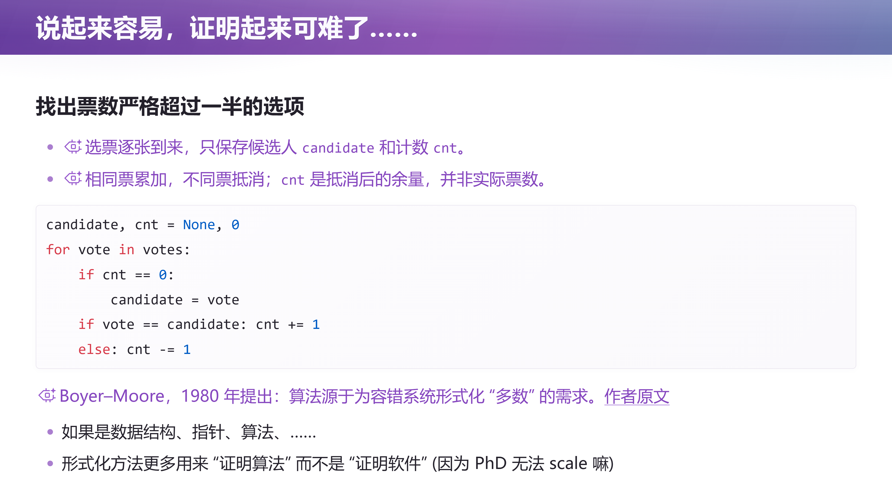

所以讲者的判断是：在那个年代，形式化方法把大家**带歪**了一点。人们花大量的人类智力去证明"平衡树确实是对的"这类问题；到 1990 年，证明一棵二叉搜索树仍然是很困难的研究问题，你还能提出一种新逻辑，声称它对证明 BST 更好。但现实是：**没有程序员会干这件事**。第一，程序员不懂数理逻辑，学完离散课就不想再碰逻辑；第二，你还强迫他学一门新逻辑；第三，你只是声称这个系统稍微简单一点点，他自己并不会用。

**在那个时候，人类的智力是不 scale 的。**

而今天的情形发生了根本性的变化：AI 是 PhD level 的智力，而且**可以 scale**——把模型的权重复制一份，你就多了一个 PhD level 的 intelligence。所以那些先驱做得太早了：理论做得非常漂亮，但另一条路意外地在程序员群体里变得更流行。顺带说一句，Hoare 这条路后来拿了图灵奖。

---

## 3. Everything is a state machine

*(参考时间: 00:29:00)*

为什么不能用暴力计算来证明程序正确？

程序总有一个初始状态，比如初始状态是 x = 1。我解释执行它，执行完不就是 x = 1 吗？那为什么我不能这样证明程序是对的？

麻烦出在两件事上。第一件是**外界输入**：`y = input()` 意味着 y 可以是任何整数。哪怕只限定 y ∈ [-10, 10]，你也一下子创建出一大堆可能的下一个状态。第二件是**并发**：多个线程的执行交错，会把状态数进一步推上去。

但请注意：这个过程本身是**完全确定性**的。如果你不计代价地把整个状态转移图构建出来，那么你相当于在每一个状态上都判断了一次断言——比如要求每个状态都满足 y > 0，直接在每个状态上用它去检查合法与否。某个状态不合法，你就找到了一个错误。

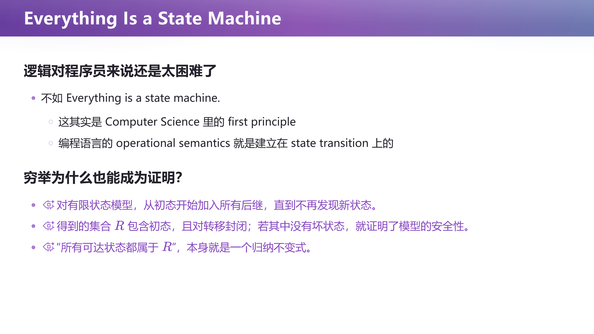

对程序员来说，这个心智负担小多了：不需要学霍尔三元组，也不需要把平面几何的噩梦再重现一遍，只需要写一个解释器。**只要你能写出这个程序的解释器，你就能用暴力方式证明它是正确的。**

### 3.1 穷举为什么也能算证明

关键在于"覆盖全部允许的行为"。设从初始状态出发、不断加入所有可能后继，直到不再出现新状态，得到集合 R。那么：

- R 包含初态；
- R 对转移封闭：任意状态的任意后继仍在 R 中。

于是"所有可达状态都属于 R"本身就是一个**归纳不变式**。只要 R 中没有坏状态，坏状态就不可达——这就是证明。

讲者举的那个经典例子是并发计数器：多个线程各自执行 `sum++`，不管多少线程、每个线程循环多少次，你最终都可能得到 `sum == 1` 这种"奇怪"的结果。那也是一个确定的状态：程序从顺序执行到并发执行，每个状态都可能选择 T1 走一步，也可能选择 T2 走一步，分支迅速爆炸——这就是**状态爆炸**。

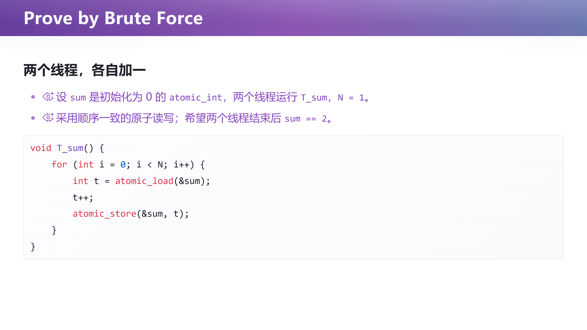

从理论上说，用枚举的方式解决问题是可以的，概念上也更容易：只要能写出解释器，就能暴力证明。后面几十年时间，人类就一直沿着这条路径改进。

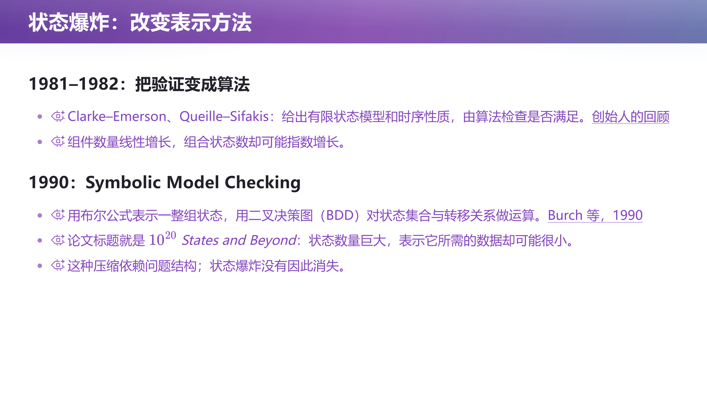

改进的方向一直在"怎样表示和搜索这些状态"上：用布尔公式和二叉决策图表示一整组状态，不必逐个存储；把"是否存在若干步以内的错误执行"编码成 SAT 问题；或者让反例反过来指导推理，逐步生成归纳引理。前面要求程序员费劲想出来的 invariant，也成了算法可以去搜索的对象。

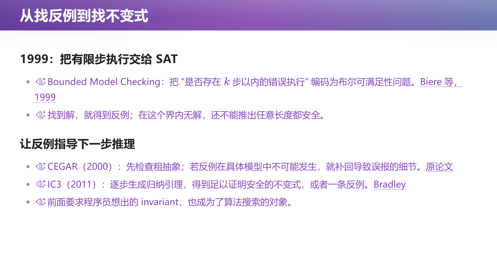

## 4. 模型、路径与完整证明

*(参考时间: 00:32:53)*

但真的遇到一个大程序，暴力做不了。那怎么办？一个思路是：**把程序里最核心的逻辑抽出来**。

### 4.1 自动售货机的建模

这是 model checking 领域非常喜欢的例子：自动售货机。现在的自动售货机很复杂——点一下弹出二维码，甚至扫脸，然后你把东西拿走。而在 1980、1990 年代讨论"做一个自动售货机"时，大家考虑的是：纸币入口、硬币入口、退币口；按了退币口要能把钱退出来；控制程序里还要识别纸币、识别硬币，硬币甚至要称重，重量不对就得走另一条逻辑。这样一份代码可能几千上万行。

对它做证明，前面那套暴力方法就不行了——尤其在当年计算机还很慢的时候。

于是我们做一个**状态机的抽象**，也就是建模。程序一开始是 0 元；收到一元硬币就变成 1；收到五元硬币就变成 5；五元之后再收到一元，就变成 6。假设这台机器卖的东西只有有限的几种饮料，那么整个状态转换图可能并不大。退币又是一个专门的状态：按了退币键、再按一个选择键，才会回到 0。这只是其中一种（而且不是最好的）建模方法，人们还提出过各种别的状态机。

关键在于：**如果我们能把一台自动售货机变成一个只有几十个或几百个状态的状态图，那就可以 prove by brute force 了。** 我们在这个状态图上遍历路径，把"卡住"这类状态标成坏状态，只要证明不存在一条从初始状态到坏状态的路径——用广度优先搜索或者深度优先搜索就够了。

### 4.2 代价：证明的是模型，不是代码

先别急着高兴。你得到了一个正确的模型，然后把模型实现成售货机上的代码——这时候要问一个尖锐的问题：

**他并没有证明代码是对的，他证明的是模型是对的。**

而模型的行为和代码的行为是不是一样？如果你的代码第一行就写了一个 `return`，它就不是这个模型了。

所以这条路其实是把正确性**拆成了两步**：

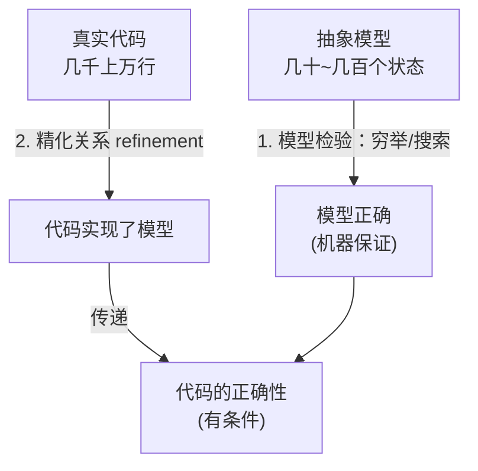

第一步证明模型正确，这没问题，机器可以保证。第二步要保证的是**代码确实实现了这个模型**——只有模型的正确性传递到代码上，才算完。

而这第二步同样不能保证一切。比如算重量的时候有一个除法，除以 y，y 恰好是 0，你的自动售货机就 crash 了。模型里没有这个除法，所以模型正确也说明不了它不会崩。

讲者还讲了一个真实遇到的例子：在自动售货机上买了东西，东西没掉下来，机器自动退款了；于是又买了一个，结果这次掉下来两个——他赚了。这类情况在代码里完全可能发生：代码要检测"物体掉下来了没有"，这个检测逻辑模型里可能根本没有建模。

### 4.3 精化映射：一层一层搭上去

不过，这条路有一个非常开创性的工作。Lamport 证明了 **the existence of refinement mappings**：在数学意义上，总是存在这样的映射，你可以一层一层地把模型变成更复杂的模型，再变成更复杂的模型，最终走到代码，把正确性一路传递下去。

即便你最终没有资源证明"这段代码是对的"，这个框架也给了你别的办法建立信心。比如让代码在每次状态迁移时打一条 log，然后让模型和代码跑**同一个测试用例**，比较两边打印出来的状态迁移序列是否完全一样。如果一样，你就得到了很强的证据：这段代码没有在第一行就 return，它大概是实现了这个模型的。

再往下的问题可以换工具解决：会不会除零？会不会有 memory corruption？——你可以直接选一门不会出现内存破坏的编程语言，这类错误就从这个清单上划掉了。

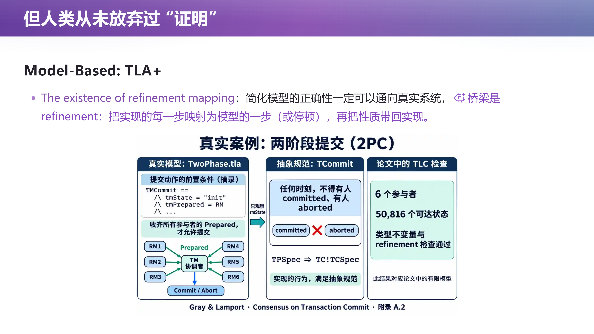

TLA+ 是 Lamport 的代表性工作，用它证明过分布式共识协议之类的性质。而且这条路线不只能证明正确性，还能**指导生成测试用例**：模型是经过严格验证的，我在模型上可以采样出各种奇怪的执行路径，知道每一条路径最终会停到哪个状态；再把这个测试用例送到代码里跑一遍，检查代码是不是也落到了同一个状态。这本质上就是 refinement mapping：我能把代码的状态投射回模型的状态，就拥有了对这个程序正确性更好的一种信心。

### 4.4 符号执行：把搜索延后成解方程

人类从来没有放弃过 proof by brute force。既然程序的状态本质上是一棵搜索树，那有没有可能不要现在就把搜索树展开，而用数学公式表示当前的搜索状态？

假设 y 是任意整数。执行 `z = x + y` 之后，我的状态可以用一组方程表示：x = 1，y 无约束，z = x + y。如果下一条是 `if (z > 5)`，那就分两种情况：一种走 then 分支，此时 PC = 8，方程里加上 z > 5；一种走 else 分支，此时 PC = 12，方程里加上 z ≤ 5。

不断往上面加方程，就可以建模这个程序。于是"搜索"被延后了，变成了一个问题：**这个方程组有没有解？** 有解，就说明存在一条从头到尾的路径，你也就找到了一个测试用例。如果要检查程序里的断言 `assert(y != 0)`，就把它写成"存在一条从程序开头走到 `y == 0` 的路径吗"——找得到，就找到了一个反例。

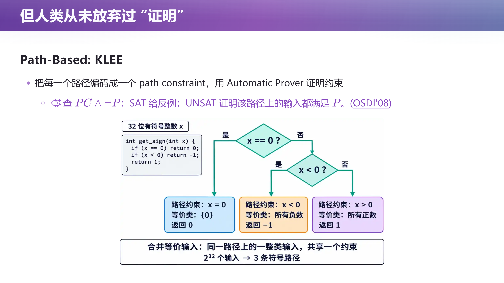

这件事在模型上很早就有技术了；难的是在**真实程序**上做。你需要一个代码的中间表示（IR），需要一套像指令集一样可执行的东西——可以选 LLVM IR，也可以选别的；然后需要模拟执行这套指令集里的所有指令，并为每一条指令（包括跳转指令）列出方程。这是很大的工程实现麻烦。但好处是你可以直接在真正的程序上跑路径。

KLEE 就是这条路线上的代表工作：把每一条路径编码成一个 path constraint，然后问求解器 PC ∧ ¬P 是否有解——有解给出反例，无解则说明这条路径上的输入都满足 P。能走到这一步，靠的是方程求解器在某个时刻变得"可以用了"。

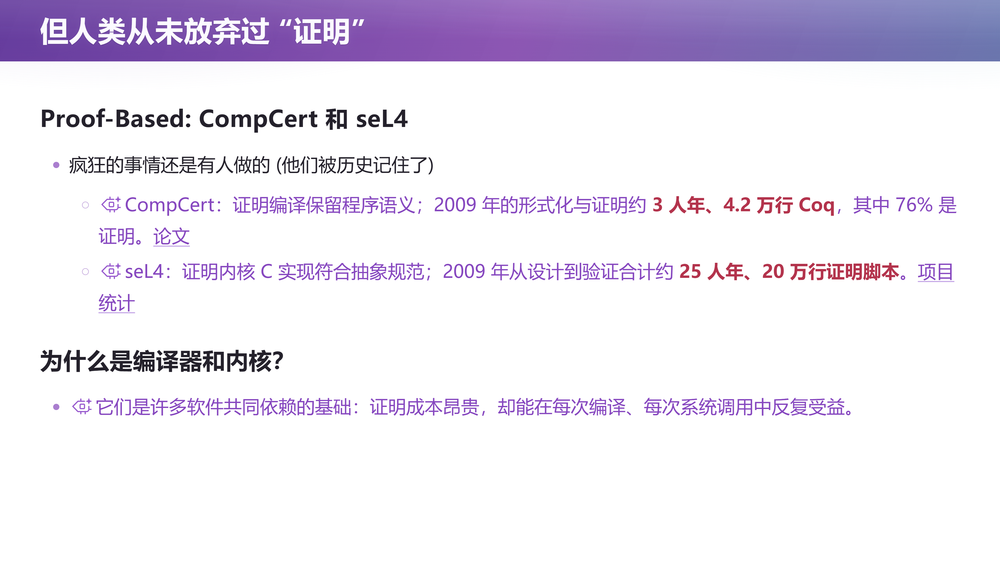

### 4.5 真正疯狂的事情：证明一个编译器

还有一条更疯狂的路：不建模、不解方程，直接证明**真正的程序**在公理意义上就是对的。而且真的有人做了，他们被历史记住了。

第一个例子是 **CompCert**，一个被证明过的编译器。

你的编译器其实是可能有 bug 的：你写一个合法的程序交给它，它可能直接 crash，也可能做不正确的翻译。你写 `int f() { return 1; }`，你相信它是对的，但你知道编译器到底翻译出了什么指令吗？它万一把 2 放进返回值寄存器呢？你能控制吗？我们实际上是**盲信**编译器的。

而 CompCert 证明的是：对于任意的输入字符串，只要它是一个合法的 C 程序，输出的东西就一定和它语义等价。编译器本身是个函数：输入一个字符串，输出另一个字符串。证明这个函数的语义保持性，是一件多么疯狂的事情。2009 年完成的初版还只是很初步的版本——很多到机器语义层面的东西它没有证明——但那份形式化与证明已经是约 3 人年、4.2 万行 Coq，其中 76% 是证明。

第二个例子是 **seL4**：一个"永远不会 crash"的操作系统内核。它证明内核的 C 实现符合抽象规范；从设计到验证合计约 25 人年，证明脚本约 20 万行。

为什么是编译器和内核？因为你的编译器是用来编译上月球车的代码的。如果编译器错了，它编译出不正确的代码，月球车上去执行这段代码时就挂了。对于这种场景，你不希望用测试"碰运气"——你希望有一个数学上的保证。它们又是许多软件共同依赖的基础：证明成本虽然昂贵，却能在每一次编译、每一次系统调用中反复受益。

### 4.6 小结：三条路，一堵墙

到这里可以画出这张地图了：

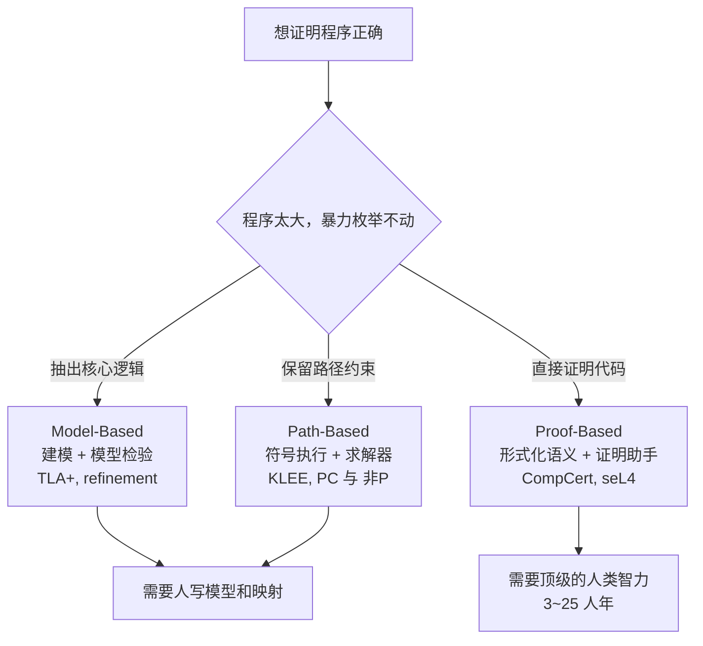

后面两种走到最后都会撞上同一堵墙：**形式化证明需要顶级的人类智力**。CompCert 是 3 人年，seL4 是 25 人年，做这些工作的人都是领域里最顶尖的。直到某一天，事情发生了变化。

## 5. Proof Assistant：铁面无私的反馈

*(参考时间: 00:51:30)*

在讲这个变化之前，先补一块地基建：**proof assistant**，证明助手。

你们可能听说过 OpenAI 在数学上丢下的那颗"核弹"——一口气做出七百多道题的成果，被说成"杀死了数学工作者"。而不管它证明了什么，背后支撑它的机制都是同一个东西：proof assistant。它给了我们"真正证明一个东西"的信心，因为它是**铁面无私的反馈机制**。正是有了这样的反馈机制，OpenAI 才可以用强化学习去训练大规模模型解决数学问题。

### 5.1 为什么需要它：中学数学其实不够严格

我们都说数学非常严格，但**中学数学其实不够严格**。

想想看：选择题是可以猜的，猜题某种程度上是在培养你的数学直觉；真要把它做对，你经常需要先猜一个结果，再想办法去凑。草稿纸也可能是骗人的——你的计算过程可能是错的，但最后负负得正，结果又算对了。改卷人也可能被一段看起来很像证明的话糊弄过去。

那怎么杜绝一切可能的错误？办法是：**还是用草稿纸，但要求草稿纸上的每一小步都是形式系统可以检验的**。就像做平面几何，来来回回就那几条公理；你不如把每一小步的推导都严格写出来，而且只写你用了哪一条规则，让计算机帮你完成内部的推导。

于是 proof assistant 的工作方式就清楚了：**你来写证明，它来检查你写的证明对不对**。它叫 assistant，是因为证明还是你写的（或者是 AI 写的），它负责检查。

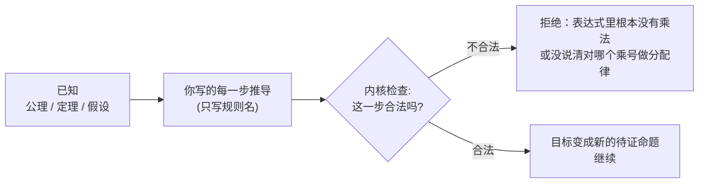

如果你说"用一下乘法分配律"，但表达式里根本没有乘法，计算机会直接拒绝你。如果你没说清楚到底对哪个乘号做分配律，下一步推导就做不下去了。


### 5.2 证明是一个状态：已知与待证

从程序员的角度看，proof assistant 其实非常熟悉：**证明是一个状态**。你有一堆已知（前提、公理、已经被证明的定理），还有一个待证的目标。

最平凡的情形是：当已知和待证**完全相同**——逐字符相同——这个证明就成立了。因为已知 1 = 1，可以推出 1 = 1。所有你想证明的性质，逻辑的、程序的、数学的，最终都要归结到"严格相等"上，由内核去 check。

更有意思的是，你可以通过**变换待证目标**让证明变得更容易。但变换之后不代表一定能证过去，所以你还要选对方向。

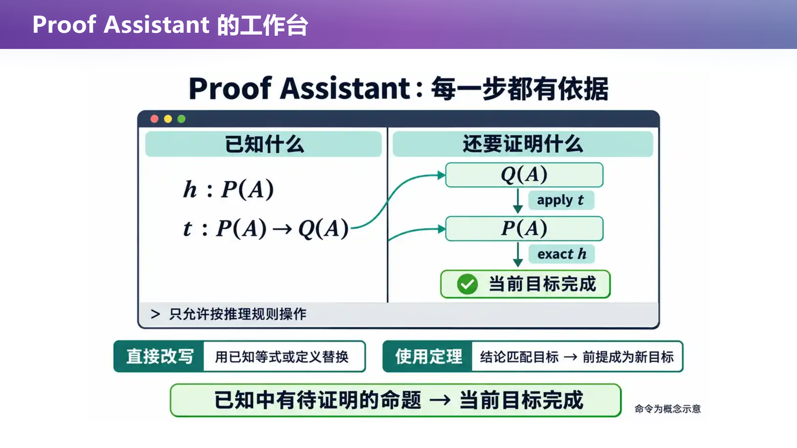

### 5.3 存在一个，与任意一个

**存在性**：要证明"这个班上至少有一个同学得了满分"，也就是 ∃x. P(x)。已知可能是同学们的成绩、一堆定理和公理。你可以把 ∃x. P(x) 中的 x 换成一个具体的名字，比如声称"我想把待证改成 P(A)"。这是允许的，P(A) 确实可以推出 ∃x. P(x)。

到这个状态以后，如果 A 考了 90 分，而 P 要求 100 分，你就证不下去了：已知里有 A 考 90 分，但 A 考 100 分和它不是逐字符相等，你再也做不了任何变换。**所以选谁很重要**——选 B，而 B 考了 100 分，目标就和已知对上，证明就关掉了。

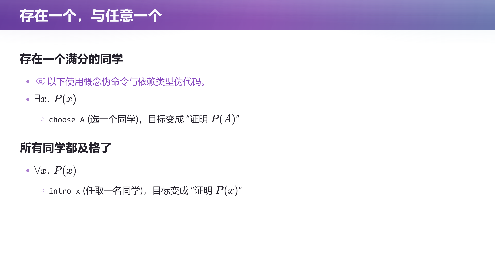

**任意性**：要证明"对所有的同学，P(x)"就麻烦一些。你可以做的是 `intro x`——任取一名同学，把 ∀x 去掉，x 变成一个自由变量。这没有改变证明的正确性（你还是需要对"任意"成立），但要去证明具体性质，你可能还需要一些领域内的定理。

**蕴含**：要证明"保研的同学都及格了"，即 P(x) ⇒ Q(x)，你可以把 P(x) 从待证移到已知——`intro h`，把 P(x) 加入假设，然后去证明 Q(x)。

**归纳**：这更有意思。要证明 ∀n ∈ ℕ. P(n)，可以把它改写成两个待证：

1. P(0)；
2. 对任意的 n，P(n) ⇒ P(n+1)。

`induction n` 做的就是这件事。它把一个命题变成了 base case 和 inductive step，把命题的证明变成两件事的证明。

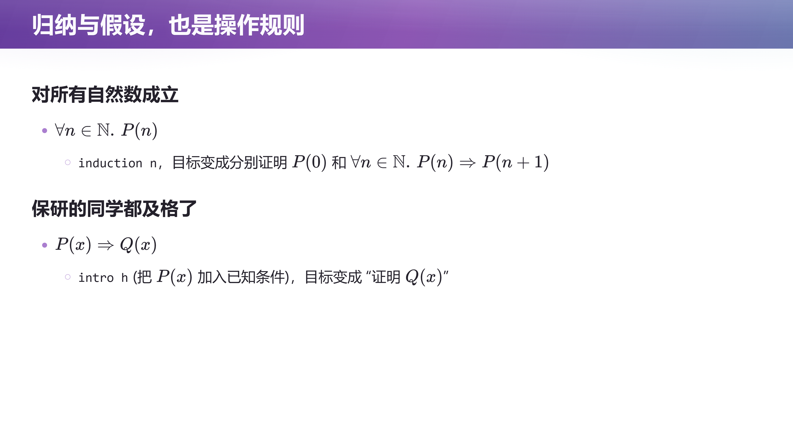

### 5.4 证明栈

严格说，proof state 是一个状态；但现在的 proof assistant 基本上把它实现成一个 **proof stack**——一个栈。

你执行 `induction n`，它就把 ∀n. P(n) 换成 P(0) 和 ∀n. P(n) ⇒ P(n+1)，压进栈里。如果你手上直接有这个 P(0)，两个能对上，就把它清掉；清掉以后，下一个目标浮到栈顶，你继续证。

因为皮亚诺算术里有归纳法，我们可以递归地定义"0 是自然数""0+1 是自然数""任何自然数加一都是自然数"，进而构建出计算机科学里几乎一切东西。这套证明系统的能力非常强。

而且 proof assistant 还可以在这套基础之上构造各种**语法糖**：比如把霍尔逻辑放进来，让你用霍尔逻辑的公理去推导——底层用的还是同一套逻辑体系。

### 5.5 人类文明的高光时刻：Curry–Howard

讲到这里，讲者说这是他最喜欢的东西之一：**Curry–Howard 对应**（Curry–Howard correspondence）。一句话概括：**命题即类型，证明即程序**。

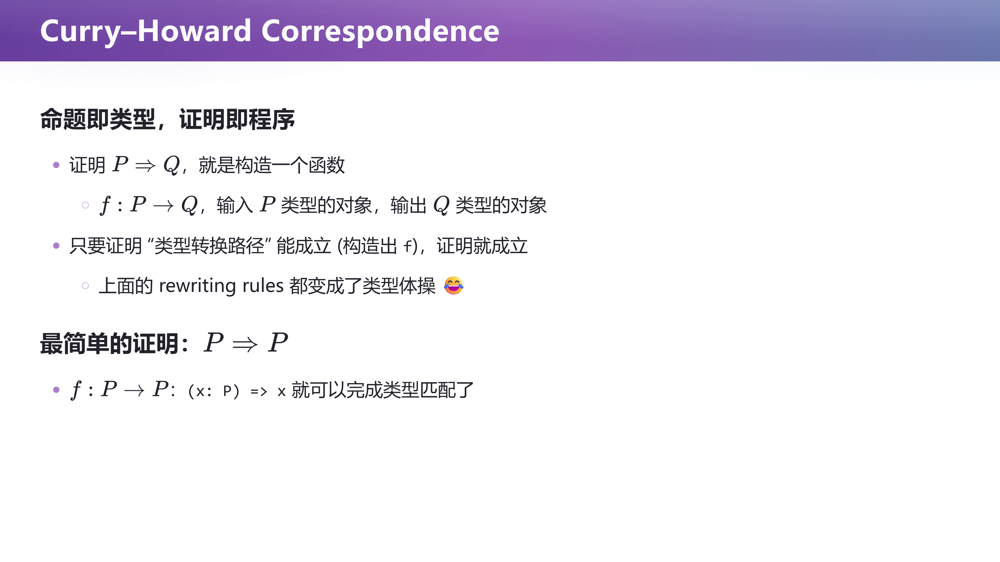

这个对应有点绕，讲者说他第一次讲也担心讲不好（南大有一门"程序设计语言的形式语义"专门讲这些）。

我们写的任何一个命题——"所有保研的学生所有课程都及格了"、哥德巴赫猜想、"程序不会 crash"——都可以写成一个逻辑公式，形如 ∀x. P(x) ⇒ Q(x)。甚至可以写成"对任意程序，这个程序是正确的"：因为程序就是字符串，所有字符串都能和自然数做一一对应（离散数学里的 cardinality），所以"对任意程序"就是"对任意自然数"。这么复杂的命题，最终都归结到皮亚诺算术上的逻辑表达式。

问题的核心在**蕴含**：在前提成立的条件下，后置条件成立。怎么证明它？Curry–Howard 给出了一个极其优雅的方式：

```text
命题  P ⇒ Q
类型  P  -->  Q
证明  一个把 P 类型对象变成 Q 类型对象的函数
```

每个谓词 P 映射成一个类型「type of P」，Q 映射成「type of Q」。你要做的是**实现一个函数**：输入一个 P 类型的对象，输出一个 Q 类型的对象。你甚至不用真的去运行它——只要在类型系统允许的规则里，一步一步做类型变换（类型体操），把一个 P 类型的对象变成 Q 类型的对象，就证明出了 P ⇒ Q。

不允许强制类型转换；只允许在公理系统和定理允许的范围内操作。比如你有一个整数，可以构造整数的二元组，这就是从一种类型得到另一种类型；P 或 Q、P 且 Q，也都能对应到类型上的操作。

### 5.6 三个最基本的证明，翻译成程序

**P ⇒ P**：自己推出自己，显然成立。对应的程序是恒等函数——一个 lambda，直接返回它的参数：

```text
(x: P) => x
```

（用 TypeScript 的写法示意；用 Python 写就是 `lambda x: x`。）输入类型是 P，输出类型经过推导以后完全一样，这个证明就过去了。

**choose A**：构造存在性证明。

```text
(p: P(A)) => [A, p]
```

给你一个 P(A) 的证明 p，返回「见证 A + 证据 p」这一对。不仅告诉我们谁满足条件，还提供他满足条件的证明。

**intro h**：构造蕴含的证明。

```text
(body: (h: H) => Q) => (h: H) => body(h)
```

填入"在假设 h: H 下构造 Q 的证明"的方法 body，就得到了 H ⇒ Q 的证明。

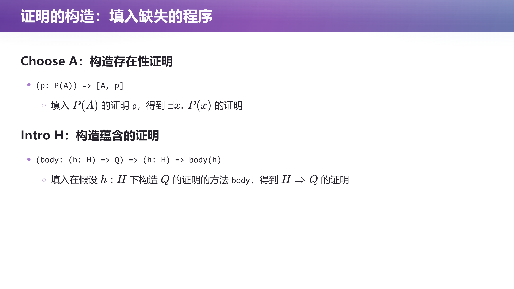

**归纳法**：写成一个递归程序。为了得到一个归纳证明，你需要 base（P(0) 的证明）和 step（把 P(k) 的证明变成 P(k+1) 的证明），然后构造：

```text
base: P(0)
step: (k: Nat, ih: P(k)) => P(k+1)

f(n: Nat): P(n) =
    if n == 0 then base
    else step(n - 1, f(n - 1))
```

你输入任意一个 n，如果是 0 就调用 base，否则调用 step。返回的函数类型正好和归纳公理合上。

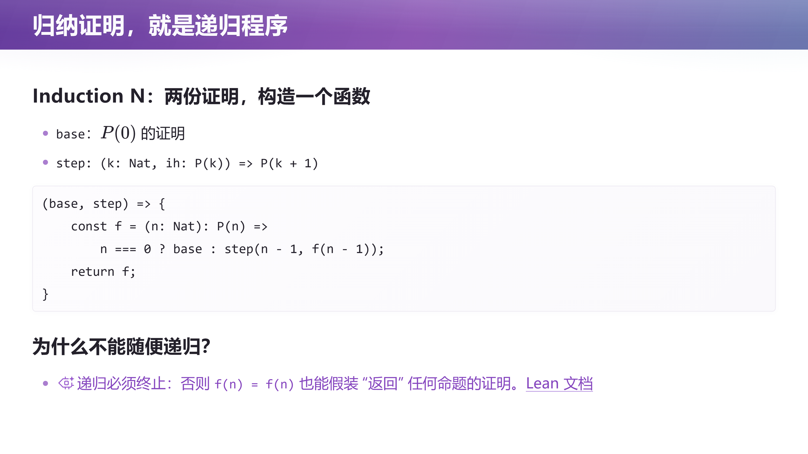

**递归和归纳是等价的。** 这是非常美妙的事情。而且反过来看，递归也必须有终止依据：每次都减小自然数，最终到达 0。否则写一个永远调用自己的函数，声称它能返回任意命题的证明——整个对应就失去意义了（Lean 对此有专门的检查）。

### 5.7 为什么这么好的东西没人学

讲者的说法是："因为老师不会，也学不动了啊。"但也许小学生能学会呢？

讲者设想过一个场景：把以前上课用的那个 Python playground 改造成一个 **Lean playground**。Lean 不只是一个证明语言，它同时是一个很好的函数式编程语言；在 tactic mode 下你可以写那些 simplify only 之类你也不知道它怎么证的证明，但也可以把它当成普通的函数式程序来用，定义 `f x y` 返回一个布尔值，C 里面能写的，在 Lean 里也能写。

于是小学生学 Scratch、学 Python、学 C++，也可以学一门这样的语言。写个函数画个图——比如用 100×100 的分形，把谢尔宾斯基三角形画出来：生成 Lean 代码、链接到 JavaScript 世界、画到画布上。

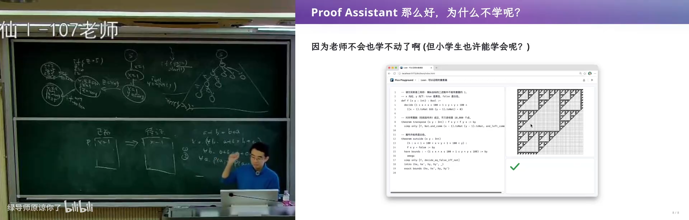

小朋友会发现：我定义了一个函数，它不仅可以画图，我还能证明它对所有整数都成立，而不只是在一万个点上检查过；我还能证明画布外面全都是白色。

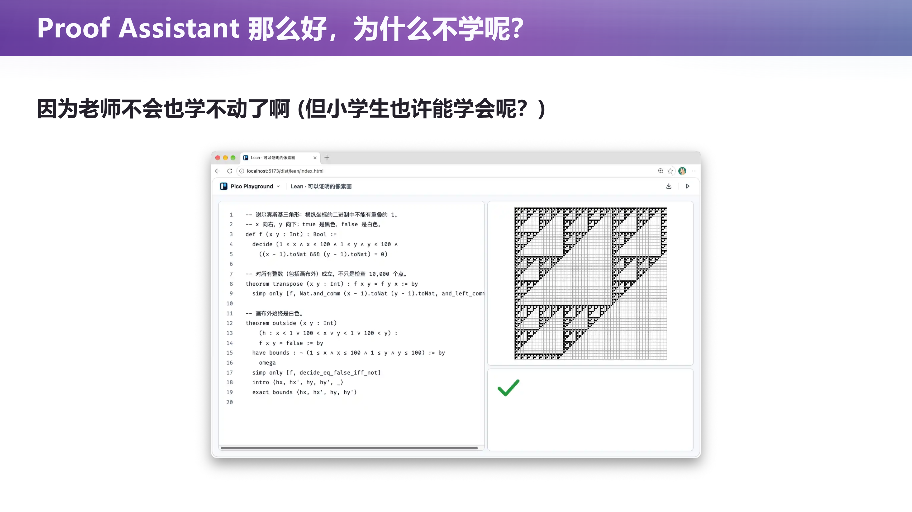

讲者认为，既然南大可以上"程序设计语言的形式语义"，那为什么不能在离散数学课上就教一点 proof assistant？甚至从小学高年级就开始——反正小学生也不懂数学，那就在这个时候"洗脑"：这个就叫数学。

---

## 6. 当 proof 也变成一种 tax

*(参考时间: 01:13:01)*

接下来讲者要讲一个"鬼故事"。故事的开头是：**他的博士论文烂尾了。**


### 6.1 那个烂尾的 conjecture

当年他有一个发现：如果你要去观测一个程序的执行，那么"记录"和"恢复"之间存在一个 trade-off——你记录得越多，恢复的开销就越小；你记得越少，恢复时就要付出越大的代价。人已经做了三十年，这条曲线上有一块地方一直是空的：**不存在同时让记录开销小、恢复开销也小的方案**。

他猜：这个地方是不是真的就没有？于是盲猜"没有"。

问题在于，要把它证出来，需要证明的是：**对任意的程序，对任意的修改，如果能在多项式时间内做某件事，那么就能推出 P = NP**。这里既有"任意程序"，又有"任意修改"——他不知道怎么处理，于是只证了一个非常受限的情况，论文就搁置了。

那时候他还不会用 proof assistant，只写了一份 informal 的证明，然后看了大概一百遍，每天都在想：万一我这个错了，就彻底晚节不保了。他还很担心这个 conjecture 有一天被推翻——那等于立了个 flag 然后 flag 倒了。

### 6.2 不属于我的力量

今年某一天，他发现自己在某个体力/抽卡系统里的"重置卡"用不掉了，于是想起了一个**不属于他的力量**。

他把这个问题丢给了模型。好消息是：没有晚节不保。

模型先写了一个 informal 的证明。中间它还放弃过一次，说"这个好像证不出来"。讲者就鼓励了它一下——"我觉得直觉上应该可以，虽然我也不知道怎么证"——然后它推下去了。拿到 informal proof 之后，又让 Claude 做了交叉检查，结论是没什么问题；接着又写了**两万行 Lean**，把整个形式化证明补完，多烧了一些 token。

然后讲者顺着这个结果继续往后推了一些有用的结论，再让模型评估投稿前景：GPT-6 认为投 PODC（Principles of Distributed Computing，理论计算机的顶级会议）没问题，Claude 认为在 borderline 上。讲者说他不是做理论计算机的，一点也不懂这些，而且——**他已经不想投了**。

这件事可怕的地方不在于论文能不能中，而在于：**我有一个不属于我的力量，而我竟然可以用它来产生一些有用的东西。**


### 6.3 形式化方法最好的时代

于是我们面临一个判断：**现在是形式化方法最好的时代。**

以前，seL4、CompCert 这样的工作需要的都是**顶级的人类智力**。而现在，突然之间，从软件构建的角度看，这种智力有了，而且是无穷无尽的。

如果要做一些新的、有创新的东西——不管你写毕业论文还是要发表论文——你需要证明一个"不存在的创新点"，要付出大量的 storytelling 劳动去包装你的工作；你需要 engineering 劳动，写代码做实验证明方法有效；你需要把它提炼成一些数学表达，也就是 formalization。而今天，连**证明本身**也成了 tax：

- storytelling tax：把想法讲成一个别人能听懂的叙述；
- engineering tax：把它做成能跑的系统；
- formalization tax：把它写成机器能处理的形式；
- **proof tax**：现在连证明也可以交给模型了。

讲者的体会是：以后你只要知道世界上有一个东西叫 Curry–Howard correspondence 就够了。他自己当年推过，现在也推不下去了——"我也翻车了"——但这不妨碍他大概知道：世界上有一个不属于我的力量，可以借过来解决一些还在我的力量范围里的问题。

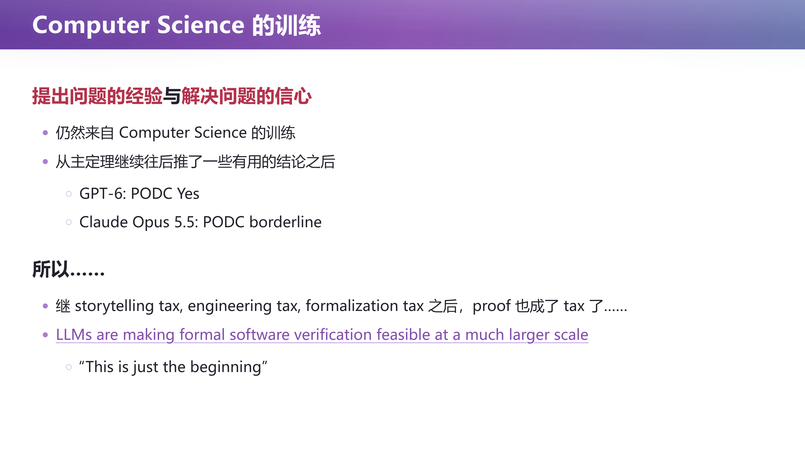

当然，留下的是什么？**提出问题的经验，和解决问题的信心，仍然来自 Computer Science 的训练。** 知道什么问题值得问、结果能往哪里推，比等模型吐出一段漂亮答案更有力量。

就在前两天，Anthropic 的博客发了这样一条：*LLMs are making formal software verification feasible at a much larger scale*。他们与 Theorem 合作，为一百多个开源软件库在 RISC-V 汇编层面证明了安全性质；课堂上顺带提到的一个小结论是，某个只跑在 64 MB 内存上的程序也被证明了不会 crash。

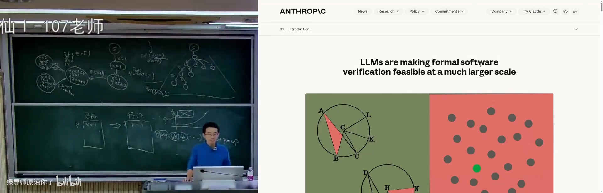

文章里有一句话很耐人寻味：

> This is just the beginning.

### 6.4 但是，证明语言不是为程序设计的

讲者在这里留了一个冷静的注脚：Lean、Coq 这类工具，它们的 proof stack 本身是**为数学设计的，不是为程序设计的**。要真正让"证明一个软件"变得日常，我们可能需要一个更好的语言——也许也不需要，毕竟 AI 连汇编都能写，而这些东西用起来本来就有点像汇编。

但方向是清楚的：**我们可以证明程序的性质，而且不再害怕大型软件系统的数学性质。** 这会大幅增强我们的信心。以前，能理解形式化方法、知道软件验证基本原理的程序员已经是凤毛麟角，因为那里面是非常 involve 的数学；而当数学突然变便宜的时候，这件事就彻底变了。

比较难受的是另一批人：像 XEM 这样融了很多钱的公司，当年融资时讲的故事正是"数学是提升软件可靠性、对齐人类世界的好手段，所以我们要做数学证明"。结果模型直接把数学证明这一层碾过去了。他们最难受的地方在于：数学解决了，**剩下的部分却更难**。

## 7. 证了个寂寞：形式化也要能执行、能测试

*(参考时间: 01:18:00)*

剩下的部分是什么？回到软件工程最基本的那个 gap：

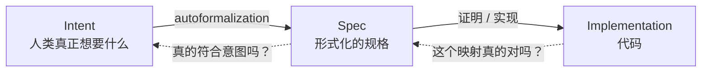

我确实可以写一个数学证明，但如果在数学证明之外还有另外一份代码，而这份代码才是我要交付的实现，那么：我证明的 spec 是不是真的对应了我的 implementation？我的 implementation 是不是对应了 spec？spec 又是不是真实反映了人类的意图？过去我们说"人还是在这一层"；现在，当所有这些都变便宜以后，问题又回到了这个最根本的 gap 上。


### 7.1 反例：那个"证了个寂寞"的 P≠NP

形式化验证翻过很多次车，有的还很出名。

之前有人声称证明了 P ≠ NP，并且给出了一份很长的 Lean 证明。大家最后发现，中间有一个地方的**定义是错的**。这种错误恰恰是形式化验证最容易漏掉的：没有人会去逐字检查你的定义，因为看起来它已经被机器验证过了。

更具体一点：他声称找到了 P 的一个算法，但这个算法解决的并不是原来的问题，而是原问题的一个非常小的特例——那个特例刚好可以在多项式时间里解决。于是链条在中间断掉了：表面上有些东西被证明了，但核心的 spec 写错了，最终结论就是错的。

### 7.2 怎么防止证了个寂寞

讲者说自己有一点领域知识，所以能一定程度上防止形式化验证变成"证了个寂寞"。办法是：**形式化本身也是可以执行、可以测试的。**

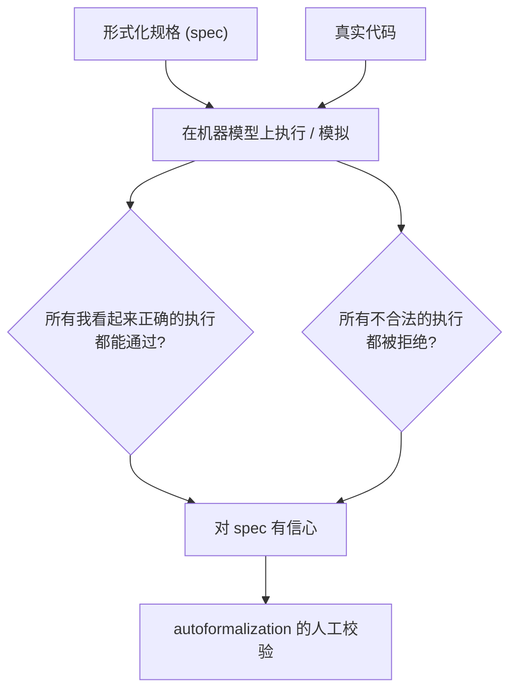

我可以在一个模型上生成很多程序的执行，要求所有看起来正确的执行都能通过，所有不合法的执行都被拒绝；我也可以检查一些定义是否真的表达了原意。这样我就能确认：这个程序确实解决了我原来的问题，而不只是解决了一个玩具版本。这个循环，讲者叫它 **autoformalization** 的校验。

困难在于，autoformalization 本身也会出错。OpenAI 那个数学结果里就出现过"图文不符"：Lean 证明的东西，和用自然语言写的那个东西并不是同一个命题。这可能是模型在翻译时产生了幻觉，也可能是别的原因。如果定理陈述本身依赖的公理系统没问题，最终那个证明可能仍然成立；但中间确实出现了自然语言与形式语言之间的不一致。

## 8. 携带证明的软件

*(参考时间: 01:23:00)*

如果证明可以变便宜，软件交付的形态也可能变化。讲者翻出了一篇很老的论文：**proof-carrying code**，携带证明的代码。它在 1996 年先以另一个名字发表，1997 年又写了一篇 POPL 的文章，最后被大家记住的名字是 proof-carrying code；那张图最早出现在 OSDI'96，并拿了最佳论文。

它的愿景是这样的：

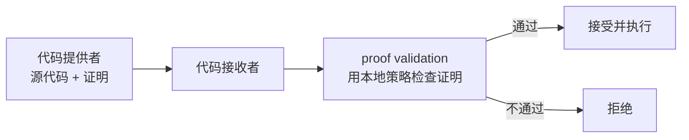

你收到一份源代码，你可以**不相信它**。就像我们今天盲信编译器一样——我们假设编译器不会编译出错误的东西，但这其实是不对的，编译器里能找出很多 bug，只是因为常见代码的 bug 都已经触发过、修掉了，而且有海量的回归测试兜底，才让质量勉强可以接受。

那能不能在源代码旁边就带一些证明？不需要证很多，比如只要证明"不会 memory corruption""不会 crash"，就可以安全地把它插进操作系统内核，而不会破坏内核世界里的其他东西。

这正是今天 eBPF 的感觉：只有证明了绝对安全，才允许你插进内核。虽然 eBPF 和 proof-carrying code 不完全一样，但思路很接近。

那么 **specification 在哪里**？讲者提醒：代码里其实已经有很多 specification 的性质，你都可以直接写成一个断言。刚才那棵平衡树的例子：任何一个节点，它的 parent 的 left 是自己，或者 parent 的 right 是自己——**这就是一条 specification**。我们写 assert 的时候，它是在运行时被校验的；理论上也可以在程序运行时一边 collect trace，一边用 assert 去断言"从执行一开始到现在"的状态性质。

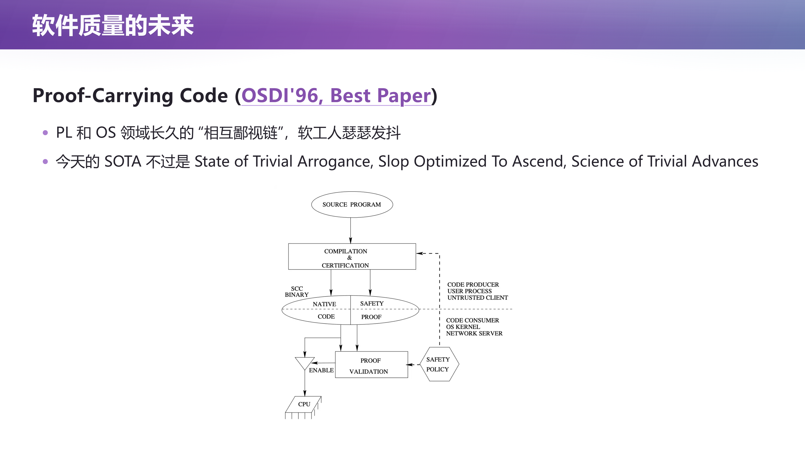

于是未来的图景就出来了：今天我们能做 proof-carrying code 的话，是不是意味着以后写一个 assert，**如果大语言模型不能把这个 assert 翻译成正确的 proof system 代码，你就过不了编译**？我们的代码自带 specification、自带 assertion、自带校验功能。

讲者说，在 LM 出现之前，他会觉得这件事三十年有没有希望都难说；而现在他觉得很快就会实现。到那时候，**软件可靠性相关的教科书、课上讲的所有东西都要重写**——因为以前我们理所当然地认为，证明是一件非常需要数学智力的工作：你想证明你的链表是个链表、你想证明那棵树是棵树，太难了。而当它不难的时候，故事就完全变了。

### 8.1 顺手吐槽：PL 与 OS 的鄙视链

讲者还讲了一点学术圈的八卦：程序语言（PL）和操作系统（OS）两个圈子长期互相鄙视。做 PL 的人说"我做的东西我不 care 它有什么用，我只管做"；做 OS 的人说"我只管用，不管它是怎么来的，只要有用就行"。于是 PL 的人觉得做 OS 的人一天到晚在做我们已经做过的东西，OS 的人觉得做 PL 的人一天到晚在做没用的东西。

而 proof-carrying code 这篇论文"nothing new"——Curry–Howard 对应、逻辑里真正优雅的东西早就有了。它之所以能拿 OSDI 最佳论文，是因为它把那些优雅的东西真的搬到了一个操作系统的人愿意用的地方。

## 9. There Is No Silver Bullet

*(参考时间: 01:27:00)*

讲者最后讲了一件小事：他昨天发了一条小红书，说所谓 SOTA，也可以读成 **State of Trivial Arrogance**（琐碎傲慢的状态），或者 **Slop Optimized To Ascend**（优化过的垃圾往上爬），或者 **Science of Trivial Advances**（琐碎进展的科学）。

这不是要否定什么。你们要毕业，肯定要发一篇 SOTA 的论文；但也可以回头想一想，历史上的人做过这么多很了不起的工作，我们也许可以站在他们的肩膀上再往前多走一点。

### 9.1 形式化的价值在哪里

形式化方法一定会在未来有非常蓬勃的发展。但是 **there is no silver bullet**——希望依然不在形式化这一边全部兑现。

回到软件工程的本质：intent、spec、implementation 之间的 gap。现在就算 implementation 里面所有能写出来的细碎性质我都能证明——证明它不 crash、证明数据结构是对的、甚至证明它的性能达到某个程度、cache miss rate 到某个程度——只要算力足够多，我都可以证明。

但形式化的价值，依赖于我们能不能用**比实现更简单、更独立的方式**来表达"正确"。"对任意的程序状态、对任意的内存访问，这个访问都不能越界"，这就是一个非常简洁、独立于实现的方式，去表达程序要满足的正确性。这样的性质特别适合交给验证系统。

但并不是所有在人类世界里的东西都能这样表达。


### 9.2 Autoformalization 的困难案例

构建软件里最困难的部分，其实是决定**到底要造什么**。这件事对应的就是 autoformalization：怎么把 informal 的东西翻译成 formal 的东西。

前面那些例子——不 crash、不越界——autoformalization 都比较容易。但一旦要证明的是一些还算比较干净的数学定理，autoformalization 就已经开始出问题了（就像前面说的图文不符）。再往外走，就更难：

- **"我要一个领导满意的教务系统"**。这下就麻烦了：到底什么是领导满意？这是一种艺术，你要去猜领导想要什么。也许他对性能不感兴趣，甚至对 crash 也不感兴趣，但他向上交账的时候对那个 dashboard 比较感兴趣，所以界面要做好。这时候，从霍尔逻辑到 Curry–Howard 对应搭起来的整个大厦，地基就动摇了。
- **"我要一个用户满意的折叠屏关闭特效"**。合上的时候有一个毛玻璃效果，窗口缓缓地像折上一样，正面屏上还有一个等价的效果，"啪"地合上，你觉得很好。但这肯定不是**唯一**好的折叠屏关闭特效，它是万千合理设计中的一个。你真正想要的其实是"自然、舒适、符合预期"——而这些词指向的是人类心理世界里的东西。


还有大量介于中间的情况：它可能**可以** autoformalize，但 formalization 会很长，长到人也很难检查。

### 9.3 一个暴论：System II 是 fully rational 的

最后讲者抛出一个"暴论"：人类的推理系统，尤其是做数学的那个 System II，是**完全理性**的。他认为自己所有的输出——包括有一定创新性的论文、有创新性的课，甚至小红书上抽象的发帖——最终都可以被理解为一个接近确定性的形式推理系统，在 grounding 到人类世界的地方接一个打分的神经网络。

那创新从哪里来？来自两处：**autoformalization 过程中的随机性**（我今天觉得它好，明天觉得它不好，它会在你当前感知到的环境上注入随机性），以及**人类推理时的错误注入**（推理出错，会把整个系统引向另一个方向，于是看起来像是"发现了新东西"）。

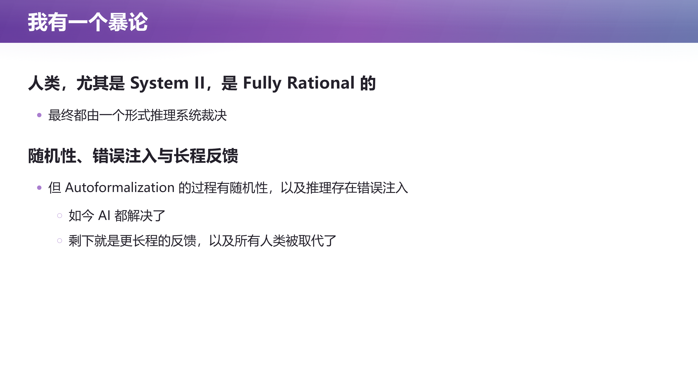

如果这个说法成立，那么当 AI 已经解决了 formal 世界的问题、又一定程度上能 autoformalize 之后，下一步显然就是：**把人类的意图和模型真正对齐**，再用好模型的 formalization 能力。当它真的能像一个人一样，理解那个"合上时该有多舒适"的时候——

讲者说，我觉得那天 AGI 就来了。

## 附：官方参考与延伸阅读

课程官方页面：

- 课程主页：<https://jyywiki.cn/GSE/2026/>
- 本讲讲义《软件质量保障 (2)》：<https://jyywiki.cn/GSE/2026/lect12.md>
- 本讲幻灯片：<https://jyywiki.cn/GSE/2026/slides12.html>

按章节对应的延伸材料：

- **从"调试程序"到"证明程序"**：
  - Turing, *Checking a Large Routine*（1949），<https://turingarchive.kings.cam.ac.uk/checking-large-routine>
  - McCarthy 关于用数学规格描述计算的论述，<https://www-formal.stanford.edu/jmc/towards/node6.html>
  - Hoare, *An Axiomatic Basis for Computer Programming*（1969），<https://sites.cs.ucsb.edu/~kemm/courses/cs266/acmhoare69.pdf>
- **一个不变式，抵过无数次运行**：Boyer 与 Moore 的多数投票算法原文，<https://www.cs.utexas.edu/~boyer/mjrty.pdf>
- **状态爆炸与模型检验**：Burch 等，*Symbolic Model Checking: 10²⁰ States and Beyond*，<https://www.cis.upenn.edu/~lee/04cis700/papers/BCM%2B90.pdf>；Bradley, *IC3*，<https://theory.stanford.edu/~arbrad/papers/IC3.pdf>
- **模型、路径与完整证明**：
  - Lamport, *Refinement in State-Based Formalisms*，<https://lamport.azurewebsites.net/pubs/refinement.pdf>
  - Abadi 与 Lamport, *The Existence of Refinement Mappings*，<https://www.sciencedirect.com/science/article/pii/030439759190224P>
  - KLEE 入门教程，<https://klee-se.org/tutorials/testing-function/>
  - CompCert 论文，<https://gallium.inria.fr/~xleroy/publi/compcert-CACM.pdf>
  - seL4 项目统计，<https://trustworthy.systems/projects/OLD/l4.verified/numbers>
- **Proof Assistant**：Lean tactic 文档，<https://lean-lang.org/doc/reference/latest/Tactic-Proofs/>
- **当 proof 也变成一种 tax**：讲者的读博回忆录，<https://zhuanlan.zhihu.com/p/82579410>；Anthropic, *LLMs are making formal software verification feasible at a much larger scale*，<https://www.anthropic.com/research/formal-verification>
- **携带证明的软件**：Necula 与 Lee, *Safe Kernel Extensions Without Run-Time Checking*（OSDI'96 最佳论文），<https://www.usenix.org/legacy/publications/library/proceedings/osdi96/necula.html>；大会获奖记录见 <https://www.usenix.org/legacy/publications/library/proceedings/osdi96/opening_remarks/proceedings.html>

**版权说明**：本讲讲义与幻灯片系 © 蒋炎岩 作品，依 [CC BY-NC 4.0](http://creativecommons.org/licenses/by-nc/4.0/) 发布。本书为非商业学习笔记，引用的文字、幻灯片与图片均归原作者所有，并按同一许可署名使用；课程站点备案信息见[苏 ICP 备 2020049101 号](https://beian.miit.gov.cn/)。

---

*本电子书由 [videobook](https://github.com/Luke-Evan/videobook) 流水线生成。课程讲义与幻灯片版权归讲师所有，依 [CC BY-NC 4.0](http://creativecommons.org/licenses/by-nc/4.0/) 发布。*
